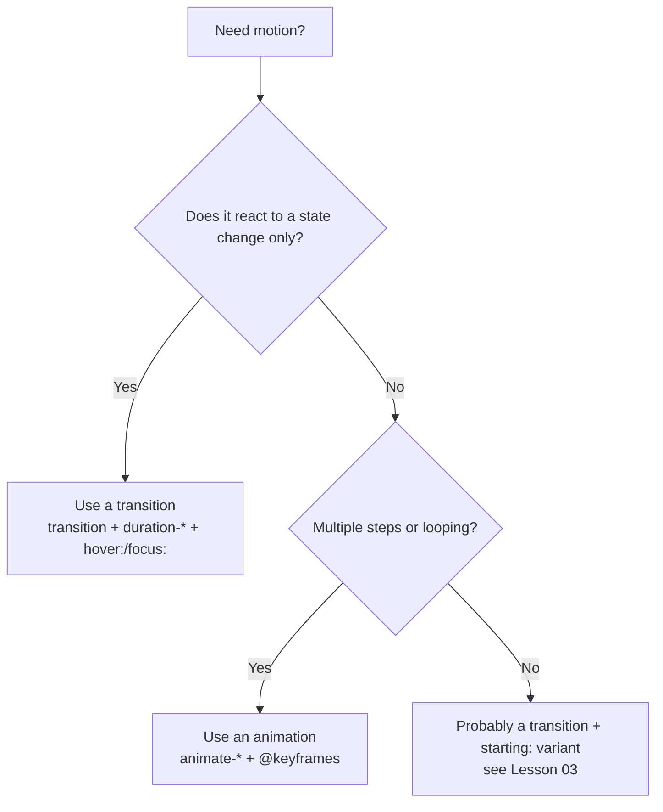

# Lesson 01 — Animations & Keyframes

## 🎯 Learning Objectives

By the end of this lesson you will be able to:

- Use Tailwind's four built-in animations (`animate-spin`, `animate-ping`, `animate-pulse`, `animate-bounce`)
- Define custom `@keyframes` and `--animate-*` tokens inside `@theme` (Tailwind v4)
- Use arbitrary animation values and CSS-variable animations
- Respect users who prefer reduced motion with `motion-safe:` and `motion-reduce:`
- Choose between a transition and an animation

---

## Introduction

In Module 04 you learned **transitions**: the browser moves a property from state A to state B when something changes (hover, focus, a class toggle). An **animation** is different — it runs on its own, can have many steps, and can loop forever.

In Book 03 (CSS, Module 11) you wrote `@keyframes` by hand. Tailwind gives you utilities that apply those animations, and in v4 you define your own keyframes **in CSS, next to your theme tokens** — no `tailwind.config.js` required.

---

## 1. Built-in animation utilities

| Utility | What it does | Typical use |
|---|---|---|
| `animate-spin` | Rotates 360° linearly, forever | Loading spinners |
| `animate-ping` | Scales up + fades out, forever | Notification "radar" dots |
| `animate-pulse` | Fades in and out gently | Skeleton loaders |
| `animate-bounce` | Bounces vertically | "Scroll down" hints |
| `animate-none` | Removes any animation | Resetting at a breakpoint or state |

```html
<!-- Spinner -->
<svg class="size-5 animate-spin text-white" viewBox="0 0 24 24" fill="none">
  <circle class="opacity-25" cx="12" cy="12" r="10" stroke="currentColor" stroke-width="4" />
  <path class="opacity-75" fill="currentColor" d="M4 12a8 8 0 018-8v4a4 4 0 00-4 4H4z" />
</svg>

<!-- Notification dot -->
<span class="relative flex size-3">
  <span class="absolute inline-flex size-full animate-ping rounded-full bg-sky-400 opacity-75"></span>
  <span class="relative inline-flex size-3 rounded-full bg-sky-500"></span>
</span>
```

> 💡 The ping dot uses **two** elements: one animates outward, one stays still. Layering a static element over an animated one is a very common pattern.

---

## 2. Transition vs animation

| | Transition (Module 04) | Animation (this lesson) |
|---|---|---|
| Trigger | A state change (hover, class toggle) | Starts on its own when applied |
| Steps | Two (from → to) | Any number (`0%`, `50%`, `100%`) |
| Looping | No | Yes (`infinite`) |
| Utilities | `transition`, `duration-*`, `ease-*` | `animate-*` |



---

## 3. Custom keyframes in Tailwind v4

In v3 you extended `theme.keyframes` and `theme.animation` in `tailwind.config.js`. In v4 you define them in your CSS entry file (Module 01, `css-entry-point-and-project-structure`) inside `@theme`:

```css
@import "tailwindcss";

@theme {
  --animate-wiggle: wiggle 0.8s ease-in-out infinite;
  --animate-fade-in: fade-in 0.4s ease-out both;

  @keyframes wiggle {
    0%, 100% { transform: rotate(-4deg); }
    50%      { transform: rotate(4deg); }
  }

  @keyframes fade-in {
    from { opacity: 0; transform: translateY(8px); }
    to   { opacity: 1; transform: translateY(0); }
  }
}
```

This generates `animate-wiggle` and `animate-fade-in`, usable like any built-in utility and with every variant (`hover:animate-wiggle`, `md:animate-none`).

The `--animate-*` namespace follows the same rule as every other theme namespace: **the variable name becomes the utility name**. (Module 06 covers `@theme` in depth.)

To remove Tailwind's default animations and keep only yours:

```css
@theme {
  --animate-*: initial;
  --animate-wiggle: wiggle 0.8s ease-in-out infinite;
}
```

---

## 4. Arbitrary and variable-based animations

For a one-off, skip the theme:

```html
<div class="animate-[wiggle_1s_ease-in-out_infinite]">…</div>
```

Underscores stand in for spaces. For an animation stored in a CSS variable, use the parentheses shorthand:

```html
<div class="animate-(--my-animation)">…</div>
```

> ⚠️ The `@keyframes` still has to exist in your CSS. Arbitrary values only *reference* it.

---

## 5. Respecting reduced motion

Some users get dizzy or distracted by motion and set "reduce motion" in their OS. Tailwind exposes this as two variants:

```html
<!-- Only animate if the user hasn't asked for less motion -->
<div class="motion-safe:animate-bounce">↓ Scroll</div>

<!-- Animate by default, switch off when reduced motion is requested -->
<svg class="animate-spin motion-reduce:animate-none">…</svg>
```

> ✅ Rule of thumb: **decorative** motion → `motion-safe:`. **Essential** feedback (a spinner that says "working") → keep it, but consider a gentler alternative such as `motion-reduce:animate-pulse`.

(Module 09 returns to this in `motion-contrast-and-forced-colors`.)

---

## 6. Performance and gotchas

- Animate `transform` and `opacity`. They don't trigger layout and can run on the GPU. Avoid animating `width`, `height`, `top`, `left` (recall `will-change` from the Book 03 addendum — use it sparingly).
- ⚠️ **`delay-*` is a transition delay, not an animation delay.** For animations use an arbitrary property: `[animation-delay:150ms]`, or inline `style={{ animationDelay: '150ms' }}` for staggered lists.
- `animate-*` sets the whole `animation` shorthand, so you can't combine two `animate-*` classes — the last one wins. Define a combined animation in `@theme` if you need two.
- The ecosystem option for enter/exit presets (`animate-in`, `fade-in`, `slide-in-from-*`) is the `tw-animate-css` plugin, the successor to `tailwindcss-animate`, commonly used with shadcn/ui (Module 08).

---

## 🧪 Practical Example — Skeleton card + loading button

```html
<!-- Skeleton -->
<div class="mx-auto w-full max-w-sm rounded-xl border border-slate-200 p-4">
  <div class="flex animate-pulse gap-4 motion-reduce:animate-none">
    <div class="size-12 rounded-full bg-slate-200"></div>
    <div class="flex-1 space-y-3 py-1">
      <div class="h-3 rounded bg-slate-200"></div>
      <div class="h-3 w-5/6 rounded bg-slate-200"></div>
      <div class="h-3 w-2/3 rounded bg-slate-200"></div>
    </div>
  </div>
</div>

<!-- Loading button -->
<button class="inline-flex items-center gap-2 rounded-lg bg-indigo-600 px-4 py-2 text-white" disabled>
  <svg class="size-4 animate-spin" viewBox="0 0 24 24" fill="none">
    <circle class="opacity-25" cx="12" cy="12" r="10" stroke="currentColor" stroke-width="4" />
    <path class="opacity-75" fill="currentColor" d="M4 12a8 8 0 018-8v4a4 4 0 00-4 4H4z" />
  </svg>
  Saving…
</button>
```

In React you'd render the skeleton while `isLoading` is true; in Vue use `v-if="loading"`. The classes are identical.

---

## 📝 Revision Questions

<details>
<summary>1. What is the difference between a transition and an animation?</summary>

A transition moves between two states in response to a change (hover, class toggle). An animation runs independently, can have many keyframe steps, and can loop.
</details>

<details>
<summary>2. In Tailwind v4, where do you define custom keyframes?</summary>

In your CSS entry file, inside `@theme`, together with a `--animate-*` variable. The variable name becomes the utility name (`--animate-wiggle` → `animate-wiggle`).
</details>

<details>
<summary>3. Why doesn't `delay-200` delay an animation?</summary>

`delay-*` sets `transition-delay`. For animations use `[animation-delay:200ms]` or an inline style.
</details>

<details>
<summary>4. How do you disable a spinner's animation for users who prefer reduced motion?</summary>

`animate-spin motion-reduce:animate-none`, or `motion-safe:animate-spin` to only animate when motion is allowed.
</details>

<details>
<summary>5. Which CSS properties are cheapest to animate?</summary>

`transform` and `opacity`.
</details>
