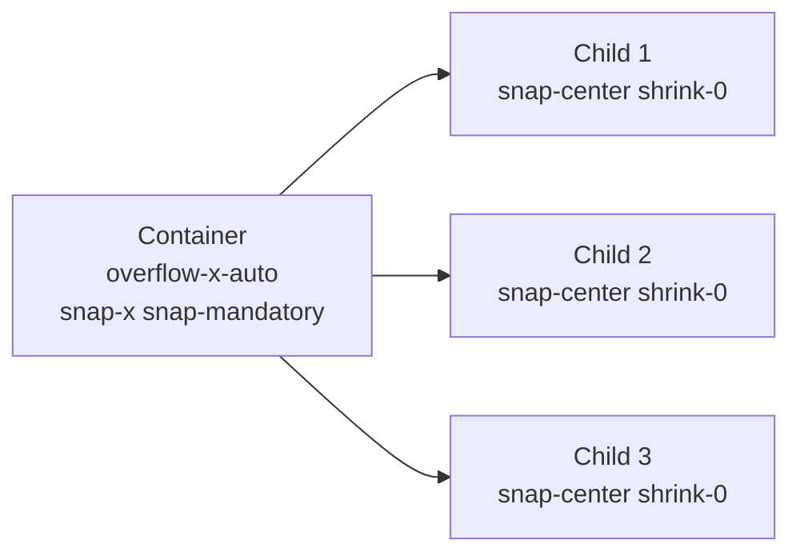

# Lesson 02 — Scroll Behavior & Snap

## 🎯 Learning Objectives

- Enable smooth scrolling with `scroll-smooth` (and make it motion-safe)
- Build carousels and galleries with scroll-snap utilities
- Offset anchor links under sticky headers with `scroll-mt-*` / `scroll-pt-*`
- Control scroll chaining with `overscroll-*`
- Hide scrollbars and tune touch scrolling responsibly

---

## Introduction

Scrolling is the most-used interaction on the web. CSS gives you native control over how it *feels* — no JavaScript carousel library needed for simple cases. In Book 03 you met `scroll-behavior` and scroll-snap in raw CSS; Tailwind turns them into one-class utilities.

---

## 1. Smooth scrolling

```html
<html class="scroll-smooth">
```

`scroll-smooth` sets `scroll-behavior: smooth` — in-page anchor links (`<a href="#pricing">`) glide instead of jumping. `scroll-auto` restores the default.

Because smooth scrolling is motion, gate it:

```html
<html class="motion-safe:scroll-smooth">
```

---

## 2. Scroll snap

Scroll snap makes a scroll container "catch" on specific child positions. There are three parts:

| Part | Utilities | Meaning |
|---|---|---|
| **Container axis + strictness** | `snap-x`, `snap-y`, `snap-both`, `snap-none` + `snap-mandatory` / `snap-proximity` | Which axis snaps and how strongly |
| **Child alignment** | `snap-start`, `snap-center`, `snap-end`, `snap-align-none` | Where the child lines up |
| **Child behavior** | `snap-normal`, `snap-always` | Whether fast flicks may skip a child |

- `snap-mandatory` — always settles on a snap point.
- `snap-proximity` — snaps only when close; friendlier for long content.



> ⚠️ Snap needs a scroll container: add `overflow-x-auto` (or `overflow-y-auto`). Flex children must also have `shrink-0` or they'll squash instead of overflowing (recall Module 02 `flex-sizing-and-order`).

---

## 3. Scroll margin and padding

A sticky header covers the top of an anchor target. Fix it with scroll margin on the **target**:

```html
<header class="sticky top-0 h-16 bg-white">…</header>
<section id="pricing" class="scroll-mt-20">…</section>
```

On the **container**, use scroll padding so snap points respect an inset:

```html
<div class="snap-x snap-mandatory scroll-px-6 overflow-x-auto">…</div>
```

Families: `scroll-m-*`, `scroll-mt/mr/mb/ml/mx/my-*`, `scroll-p-*`, `scroll-pt/pr/pb/pl/px/py-*` (logical `scroll-ms-*`, `scroll-ps-*` exist too).

---

## 4. Overscroll behavior

When you reach the end of an inner scroller (a modal body, a chat panel), the page behind may start scrolling — "scroll chaining."

| Utility | Effect |
|---|---|
| `overscroll-auto` | Default chaining |
| `overscroll-contain` | Stop chaining to the page behind |
| `overscroll-none` | Stop chaining and the bounce effect |

```html
<div class="max-h-64 overflow-y-auto overscroll-contain">…long list…</div>
```

---

## 5. Touch and scrollbars

- `touch-pan-x`, `touch-pan-y`, `touch-manipulation` tune touch gestures (e.g. allow horizontal swipe but let the page scroll vertically).
- Tailwind core doesn't ship scrollbar-hiding utilities. Use an arbitrary property: `[scrollbar-width:none]` (and `[&::-webkit-scrollbar]:hidden` for older WebKit).

> ⚠️ Hiding scrollbars removes a visual cue. Only hide them when another cue exists (peeking next card, dots, arrows).

---

## 🧪 Practical Example — Snap carousel with peeking cards

```html
<div class="relative">
  <ul class="flex snap-x snap-mandatory gap-4 overflow-x-auto scroll-px-6 px-6 pb-4 [scrollbar-width:none]">
    <li class="w-72 shrink-0 snap-center rounded-2xl bg-indigo-500 p-6 text-white">Card 1</li>
    <li class="w-72 shrink-0 snap-center rounded-2xl bg-sky-500 p-6 text-white">Card 2</li>
    <li class="w-72 shrink-0 snap-center rounded-2xl bg-emerald-500 p-6 text-white">Card 3</li>
    <li class="w-72 shrink-0 snap-center rounded-2xl bg-rose-500 p-6 text-white">Card 4</li>
  </ul>
</div>
```

Cards are 18rem wide, so the next card peeks in — the visual cue replacing the scrollbar. On desktop, switch to a grid with `md:grid md:grid-cols-4 md:overflow-visible` (Lesson 09).

---

## 📝 Revision Questions

<details>
<summary>1. What's the difference between `snap-mandatory` and `snap-proximity`?</summary>

Mandatory always settles on a snap point; proximity only snaps when the scroll stops near one.
</details>

<details>
<summary>2. Your anchor target hides under a sticky header. What do you add and where?</summary>

`scroll-mt-*` (sized to the header height) on the target element.
</details>

<details>
<summary>3. Why might snap children shrink instead of scrolling?</summary>

Flex children shrink by default. Add `shrink-0` and a fixed width.
</details>

<details>
<summary>4. What does `overscroll-contain` prevent?</summary>

Scroll chaining — the page behind scrolling when an inner scroller hits its end.
</details>

<details>
<summary>5. How do you make smooth scrolling respect reduced-motion settings?</summary>

`motion-safe:scroll-smooth`.
</details>
