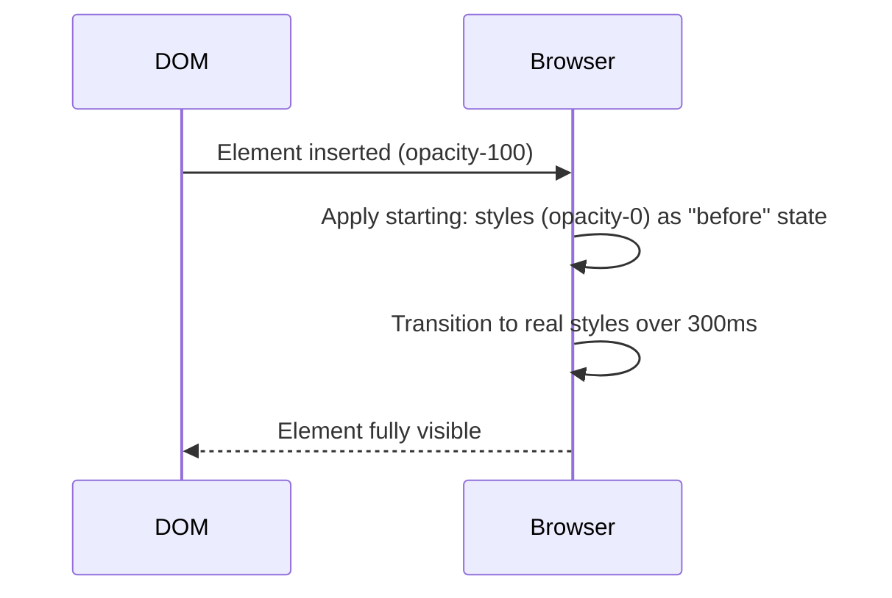

# Lesson 03 — Starting Style & Entry Animations

## 🎯 Learning Objectives

- Explain why elements that appear (`display: none` → visible) can't normally transition
- Use the `starting:` variant to animate elements as they enter
- Use `transition-discrete` to transition `display` and `overlay`-like discrete properties
- Animate `<dialog>`, popovers and `[open]` elements
- Know the browser-support story and how it degrades

---

## Introduction

In Lesson 01 you saw that a transition needs two states. But what about an element that is **added to the DOM** or goes from `display: none` to `block`? It has no "before" state, so the browser just shows it. For years you needed JavaScript (add the element, wait a frame, add a class) to fade something in.

Modern CSS solves this with `@starting-style`: it declares the style an element should animate **from** on its first render. Tailwind v4 exposes it as the **`starting:` variant**.

---

## 1. The problem

```html
<!-- ❌ No fade — it just appears -->
<div class="opacity-100 transition-opacity duration-300">Hello</div>
```

The element's first computed style is already `opacity: 1`. Nothing changed, so nothing transitions.

---

## 2. The `starting:` variant

```html
<!-- ✅ Fades in the moment it's rendered -->
<div class="opacity-100 transition-opacity duration-300 starting:opacity-0">
  Hello
</div>
```

`starting:opacity-0` means "on the very first style update, pretend opacity was 0." The browser then transitions to the real value, `opacity-100`.



Combine it with transforms for a slide-up entry:

```html
<div class="translate-y-0 opacity-100 transition duration-500
            starting:translate-y-4 starting:opacity-0">
  Toast message
</div>
```

---

## 3. Transitioning `display` with `transition-discrete`

`display` (and `content-visibility`, `overlay`) are **discrete** properties — they flip, they don't interpolate. By default, transitions ignore them. `transition-discrete` sets `transition-behavior: allow-discrete`, which lets them flip at the right moment (at the start when appearing, at the end when disappearing).

| Utility | CSS |
|---|---|
| `transition-discrete` | `transition-behavior: allow-discrete` |
| `transition-normal` | `transition-behavior: normal` (default) |

### Popover example

```html
<button popovertarget="menu" class="rounded-lg bg-slate-900 px-4 py-2 text-white">Open</button>

<div id="menu" popover
     class="rounded-xl border border-slate-200 bg-white p-4 shadow-lg
            opacity-0 transition-all transition-discrete duration-200
            open:opacity-100
            starting:open:opacity-0">
  Menu content
</div>
```

How to read it:

- Default state: `opacity-0`.
- `open:opacity-100` — when the popover is open, it's visible. (`open:` matches both `[open]` and `:popover-open`.)
- `starting:open:opacity-0` — on first display, start from transparent so the **enter** animates.
- `transition-discrete` lets the `display` change (popover goes from `none` to `block`) cooperate with the opacity transition so the **exit** can also fade.

### `<dialog>` example

```html
<dialog class="m-auto rounded-2xl p-6 opacity-0 scale-95 transition-all transition-discrete duration-200
               open:scale-100 open:opacity-100
               starting:open:scale-95 starting:open:opacity-0
               backdrop:bg-black/40 backdrop:backdrop-blur-sm">
  <h2 class="text-lg font-semibold">Delete project?</h2>
  <form method="dialog" class="mt-4 flex justify-end gap-2">
    <button class="rounded px-3 py-1.5">Cancel</button>
    <button class="rounded bg-red-600 px-3 py-1.5 text-white">Delete</button>
  </form>
</dialog>
```

(You'll build this properly in Module 07, `modals-with-dialog`.)

---

## 4. Advanced note — top-layer exit animations

Dialogs and popovers live in the browser's *top layer*. For the **exit** animation to play, the element must stay in the top layer until the transition ends, which requires transitioning the `overlay` property too. Tailwind has no dedicated utility, so use an arbitrary value:

```html
<dialog class="… transition-[opacity,display,overlay] transition-discrete duration-200 …">
```

Support for `overlay` transitions is newer and Chromium-first, so test in your target browsers.

---

## 5. Browser support and graceful degradation

- `@starting-style` and `transition-behavior: allow-discrete` are part of the modern baseline (all major engines in 2024+).
- In an older browser, nothing breaks: the element simply appears without animation. This is a **progressive enhancement** — design the final state to be correct on its own (Module 09, `browser-support-and-fallbacks`).
- In React/Vue, you can still use `starting:` for elements mounted by conditional rendering — no `react-transition-group` needed for simple fades.

---

## 🧪 Practical Example — Toast that slides in

```html
<div class="fixed right-4 bottom-4 flex w-80 items-start gap-3 rounded-xl border border-emerald-200 bg-emerald-50 p-4
            translate-y-0 opacity-100 transition duration-300 ease-out
            starting:translate-y-3 starting:opacity-0
            motion-reduce:transition-none">
  <span class="mt-0.5 size-2.5 rounded-full bg-emerald-500"></span>
  <p class="text-sm text-emerald-900">Profile saved successfully.</p>
</div>
```

Render it conditionally in React (`{saved && <Toast />}`) or Vue (`v-if="saved"`) and it fades up on mount.

---

## 📝 Revision Questions

<details>
<summary>1. Why can't a newly inserted element transition normally?</summary>

It has no previous computed style, so there is no "from" state to interpolate.
</details>

<details>
<summary>2. What does `starting:opacity-0` do?</summary>

It supplies the style the element animates *from* on its first render (`@starting-style`).
</details>

<details>
<summary>3. What does `transition-discrete` change?</summary>

It sets `transition-behavior: allow-discrete`, letting discrete properties like `display` take part in transitions.
</details>

<details>
<summary>4. What happens in a browser that doesn't support `@starting-style`?</summary>

The element appears instantly without the entry animation — it degrades gracefully.
</details>

<details>
<summary>5. Why might a dialog's exit animation fail even with `transition-discrete`?</summary>

Top-layer elements may also need `overlay` in the transitioned properties, and support is newer.
</details>
