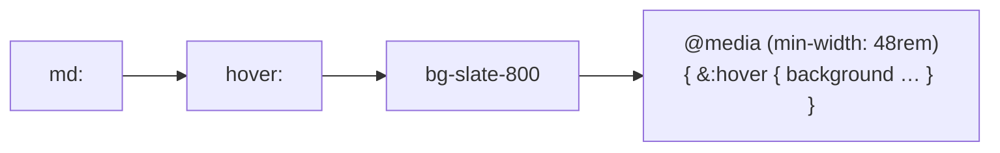

# Lesson 04 — Hover, Focus & Active States

## 🎯 Learning Objectives

- Style interaction states with `hover:`, `focus:`, `focus-visible:`, `active:` and `disabled:`
- Stack variants (`md:hover:`, `dark:focus-visible:`) and read them correctly
- Explain the v4 change that wraps `hover:` in a hover media query
- Build an accessible button with every state covered
- Avoid common focus-ring mistakes

---

## Introduction

In Tailwind, **a variant is a prefix that applies a utility only under a condition**. You've already used `md:` (screen width). This lesson covers *interaction* variants — the CSS pseudo-classes you learned in Book 03 (`:hover`, `:focus`, `:active`) expressed as prefixes.

```html
<button class="bg-indigo-600 hover:bg-indigo-700">Save</button>
```

The pattern is always `variant:utility`. No new CSS file, no class names to invent.

---

## 1. Common state variants

| Variant | CSS | Use |
|---|---|---|
| `hover:` | `:hover` | Pointer over element |
| `focus:` | `:focus` | Element has focus (any method) |
| `focus-visible:` | `:focus-visible` | Focus from **keyboard** (not mouse click) |
| `focus-within:` | `:focus-within` | A descendant has focus |
| `active:` | `:active` | While being pressed |
| `disabled:` / `enabled:` | `:disabled` / `:enabled` | Form control state |
| `visited:` | `:visited` | Visited links |
| `checked:` | `:checked` | Checkbox / radio |
| `required:`, `invalid:` | `:required`, `:invalid` | Form validation |
| `read-only:` | `:read-only` | Read-only input |
| `first:` `last:` `odd:` `even:` `empty:` | structural | List styling |
| `open:` | `[open]` / `:popover-open` | `<details>`, `<dialog>`, popovers |

---

## 2. `focus` vs `focus-visible` (accessibility)

- `focus:` fires on mouse click **and** keyboard — buttons show a ring after every click, which many designers dislike.
- `focus-visible:` fires only when the browser decides the user needs to *see* focus (keyboard navigation). Prefer it for rings on buttons and links.
- For text inputs, `focus:` is right — the user needs to see where they're typing.

> ⚠️ Never remove focus indication without replacing it. In v4, `outline-none` truly sets `outline-style: none`. Use **`outline-hidden`** when you want to hide the default outline but keep a fallback for forced-colors mode, and pair it with a visible `ring` (recall Module 04, `outline-and-ring`).

```html
<a class="rounded outline-hidden focus-visible:ring-2 focus-visible:ring-indigo-500 focus-visible:ring-offset-2">
  Skip to content
</a>
```

---

## 3. Stacking variants

Variants combine. They are applied **left to right** in v4 (right to left in v3).

```html
<button class="bg-slate-900 text-white
               hover:bg-slate-700
               md:hover:bg-slate-800
               dark:bg-white dark:text-slate-900 dark:hover:bg-slate-200">
```

Read it as: "(at md and up) (when hovering) → `bg-slate-800`."



---

## 4. v4 change: `hover:` only on hover-capable devices

In Tailwind v4, `hover:` is wrapped in `@media (hover: hover)`. On touch devices, tapping an element no longer leaves a "stuck" hover style behind. If you ever need the old behavior:

```css
@custom-variant hover (&:hover);
```

(Module 06 covers `@custom-variant`.)

Also new in v4's preflight: buttons use `cursor: default` (like native apps), so add `cursor-pointer` if you want the hand cursor.

---

## 5. Transitions make states feel alive

States without transitions look abrupt. Pair them with Module 04's `transition` utilities:

```html
<button class="transition duration-150 ease-out hover:-translate-y-0.5 active:translate-y-0 active:scale-95">
```

Keep durations short (100–200 ms) for UI feedback.

---

## 🧪 Practical Example — A fully accessible button

```html
<button
  class="inline-flex cursor-pointer items-center justify-center rounded-lg bg-indigo-600 px-5 py-2.5
         text-sm font-medium text-white shadow-sm
         transition duration-150 ease-out
         hover:bg-indigo-700
         active:scale-95 active:bg-indigo-800
         outline-hidden focus-visible:ring-2 focus-visible:ring-indigo-500 focus-visible:ring-offset-2
         disabled:cursor-not-allowed disabled:opacity-50 disabled:hover:bg-indigo-600 disabled:active:scale-100
         motion-reduce:transition-none">
  Save changes
</button>
```

Covered: default, hover, pressed, keyboard focus, disabled (with the hover/active overrides), reduced motion.

> 💡 In React, you'll wrap this in a `<Button>` component (Module 07 and Module 08). Variants are the reason you rarely need `useState` for hover styling.

---

## 📝 Revision Questions

<details>
<summary>1. When should you prefer `focus-visible:` over `focus:`?</summary>

For buttons and links, so the ring appears for keyboard users but not after every mouse click.
</details>

<details>
<summary>2. What did Tailwind v4 change about `hover:`?</summary>

It only applies on devices that support hover (`@media (hover: hover)`), preventing sticky hover on touch screens.
</details>

<details>
<summary>3. In which order are stacked variants applied in v4?</summary>

Left to right.
</details>

<details>
<summary>4. Why is `outline-hidden` safer than `outline-none` for custom focus rings?</summary>

`outline-hidden` keeps an invisible outline that appears in forced-colors mode; `outline-none` removes it entirely.
</details>

<details>
<summary>5. How do you stop hover styles applying to a disabled button?</summary>

Add overrides such as `disabled:hover:bg-…`, or use `enabled:hover:bg-…` so hover only applies when enabled.
</details>
