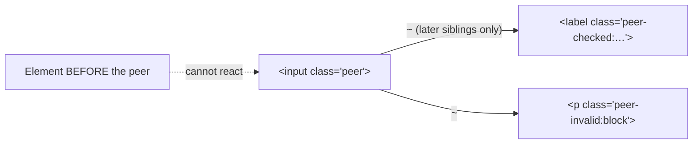

# Lesson 05 — Group & Peer Variants

## 🎯 Learning Objectives

- Style children based on a parent's state with `group` / `group-*`
- Style siblings based on another sibling's state with `peer` / `peer-*`
- Name groups and peers to avoid collisions in nested layouts
- Build a custom toggle switch and floating label with `peer`
- Know the limits of `peer` (sibling order) and when to reach for `has-*` (Lesson 06)

---

## Introduction

`hover:` styles an element when **it** is hovered. But often you want a *different* element to react: when a card is hovered, its arrow icon moves; when a checkbox is checked, its label changes color.

Tailwind solves this with two marker classes:

| Marker | Variant | Relationship |
|---|---|---|
| `group` | `group-hover:`, `group-focus:`, `group-*` | **Descendants** react to an ancestor |
| `peer` | `peer-checked:`, `peer-invalid:`, `peer-*` | **Later siblings** react to an earlier sibling |

---

## 1. `group` — parent state, child styles

```html
<a href="#" class="group block rounded-xl border p-5 transition hover:border-indigo-400 hover:shadow-md">
  <h3 class="font-semibold text-slate-900 group-hover:text-indigo-600">Read the docs</h3>
  <p class="text-sm text-slate-500">Everything you need to get started.</p>
  <span class="mt-3 inline-block transition group-hover:translate-x-1">→</span>
</a>
```

Mark the parent `group`; children use `group-hover:`, `group-focus-visible:`, `group-active:`, `group-disabled:` and so on.

### Named groups for nesting

Nested `group`s collide — a child's `group-hover:` reacts to the *nearest* group. Give each a name with a slash:

```html
<ul>
  <li class="group/item">
    <span class="group-hover/item:underline">Project</span>
    <button class="group/edit">
      <svg class="group-hover/edit:text-indigo-600 …" />
    </button>
  </li>
</ul>
```

---

## 2. `peer` — sibling state, sibling styles

```html
<input id="agree" type="checkbox" class="peer size-4" />
<label for="agree" class="text-slate-500 peer-checked:font-medium peer-checked:text-slate-900">
  I agree to the terms
</label>
```

> ⚠️ **Order matters.** `peer` uses the CSS sibling combinator (`~`), which only looks **forward**. The element with `peer` must come **before** the elements that react to it in the DOM.

Named peers work the same way: `peer/email`, `peer-invalid/email:`.



---

## 3. Arbitrary group/peer states

For states without a built-in variant, use brackets:

```html
<div class="group is-published">
  <span class="hidden group-[.is-published]:inline">Live</span>
</div>
```

Group/peer also combine with attribute variants (Lesson 07): `group-data-[state=open]:rotate-180`, `peer-aria-checked:…`.

---

## 4. v4 note

`group-hover:` and `peer-hover:` inherit the v4 behavior from Lesson 04: they only apply on hover-capable devices.

---

## 🧪 Practical Examples

### A. Toggle switch (no JavaScript)

```html
<label class="relative inline-flex cursor-pointer items-center">
  <input type="checkbox" class="peer sr-only" />
  <span class="h-6 w-11 rounded-full bg-slate-300 transition-colors
               peer-checked:bg-indigo-600
               peer-focus-visible:ring-2 peer-focus-visible:ring-indigo-500 peer-focus-visible:ring-offset-2"></span>
  <span class="absolute left-0.5 size-5 rounded-full bg-white shadow transition-transform
               peer-checked:translate-x-5"></span>
</label>
```

The input is hidden with `sr-only` (still accessible to screen readers and keyboards), and the two `<span>`s are its later siblings.

### B. Floating label

```html
<div class="relative">
  <input id="email" placeholder=" "
         class="peer w-full rounded-lg border border-slate-300 px-3 pt-5 pb-2 outline-hidden
                focus:border-indigo-500" />
  <label for="email"
         class="pointer-events-none absolute left-3 top-4 origin-left text-slate-500 transition
                peer-focus:-translate-y-3 peer-focus:scale-75
                peer-[:not(:placeholder-shown)]:-translate-y-3 peer-[:not(:placeholder-shown)]:scale-75">
    Email
  </label>
</div>
```

Same idea as Bootstrap's floating labels (Book 05, Module 05) — but built from two utilities and a `peer`.

### C. Show validation message

```html
<input type="email" required class="peer rounded border px-3 py-2 invalid:border-red-500" />
<p class="hidden text-sm text-red-600 peer-invalid:block">Enter a valid email.</p>
```

(Tip: raw `invalid:` fires before the user types. Module 07 covers using `user-invalid`-style patterns and framework validation.)

---

## 📝 Revision Questions

<details>
<summary>1. What's the difference between `group` and `peer`?</summary>

`group` lets **descendants** react to an ancestor's state; `peer` lets **later siblings** react to a sibling's state.
</details>

<details>
<summary>2. Why does a `peer` element have to come first in the markup?</summary>

It compiles to the general sibling combinator (`~`), which only matches siblings that come after it.
</details>

<details>
<summary>3. How do you avoid collisions between nested groups?</summary>

Name them: `group/item` and `group-hover/item:…`.
</details>

<details>
<summary>4. Why use `sr-only` on a custom checkbox instead of `hidden`?</summary>

`hidden` (`display: none`) removes it from the accessibility tree and keyboard focus; `sr-only` hides it visually but keeps it accessible.
</details>

<details>
<summary>5. Name a case where `peer` can't work and you need another approach.</summary>

When the reacting element is a parent or an earlier sibling — use `has-*` (next lesson).
</details>
