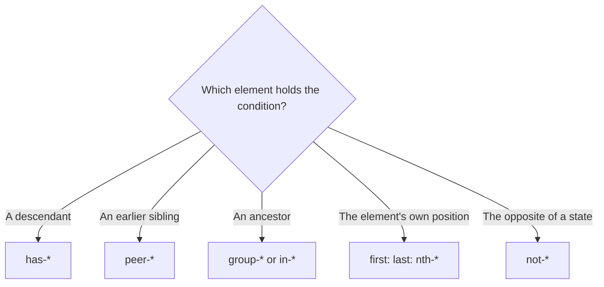

# Lesson 06 — `has-*`, `not-*`, `in-*` & `nth-*` Variants

## 🎯 Learning Objectives

- Style a parent based on its children with `has-*`
- Invert any condition with `not-*`
- Use `in-*` as a "group without the marker"
- Target positions with `nth-*`, `first:`, `last:`, `odd:`, `even:`, `only:`
- Style every direct child from the parent with `*:` (and know its caveats)

---

## Introduction

For decades CSS couldn't select a **parent** based on its children. `group` and `peer` (Lesson 05) were workarounds. The `:has()` pseudo-class changed that, and Tailwind exposes it — along with `:not()`, `:nth-child()` and friends — as variants.

---

## 1. `has-*` — style a parent by what it contains

```html
<!-- Card gets a ring when its radio is selected -->
<label class="block rounded-xl border p-4 has-checked:border-indigo-500 has-checked:bg-indigo-50 has-checked:ring-1 has-checked:ring-indigo-500">
  <input type="radio" name="plan" class="sr-only" />
  <span class="font-medium">Pro plan</span>
</label>
```

Any variant can follow `has-`:

```html
<div class="has-focus-visible:ring-2">…</div>        <!-- any descendant keyboard-focused -->
<div class="has-[img]:p-0">…</div>                    <!-- contains an  -->
<form class="has-invalid:border-red-500">…</form>     <!-- any invalid field inside -->
<li class="has-[>ul]:font-semibold">…</li>           <!-- has a direct child <ul> -->
```

`has-*` also composes with group and peer: `group-has-[a]:block`, `peer-has-checked:…`.

> 💡 `:has()` is part of the baseline in all modern browsers (since late 2023).

---

## 2. `not-*` — invert a condition (v4)

```html
<button class="not-disabled:hover:bg-indigo-700">…</button>
<li class="not-first:border-t">…</li>
<a class="not-[.active]:text-slate-500">…</a>
```

`not-*` also negates media and feature queries:

```html
<div class="not-supports-[display:grid]:flex">…</div>
<div class="not-motion-reduce:transition">…</div>
```

> ✅ Compare: `not-first:border-t` (borders between items) vs the older `border-t first:border-t-0`. The first states your intent directly.

---

## 3. `in-*` — a group without the `group` class

`in-*` reacts to state on **any ancestor**, without marking one:

```html
<div tabindex="0">
  <span class="opacity-50 in-focus:opacity-100">Shows when the parent has focus</span>
</div>
```

Use `in-*` for quick, single-use cases and `group/*` when you need explicit control over *which* ancestor triggers the style.

---

## 4. `nth-*` and positional variants

| Variant | Meaning |
|---|---|
| `first:` / `last:` | First / last child |
| `only:` | Only child |
| `odd:` / `even:` | Zebra rows |
| `nth-3:` | Exactly the 3rd child |
| `nth-[2n+1]:` | Formula |
| `nth-last-2:` | 2nd from the end |
| `first-of-type:`, `last-of-type:`, `nth-of-type-2:` | By element type |
| `empty:` | No children / text |

```html
<tr class="odd:bg-white even:bg-slate-50">…</tr>
<li class="nth-3:font-bold nth-[3n]:text-indigo-600">…</li>
<p class="empty:hidden">{message}</p>
```

`empty:hidden` is handy in React/Vue: when the slot or `{message}` renders nothing, the empty wrapper disappears.

---

## 5. Child (`*:`) and descendant (`**:`) variants

Style direct children from the parent instead of repeating classes:

```html
<ul class="*:rounded *:bg-slate-100 *:px-3 *:py-1 flex gap-2">
  <li>HTML</li><li>CSS</li><li>JS</li>
</ul>
```

Tailwind v4.1+ also provides `**:` for all descendants.

> ⚠️ Specificity gotcha: utilities **on the child itself** can lose to `*:` rules depending on order, because the parent rule is a more specific selector. Prefer `*:` for uniform children; put one-off exceptions in a variant like `*:first:…`.

---

## 6. Variant stacking order (v4)

Variants read left to right, closest to the element first. This matters here:

```html
<ul class="*:first:pt-0">…</ul>   <!-- v4: children, then the first one -->
```

In v3 this was written in the opposite order.



---

## 🧪 Practical Example — Selectable plan cards + zebra list

```html
<fieldset class="grid gap-3 sm:grid-cols-3">
  <label class="rounded-xl border border-slate-200 p-4 transition
                has-checked:border-indigo-500 has-checked:bg-indigo-50
                has-focus-visible:ring-2 has-focus-visible:ring-indigo-500">
    <input type="radio" name="plan" class="sr-only" checked />
    <span class="block font-semibold">Starter</span>
    <span class="text-sm text-slate-500">$0 / month</span>
  </label>
  <!-- repeat for Pro and Team -->
</fieldset>

<ul class="mt-6 divide-y rounded-xl border">
  <li class="px-4 py-2 odd:bg-slate-50 not-last:border-slate-200">Invoice #1001</li>
  <li class="px-4 py-2 odd:bg-slate-50">Invoice #1002</li>
</ul>
```

No JavaScript and no `useState` for "which card is selected" styling — the native radio state drives everything.

---

## 📝 Revision Questions

<details>
<summary>1. What can `has-*` do that `group` and `peer` cannot?</summary>

Style a parent (or earlier sibling) based on its descendants' state — no marker class required.
</details>

<details>
<summary>2. Write a class that adds a top border to every item except the first.</summary>

`not-first:border-t`.
</details>

<details>
<summary>3. How is `in-*` different from `group-*`?</summary>

`in-*` reacts to any ancestor's state without a marker; `group-*` requires `group` on a specific ancestor.
</details>

<details>
<summary>4. What does `empty:hidden` do?</summary>

Hides an element that has no content.
</details>

<details>
<summary>5. What's the specificity risk of `*:` utilities?</summary>

They compile to a parent-based selector, which can override utilities on the child itself.
</details>
