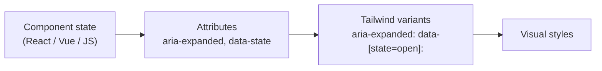

# Lesson 07 — ARIA, Data & Attribute Variants

## 🎯 Learning Objectives

- Style from `aria-*` attributes so visuals follow accessibility state
- Style from `data-*` attributes (the standard hook for headless UI libraries)
- Use arbitrary variants (`[&>svg]:size-4`) for selectors Tailwind doesn't name
- Avoid the React `data-*` boolean gotcha
- Combine attribute variants with `group` and `peer`

---

## Introduction

The cleanest way to style a component is to let its **state live in one place** and have CSS react to it. For accessibility you must set attributes like `aria-expanded` anyway — so style from them and you never keep a second, visual-only class in sync.

---

## 1. `aria-*` variants

Built-in shortcuts exist for the boolean ARIA states:

| Variant | Matches |
|---|---|
| `aria-checked:` | `[aria-checked="true"]` |
| `aria-disabled:` | `[aria-disabled="true"]` |
| `aria-expanded:` | `[aria-expanded="true"]` |
| `aria-hidden:` | `[aria-hidden="true"]` |
| `aria-pressed:` | `[aria-pressed="true"]` |
| `aria-selected:` | `[aria-selected="true"]` |
| `aria-busy:`, `aria-invalid:`, `aria-readonly:`, `aria-required:` | likewise |

Any other value uses brackets:

```html
<th class="aria-[sort=ascending]:bg-slate-100 aria-[sort=descending]:bg-slate-200">Name</th>
```

### Example: accordion chevron

```html
<button aria-expanded="false" class="group flex w-full items-center justify-between py-3">
  Shipping
  <svg class="size-4 transition-transform group-aria-expanded:rotate-180">…</svg>
</button>
```

`group-aria-expanded:` = "when the group (button) has `aria-expanded=true`". Toggle the attribute in JS (or via state in React/Vue) and the icon rotates.

---

## 2. `data-*` variants

```html
<!-- Matches when the attribute is merely present -->
<div data-active class="data-active:bg-indigo-50">…</div>

<!-- Matches a specific value -->
<div data-state="open" class="data-[state=open]:block data-[state=closed]:hidden">…</div>
```

In v4, `data-foo:` with no brackets matches `[data-foo]` (presence). With a value, use `data-[foo=bar]:`.

### Why this matters: headless libraries

Headless UI libraries (Radix UI, Headless UI, shadcn/ui — Module 08) expose state purely through attributes:

| Library | Attribute examples |
|---|---|
| Radix UI | `data-state="open" / "closed" / "checked"`, `data-disabled`, `data-side` |
| Headless UI | `data-open`, `data-focus`, `data-hover`, `data-active`, `data-selected` |

Tailwind variants map straight onto them:

```html
<button class="data-[state=open]:bg-slate-100 data-disabled:opacity-50">…</button>
```

---

## 3. ⚠️ The React `data-*` boolean gotcha

React stringifies booleans on `data-*` attributes:

```jsx
<li data-active={false} />   // renders data-active="false"
```

`data-active:` matches **presence**, so `"false"` still matches! Pass `undefined` (or an empty string) instead:

```jsx
<li data-active={isActive ? "" : undefined} className="data-active:bg-indigo-50" />
// or match the value explicitly
<li data-active={String(isActive)} className="data-[active=true]:bg-indigo-50" />
```

`aria-*` attributes don't have this problem because ARIA expects the strings `"true"`/`"false"`.

In Vue, `:data-active="isActive ? '' : undefined"` works the same way (Vue removes attributes bound to `undefined`/`null`/`false` — check your version's behavior for custom attributes).

---

## 4. Arbitrary variants

When no named variant exists, write the selector yourself. `&` stands for the element:

```html
<ul class="[&>li]:py-1">…</ul>                    <!-- direct li children -->
<div class="[&_p]:text-slate-600">…</div>         <!-- all descendant p -->
<a class="[&[target=_blank]]:after:content-['↗']">…</a>
<div class="[@media(min-width:900px)]:grid-cols-3">…</div>
<div class="supports-[display:grid]:grid">…</div> <!-- @supports -->
```

> 💡 Use arbitrary variants sparingly. If you write the same one three times, create a named variant with `@custom-variant` (Module 06).

---

## 5. Putting it together



One source of truth, no duplicated class toggling.

---

## 🧪 Practical Example — Tabs driven by `aria-selected`

```html
<div role="tablist" class="flex gap-1 rounded-xl bg-slate-100 p-1">
  <button role="tab" aria-selected="true"
          class="rounded-lg px-4 py-1.5 text-sm text-slate-600 transition
                 aria-selected:bg-white aria-selected:font-medium aria-selected:text-slate-900 aria-selected:shadow-sm">
    Overview
  </button>
  <button role="tab" aria-selected="false"
          class="rounded-lg px-4 py-1.5 text-sm text-slate-600 transition
                 aria-selected:bg-white aria-selected:font-medium aria-selected:text-slate-900 aria-selected:shadow-sm">
    Billing
  </button>
</div>
```

In React: `aria-selected={tab === active}`. In React Native with NativeWind there is no DOM, so this pattern differs (Module 08).

---

## 📝 Revision Questions

<details>
<summary>1. Why style from `aria-*` rather than adding an `active` class?</summary>

The ARIA attribute is required for accessibility anyway; styling from it keeps one source of truth.
</details>

<details>
<summary>2. How does `data-active:` differ from `data-[active=true]:` in v4?</summary>

`data-active:` matches the attribute's presence; the bracket form matches a specific value.
</details>

<details>
<summary>3. Why can `data-active={false}` in React still trigger `data-active:` styles?</summary>

React renders it as `data-active="false"`, and the attribute is present.
</details>

<details>
<summary>4. What does `[&>li]:py-1` do?</summary>

Applies `py-1` to direct `li` children of the element.
</details>

<details>
<summary>5. Which attributes do Radix UI components expose for styling?</summary>

`data-state` (open/closed/checked), `data-disabled`, `data-side`, and others.
</details>
