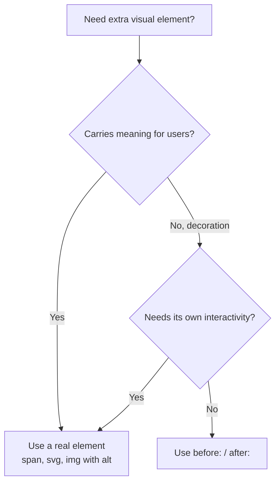

# Lesson 08 — Pseudo-elements & Placeholder Variants

## 🎯 Learning Objectives

- Style `::before` and `::after` with `before:` / `after:` and the `content-*` utilities
- Style form-related pseudo-elements: `placeholder:`, `file:`, `autofill:`
- Style text pseudo-elements: `first-letter:`, `first-line:`, `selection:`, `marker:`
- Style `<dialog>` backdrops with `backdrop:`
- Know the v4 placeholder color change

---

## Introduction

Pseudo-elements (Book 03, Module 04) let CSS generate or style parts of an element you can't target with a class. Tailwind exposes the common ones as variants. They're perfect for decoration — required-field stars, underline animations, badges — without extra markup.

---

## 1. `before:` and `after:`

Tailwind automatically adds `content: ''` when you use `before:` or `after:` utilities, so this just works:

```html
<span class="relative before:absolute before:inset-0 before:rounded before:bg-yellow-200 before:-z-10">
  Highlighted
</span>
```

For actual text, use `content-[…]`:

```html
<label class="after:ml-0.5 after:text-red-500 after:content-['*']">Email</label>
<a data-label="New" class="after:ml-1 after:content-[attr(data-label)]">Blog</a>
```

Notes:

- Pseudo-elements are `display: inline` by default. Use `before:block`, `before:absolute`, `before:inline-block` as needed.
- If you position them absolutely, the parent needs `relative` (Module 02, `position-inset-and-z-index`).
- Content from CSS isn't read reliably by screen readers — don't put essential information there.

### Animated underline

```html
<a href="#" class="relative inline-block
   after:absolute after:inset-x-0 after:-bottom-0.5 after:h-0.5 after:origin-left
   after:scale-x-0 after:bg-indigo-600 after:transition-transform after:duration-300
   hover:after:scale-x-100">
  Hover me
</a>
```

Notice the stack: `hover:after:scale-x-100` — hover, then the pseudo-element, then the utility.

---

## 2. Form pseudo-elements

### `placeholder:`

```html
<input class="placeholder:italic placeholder:text-slate-400" placeholder="Search…" />
```

> ⚠️ **v4 change:** the default placeholder color is now the current text color at 50% opacity (v3 used `gray-400`). Set `placeholder:text-*` explicitly if you need a specific color.

### `file:` — the "Choose file" button

```html
<input type="file" class="text-sm text-slate-500
  file:mr-4 file:rounded-full file:border-0 file:bg-indigo-50 file:px-4 file:py-2
  file:font-semibold file:text-indigo-700 hover:file:bg-indigo-100" />
```

### Others worth knowing

| Variant | Targets |
|---|---|
| `autofill:` | Browser autofill styling |
| `placeholder-shown:` | Input currently showing its placeholder (floating labels, Lesson 05) |
| `backdrop:` | `<dialog>` / popover backdrop (`backdrop:bg-black/50 backdrop:backdrop-blur-sm`) |
| `details-content:` | Content area of `<details>` (newer v4.x releases) |

---

## 3. Text pseudo-elements

| Variant | Targets | Example |
|---|---|---|
| `first-letter:` | First letter | Drop caps |
| `first-line:` | First line | Lead-in styling |
| `selection:` | Highlighted text | Brand-colored selection |
| `marker:` | List bullets/numbers | Colored bullets |

```html
<p class="first-letter:float-left first-letter:mr-2 first-letter:text-6xl first-letter:font-bold first-letter:text-indigo-600
          first-line:uppercase first-line:tracking-wide">
  Once upon a time…
</p>

<body class="selection:bg-indigo-200 selection:text-indigo-900">

<ul class="list-disc pl-5 marker:text-indigo-500">…</ul>
```

`selection:` and `marker:` inherit down: put them on a parent and children pick them up (Tailwind sets them up to apply to descendants).

---

## 4. Choosing: real element or pseudo-element?



---

## 🧪 Practical Example — Input with required star, styled file upload, and a ribbon

```html
<div class="max-w-sm space-y-6">
  <div>
    <label for="name" class="block text-sm font-medium after:ml-0.5 after:text-red-500 after:content-['*']">
      Full name
    </label>
    <input id="name" required
           class="mt-1 w-full rounded-lg border border-slate-300 px-3 py-2
                  placeholder:text-slate-400 focus:border-indigo-500 focus:outline-hidden focus:ring-2 focus:ring-indigo-200"
           placeholder="Ada Lovelace" />
  </div>

  <input type="file" class="text-sm file:mr-3 file:rounded-lg file:border-0 file:bg-slate-900 file:px-3 file:py-2 file:text-white" />

  <div class="relative overflow-hidden rounded-xl border p-6
              before:absolute before:top-3 before:-right-8 before:rotate-45 before:bg-indigo-600 before:px-8 before:py-1
              before:text-xs before:font-bold before:text-white before:content-['NEW']">
    New feature card
  </div>
</div>
```

---

## 📝 Revision Questions

<details>
<summary>1. Do you need to write `content-['']` when using `before:`?</summary>

No. Tailwind adds an empty content value automatically; use `content-[…]` only to show text.
</details>

<details>
<summary>2. What changed about placeholder color in v4?</summary>

It now defaults to the current text color at 50% opacity instead of a fixed gray.
</details>

<details>
<summary>3. How do you style the "Choose file" button of an `<input type="file">`?</summary>

With the `file:` variant, e.g. `file:bg-indigo-50 file:px-4`.
</details>

<details>
<summary>4. Why shouldn't essential info live in `::after` content?</summary>

Screen readers handle generated content inconsistently, so it may not be announced.
</details>

<details>
<summary>5. Which variant styles a `<dialog>`'s dimmed overlay?</summary>

`backdrop:`.
</details>
