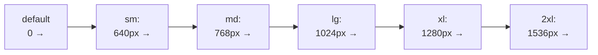

# Lesson 09 — Responsive Breakpoints

## 🎯 Learning Objectives

- Apply the mobile-first model with `sm:`, `md:`, `lg:`, `xl:`, `2xl:`
- Use `max-*` and range variants (`md:max-lg:`)
- Define custom breakpoints in `@theme`
- Use arbitrary `min-[…]:` / `max-[…]:` values for one-offs
- Combine breakpoints with orientation, print, and viewport units
- Compare Tailwind's approach to Bootstrap's (Book 05)

---

## Introduction

In Book 03 (Module 08) you wrote `@media (min-width: …)` rules by hand. In Book 05 you used Bootstrap's `col-md-6`. Tailwind's approach: **a breakpoint is a variant prefix**.

```html
<div class="grid grid-cols-1 gap-4 md:grid-cols-2 lg:grid-cols-4">
```

---

## 1. Mobile-first

Unprefixed utilities apply at **all** sizes. A prefixed utility applies at that width **and above**.

> ⚠️ The most common mistake: thinking `sm:` means "on small screens." It means "from the `sm` width up." Design the mobile layout with unprefixed classes, then add prefixes as the screen grows.

```html
<!-- ❌ Wrong mental model: "text-center on mobile only" -->
<p class="sm:text-center">

<!-- ✅ Centered on mobile, left-aligned from md up -->
<p class="text-center md:text-left">
```

### Default breakpoints (v4)

| Prefix | Min width | Media query |
|---|---|---|
| `sm:` | 40rem (640px) | `@media (width >= 40rem)` |
| `md:` | 48rem (768px) | `@media (width >= 48rem)` |
| `lg:` | 64rem (1024px) | `@media (width >= 64rem)` |
| `xl:` | 80rem (1280px) | `@media (width >= 80rem)` |
| `2xl:` | 96rem (1536px) | `@media (width >= 96rem)` |

For comparison, Bootstrap's are 576 / 768 / 992 / 1200 / 1400 px. Don't map class-for-class when migrating (Module 09, `migrating-from-v3-and-from-bootstrap`) — check the actual widths.



---

## 2. `max-*` and ranges

Target "below" a breakpoint with `max-*`:

```html
<div class="max-md:hidden">Hidden below 768px</div>
```

Limit a style to a **range** by stacking:

```html
<div class="md:max-xl:flex">Only between md and xl</div>
```

---

## 3. Custom breakpoints

Add or replace breakpoints in `@theme` (CSS-first, v4):

```css
@theme {
  --breakpoint-xs: 30rem;     /* adds xs: and max-xs: */
  --breakpoint-3xl: 120rem;   /* adds 3xl: */
}
```

To start fresh:

```css
@theme {
  --breakpoint-*: initial;
  --breakpoint-tablet: 40rem;
  --breakpoint-laptop: 64rem;
  --breakpoint-desktop: 80rem;
}
```

Now `tablet:`, `laptop:`, `desktop:` exist and the defaults don't.

> 💡 Use rem units so layouts respect users' browser font-size settings.

---

## 4. One-off arbitrary breakpoints

```html
<div class="min-[820px]:flex max-[600px]:hidden">…</div>
```

If you use the same value more than twice, promote it to a named breakpoint.

---

## 5. Other "responsive" conditions

| Variant | Condition |
|---|---|
| `portrait:` / `landscape:` | Orientation |
| `print:` | Printing (Book 03 addendum) |
| `motion-reduce:` / `motion-safe:` | Reduced-motion preference (Lesson 01) |
| `contrast-more:` | High-contrast preference |
| `dark:` | Color scheme (Module 06) |

Recent v4.x releases also add pointer-capability variants (e.g. for coarse vs fine pointers) — check the docs for the exact names in your installed version.

Viewport units pair well with breakpoints on mobile:

```html
<section class="min-h-svh">…</section>   <!-- small viewport height: stable with browser bars -->
<div class="h-dvh">…</div>               <!-- dynamic viewport height -->
```

---

## 6. Common responsive recipes

```html
<!-- Stack → row -->
<div class="flex flex-col gap-4 md:flex-row">…</div>

<!-- Responsive type -->
<h1 class="text-3xl md:text-5xl lg:text-6xl">…</h1>

<!-- Show/hide -->
<nav class="hidden md:block">…</nav>
<button class="md:hidden">☰</button>

<!-- Responsive container padding -->
<main class="px-4 sm:px-6 lg:px-8">…</main>
```

> ⚠️ Remember (Module 01, `how-tailwind-generates-css`): class names must appear **in full** in your source. `md:grid-cols-${n}` will not work; map values to complete strings instead.

---

## 🧪 Practical Example — Responsive pricing section

```html
<section class="px-4 py-12 sm:px-6 lg:px-8">
  <h2 class="text-center text-2xl font-bold sm:text-3xl lg:text-4xl">Choose a plan</h2>

  <div class="mx-auto mt-10 grid max-w-6xl gap-6 sm:grid-cols-2 lg:grid-cols-3">
    <div class="rounded-2xl border p-6">
      <h3 class="font-semibold">Starter</h3>
      <p class="mt-2 text-3xl font-bold">$0</p>
    </div>
    <div class="rounded-2xl border-2 border-indigo-500 p-6 lg:-translate-y-2 lg:shadow-lg">
      <h3 class="font-semibold">Pro</h3>
      <p class="mt-2 text-3xl font-bold">$19</p>
    </div>
    <div class="rounded-2xl border p-6 sm:col-span-2 lg:col-span-1">
      <h3 class="font-semibold">Team</h3>
      <p class="mt-2 text-3xl font-bold">$49</p>
    </div>
  </div>
</section>
```

One column on phones, two on tablets (Team spans the full row), three on desktop with the middle card lifted.

Don't forget the viewport meta tag: `<meta name="viewport" content="width=device-width, initial-scale=1">`.

---

## 📝 Revision Questions

<details>
<summary>1. What does `md:flex` mean?</summary>

`display: flex` from 768px (48rem) and wider.
</details>

<details>
<summary>2. How do you apply a style only between `md` and `xl`?</summary>

Stack a min and a max: `md:max-xl:…`.
</details>

<details>
<summary>3. How do you define a custom `3xl` breakpoint in v4?</summary>

`@theme { --breakpoint-3xl: 120rem; }`.
</details>

<details>
<summary>4. Why can `md:grid-cols-${cols}` fail?</summary>

Tailwind scans for complete class strings; dynamically built names aren't detected.
</details>

<details>
<summary>5. How do Tailwind's default breakpoints differ from Bootstrap's?</summary>

Tailwind: 640/768/1024/1280/1536px (rem-based); Bootstrap: 576/768/992/1200/1400px.
</details>
