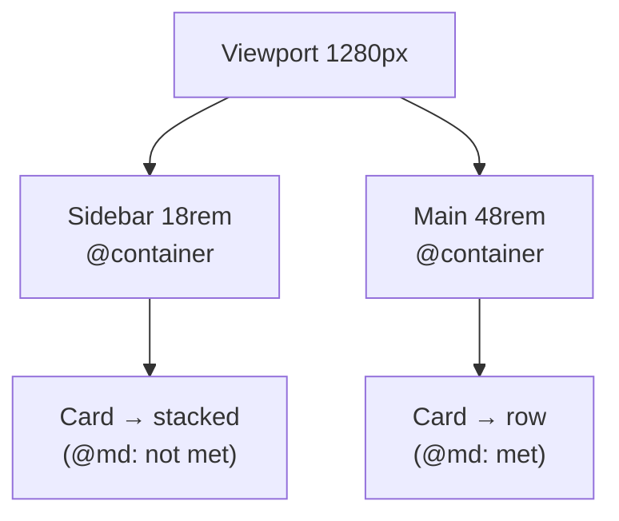
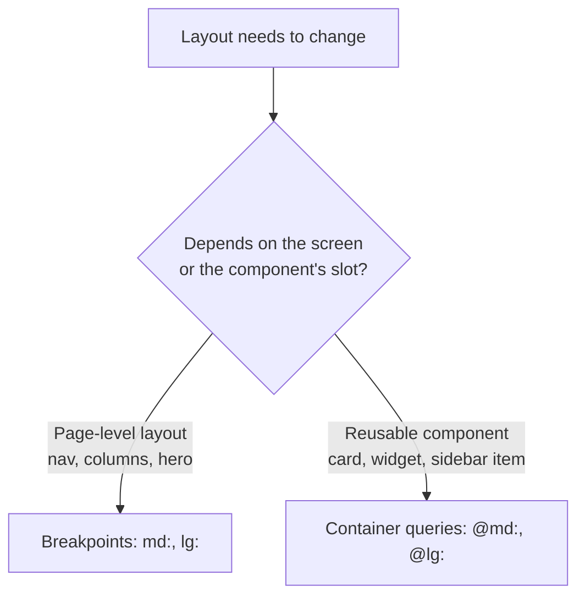

# Lesson 10 — Container Queries

## 🎯 Learning Objectives

- Explain how container queries differ from viewport (media) queries
- Mark a container with `@container` and style children with `@sm:`, `@md:`, …
- Use `@max-*`, ranges, named containers and arbitrary sizes
- Customize container sizes in `@theme`
- Distinguish the `@container` marker from the `container` utility
- Build a card that adapts to its slot, not the screen

---

## Introduction

Media queries ask: *"How wide is the screen?"* That breaks for reusable components. A product card in a narrow sidebar and the same card in a wide main column are on the **same screen** but need different layouts.

**Container queries** ask: *"How wide is my parent?"* The component becomes truly self-contained — a big win in React/Vue where the same component is reused in many places.

In Tailwind v4 they're built in (the old `@tailwindcss/container-queries` plugin is no longer needed).

---

## 1. The two-step pattern

1. Mark an ancestor as a container with `@container`.
2. Use `@`-prefixed variants on its descendants.

```html
<div class="@container">
  <div class="flex flex-col gap-3 @md:flex-row @md:items-center">
    
    <div>
      <h3 class="font-semibold">Mountain trip</h3>
      <p class="text-sm text-slate-500">Three days in the Western Ghats.</p>
    </div>
  </div>
</div>
```

`@container` sets `container-type: inline-size`, so the element can be queried on its width. (Remember Book 03, Module 12 — `@container` in raw CSS.)

> ⚠️ A container can't size itself from its own contents along the queried axis, and **an element can't query itself** — styles apply to *descendants* of the container.



---

## 2. Default container sizes

| Variant | Min container width |
|---|---|
| `@3xs` | 16rem (256px) |
| `@2xs` | 18rem (288px) |
| `@xs` | 20rem (320px) |
| `@sm` | 24rem (384px) |
| `@md` | 28rem (448px) |
| `@lg` | 32rem (512px) |
| `@xl` | 36rem (576px) |
| `@2xl` | 42rem (672px) |
| `@3xl` | 48rem (768px) |
| `@4xl` | 56rem (896px) |
| `@5xl` | 64rem (1024px) |
| `@6xl` | 72rem (1152px) |
| `@7xl` | 80rem (1280px) |

> ⚠️ These are **smaller steps** than the viewport breakpoints. `@md` is 28rem, not 48rem.

---

## 3. Max, range, arbitrary

```html
<div class="@container">
  <div class="@max-md:hidden">Hidden when the container is narrower than @md</div>
  <div class="@sm:@max-lg:grid-cols-2">Only between @sm and @lg</div>
  <div class="@min-[475px]:flex">Arbitrary min</div>
  <div class="@max-[600px]:p-2">Arbitrary max</div>
</div>
```

---

## 4. Named containers

When containers nest, name them to choose which one you're querying:

```html
<div class="@container/main">
  <div class="@container/card">
    <div class="flex-col @md/main:flex-row @sm/card:gap-6">…</div>
  </div>
</div>
```

---

## 5. Custom sizes in `@theme`

```css
@theme {
  --container-8xl: 96rem;      /* adds @8xl: and max-w-8xl */
}
```

The `--container-*` namespace powers both container-query variants and `max-w-*` utilities — one token, two features.

---

## 6. Container query units

Inside a container you can size relative to it with `cqw`, `cqi`, etc. via arbitrary values:

```html
<h2 class="@container text-[length:clamp(1rem,5cqi,2rem)]">…</h2>
```

(The unit refers to the nearest ancestor container.)

---

## 7. `@container` vs `container`

Don't confuse them:

| | `@container` | `container` |
|---|---|---|
| Purpose | Mark an element for container queries | Fixed `max-width` that steps at each viewport breakpoint |
| Based on | Parent's width | Viewport width |
| Module | This lesson | Module 02 |

In v4, `container` no longer centers or pads by default. Configure it once in CSS:

```css
@utility container {
  margin-inline: auto;
  padding-inline: 1rem;
}
```

Use `@container-normal` to remove container behavior at a variant (e.g., `lg:@container-normal`).

---

## 8. When to use which



Rule of thumb: **page layout → breakpoints; component layout → container queries.** They combine happily: `md:grid-cols-3` on the page grid, `@md:flex-row` inside each card.

Browser support is in the baseline for all modern browsers (since 2023).

---

## 🧪 Practical Example — A card that works anywhere

```html
<main class="grid gap-6 lg:grid-cols-[18rem_1fr]">
  <aside class="@container"> <!-- narrow slot -->
    <article class="rounded-xl border p-4">
      <div class="flex flex-col gap-3 @sm:flex-row">
        
        <div><h3 class="font-semibold">Trail shoes</h3><p class="text-sm text-slate-500">$89</p></div>
      </div>
    </article>
  </aside>

  <section class="@container"> <!-- wide slot -->
    <article class="rounded-xl border p-4">
      <div class="flex flex-col gap-3 @sm:flex-row">
        
        <div><h3 class="font-semibold">Trail shoes</h3><p class="text-sm text-slate-500">$89</p></div>
      </div>
    </article>
  </section>
</main>
```

The **identical** markup produces different layouts depending on where it's placed. In React this is one `<ProductCard />` — no `isSidebar` prop.

---

## 📝 Revision Questions

<details>
<summary>1. What do container queries measure that media queries don't?</summary>

The width of a parent container instead of the viewport.
</details>

<details>
<summary>2. Which two things are required for `@md:` to work?</summary>

An ancestor marked `@container`, and the `@md:` variant on a descendant.
</details>

<details>
<summary>3. Is `@md` the same width as `md`?</summary>

No — `@md` is 28rem (container), `md` is 48rem (viewport).
</details>

<details>
<summary>4. How do you target a specific container when nesting?</summary>

Name it: `@container/main` and use `@md/main:…`.
</details>

<details>
<summary>5. Which should you use for page-level layout vs a reusable card?</summary>

Breakpoints for page layout; container queries for reusable component layout.
</details>
