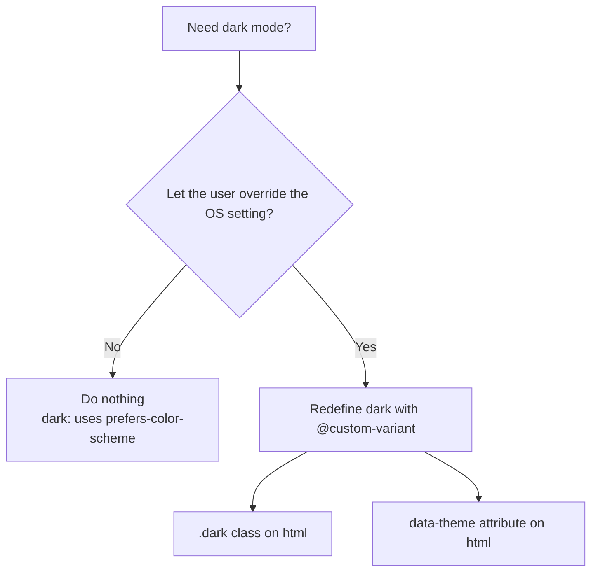

# Lesson 01 — Dark Mode & Color Scheme

## 🎯 Learning Objectives

By the end of this lesson you will be able to:

- Use the `dark:` variant with the default system-preference strategy
- Switch to a manual strategy (class or data-attribute) with `@custom-variant`
- Build a light / dark / system toggle that remembers the user's choice
- Prevent the "flash of wrong theme" on page load
- Use `scheme-*` utilities so native UI (scrollbars, form controls) matches your theme

---

## Introduction

In Book 03 you used `@media (prefers-color-scheme: dark)`. In Book 05 (Module 10) Bootstrap gave you `data-bs-theme`. Tailwind gives you a **variant**:

```html
<div class="bg-white text-slate-900 dark:bg-slate-900 dark:text-white">…</div>
```

Out of the box, `dark:` follows the operating system (`prefers-color-scheme`). To let users override that with a toggle, you redefine what `dark:` means.

---

## 1. Default: follow the system

No configuration needed:

```html
<body class="bg-white dark:bg-slate-950">
  <h1 class="text-slate-900 dark:text-slate-100">Hello</h1>
  <p class="text-slate-600 dark:text-slate-400">Follows the OS setting.</p>
</body>
```

`dark:` compiles to `@media (prefers-color-scheme: dark)`. Dark utilities stack with other variants: `dark:hover:bg-slate-800`, `md:dark:p-8` (Module 05, lesson 04 — variants read left to right in v4).

---

## 2. Manual strategy: override the `dark` variant

To control dark mode yourself, redefine the variant in your CSS entry file (v4 has no `darkMode: 'class'` in a config file):

### Class strategy

```css
@import "tailwindcss";

@custom-variant dark (&:where(.dark, .dark *));
```

Now `dark:` applies when the element **or any ancestor** has the class `dark`:

```html
<html class="dark">…</html>
```

### Data-attribute strategy

```css
@custom-variant dark (&:where([data-theme=dark], [data-theme=dark] *));
```

```html
<html data-theme="dark">…</html>
```

> 💡 `:where()` keeps specificity at zero, so dark utilities don't accidentally beat other utilities. (Lesson 06 explains `@custom-variant` fully.)



---

## 3. Light / dark / system toggle

Three user choices, stored in `localStorage`:

| Choice | Stored value | Result |
|---|---|---|
| Light | `"light"` | No `dark` class |
| Dark | `"dark"` | `dark` class |
| System | *(nothing stored)* | Follow `prefers-color-scheme` |

```js
// Apply the saved or system theme
function applyTheme() {
  const isDark =
    localStorage.theme === "dark" ||
    (!("theme" in localStorage) && window.matchMedia("(prefers-color-scheme: dark)").matches);
  document.documentElement.classList.toggle("dark", isDark);
}

// User actions
function setTheme(choice) {            // "light" | "dark" | "system"
  if (choice === "system") localStorage.removeItem("theme");
  else localStorage.theme = choice;
  applyTheme();
}

// Keep "system" in sync if the OS setting changes while the page is open
window.matchMedia("(prefers-color-scheme: dark)").addEventListener("change", applyTheme);
```

(`localStorage` and `matchMedia` are from Book 04, Modules 07 and 04.)

---

## 4. Avoid the flash of wrong theme (FOUC)

If you apply the theme in a script at the **end** of `<body>`, the page paints light first, then flips. Put a tiny **blocking inline script in `<head>`**, before any CSS paints:

```html
<head>
  <script>
    document.documentElement.classList.toggle(
      "dark",
      localStorage.theme === "dark" ||
        (!("theme" in localStorage) && window.matchMedia("(prefers-color-scheme: dark)").matches),
    );
  </script>
  <link rel="stylesheet" href="/src/styles.css" />
</head>
```

> ⚠️ In server-rendered React frameworks the server doesn't know the theme, so you can hit a hydration mismatch. Libraries like `next-themes` solve this; you'll meet it in Book 10.

---

## 5. `color-scheme`: theme the browser's own UI

Tailwind classes only restyle what you style. Scrollbars, `<input type="date">`, checkboxes and the default form-control colors come from the browser, and they stay light unless you tell the browser the page is dark:

| Utility | CSS |
|---|---|
| `scheme-light` | `color-scheme: light` |
| `scheme-dark` | `color-scheme: dark` |
| `scheme-light-dark` | `color-scheme: light dark` (follow the OS) |
| `scheme-normal` | `color-scheme: normal` |

```html
<html class="scheme-light dark:scheme-dark">
```

Also add `<meta name="color-scheme" content="light dark">` in the `<head>` so the browser knows before CSS loads.

---

## 6. Designing good dark palettes

- Don't just invert. Pure white (`white`) text on pure black (`black`) is harsh; use `slate-100` on `slate-950` or similar.
- Use **lighter surfaces for elevation** in dark mode (cards slightly lighter than the page), because shadows are less visible.
- Re-check contrast (Module 09, accessibility). Colors that pass on white may fail on dark backgrounds.
- Dim large images with `dark:brightness-90` (Module 04, filters).
- Writing `dark:` on every element gets noisy. Lesson 09 shows **semantic tokens** that switch automatically with no `dark:` at all.

---

## 🧪 Practical Example — Theme toggle (React)

```jsx
import { useEffect, useState } from "react";

export function ThemeToggle() {
  const [choice, setChoice] = useState(() => localStorage.theme ?? "system");

  useEffect(() => {
    const apply = () => {
      const dark =
        choice === "dark" ||
        (choice === "system" && matchMedia("(prefers-color-scheme: dark)").matches);
      document.documentElement.classList.toggle("dark", dark);
    };
    apply();
    if (choice === "system") localStorage.removeItem("theme");
    else localStorage.theme = choice;

    const mq = matchMedia("(prefers-color-scheme: dark)");
    mq.addEventListener("change", apply);
    return () => mq.removeEventListener("change", apply);
  }, [choice]);

  return (
    <div role="group" aria-label="Theme" className="inline-flex rounded-lg bg-slate-100 p-1 dark:bg-slate-800">
      {["light", "system", "dark"].map((c) => (
        <button
          key={c}
          aria-pressed={choice === c}
          onClick={() => setChoice(c)}
          className="rounded-md px-3 py-1 text-sm capitalize text-slate-600 aria-pressed:bg-white aria-pressed:text-slate-900 aria-pressed:shadow-sm
                     dark:text-slate-400 dark:aria-pressed:bg-slate-700 dark:aria-pressed:text-white"
        >
          {c}
        </button>
      ))}
    </div>
  );
}
```

The button styling is driven by `aria-pressed` (Module 05, lesson 07). For Vue, the same logic fits a composable with `ref` + `watchEffect`.

---

## 📝 Revision Questions

<details>
<summary>1. What does `dark:` follow by default in Tailwind v4?</summary>

The operating system's `prefers-color-scheme: dark` setting.
</details>

<details>
<summary>2. How do you make `dark:` depend on a `.dark` class instead?</summary>

`@custom-variant dark (&:where(.dark, .dark *));` in your CSS entry file.
</details>

<details>
<summary>3. Why put the theme script in `<head>`?</summary>

It runs before the first paint, preventing a flash of the wrong theme.
</details>

<details>
<summary>4. What does `scheme-dark` do that `dark:bg-slate-900` doesn't?</summary>

It sets `color-scheme: dark`, so native UI (scrollbars, form controls) renders dark too.
</details>

<details>
<summary>5. How do you represent the "system" choice in `localStorage`?</summary>

By storing nothing (remove the key) and falling back to `prefers-color-scheme`.
</details>
