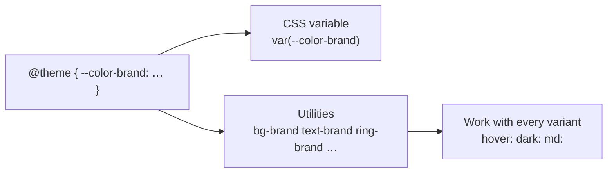

# Lesson 02 — The `@theme` Directive & Design Tokens

## 🎯 Learning Objectives

- Explain what `@theme` does and how it differs from `:root`
- Name the main theme variable namespaces and the utilities each one generates
- Use `@theme static` and `@theme inline` and know when each matters
- Reset or replace default theme values
- Use the `--default-*` variables to change global defaults

---

## Introduction

In Tailwind v3 your design system lived in `tailwind.config.js`. In v4 it lives in **CSS**, inside `@theme`. You've already used it twice in Module 05 (`--animate-wiggle`, `--breakpoint-xs`). This lesson explains the mechanism behind both.

A **design token** is a named design decision: `brand color`, `base spacing`, `heading font`. Tokens let you change a design in one place.

---

## 1. What `@theme` does

```css
@import "tailwindcss";

@theme {
  --color-brand: oklch(0.62 0.19 259);
  --font-display: "Satoshi", sans-serif;
}
```

Each variable does two things at once:

1. It becomes a real **CSS custom property** on `:root` (`var(--color-brand)` works anywhere).
2. Because of its **namespace** (`--color-*`), Tailwind generates **utilities**: `bg-brand`, `text-brand`, `border-brand`, `font-display`…



> ✅ **`@theme` vs `:root`:** use `@theme` for values that should generate utilities. Use plain `:root { --x: … }` for variables that shouldn't (e.g. a one-off value you only read with `var(--x)`).

`@theme` must be at the **top level** of your CSS — not nested inside a selector or media query.

---

## 2. Namespaces

The variable's prefix decides which utilities it creates:

| Namespace | Utilities generated |
|---|---|
| `--color-*` | `bg-*`, `text-*`, `border-*`, `ring-*`, `fill-*`, `from-*`, … |
| `--font-*` | `font-*` (font family) |
| `--text-*` | `text-*` (font size) |
| `--font-weight-*` | `font-*` (weight) |
| `--tracking-*` | `tracking-*` |
| `--leading-*` | `leading-*` |
| `--breakpoint-*` | `sm:`, `md:`, … variants |
| `--container-*` | `@md:` variants and `max-w-*` |
| `--spacing` / `--spacing-*` | `p-*`, `m-*`, `w-*`, `gap-*`, … |
| `--radius-*` | `rounded-*` |
| `--shadow-*` / `--inset-shadow-*` / `--drop-shadow-*` | `shadow-*`, … |
| `--blur-*` | `blur-*` |
| `--ease-*` | `ease-*` |
| `--animate-*` | `animate-*` |
| `--perspective-*`, `--aspect-*` | `perspective-*`, `aspect-*` |

Naming matters: the part after the namespace becomes the utility name. `--radius-card` → `rounded-card`; `--shadow-soft` → `shadow-soft`.

---

## 3. `static` and `inline` options

### Unused variables are not emitted

By default Tailwind only writes a theme variable into the final CSS if some utility **uses** it. That keeps your CSS small. To always output everything, use `static`:

```css
@theme static {
  --color-brand: oklch(0.62 0.19 259);   /* always emitted */
}
```

Use it when JavaScript reads the variable (`getComputedStyle`) or a library like Framer Motion needs it.

### `inline` — when a token points at another variable

```css
@theme inline {
  --font-sans: var(--font-inter);
}
```

By default a utility compiles to `font-family: var(--font-sans)`, and that variable is defined on `:root` with the value `var(--font-inter)`. If `--font-inter` is defined **somewhere else** (e.g. injected on `<body>` by a font loader), the chain resolves at the wrong level and fails. With `inline`, the utility gets the value directly: `font-family: var(--font-inter)`, resolved where it's used.

> 💡 `inline` is also essential for theme switching, which you'll build in Lesson 09.

---

## 4. Resetting defaults

Tailwind ships a large default theme. You can keep it, extend it, or remove parts:

```css
@theme {
  /* Remove all default colors, keep only mine */
  --color-*: initial;
  --color-white: #fff;
  --color-black: #000;
  --color-brand: oklch(0.62 0.19 259);
}
```

| Pattern | Effect |
|---|---|
| `--color-brand: …` | **Add** a token (defaults stay) |
| `--color-blue-500: …` | **Override** one default |
| `--color-*: initial` | Remove a whole namespace |
| `--*: initial` | Remove the entire default theme |

> ⚠️ After `--color-*: initial`, the shades (`blue-500`, `slate-200`…) are gone, and so are `white` and `black`, because those are theme colors too. Keywords like `transparent`, `current` and `inherit` are built in.

---

## 5. Global defaults: `--default-*`

A few variables change defaults across the whole framework:

```css
@theme {
  --default-font-family: var(--font-sans);
  --default-mono-font-family: var(--font-mono);
  --default-border-width: 1px;
  --default-transition-duration: 150ms;
  --default-transition-timing-function: cubic-bezier(0.4, 0, 0.2, 1);
  --default-ring-width: 1px;
}
```

Remember Module 04: the bare `ring` utility width changed in v4. `--default-ring-width` lets you restore your old preference in one line.

---

## 6. Using tokens outside of classes

Every token is a CSS variable, so it works in plain CSS, arbitrary values and JavaScript:

```css
.hero { background: linear-gradient(var(--color-brand), black); }
```

```html
<div class="bg-[var(--color-brand)]/20">…</div>     <!-- or: bg-brand/20 -->
<div class="rounded-(--radius-card)">…</div>        <!-- v4 shorthand for var() -->
```

```js
getComputedStyle(document.documentElement).getPropertyValue("--color-brand");
```

(Reading in JS needs the variable to be emitted — use `@theme static` if no utility uses it.)

---

## 🧪 Practical Example — A small design system

```css
@import "tailwindcss";

@theme {
  /* colors */
  --color-brand-50:  oklch(0.97 0.02 259);
  --color-brand-500: oklch(0.62 0.19 259);
  --color-brand-900: oklch(0.30 0.10 259);

  /* shape */
  --radius-card: 1rem;
  --shadow-card: 0 1px 2px rgb(0 0 0 / 0.06), 0 8px 24px rgb(0 0 0 / 0.08);

  /* type */
  --font-display: "Fraunces", Georgia, serif;
  --text-eyebrow: 0.75rem;
  --text-eyebrow--line-height: 1rem;

  /* motion */
  --ease-snappy: cubic-bezier(0.2, 0, 0, 1);
}
```

```html
<article class="rounded-card bg-white p-6 shadow-card">
  <p class="text-eyebrow font-medium tracking-widest text-brand-500 uppercase">New</p>
  <h2 class="font-display text-2xl text-brand-900">Design tokens</h2>
  <button class="mt-4 rounded-card bg-brand-500 px-4 py-2 text-white transition ease-snappy hover:bg-brand-900">
    Read more
  </button>
</article>
```

Change `--color-brand-500` once and every button, ring and border updates.

---

## 📝 Revision Questions

<details>
<summary>1. What two things does a variable in `@theme` produce?</summary>

A real CSS custom property, and (depending on its namespace) utility classes.
</details>

<details>
<summary>2. What utility does `--radius-card: 1rem` create?</summary>

`rounded-card`.
</details>

<details>
<summary>3. When do you need `@theme static`?</summary>

When a variable must always be emitted even if no utility uses it (e.g. read from JavaScript).
</details>

<details>
<summary>4. Why use `@theme inline` for `--font-sans: var(--font-inter)`?</summary>

So the utility references `var(--font-inter)` directly where it's used, instead of through a `:root` variable that may resolve in the wrong scope.
</details>

<details>
<summary>5. How do you remove all of Tailwind's default colors?</summary>

`--color-*: initial;` inside `@theme`.
</details>
