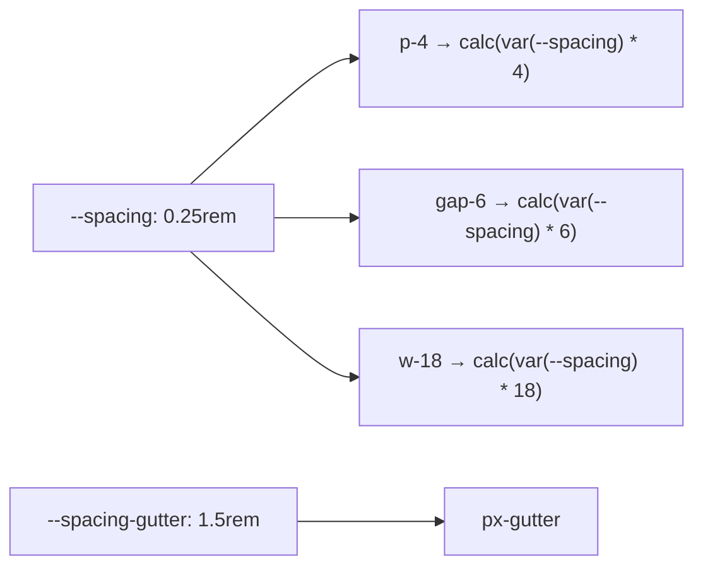

# Lesson 03 — Customizing Colors, Spacing & Fonts

## 🎯 Learning Objectives

- Add a brand color scale (OKLCH) and use it with opacity modifiers
- Choose between extending and replacing the default palette
- Change the spacing scale with the `--spacing` base value and add named steps
- Add custom fonts, including font features, with `@font-face` and `@theme`
- Add custom font sizes with paired line heights

---

## Introduction

Lesson 02 gave you the mechanism. Now apply it to the three customizations you'll do on almost every project: **colors**, **spacing** and **fonts**.

---

## 1. Colors

### Add a brand scale

```css
@theme {
  --color-brand-50:  oklch(0.97 0.02 259);
  --color-brand-100: oklch(0.93 0.05 259);
  --color-brand-200: oklch(0.87 0.09 259);
  --color-brand-300: oklch(0.79 0.13 259);
  --color-brand-400: oklch(0.70 0.17 259);
  --color-brand-500: oklch(0.62 0.19 259);
  --color-brand-600: oklch(0.54 0.20 259);
  --color-brand-700: oklch(0.46 0.18 259);
  --color-brand-800: oklch(0.38 0.14 259);
  --color-brand-900: oklch(0.30 0.10 259);
  --color-brand-950: oklch(0.22 0.07 259);
}
```

Now `bg-brand-500`, `text-brand-700`, `ring-brand-300/50`, `from-brand-400` all exist.

> 💡 In OKLCH (Module 03, `color-palette-and-oklch`) the three numbers are lightness, chroma and hue. Keeping **hue** constant and stepping **lightness** gives a perceptually even scale. Generator tools exist, but understanding the three numbers lets you tweak by hand.

### Opacity modifiers work on custom colors

`bg-brand-500/20` works with any color format, because v4 builds the transparency with `color-mix()` rather than needing the color split into channels.

### Extend vs replace

| Goal | Approach |
|---|---|
| Keep Tailwind's palette and add yours | Just add `--color-brand-*` |
| Use only your palette | `--color-*: initial;` first, then define everything (including `white` / `black` if you need them) |
| Tweak one default | Redefine that one variable, e.g. `--color-red-500: oklch(…)` |

Large teams usually **replace**: it prevents anyone from reaching for `bg-blue-500` when the brand color exists.

### Semantic names

```css
@theme {
  --color-primary: var(--color-brand-600);
  --color-danger: var(--color-red-600);
}
```

`bg-primary` expresses intent; you can retarget it later. (Lesson 09 takes this further.)

---

## 2. Spacing

Every numeric spacing utility is computed from **one variable**:

```css
@theme {
  --spacing: 0.25rem;   /* default: p-4 = 4 × 0.25rem = 1rem */
}
```

`p-4`, `mt-8`, `w-12`, `gap-6`, `size-10` all multiply `--spacing`. Change it and the whole scale rescales:

```css
@theme { --spacing: 0.3rem; }   /* every step is 20% larger */
```

Because it's a multiplier, **any number works**: `p-13`, `mt-7.5`, `w-18` — no need to register them.

### Named steps

```css
@theme {
  --spacing-gutter: 1.5rem;
  --spacing-header: 4.5rem;
}
```

→ `px-gutter`, `scroll-mt-header`, `h-header`, `gap-gutter`.



---

## 3. Fonts

### Step 1 — load the font

Using a local or self-hosted file:

```css
@font-face {
  font-family: "Inter Variable";
  src: url("/fonts/InterVariable.woff2") format("woff2");
  font-weight: 100 900;
  font-display: swap;
}
```

Or install from npm (e.g. Fontsource: `npm i @fontsource-variable/inter`) and `@import` it. (Module 03, `web-fonts-and-font-features`, covered loading strategies, `font-display` and preloading.)

### Step 2 — register it as a token

```css
@theme {
  --font-sans: "Inter Variable", ui-sans-serif, system-ui, sans-serif;
  --font-display: "Fraunces", ui-serif, Georgia, serif;
}
```

Overriding `--font-sans` changes the **default body font** too, because Preflight applies `font-sans` to `html`.

### Font features and variations

```css
@theme {
  --font-display: "Satoshi", sans-serif;
  --font-display--font-feature-settings: "cv02", "cv03", "cv04";
  --font-display--font-variation-settings: "opsz" 32;
}
```

These apply automatically wherever `font-display` is used.

---

## 4. Font sizes with line heights

```css
@theme {
  --text-tiny: 0.625rem;
  --text-tiny--line-height: 1.5;

  --text-hero: clamp(2.5rem, 6vw, 5rem);
  --text-hero--line-height: 1.05;
  --text-hero--letter-spacing: -0.03em;
}
```

`text-tiny` and `text-hero` now set size, line height and (optionally) letter spacing together. Fluid sizes via `clamp()` are a clean way to reduce the number of breakpoint prefixes (Book 03, Module 02).

---

## 5. Radius, shadows and more (quick hits)

```css
@theme {
  --radius-card: 1rem;
  --shadow-soft: 0 8px 30px rgb(0 0 0 / 0.08);
  --blur-glass: 16px;
}
```

→ `rounded-card`, `shadow-soft`, `backdrop-blur-glass`... (Module 04.)

---

## 🧪 Practical Example — Rebrand a page by editing one block

```css
@import "tailwindcss";

@theme {
  --color-*: initial;
  --color-white: #fff;
  --color-black: #000;
  --color-ink-50:  oklch(0.98 0.005 260);
  --color-ink-200: oklch(0.90 0.01 260);
  --color-ink-600: oklch(0.45 0.02 260);
  --color-ink-900: oklch(0.20 0.02 260);
  --color-brand-500: oklch(0.65 0.20 25);
  --color-brand-600: oklch(0.57 0.21 25);

  --spacing: 0.25rem;
  --spacing-gutter: 1.5rem;

  --font-sans: "Inter Variable", system-ui, sans-serif;
  --font-display: "Fraunces", Georgia, serif;
  --text-hero: clamp(2.5rem, 6vw, 4.5rem);
  --text-hero--line-height: 1.05;
}
```

```html
<section class="bg-ink-50 px-gutter py-20">
  <h1 class="font-display text-hero text-ink-900">Ship faster</h1>
  <p class="mt-4 max-w-prose text-ink-600">Design tokens make a rebrand a one-file change.</p>
  <a class="mt-8 inline-block rounded-lg bg-brand-500 px-5 py-3 text-white hover:bg-brand-600">Get started</a>
</section>
```

Try swapping hue `25` to `150` — the whole page turns green.

---

## 📝 Revision Questions

<details>
<summary>1. How do you add `bg-brand-500` to your project?</summary>

Define `--color-brand-500: …` in `@theme`.
</details>

<details>
<summary>2. What does changing `--spacing` do?</summary>

Rescales every numeric spacing utility, because they all multiply that single value.
</details>

<details>
<summary>3. Do you need to register `p-13` before using it?</summary>

No. Numeric spacing utilities are computed from `--spacing`, so any number works.
</details>

<details>
<summary>4. How do you attach a line height to a custom font size `--text-tiny`?</summary>

Define `--text-tiny--line-height` alongside it.
</details>

<details>
<summary>5. Why do large teams often replace the default palette?</summary>

It prevents off-brand colors from being used by accident and keeps the design system consistent.
</details>
