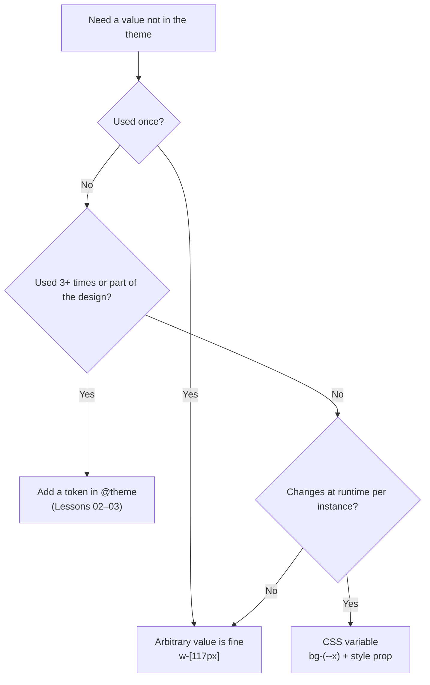

# Lesson 04 — Arbitrary Values & Properties

## 🎯 Learning Objectives

- Use square-bracket arbitrary values for one-off styles
- Use the v4 `(--var)` shorthand and type hints for CSS variables
- Write arbitrary properties and arbitrary variants
- Use the v4 `!` important modifier (suffix position)
- Configure a Tailwind class `prefix()` with the v4 syntax
- Decide when a value should become a theme token instead

---

## Introduction

Design systems cover 95% of cases. The other 5% — a hero image offset of exactly 117px, a one-off grid template — shouldn't force you to leave your HTML. Tailwind's escape hatch is the **square bracket**.

---

## 1. Arbitrary values

```html
<div class="top-[117px] w-[calc(100%-2rem)] bg-[#316ff6] grid-cols-[1fr_500px_2fr]">
```

- Underscores become spaces: `grid-cols-[1fr_500px_2fr]` → `1fr 500px 2fr`.
- Inside `calc()`, Tailwind adds spaces around operators for you.
- To keep a literal underscore (e.g. in a URL), escape it: `bg-[url('/img/my\_file.png')]`.
- Negative values: write the minus inside — `mt-[-10px]`.

Works with every utility, every variant: `md:w-[420px]`, `hover:bg-[#0ea5e9]`.

---

## 2. CSS variables and type hints

Referencing a CSS variable — v4 shorthand uses parentheses instead of `var()`:

```html
<div class="bg-(--brand) w-(--sidebar-width) rounded-(--radius-card)">
```

The old form `bg-[var(--brand)]` still works.

Some utilities share a name but mean different things (`text-` is font size **or** color). If Tailwind can't infer the type, add a **type hint**:

```html
<p class="text-(length:--hero-size) text-(color:--hero-color)">
<p class="text-[length:var(--hero-size)] text-[color:var(--hero-color)]">
```

---

## 3. Arbitrary properties

No utility for the CSS property? Write it directly:

```html
<div class="[mask-type:luminance] hover:[mask-type:alpha]">
<div class="[--scroll-offset:56px] scroll-mt-(--scroll-offset)">
<div class="[content-visibility:auto]">
```

The property name and value go in brackets, separated by a colon. Variants apply normally. Setting a **CSS variable** this way is a great pattern for per-instance values (e.g. from React props):

```jsx
<div className="size-(--size) bg-brand-500" style={{ "--size": `${px}px` }} />
```

---

## 4. Arbitrary variants (recap)

You saw these in Module 05, lesson 07:

```html
<ul class="[&>li]:py-1">
<a class="[&[target=_blank]]:after:content-['↗']">
<div class="[@media(min-width:900px)]:grid-cols-3">
```

---

## 5. ⚠️ Dynamic classes don't work

```jsx
// ❌ Tailwind can't see this class name in your source
<div className={`bg-${color}-500`} />
<div className={`w-[${width}px]`} />
```

Tailwind finds classes by scanning for **complete strings**. Use a lookup of full class names, or feed the value through a CSS variable:

```jsx
const colors = { red: "bg-red-500", blue: "bg-blue-500" };   // ✅ full strings
<div className={colors[color]} />

<div className="w-(--w)" style={{ "--w": `${width}px` }} />  // ✅ variable
```

(Lesson 08 shows how to force-generate classes with `@source inline()`.)

---

## 6. The `!` important modifier — position changed in v4

```html
<!-- v4: at the END of the utility -->
<div class="bg-red-500!">
<div class="hover:bg-red-500! md:p-4!">

<!-- v3 style (still works but deprecated): at the START -->
<div class="!bg-red-500">
```

Use sparingly — it's a last resort for fighting third-party CSS. Prefer fixing the cascade (Lesson 07).

---

## 7. Class prefix — syntax changed in v4

Adding a prefix avoids collisions with an existing CSS framework (migrating from Bootstrap!). In v4 it's configured in CSS:

```css
@import "tailwindcss" prefix(tw);
```

```html
<div class="tw:flex tw:bg-red-500 tw:hover:bg-red-600 md:tw:p-4">
```

Differences from v3 (`tw-flex`):

- The prefix looks like a **variant** (colon, not dash) and goes at the **start**, before other variants.
- Theme variables are emitted with the prefix too (`--tw-color-red-500`) so they don't clash with yours.

---

## 8. When to stop using arbitrary values



---

## 🧪 Practical Example — A per-card accent color from data

```jsx
function Tag({ label, hue }) {
  return (
    <span
      style={{ "--hue": hue }}
      className="inline-flex items-center rounded-full px-3 py-1 text-sm font-medium
                 bg-[oklch(0.95_0.05_var(--hue))] text-[oklch(0.40_0.15_var(--hue))]
                 dark:bg-[oklch(0.30_0.08_var(--hue))] dark:text-[oklch(0.90_0.08_var(--hue))]"
    >
      {label}
    </span>
  );
}
```

One component, any hue, no dynamic class names: the full class strings are static, and only the CSS variable changes.

---

## 📝 Revision Questions

<details>
<summary>1. What do underscores mean inside an arbitrary value?</summary>

Spaces. Escape them (`\_`) to keep a literal underscore.
</details>

<details>
<summary>2. What is the v4 shorthand for `bg-[var(--brand)]`?</summary>

`bg-(--brand)`.
</details>

<details>
<summary>3. Why won't `className={`bg-${color}-500`}` work?</summary>

Tailwind scans source for complete class strings; dynamically assembled names aren't detected.
</details>

<details>
<summary>4. Where does the important modifier go in v4?</summary>

At the end: `bg-red-500!` (the leading `!` form is deprecated).
</details>

<details>
<summary>5. How do you set a class prefix in v4, and how is it written in HTML?</summary>

`@import "tailwindcss" prefix(tw);` and `tw:flex`, `tw:hover:bg-red-500`.
</details>
