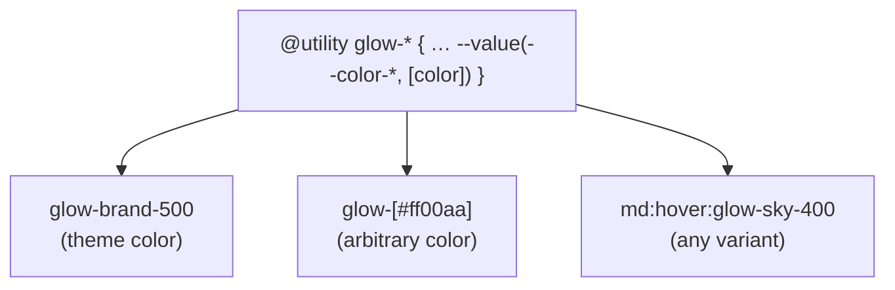

# Lesson 05 — Custom Utilities with `@utility`

## 🎯 Learning Objectives

- Create simple custom utilities with `@utility`
- Understand why `@utility` replaced `@layer utilities` in v4
- Create functional utilities that accept values (`tab-*`) via `--value()`
- Add complex selectors and nested rules inside a utility
- Choose between `@utility`, `@layer components`, `@apply` and component extraction

---

## Introduction

Tailwind covers most CSS, but your project may need a utility it doesn't ship — `scrollbar-hidden`, a branded gradient, a `text-balance`-style helper. In v3 you used `@layer utilities { .foo { … } }` or a JS plugin. In v4 there's one clear way: **`@utility`**.

---

## 1. A simple utility

```css
@utility scrollbar-hidden {
  scrollbar-width: none;
  &::-webkit-scrollbar {
    display: none;
  }
}
```

```html
<div class="scrollbar-hidden overflow-x-auto">…</div>
```

That's it. And because it's a real Tailwind utility, **every variant works automatically**:

```html
<div class="md:scrollbar-hidden hover:scrollbar-hidden dark:scrollbar-hidden">
```

> ⚠️ **Why not `@layer utilities`?** In v4, `@layer utilities { .foo {} }` is plain CSS inside a native cascade layer. It won't be recognized as a utility, so `hover:foo` and `md:foo` won't work. Use `@utility` for anything you want to behave like a Tailwind class. The name must be a single class name (no spaces or combinators).

---

## 2. Reusing Tailwind inside a utility

```css
@utility glass {
  @apply bg-white/10 backdrop-blur-md border border-white/20;
}
```

You can also use `--spacing()` and other theme functions (Lesson 07):

```css
@utility gutter-x {
  padding-inline: --spacing(6);
}
```

---

## 3. Functional utilities: values after a dash

A name ending in `-*` makes the utility accept a value. `--value()` tells Tailwind where valid values come from:

```css
@theme {
  --tab-size-github: 8;
}

@utility tab-* {
  tab-size: --value(--tab-size-*, integer, [integer]);
}
```

| Usage | Matches because… |
|---|---|
| `tab-github` | Theme key `--tab-size-github` |
| `tab-4` | A bare `integer` |
| `tab-[12]` | An arbitrary `[integer]` |

Common `--value()` sources:

| Argument | Meaning |
|---|---|
| `--color-*` | A theme namespace |
| `integer`, `number`, `percentage`, `ratio`, `color`, `length`… | A bare typed value |
| `[length]`, `[color]`… | Arbitrary value (in brackets) of that type |
| `"literal"` | A specific keyword |

Example: a glow whose color comes from your palette:

```css
@utility glow-* {
  box-shadow: 0 0 24px --value(--color-*, [color]);
}
```

→ `glow-brand-500`, `glow-sky-400`, `glow-[#ff00aa]`, and with variants: `hover:glow-brand-500`.

(There's also `--modifier()` for the `/something` suffix, e.g. `text-shadow-lg/50`. Check the docs when you need it.)



---

## 4. Complex selectors and nesting

Use `&` and nesting inside a utility:

```css
@utility prose-links {
  a {
    color: var(--color-brand-600);
    text-decoration: underline;
    &:hover {
      color: var(--color-brand-800);
    }
  }
}
```

Utilities can also hold a whole component-like block. Because they sit in the **utilities layer**, they correctly beat base/component styles, and *other utilities override them by source order* (put later utilities in markup carefully).

---

## 5. Customizing `container` (callback to Module 02)

In v4 the built-in `container` is no longer centered or padded. Extend it with `@utility`:

```css
@utility container {
  margin-inline: auto;
  padding-inline: 1rem;
  @media (min-width: 64rem) {
    padding-inline: 2rem;
  }
}
```

(Defining a utility with an existing name adds to the built-in one.)

---

## 6. Choosing the right tool

```mermaid
flowchart TD
    A[I keep repeating styles] --> B{Single CSS declaration group,<br/>need hover:/md: variants?}
    B -- Yes --> C["@utility"]
    B -- No --> D{A multi-element UI piece<br/>(card, button, nav)?}
    D -- Yes --> E["Extract a component<br/>(React/Vue) — Module 07, lesson 08"]
    D -- No --> F{Plain CSS class you<br/>control in one stylesheet?}
    F -- Yes --> G["@layer components + @apply<br/>(Lesson 07)"]
    F -- No --> H["Keep the utilities in markup"]
```

Rule of thumb from the Tailwind docs: **don't reach for CSS abstractions too early.** Repeating `px-4 py-2 rounded-lg` in three places is fine; extracting at 10+ is better — as a component, not a class.

---

## 🧪 Practical Example — A tiny utility kit

```css
@import "tailwindcss";

@theme {
  --color-brand-500: oklch(0.62 0.19 259);
  --color-brand-600: oklch(0.54 0.20 259);
}

/* hide scrollbars but keep scrolling */
@utility no-scrollbar {
  scrollbar-width: none;
  &::-webkit-scrollbar { display: none; }
}

/* branded focus ring that works with any variant */
@utility focus-brand {
  outline: 2px solid transparent;
  &:focus-visible {
    box-shadow: 0 0 0 2px white, 0 0 0 4px var(--color-brand-500);
  }
}

/* colored glow with theme or arbitrary color */
@utility glow-* {
  box-shadow: 0 0 24px --value(--color-*, [color]);
}
```

```html
<nav class="no-scrollbar flex gap-4 overflow-x-auto">…</nav>
<button class="focus-brand rounded-lg bg-brand-500 px-4 py-2 text-white hover:glow-brand-600">Save</button>
```

---

## 📝 Revision Questions

<details>
<summary>1. Why doesn't `@layer utilities { .foo {} }` give you `hover:foo` in v4?</summary>

It's just CSS in a cascade layer, not a registered Tailwind utility. `@utility` registers it so variants work.
</details>

<details>
<summary>2. What does `@utility tab-*` enable?</summary>

A functional utility that accepts values after the dash (`tab-4`, `tab-[12]`, `tab-github`).
</details>

<details>
<summary>3. What does `--value(--color-*, [color])` allow?</summary>

Values from the theme's color namespace, or an arbitrary color in brackets.
</details>

<details>
<summary>4. How do you make the built-in `container` centered with padding in v4?</summary>

Define `@utility container { margin-inline: auto; padding-inline: …; }`.
</details>

<details>
<summary>5. When is a component better than a custom utility?</summary>

When you're repeating a multi-element piece of UI (card, nav) rather than a style group.
</details>
