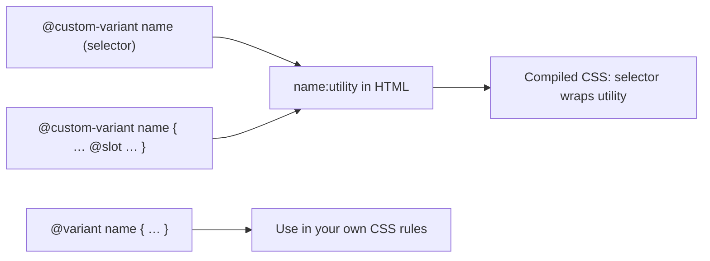

# Lesson 06 — Custom Variants with `@custom-variant`

## 🎯 Learning Objectives

- Define a custom variant with the one-line shorthand
- Define a custom variant with a block and `@slot`
- Create attribute-driven theme and state variants (`theme-midnight:`, `sidebar-open:`)
- Override built-in variants (`dark`, `hover`)
- Use `@variant` to apply Tailwind variants inside your own CSS

---

## Introduction

Variants are Tailwind's superpower: `hover:`, `md:`, `dark:`. In Module 05 you learned dozens of built-in ones, plus arbitrary variants like `[&>li]:py-1`. When you use the same custom condition repeatedly, **name it**.

---

## 1. Shorthand form

One selector or at-rule in parentheses:

```css
@custom-variant theme-midnight (&:where([data-theme=midnight], [data-theme=midnight] *));
```

```html
<html data-theme="midnight">
  <div class="bg-white theme-midnight:bg-slate-950 theme-midnight:text-slate-100">…</div>
</html>
```

`&` is the element being styled. `:where()` gives zero specificity so the variant doesn't outrank other utilities (recall Lesson 01).

At-rules work too:

```css
@custom-variant pointer-coarse (@media (pointer: coarse));
@custom-variant tall (@media (min-height: 50rem));
```

```html
<button class="p-2 pointer-coarse:p-4">…</button>
```

---

## 2. Block form with `@slot`

When the rule needs several nested layers, write a block. `@slot` marks where the utility's styles go:

```css
@custom-variant any-hover {
  @media (any-hover: hover) {
    &:hover {
      @slot;
    }
  }
}
```

`any-hover:bg-sky-500` compiles to:

```css
@media (any-hover: hover) { .any-hover\:bg-sky-500:hover { background-color: … } }
```

---

## 3. State variants driven by attributes

Perfect for app-level UI state set from JavaScript, React or Vue:

```css
@custom-variant sidebar-open (&:where([data-sidebar=open] &));
@custom-variant loading (&:where([data-loading] &, &[data-loading]));
```

```html
<body data-sidebar="open">
  <aside class="-translate-x-full transition sidebar-open:translate-x-0">…</aside>
  <main class="sidebar-open:md:ml-64">…</main>
</body>
```

```jsx
useEffect(() => {
  document.body.dataset.sidebar = open ? "open" : "closed";
}, [open]);
```

Compare with Module 05, lesson 07: for **component-level** state, `group-data-[state=open]:…` is usually enough. Custom variants shine for **global** states.

---

## 4. Variants stack and combine

Custom variants work like built-in ones:

```html
<div class="theme-midnight:hover:bg-slate-800 md:theme-midnight:p-8">
```

---

## 5. Overriding built-in variants

Two you've seen:

```css
/* manual dark mode (Lesson 01) */
@custom-variant dark (&:where(.dark, .dark *));

/* restore v3-style hover (Module 05, lesson 04) */
@custom-variant hover (&:hover);
```

---

## 6. `@variant` — use variants inside your own CSS

When writing plain CSS (e.g. in `@layer base`), apply Tailwind's variants without remembering the media query:

```css
.card {
  background: white;
  @variant dark {
    background: var(--color-slate-900);
  }
  @variant hover {
    box-shadow: var(--shadow-lg);
  }
}
```

`@variant` resolves to whatever `dark` or `hover` currently means in your project, including your overrides.



---

## 🧪 Practical Example — Theme + density variants

```css
@import "tailwindcss";

@custom-variant dark (&:where([data-theme=dark], [data-theme=dark] *));
@custom-variant compact (&:where([data-density=compact], [data-density=compact] *));
```

```html
<html data-theme="light" data-density="compact">
  <button class="rounded-lg bg-brand-500 px-5 py-3 text-white compact:px-3 compact:py-1.5 compact:text-sm dark:bg-brand-400">
    Save
  </button>
</html>
```

Flip `data-density` and every button, row and input shrinks, without touching component code.

---

## 📝 Revision Questions

<details>
<summary>1. What does `&` represent in a `@custom-variant` selector?</summary>

The element the utility is applied to.
</details>

<details>
<summary>2. What does `@slot` do?</summary>

It marks where the utility's own declarations are inserted inside a block-form variant.
</details>

<details>
<summary>3. Why wrap selectors in `:where()`?</summary>

It keeps specificity at zero so the variant doesn't override other utilities unexpectedly.
</details>

<details>
<summary>4. How do you restore v3's `hover:` behavior (apply even on touch devices)?</summary>

`@custom-variant hover (&:hover);`.
</details>

<details>
<summary>5. What's `@variant` for?</summary>

Using a Tailwind variant (including overridden ones) inside your own CSS rules.
</details>
