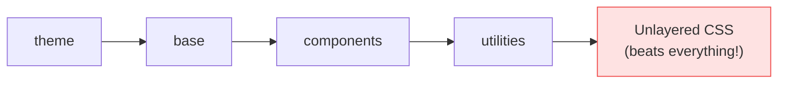

# Lesson 07 — `@layer`, `@apply` & Base Styles

## 🎯 Learning Objectives

- Explain Tailwind v4's native cascade layers and their order
- Add global defaults with `@layer base`
- Use `@apply` correctly, including in Vue SFCs and CSS Modules via `@reference`
- Avoid the "unlayered CSS beats utilities" trap
- Use the CSS functions `--spacing()`, `--alpha()` and `--theme()`

---

## Introduction

You learned the cascade and `@layer` in Book 03 (Module 12). Tailwind v4 builds on **native cascade layers** instead of its own layer system. Understanding the order explains most "why isn't my style winning?" questions.

---

## 1. The layer order

```css
@layer theme, base, components, utilities;
```

Later layers beat earlier ones, regardless of selector specificity.

| Layer | Contains |
|---|---|
| `theme` | Your `@theme` variables |
| `base` | Preflight (reset) + your element defaults |
| `components` | Component classes you write (`.btn`) |
| `utilities` | All utilities (`p-4`, `hover:bg-…`) |



---

## 2. `@layer base` — global defaults

Style bare HTML elements without classes:

```css
@layer base {
  html {
    scroll-behavior: smooth;
  }
  h1 { @apply text-3xl font-bold tracking-tight; }
  h2 { @apply text-2xl font-semibold; }
  a  { @apply text-brand-600 underline-offset-4 hover:underline; }
  button { cursor: pointer; }          /* v4 Preflight uses the default cursor */
  ::selection { background: var(--color-brand-200); }
}
```

Because `base` sits below `utilities`, a class like `text-lg` on an `<h2>` always wins. That's what you want.

---

## 3. `@layer components` — simple component classes

```css
@layer components {
  .card {
    background: white;
    border-radius: var(--radius-card);
    box-shadow: var(--shadow-card);
    padding: --spacing(6);
  }
}
```

Utilities override components: `<div class="card p-2">` gets `p-2`.

> ⚠️ Classes in `@layer components` are **plain CSS**. `md:card` and `hover:card` won't work. If you need variants, use `@utility` (Lesson 05).

---

## 4. `@apply` — inline utilities into CSS

```css
.btn-primary {
  @apply rounded-lg bg-brand-500 px-4 py-2 font-medium text-white hover:bg-brand-600 focus-visible:ring-2;
}
```

`@apply` supports variants (`hover:`, `md:`, `dark:`) and `!` (`@apply bg-red-500!`).

**Use sparingly.** It reintroduces naming, separate files and context-switching, which Tailwind is designed to avoid. Good uses: third-party markup you can't add classes to (a CMS `<article>`), and base element styles.

### ⚠️ `@apply` in Vue SFCs, CSS Modules and separate files (v4)

Those stylesheets are processed in isolation and **don't know your theme or utilities**. Tell Tailwind where to look with `@reference`:

```vue
<style scoped>
@reference "../../app.css";

h1 {
  @apply text-2xl font-bold text-brand-600;
}
</style>
```

```css
/* Button.module.css (React) */
@reference "../app.css";
.primary { @apply bg-brand-500 text-white; }
```

`@reference` imports nothing into your output (no duplicate CSS), it only makes the definitions available. A lighter alternative: skip `@apply` and use the variables directly (`background: var(--color-brand-500)`), which needs no `@reference`.

---

## 5. ⚠️ Unlayered CSS beats utilities

In native layers, **any CSS outside a layer wins over every layer**, including `utilities`:

```css
/* ❌ unlayered → beats p-4, text-lg, … */
.legacy-button { padding: 20px; }
```

```html
<button class="legacy-button p-2">  <!-- still 20px! -->
```

Fixes:

- Put your CSS in a layer (`@layer components { … }`).
- Import third-party/legacy CSS into a layer:

```css
@import "tailwindcss";
@import "./legacy-bootstrap-bits.css" layer(components);
```

This is the first thing to check when migrating from Bootstrap (Module 09).

---

## 6. CSS functions in v4

| Function | Use |
|---|---|
| `--spacing(4)` | `calc(var(--spacing) * 4)` — on-scale spacing in custom CSS |
| `--alpha(var(--color-lime-200) / 50%)` | Adjust a color's opacity |
| `--theme(--breakpoint-xl)` | Read a theme value inside a media query |

```css
.hero {
  padding-block: --spacing(16);
  border-color: --alpha(var(--color-brand-500) / 30%);
}

@media (width >= --theme(--breakpoint-xl)) {
  .hero { padding-block: --spacing(24); }
}
```

The v3 `theme('colors.blue.500')` function still works for compatibility but is deprecated. Prefer `var(--color-blue-500)`.

---

## 🧪 Practical Example — Styling CMS content you can't add classes to

```css
@import "tailwindcss";

@layer base {
  :root { color-scheme: light dark; }
  body { @apply bg-white text-slate-900 dark:bg-slate-950 dark:text-slate-100; }
}

@layer components {
  .article-body {
    h2 { @apply mt-10 mb-3 text-2xl font-semibold; }
    p  { @apply my-4 leading-7; }
    a  { @apply text-brand-600 underline underline-offset-4 hover:text-brand-800; }
    blockquote { @apply border-l-4 border-brand-300 pl-4 text-slate-600 italic; }
    img { @apply my-6 rounded-xl; }
  }
}
```

```html
<div class="article-body max-w-prose">{@html cmsContent}</div>
```

(For long-form text the official typography plugin does this for you. See Module 08.)

---

## 📝 Revision Questions

<details>
<summary>1. What is the layer order in Tailwind v4?</summary>

`theme`, `base`, `components`, `utilities` — later layers win.
</details>

<details>
<summary>2. Why can `md:card` fail for a class defined in `@layer components`?</summary>

Plain CSS in a layer isn't a registered utility. Use `@utility` if you need variants.
</details>

<details>
<summary>3. What does `@reference` do?</summary>

Gives a separate stylesheet (Vue SFC, CSS Module) access to your theme/utilities for `@apply`, without emitting duplicate CSS.
</details>

<details>
<summary>4. Why might `.my-class { padding: 20px }` beat `p-2`?</summary>

It's unlayered, and unlayered CSS beats all layers. Put it in a layer.
</details>

<details>
<summary>5. What does `--spacing(6)` produce?</summary>

`calc(var(--spacing) * 6)`.
</details>
