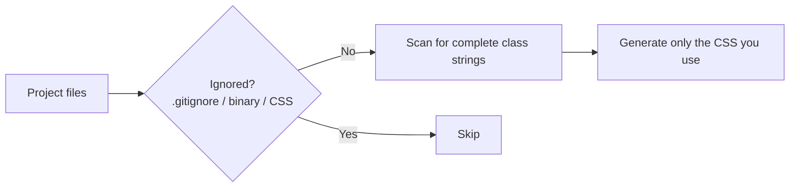

# Lesson 08 — `@source`, `@plugin` & Legacy Config

## 🎯 Learning Objectives

- Explain automatic source detection and how to extend or restrict it
- Force-generate classes with `@source inline()` (the v4 replacement for `safelist`)
- Explain the dynamic-class-name pitfall and its fixes
- Load plugins with `@plugin`
- Load a legacy `tailwind.config.js` with `@config` and know what's unsupported

---

## Introduction

Tailwind generates only the CSS for classes it **finds in your files** (Module 01, `how-tailwind-generates-css`). In v3 you listed paths in `content: []`. In v4 detection is **automatic**, and the CSS directives in this lesson are for the exceptions.

---

## 1. Automatic detection

By default Tailwind scans your project, **ignoring**:

- Anything in `.gitignore` (e.g. `node_modules`, `dist`)
- Binary files (images, videos, zips)
- CSS files and lock files



---

## 2. `@source` — add or exclude paths

### Add a path that is normally ignored

A component library in `node_modules` contains Tailwind classes that Tailwind skipped:

```css
@import "tailwindcss";
@source "../node_modules/@my-company/ui-lib";
```

### Exclude a path

```css
@source not "../src/legacy";
```

### Change the base scanning folder

```css
@import "tailwindcss" source("../src");
```

### Turn automatic detection off

```css
@import "tailwindcss" source(none);
@source "../src/app";        /* then opt in explicitly */
```

Typical in monorepos, where each package should scan only itself.

---

## 3. The dynamic class name pitfall

```jsx
// ❌ never works — the full class string doesn't exist in source
<div className={`bg-${color}-500 text-${size}`} />
```

Tailwind doesn't run your code. It scans text. Three fixes:

**1. Map to complete strings (best):**

```jsx
const variants = {
  success: "bg-green-500 text-white",
  danger: "bg-red-500 text-white",
};
<div className={variants[status]} />
```

**2. Pass a CSS variable (Lesson 04):**

```jsx
<div className="bg-(--c)" style={{ "--c": userColor }} />
```

**3. Force-generate with `@source inline()`** when classes come from a database or CMS:

```css
@source inline("underline");
@source inline("{hover:,focus:,}bg-red-{50,{100..900..100},950}");
```

Brace expansion generates the whole list: `bg-red-50`, `bg-red-100`… plus `hover:` and `focus:` versions. Exclude with `@source not inline("…")`.

> This replaces the `safelist` array from `tailwind.config.js`. It needs Tailwind v4.1 or newer.

Remember this in React/Vue (Module 08): building a `className` string from props is the most common cause of "my style doesn't show up."

---

## 4. `@plugin` — load plugins

```css
@import "tailwindcss";
@plugin "@tailwindcss/typography";
@plugin "@tailwindcss/forms";
```

Local plugin file:

```css
@plugin "./plugins/my-plugin.js";
```

A JS plugin can add utilities, variants and base styles:

```js
// plugins/my-plugin.js
import plugin from "tailwindcss/plugin";

export default plugin(function ({ addUtilities, matchUtilities, theme }) {
  addUtilities({ ".content-auto": { "content-visibility": "auto" } });
});
```

> ✅ For new work, **prefer CSS** (`@utility`, `@custom-variant`, `@theme`). JS plugins are for sharing logic across projects or using third-party plugins. (Module 08 covers the official plugins: which are still separate and which moved into core.)

---

## 5. `@config` — keep a legacy JS config

v4 does **not** auto-detect `tailwind.config.js`. If you're migrating gradually:

```css
@import "tailwindcss";
@config "../tailwind.config.js";
```

What doesn't carry over:

| v3 config option | Status in v4 |
|---|---|
| `corePlugins` | Not supported |
| `safelist` | Not supported → `@source inline()` |
| `separator` | Not supported |
| `resolveConfig` | Removed |
| `content` | Replaced by automatic detection + `@source` |

The recommended migration path is the official upgrade tool:

```bash
npx @tailwindcss/upgrade
```

It converts your config to CSS where it can. (Module 09 walks through a full migration.)

---

## 🧪 Practical Example — A design system package in a monorepo

```
repo/
├─ packages/ui/           ← shared React components with Tailwind classes
└─ apps/web/
   └─ src/styles.css
```

```css
/* apps/web/src/styles.css */
@import "tailwindcss" source("../src");          /* scan only this app… */
@source "../../../packages/ui/src";              /* …plus the shared UI package */
@source not "../src/__fixtures__";
@source inline("{bg,text}-{red,green,amber}-{500,600}");   /* status colors from the API */

@plugin "@tailwindcss/typography";
```

Everything that affects what CSS is generated is visible in one file.

---

## 📝 Revision Questions

<details>
<summary>1. What does Tailwind v4 ignore when scanning?</summary>

`.gitignore`d paths, binary files, CSS files and lock files.
</details>

<details>
<summary>2. How do you make Tailwind scan a package inside `node_modules`?</summary>

`@source "../node_modules/that-package";`.
</details>

<details>
<summary>3. What replaces `safelist` in v4?</summary>

`@source inline("…")` (v4.1+), with brace expansion.
</details>

<details>
<summary>4. Why does `` `bg-${color}-500` `` fail, and what is the best fix?</summary>

Tailwind scans for complete class strings. Map values to full class names (or use a CSS variable).
</details>

<details>
<summary>5. How do you use an old `tailwind.config.js` in v4?</summary>

`@config "../tailwind.config.js";` — it isn't detected automatically, and some options aren't supported.
</details>
