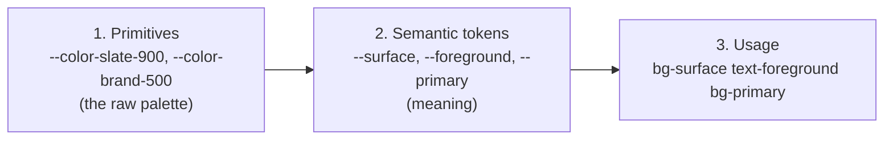

# Lesson 09 — Multi-theme & CSS Variables

## 🎯 Learning Objectives

- Build a semantic token layer that switches themes without `dark:` on every element
- Explain why `@theme inline` is required for theme switching
- Support light, dark and extra named themes with `data-theme`
- Scope a theme to part of the page
- Change theme values at runtime from JavaScript or React props
- Compare this approach with Bootstrap's `data-bs-theme`

---

## Introduction

In Lesson 01 you wrote `bg-white dark:bg-slate-900` everywhere. That works, but it doesn't scale: every component repeats every color decision twice, and adding a third theme (`ocean`, a customer's brand) is a nightmare.

The scalable pattern: **components use semantic names (`bg-surface`, `text-foreground`); a theme is just a different set of values for those names.**

---

## 1. Three layers of tokens



Only layer 2 changes between themes.

---

## 2. The pattern

```css
@import "tailwindcss";

@custom-variant dark (&:where(.dark, .dark *));

/* Semantic tokens — values per theme */
:root {
  --surface: oklch(1 0 0);
  --surface-muted: oklch(0.97 0.005 260);
  --foreground: oklch(0.20 0.02 260);
  --muted-foreground: oklch(0.50 0.02 260);
  --border: oklch(0.92 0.01 260);
  --primary: oklch(0.55 0.20 259);
  --primary-foreground: oklch(0.99 0 0);
  color-scheme: light;
}

.dark {
  --surface: oklch(0.18 0.01 260);
  --surface-muted: oklch(0.22 0.01 260);
  --foreground: oklch(0.96 0.005 260);
  --muted-foreground: oklch(0.70 0.02 260);
  --border: oklch(0.30 0.01 260);
  --primary: oklch(0.70 0.17 259);
  --primary-foreground: oklch(0.15 0 0);
  color-scheme: dark;
}

/* Expose them to Tailwind as utilities */
@theme inline {
  --color-surface: var(--surface);
  --color-surface-muted: var(--surface-muted);
  --color-foreground: var(--foreground);
  --color-muted-foreground: var(--muted-foreground);
  --color-border: var(--border);
  --color-primary: var(--primary);
  --color-primary-foreground: var(--primary-foreground);
}
```

Now:

```html
<div class="border border-border bg-surface p-6 text-foreground">
  <p class="text-muted-foreground">Looks right in light and dark.</p>
  <button class="rounded-lg bg-primary px-4 py-2 text-primary-foreground">Save</button>
</div>
```

**Zero `dark:` classes.** Toggle `.dark` on `<html>` (Lesson 01) and everything switches. This is the same convention shadcn/ui uses (Module 08).

### Why `@theme inline`?

Without `inline`, `--color-surface: var(--surface)` would be defined once on `:root`, and the **resolved value** would be inherited by every descendant. If you then override `--surface` on a nested element (a themed section), descendants would still see the old resolved value. With `inline`, the utility emits `background-color: var(--surface)` directly, resolved where it's used, so nested overrides work.

---

## 3. More themes: `data-theme`

```css
[data-theme="ocean"] {
  --surface: oklch(0.96 0.02 220);
  --foreground: oklch(0.25 0.05 230);
  --primary: oklch(0.60 0.15 220);
  --primary-foreground: oklch(0.99 0 0);
}

[data-theme="midnight"] {
  --surface: oklch(0.15 0.03 280);
  --foreground: oklch(0.95 0.01 280);
  --primary: oklch(0.72 0.18 300);
  --primary-foreground: oklch(0.12 0.02 280);
  color-scheme: dark;
}
```

```js
document.documentElement.dataset.theme = "ocean";
```

No new CSS per component. Adding a theme means one more block of variables.

---

## 4. Scoped themes

CSS variables cascade, so you can theme a **subtree**:

```html
<body>
  <main class="bg-surface text-foreground">…</main>

  <section data-theme="midnight" class="bg-surface text-foreground p-12">
    Always dark, even when the rest of the page is light.
  </section>
</body>
```

Great for a dark footer, a marketing hero, or previewing a customer's brand next to the default.

---

## 5. Runtime values

Because themes are just variables, JavaScript can change them live: a color picker, user-chosen accent, per-tenant branding.

```jsx
function BrandProvider({ hue, children }) {
  return (
    <div style={{ "--primary": `oklch(0.6 0.2 ${hue})` }}>
      {children}
    </div>
  );
}
```

Components using `bg-primary` update instantly with no re-render of classes and no rebuild.

---

## 6. Option: `light-dark()`

CSS has a function that picks a value based on `color-scheme`:

```css
:root {
  color-scheme: light dark;
  --surface: light-dark(oklch(1 0 0), oklch(0.18 0.01 260));
}
```

It cuts the duplicate `.dark { … }` block, but it only supports **two** schemes (light/dark), not extra named themes, and follows `color-scheme`, so you'll set that from your toggle. It's supported in all current browsers; check your support targets (Module 09).

---

## 7. Tailwind vs Bootstrap theming

| | Bootstrap (Book 05, Module 10) | Tailwind |
|---|---|---|
| Switch | `data-bs-theme="dark"` | `.dark` or `data-theme` (your choice) |
| Values | Sass maps + generated CSS variables | CSS variables you write + `@theme inline` |
| New theme | Add Sass/CSS color-mode block | Add one variables block |
| Per-element | `data-bs-theme` on any element | `data-theme` on any element |

The mental model is the same: **swap variables, not classes.**

---

## ⚠️ Pitfalls

- **FOUC**: apply the saved theme in a `<head>` inline script (Lesson 01).
- **SSR hydration**: the server can't read `localStorage`. Use a library such as `next-themes` in Next.js (Book 10) or set the class server-side from a cookie.
- **Forgetting `color-scheme`** leaves scrollbars/form controls light in dark themes.
- **Contrast**: test every theme (Module 09).

---

## 🧪 Practical Example — Theme switcher: light, dark, ocean

```html
<html lang="en" data-theme="light">
<head>
  <script>
    document.documentElement.dataset.theme = localStorage.getItem("theme") ?? "light";
  </script>
</head>
<body class="bg-surface text-foreground">
  <header class="flex items-center justify-between border-b border-border p-4">
    <h1 class="font-semibold">Dev Atlas</h1>
    <select id="theme" class="rounded-md border border-border bg-surface-muted px-2 py-1 text-sm">
      <option value="light">Light</option>
      <option value="dark">Dark</option>
      <option value="ocean">Ocean</option>
    </select>
  </header>
  <script>
    const sel = document.getElementById("theme");
    sel.value = document.documentElement.dataset.theme;
    sel.addEventListener("change", () => {
      document.documentElement.dataset.theme = sel.value;
      localStorage.setItem("theme", sel.value);
    });
  </script>
</body>
</html>
```

With the CSS from sections 2–3 (using `[data-theme="dark"]` in place of `.dark`), switching the dropdown restyles the whole page, and not a single component knows which theme is active.

---

## 📝 Revision Questions

<details>
<summary>1. What's the benefit of semantic tokens like `bg-surface` over `bg-white dark:bg-slate-900`?</summary>

Components don't encode theme logic. Adding or changing themes means editing variables, not every element.
</details>

<details>
<summary>2. Why must the theme exposure use `@theme inline`?</summary>

So utilities reference the semantic variable directly, resolved at the element, letting nested/scoped theme overrides work.
</details>

<details>
<summary>3. How do you add a third theme?</summary>

Add a `[data-theme="name"] { … }` block overriding the semantic variables, then set `data-theme` on `<html>`.
</details>

<details>
<summary>4. How can part of a page use a different theme?</summary>

Put `data-theme="…"` on that section; CSS variables cascade to its descendants.
</details>

<details>
<summary>5. What is the limitation of `light-dark()`?</summary>

It only handles two schemes (light/dark), so it can't express additional named themes by itself.
</details>
