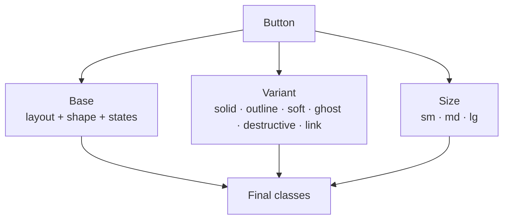

# Lesson 01 — Buttons & Badges

## 🎯 Learning Objectives

By the end of this lesson you will be able to:

- Build a button with a shared base and swappable color variants
- Cover every state: hover, pressed, keyboard focus, disabled, loading
- Make icon buttons and button groups accessibly
- Build badges: pill, dot, count and removable
- Explain how this approach differs from Bootstrap's `.btn` classes

---

## Introduction

Modules 01–06 gave you the vocabulary: utilities, variants, tokens. Module 07 is where you **combine them into real UI**. Buttons and badges are the best starting point because every other component contains them.

In Bootstrap (Book 05, Module 06) you wrote `class="btn btn-primary btn-lg"` and Bootstrap decided what that meant. In Tailwind you **compose the look yourself** from a shared base plus a variant. You get total control; in exchange you manage the repetition (Lesson 08).

---

## 1. Anatomy of a button

Split the classes into three groups:

| Group | Classes | Purpose |
|---|---|---|
| **Base** (all buttons) | `inline-flex items-center justify-center gap-2 rounded-lg font-medium transition cursor-pointer` | Shape, alignment |
| **State** (all buttons) | `outline-hidden focus-visible:outline-2 focus-visible:outline-offset-2 disabled:pointer-events-none disabled:opacity-50` | Focus + disabled |
| **Variant + size** | colors, padding, text size | Look |

```html
<button class="inline-flex cursor-pointer items-center justify-center gap-2 rounded-lg px-4 py-2 text-sm font-medium transition
               outline-hidden focus-visible:outline-2 focus-visible:outline-offset-2 disabled:pointer-events-none disabled:opacity-50
               bg-indigo-600 text-white hover:bg-indigo-700 focus-visible:outline-indigo-600 active:bg-indigo-800">
  Save changes
</button>
```

Notes:

- `cursor-pointer` is explicit because v4's Preflight leaves buttons with the default cursor (Module 05, lesson 04).
- The focus indicator uses `outline` + `outline-offset`, which keeps working on any background. Compare with `ring-offset`, which needs a matching background color (Module 04, `outline-and-ring`).
- `disabled:pointer-events-none` stops hover styles from firing on disabled buttons.

---

## 2. Variants

Only the color classes change:

| Variant | Classes |
|---|---|
| **Solid** | `bg-indigo-600 text-white hover:bg-indigo-700 focus-visible:outline-indigo-600` |
| **Outline** | `border border-slate-300 bg-white text-slate-700 hover:bg-slate-50 focus-visible:outline-slate-400` |
| **Soft** | `bg-indigo-50 text-indigo-700 hover:bg-indigo-100 focus-visible:outline-indigo-600` |
| **Ghost** | `text-slate-700 hover:bg-slate-100 focus-visible:outline-slate-400` |
| **Destructive** | `bg-red-600 text-white hover:bg-red-700 focus-visible:outline-red-600` |
| **Link** | `text-indigo-600 underline-offset-4 hover:underline focus-visible:outline-indigo-600` |

> 💡 Keep **border width consistent**. If Outline has a 1px border and Solid has none, the two buttons are 2px different in height when side by side. Give Solid `border border-transparent`.

### Sizes

| Size | Classes |
|---|---|
| Small | `px-3 py-1.5 text-xs` |
| Medium | `px-4 py-2 text-sm` |
| Large | `px-6 py-3 text-base` |

---

## 3. Icon buttons

A button with only an icon has **no accessible name**. Always label it:

```html
<button aria-label="Close" class="inline-flex size-9 items-center justify-center rounded-lg text-slate-500 hover:bg-slate-100 hover:text-slate-900
                                 outline-hidden focus-visible:outline-2 focus-visible:outline-indigo-600">
  <svg class="size-5" viewBox="0 0 20 20" fill="currentColor" aria-hidden="true">…</svg>
</button>
```

`size-9` sets width and height together; `aria-hidden` hides the decorative SVG from screen readers. Make the touch target at least about 36–44px.

---

## 4. Loading and disabled states

Use the spinner from Module 05 and the `aria-busy` attribute:

```html
<button aria-busy="true" disabled class="inline-flex items-center gap-2 rounded-lg bg-indigo-600 px-4 py-2 text-sm text-white disabled:opacity-70">
  <svg class="size-4 animate-spin motion-reduce:animate-none" viewBox="0 0 24 24" fill="none">
    <circle class="opacity-25" cx="12" cy="12" r="10" stroke="currentColor" stroke-width="4" />
    <path class="opacity-75" fill="currentColor" d="M4 12a8 8 0 018-8v4a4 4 0 00-4 4H4z" />
  </svg>
  Saving…
</button>
```

For links styled as buttons, `disabled` doesn't exist. Use `aria-disabled="true"` plus `aria-disabled:pointer-events-none aria-disabled:opacity-50` (Module 05, lesson 07).

---

## 5. Button groups

```html
<div class="inline-flex rounded-lg shadow-sm" role="group" aria-label="View">
  <button class="border border-slate-300 bg-white px-4 py-2 text-sm first:rounded-l-lg last:rounded-r-lg not-first:-ml-px
                 hover:bg-slate-50 focus-visible:relative focus-visible:z-10">List</button>
  <button class="border border-slate-300 bg-white px-4 py-2 text-sm first:rounded-l-lg last:rounded-r-lg not-first:-ml-px
                 hover:bg-slate-50 focus-visible:relative focus-visible:z-10">Grid</button>
  <button class="border border-slate-300 bg-white px-4 py-2 text-sm first:rounded-l-lg last:rounded-r-lg not-first:-ml-px
                 hover:bg-slate-50 focus-visible:relative focus-visible:z-10">Map</button>
</div>
```

`not-first:-ml-px` (Module 05, lesson 06) overlaps adjacent borders so they don't double up. `focus-visible:relative focus-visible:z-10` lifts the focused button so its outline isn't hidden by neighbors.

---

## 6. Badges

```html
<!-- Pill -->
<span class="inline-flex items-center rounded-full bg-green-50 px-2.5 py-0.5 text-xs font-medium text-green-700 ring-1 ring-green-600/20 ring-inset">
  Active
</span>

<!-- Dot -->
<span class="inline-flex items-center gap-1.5 rounded-full bg-slate-100 px-2.5 py-0.5 text-xs font-medium text-slate-700">
  <span class="size-1.5 rounded-full bg-amber-500"></span> Pending
</span>
```

`ring-inset` draws the ring inside, so the badge's outer size doesn't grow.

### Count badge on an icon button

```html
<button class="relative inline-flex size-10 items-center justify-center rounded-full hover:bg-slate-100" aria-label="Notifications, 3 unread">
  <svg class="size-6" …></svg>
  <span class="absolute -top-0.5 -right-0.5 grid min-w-5 place-items-center rounded-full bg-red-600 px-1 text-[11px] font-semibold text-white" aria-hidden="true">3</span>
</button>
```

The accessible label carries the count; the visual badge is hidden from assistive tech to avoid double reading.

### Removable badge

```html
<span class="inline-flex items-center gap-1 rounded-md bg-indigo-50 py-0.5 pr-1 pl-2 text-xs font-medium text-indigo-700">
  Design
  <button aria-label="Remove Design" class="grid size-4 place-items-center rounded-sm hover:bg-indigo-200">×</button>
</span>
```



---

## 🧪 Practical Example — Variant map in React

```jsx
const base =
  "inline-flex cursor-pointer items-center justify-center gap-2 rounded-lg border border-transparent font-medium transition " +
  "outline-hidden focus-visible:outline-2 focus-visible:outline-offset-2 disabled:pointer-events-none disabled:opacity-50";

const variants = {
  solid: "bg-indigo-600 text-white hover:bg-indigo-700 focus-visible:outline-indigo-600",
  outline: "border-slate-300 bg-white text-slate-700 hover:bg-slate-50 focus-visible:outline-slate-400",
  ghost: "text-slate-700 hover:bg-slate-100 focus-visible:outline-slate-400",
  danger: "bg-red-600 text-white hover:bg-red-700 focus-visible:outline-red-600",
};

const sizes = { sm: "px-3 py-1.5 text-xs", md: "px-4 py-2 text-sm", lg: "px-6 py-3 text-base" };

export function Button({ variant = "solid", size = "md", className = "", ...props }) {
  return <button className={`${base} ${variants[variant]} ${sizes[size]} ${className}`} {...props} />;
}
```

Every class is a **complete string** that Tailwind can find (Module 06, lessons 04 and 08). Lesson 08 shows how to improve this with `clsx`, `tailwind-merge` and `cva`.

---

## 📝 Revision Questions

<details>
<summary>1. Why is `cursor-pointer` usually added to buttons in v4?</summary>

v4's Preflight leaves buttons with the default cursor, so you add the pointer cursor yourself if you want it.
</details>

<details>
<summary>2. Why does an icon-only button need `aria-label`?</summary>

Without text it has no accessible name, so screen readers can't announce its purpose.
</details>

<details>
<summary>3. How do you disable an `<a>` styled as a button?</summary>

Anchors have no `disabled`. Use `aria-disabled="true"` with `aria-disabled:` variants (and prevent navigation).
</details>

<details>
<summary>4. What does `ring-inset` do on a badge?</summary>

Draws the ring inside the element so its outer dimensions don't change.
</details>

<details>
<summary>5. In a button group, what does `not-first:-ml-px` achieve?</summary>

Overlaps adjacent borders so there is a single 1px line between buttons.
</details>
