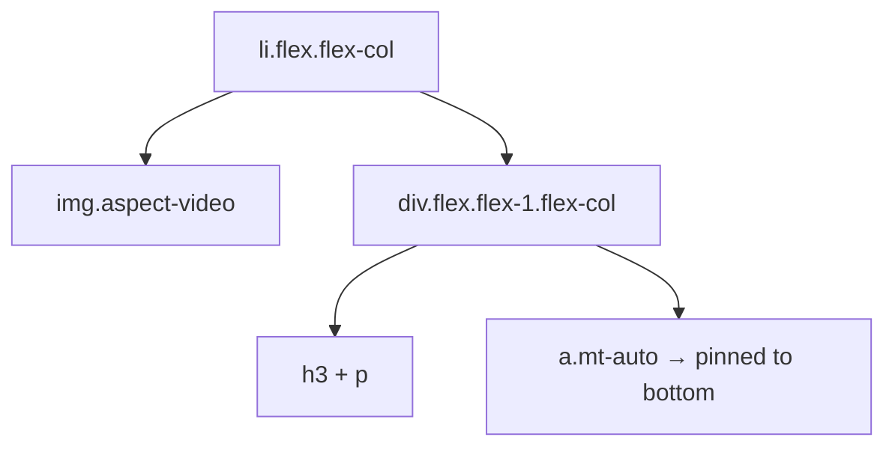

# Lesson 02 — Cards

## 🎯 Learning Objectives

- Build a standard card with image, body and footer
- Create equal-height card grids with `flex` and `mt-auto`
- Make an entire card clickable with the stretched-link pattern
- Switch a card between stacked and horizontal layouts with container queries
- Add hover and focus polish without hurting accessibility

---

## Introduction

A card is a bordered, padded surface that groups related content. Bootstrap (Book 05, Module 06) gave you `.card`, `.card-body`, `.card-title`. In Tailwind a card is a handful of utilities you already know from Modules 02–04: border, radius, shadow, padding, flex.

---

## 1. The basic card

```html
<article class="overflow-hidden rounded-xl border border-slate-200 bg-white shadow-sm">
  
  <div class="p-5">
    <p class="text-xs font-medium tracking-wide text-indigo-600 uppercase">Travel</p>
    <h3 class="mt-1 text-lg font-semibold text-slate-900">Three days in the Western Ghats</h3>
    <p class="mt-2 line-clamp-2 text-sm text-slate-600">
      A slow route through tea estates and misty ridges, with the best viewpoints and where to eat.
    </p>
  </div>
  <div class="flex items-center justify-between border-t border-slate-100 px-5 py-3 text-sm text-slate-500">
    <span>6 min read</span>
    <span>Oct 12</span>
  </div>
</article>
```

Why each piece:

- `overflow-hidden` clips the image to the rounded corners (Module 02).
- `aspect-video object-cover` keeps every image the same shape (Module 02, `overflow-aspect-ratio-and-object-fit`).
- `line-clamp-2` truncates long text predictably (Module 03).
- Use a semantic element: `<article>` for standalone content, `<li>` in a list of cards.

---

## 2. Equal-height cards in a grid

```html
<ul class="grid gap-6 sm:grid-cols-2 lg:grid-cols-3">
  <li class="flex flex-col overflow-hidden rounded-xl border border-slate-200 bg-white">
    
    <div class="flex flex-1 flex-col p-5">
      <h3 class="text-lg font-semibold">Title</h3>
      <p class="mt-2 text-sm text-slate-600">Description of varying length…</p>
      <a href="#" class="mt-auto pt-4 text-sm font-medium text-indigo-600">Read more →</a>
    </div>
  </li>
  <!-- more cards -->
</ul>
```

Grid items stretch to the row height by default. The trick is making the card `flex flex-col` and the body `flex-1`, so `mt-auto` pins the footer link to the bottom even when descriptions differ in length.



---

## 3. The stretched link (whole card clickable)

Bootstrap has `.stretched-link` (Book 05, Module 09). In Tailwind: make the card `relative`, then stretch the link's `::after` over it.

```html
<article class="group relative overflow-hidden rounded-xl border border-slate-200 bg-white transition
                hover:shadow-lg has-focus-visible:ring-2 has-focus-visible:ring-indigo-500">
  
  <div class="p-5">
    <h3 class="text-lg font-semibold">
      <a href="/posts/western-ghats" class="outline-hidden after:absolute after:inset-0">Three days in the Western Ghats</a>
    </h3>
    <p class="mt-2 text-sm text-slate-600">Click anywhere on the card.</p>
  </div>
</article>
```

- `after:absolute after:inset-0` covers the entire card with the link's pseudo-element (Module 05, lesson 08).
- `has-focus-visible:ring-2` (Module 05, lesson 06) draws the focus ring on the **card** when the inner link is keyboard-focused. The link's own outline is hidden because the ring replaces it.
- If the card also contains other links or buttons, give them `relative z-10` so they stay clickable above the stretched layer.
- The image zoom needs `overflow-hidden` on the card, or it spills out.

> ⚠️ Don't wrap a whole card in `<a>` if it contains buttons or other links. Nested interactive content is invalid HTML.

---

## 4. Horizontal ⇄ stacked with container queries

The same card in a narrow sidebar and a wide column should adapt to its **slot**, not the screen (Module 05, lesson 10):

```html
<div class="@container">
  <article class="flex flex-col gap-4 overflow-hidden rounded-xl border bg-white @md:flex-row">
    
    <div class="p-5">…</div>
  </article>
</div>
```

---

## 5. Dark mode

Pick one approach (Module 06):

```html
<!-- dark: pairs -->
<article class="border-slate-200 bg-white text-slate-900 dark:border-slate-800 dark:bg-slate-900 dark:text-slate-100">

<!-- semantic tokens (preferred in a design system) -->
<article class="border-border bg-surface text-foreground">
```

The semantic version has no `dark:` and makes component code theme-agnostic.

---

## 🧪 Practical Examples

### A. Pricing card with a highlighted plan

```html
<div class="grid gap-6 lg:grid-cols-3">
  <section class="flex flex-col rounded-2xl border border-slate-200 p-8">
    <h3 class="text-lg font-semibold">Starter</h3>
    <p class="mt-4 flex items-baseline gap-1"><span class="text-4xl font-bold tracking-tight">$0</span><span class="text-sm text-slate-500">/mo</span></p>
    <ul class="mt-6 space-y-3 text-sm text-slate-600">
      <li class="flex gap-2"><span aria-hidden="true">✓</span> 1 project</li>
      <li class="flex gap-2"><span aria-hidden="true">✓</span> Community support</li>
    </ul>
    <a href="#" class="mt-8 rounded-lg border border-slate-300 px-4 py-2 text-center text-sm font-medium hover:bg-slate-50">Get started</a>
  </section>

  <section class="relative flex flex-col rounded-2xl border-2 border-indigo-600 p-8 shadow-lg lg:-translate-y-2">
    <span class="absolute -top-3 left-1/2 -translate-x-1/2 rounded-full bg-indigo-600 px-3 py-0.5 text-xs font-semibold text-white">Popular</span>
    <h3 class="text-lg font-semibold">Pro</h3>
    <p class="mt-4 flex items-baseline gap-1"><span class="text-4xl font-bold tracking-tight">$19</span><span class="text-sm text-slate-500">/mo</span></p>
    <ul class="mt-6 space-y-3 text-sm text-slate-600">
      <li class="flex gap-2"><span aria-hidden="true">✓</span> Unlimited projects</li>
      <li class="flex gap-2"><span aria-hidden="true">✓</span> Priority support</li>
    </ul>
    <a href="#" class="mt-8 rounded-lg bg-indigo-600 px-4 py-2 text-center text-sm font-medium text-white hover:bg-indigo-700">Start free trial</a>
  </section>
  <!-- third plan -->
</div>
```

### B. Profile card with avatar overlap

```html
<div class="mx-auto max-w-sm overflow-hidden rounded-2xl border bg-white text-center shadow-sm">
  <div class="h-24 bg-linear-to-r from-indigo-500 to-sky-500"></div>
  
  <div class="p-6 pt-3">
    <h3 class="text-lg font-semibold">Priya Sharma</h3>
    <p class="text-sm text-slate-500">Frontend Engineer · Pune</p>
  </div>
</div>
```

(`bg-linear-to-r` is the v4 name for gradients — Module 03, `gradients-and-background-images`.)

---

## 📝 Revision Questions

<details>
<summary>1. How do you keep card footers aligned across a grid when text length varies?</summary>

Make each card `flex flex-col`, the body `flex-1`, and push the footer down with `mt-auto`.
</details>

<details>
<summary>2. How does the stretched-link pattern work?</summary>

The card is `relative`; the link's `::after` is `absolute inset-0`, so clicking anywhere on the card activates the link.
</details>

<details>
<summary>3. How can the card show a focus ring when only its inner link is focused?</summary>

`has-focus-visible:ring-2` on the card (the `:has()`-based variant).
</details>

<details>
<summary>4. Why is `overflow-hidden` needed on a card with a top image?</summary>

So the image is clipped to the card's rounded corners (and hover zoom stays inside).
</details>

<details>
<summary>5. When would container queries beat breakpoints for a card?</summary>

When the same card is reused in different-width slots (sidebar vs main) on the same screen.
</details>
