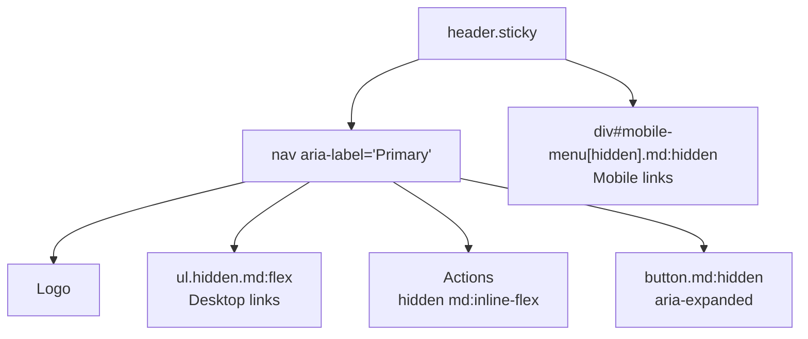

# Lesson 03 — Navbars & Responsive Menus

## 🎯 Learning Objectives

- Build a navbar with logo, links, actions and a sticky blurred background
- Mark the current page with `aria-current` and style it via variants
- Build an accessible mobile menu toggle with `aria-expanded`
- Close the menu with Escape and when the viewport grows
- Compare this with Bootstrap's `navbar-expand-*` approach

---

## Introduction

In Bootstrap (Book 05, Module 07) one class, `navbar-expand-lg`, handled collapsing. Tailwind has no navbar component, but you already have the pieces: flex (Module 02), breakpoints (Module 05, lesson 09), `aria-*` variants (lesson 07). The responsive behavior is simply **two versions of the nav, shown at different breakpoints**.

---

## 1. Structure



- Use `<header>` + `<nav aria-label="Primary">`, so screen reader users can jump to it.
- Links belong in a `<ul>` of `<li><a>`.

---

## 2. The complete navbar

```html
<header class="sticky top-0 z-50 border-b border-slate-200 bg-white/80 backdrop-blur">
  <nav aria-label="Primary" class="mx-auto flex h-16 max-w-6xl items-center justify-between px-4">
    <a href="/" class="text-lg font-bold tracking-tight">Atlas</a>

    <!-- Desktop links -->
    <ul class="hidden items-center gap-6 md:flex">
      <li><a href="/" aria-current="page"
             class="text-sm text-slate-600 hover:text-slate-900 aria-[current=page]:font-semibold aria-[current=page]:text-indigo-600">Home</a></li>
      <li><a href="/docs" class="text-sm text-slate-600 hover:text-slate-900">Docs</a></li>
      <li><a href="/pricing" class="text-sm text-slate-600 hover:text-slate-900">Pricing</a></li>
    </ul>

    <a href="/signup" class="hidden rounded-lg bg-indigo-600 px-4 py-2 text-sm font-medium text-white hover:bg-indigo-700 md:inline-flex">Sign up</a>

    <!-- Mobile toggle -->
    <button id="menu-btn" type="button" aria-expanded="false" aria-controls="mobile-menu"
            class="group inline-flex size-10 items-center justify-center rounded-lg hover:bg-slate-100 md:hidden">
      <span class="sr-only">Toggle menu</span>
      <svg class="size-6 group-aria-expanded:hidden" viewBox="0 0 24 24" fill="none" stroke="currentColor" stroke-width="2" aria-hidden="true">
        <path d="M4 7h16M4 12h16M4 17h16" />
      </svg>
      <svg class="hidden size-6 group-aria-expanded:block" viewBox="0 0 24 24" fill="none" stroke="currentColor" stroke-width="2" aria-hidden="true">
        <path d="M6 6l12 12M18 6L6 18" />
      </svg>
    </button>
  </nav>

  <!-- Mobile panel -->
  <div id="mobile-menu" hidden class="border-t border-slate-200 bg-white md:hidden">
    <ul class="space-y-1 px-4 py-3">
      <li><a href="/" aria-current="page" class="block rounded-lg px-3 py-2 text-base hover:bg-slate-50 aria-[current=page]:bg-indigo-50 aria-[current=page]:text-indigo-700">Home</a></li>
      <li><a href="/docs" class="block rounded-lg px-3 py-2 text-base hover:bg-slate-50">Docs</a></li>
      <li><a href="/pricing" class="block rounded-lg px-3 py-2 text-base hover:bg-slate-50">Pricing</a></li>
      <li><a href="/signup" class="mt-2 block rounded-lg bg-indigo-600 px-3 py-2 text-center text-white">Sign up</a></li>
    </ul>
  </div>
</header>
```

Pieces worth understanding:

| Class | Why |
|---|---|
| `sticky top-0 z-50` | Stays at the top while scrolling, above content |
| `bg-white/80 backdrop-blur` | Translucent glass effect (Module 04) |
| `hidden md:flex` | Mobile-first: hidden by default, flex from `md` up |
| `md:hidden` on the toggle and panel | Mobile-only |
| `aria-[current=page]:…` | Active link styled from the attribute you need for accessibility anyway |
| `group` + `group-aria-expanded:` | Swaps hamburger ↔ close icon based on `aria-expanded` |
| `hidden` **attribute** on the panel | Preflight guarantees `[hidden]` hides, even if a `flex` class is also present |

---

## 3. The script

```js
const btn = document.getElementById("menu-btn");
const menu = document.getElementById("mobile-menu");

function setOpen(open) {
  btn.setAttribute("aria-expanded", String(open));
  menu.hidden = !open;
}

btn.addEventListener("click", () => setOpen(btn.getAttribute("aria-expanded") !== "true"));

document.addEventListener("keydown", (e) => {
  if (e.key === "Escape" && btn.getAttribute("aria-expanded") === "true") {
    setOpen(false);
    btn.focus();
  }
});

// Reset if the viewport grows past the md breakpoint (48rem)
matchMedia("(min-width: 48rem)").addEventListener("change", (e) => e.matches && setOpen(false));
```

The JS **only toggles one attribute**. All the visual changes (icon swap, panel visibility) come from CSS reacting to that attribute (Module 05, lesson 07).

---

## 4. Variations

### Full-screen mobile overlay

```html
<div id="mobile-menu" hidden class="fixed inset-x-0 top-16 bottom-0 overflow-y-auto bg-white p-6 md:hidden">…</div>
```

Pair with `overscroll-contain` and body scroll locking (Lesson 05).

### Offset anchors under a sticky nav

```html
<section id="pricing" class="scroll-mt-20">…</section>
```

(Module 05, lesson 02; `h-16` header = 4rem, plus breathing room.)

### Animated underline links

Reuse the `after:` pattern from Module 05, lesson 08 on `<a>` elements.

---

## 5. Bootstrap comparison

| | Bootstrap (Book 05) | Tailwind |
|---|---|---|
| Collapse breakpoint | `navbar-expand-lg` | Your own `md:` / `lg:` prefixes |
| Toggler | `data-bs-toggle="collapse"` (Bootstrap JS) | ~10 lines of your JS (or framework state) |
| Active link | `.active` class | `aria-current="page"` + variants |
| Customization | Sass variables | Edit the classes / tokens |

---

## 🧪 Practical Example — React version

```jsx
import { useEffect, useState } from "react";

const links = [
  { href: "/", label: "Home" },
  { href: "/docs", label: "Docs" },
  { href: "/pricing", label: "Pricing" },
];

export function Navbar({ current = "/" }) {
  const [open, setOpen] = useState(false);

  useEffect(() => {
    const onKey = (e) => e.key === "Escape" && setOpen(false);
    const mq = matchMedia("(min-width: 48rem)");
    const onMq = (e) => e.matches && setOpen(false);
    document.addEventListener("keydown", onKey);
    mq.addEventListener("change", onMq);
    return () => {
      document.removeEventListener("keydown", onKey);
      mq.removeEventListener("change", onMq);
    };
  }, []);

  return (
    <header className="sticky top-0 z-50 border-b bg-white/80 backdrop-blur">
      <nav aria-label="Primary" className="mx-auto flex h-16 max-w-6xl items-center justify-between px-4">
        <a href="/" className="text-lg font-bold">Atlas</a>
        <ul className="hidden items-center gap-6 md:flex">
          {links.map((l) => (
            <li key={l.href}>
              <a href={l.href} aria-current={l.href === current ? "page" : undefined}
                 className="text-sm text-slate-600 hover:text-slate-900 aria-[current=page]:font-semibold aria-[current=page]:text-indigo-600">
                {l.label}
              </a>
            </li>
          ))}
        </ul>
        <button type="button" aria-expanded={open} aria-controls="mobile-menu" onClick={() => setOpen(!open)}
                className="group inline-flex size-10 items-center justify-center rounded-lg hover:bg-slate-100 md:hidden">
          <span className="sr-only">Toggle menu</span>
          {/* hamburger / close icons as in the HTML version */}
        </button>
      </nav>
      <div id="mobile-menu" hidden={!open} className="border-t bg-white md:hidden">
        <ul className="space-y-1 px-4 py-3">
          {links.map((l) => (
            <li key={l.href}><a href={l.href} className="block rounded-lg px-3 py-2 hover:bg-slate-50">{l.label}</a></li>
          ))}
        </ul>
      </div>
    </header>
  );
}
```

`aria-current={cond ? "page" : undefined}` is the correct React pattern; passing `false` would render `aria-current="false"`. In Vue, bind `:aria-current="isActive ? 'page' : undefined"` and use a ref/`v-model` for the open state.

---

## 📝 Revision Questions

<details>
<summary>1. Which classes show the desktop links from `md` up and hide them below?</summary>

`hidden md:flex` (hidden by default, `display: flex` from `md`).
</details>

<details>
<summary>2. How does the hamburger icon swap to a close icon without JS touching classes?</summary>

The button has `group` and `aria-expanded`; the icons use `group-aria-expanded:hidden` / `group-aria-expanded:block`.
</details>

<details>
<summary>3. Why mark the current link with `aria-current="page"`?</summary>

It's the accessible way to expose the active page; Tailwind can style from it with `aria-[current=page]:`.
</details>

<details>
<summary>4. Why use the `hidden` attribute for the mobile panel?</summary>

It's semantic and Preflight enforces it, even when other display utilities are present.
</details>

<details>
<summary>5. Why close the menu on `Escape` and when the viewport grows?</summary>

Escape is a standard keyboard expectation; resetting at `md` avoids a stuck-open state when switching to the desktop layout.
</details>
