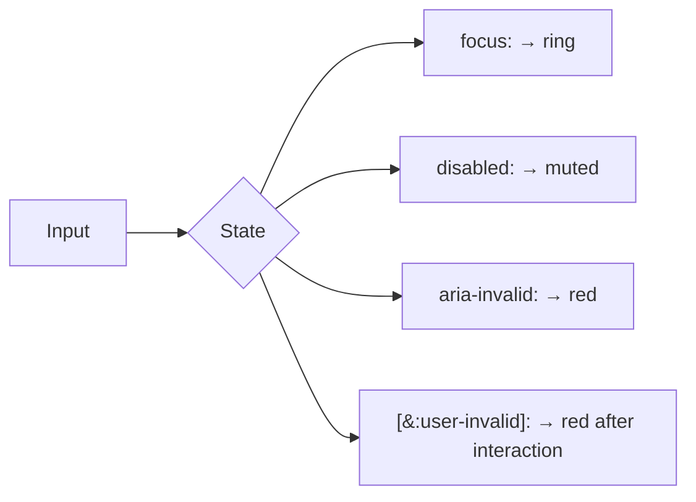

# Lesson 04 — Forms & Input Styling

## 🎯 Learning Objectives

- Explain why inputs look unstyled in Tailwind and how to style them
- Build text inputs with focus, disabled and error states
- Style error states from `aria-invalid` and avoid the `:invalid` timing trap
- Build custom checkboxes/radios/switches and leading-icon inputs
- Use `field-sizing-content` for auto-growing textareas

---

## Introduction

Preflight (Module 01) resets form controls so they inherit fonts and have no borders. That is a feature: **every control starts as a blank slate**. In Bootstrap (Book 05, Module 05) `.form-control` gave you a finished look. In Tailwind you build it once and reuse it (Lesson 08).

> 💡 The official `@tailwindcss/forms` plugin adds a sensible base look to controls. It's covered in Module 08. Here you write everything by hand so you understand it.

---

## 1. The text input

```html
<div>
  <label for="email" class="block text-sm font-medium text-slate-700">Email</label>
  <input id="email" type="email" name="email" autocomplete="email" placeholder="you@example.com"
         class="mt-1 block w-full rounded-lg border border-slate-300 bg-white px-3 py-2 text-sm text-slate-900 shadow-xs
                placeholder:text-slate-400
                outline-hidden focus:border-indigo-500 focus:ring-3 focus:ring-indigo-500/25
                disabled:cursor-not-allowed disabled:bg-slate-50 disabled:text-slate-500" />
  <p class="mt-1 text-xs text-slate-500">We'll never share your email.</p>
</div>
```

Checklist:

- A real `<label for>` — never use the placeholder as a label.
- `focus:` (not `focus-visible:`) for text inputs: users always need to see where they're typing (Module 05, lesson 04).
- `outline-hidden` + a visible ring replacement.
- `ring-indigo-500/25` — opacity modifier on a color (Module 03).
- `autocomplete` and correct `type` improve mobile keyboards and autofill.

---

## 2. Error state

Drive the error style from **`aria-invalid`**, the attribute screen readers need anyway:

```html
<input id="pw" type="password" aria-invalid="true" aria-describedby="pw-error"
       class="block w-full rounded-lg border border-slate-300 px-3 py-2 text-sm outline-hidden
              focus:border-indigo-500 focus:ring-3 focus:ring-indigo-500/25
              aria-invalid:border-red-500 aria-invalid:focus:border-red-500 aria-invalid:focus:ring-red-500/25" />
<p id="pw-error" class="mt-1 text-sm text-red-600">Password must be at least 8 characters.</p>
```

`aria-describedby` links the message to the input so it's announced with it.

### ⚠️ The `invalid:` timing trap

`invalid:` matches `:invalid`, which applies **as soon as the page loads** for an empty required field. Your form would be red before the user touches anything. Options:

```html
<!-- Only after the user interacted (modern browsers) -->
<input required class="[&:user-invalid]:border-red-500" />

<!-- Or drive it yourself from JS / a form library -->
<input aria-invalid={Boolean(error)} … />
```

`:user-invalid` only matches after the user has interacted. Use it with an arbitrary variant (Module 06, lesson 04), or set `aria-invalid` from your validation logic (React Hook Form, VeeValidate, etc.).

---

## 3. Layout

```html
<form class="grid gap-x-4 gap-y-5 sm:grid-cols-2">
  <div><label …>First name</label><input …></div>
  <div><label …>Last name</label><input …></div>
  <div class="sm:col-span-2"><label …>Email</label><input …></div>
  <div class="sm:col-span-2 flex justify-end gap-3"><button …>Cancel</button><button …>Save</button></div>
</form>
```

Grid (Module 02) replaces Bootstrap's `row`/`col-*` form layout.

---

## 4. Textarea that grows

```html
<textarea rows="3" class="field-sizing-content min-h-24 w-full rounded-lg border border-slate-300 px-3 py-2 text-sm"></textarea>
```

`field-sizing-content` makes it grow with its content, with no JavaScript. Pair it with `min-h-*`/`max-h-*`.

---

## 5. Leading icons and input groups

```html
<div class="relative">
  <svg class="pointer-events-none absolute top-1/2 left-3 size-4 -translate-y-1/2 text-slate-400" …></svg>
  <input type="search" placeholder="Search…" class="w-full rounded-lg border border-slate-300 py-2 pr-3 pl-9 text-sm" />
</div>
```

Add-on (Bootstrap's `input-group`):

```html
<div class="flex rounded-lg shadow-xs">
  <span class="inline-flex items-center rounded-l-lg border border-r-0 border-slate-300 bg-slate-50 px-3 text-sm text-slate-500">https://</span>
  <input class="block w-full min-w-0 rounded-r-lg border border-slate-300 px-3 py-2 text-sm outline-hidden focus:border-indigo-500 focus:ring-3 focus:ring-indigo-500/25" placeholder="example.com" />
</div>
```

---

## 6. Checkboxes, radios and switches

Simplest option: native controls with `accent-*` (Module 03):

```html
<label class="flex items-center gap-2 text-sm">
  <input type="checkbox" class="size-4 rounded-sm accent-indigo-600" /> Remember me
</label>
```

Fully custom checkbox using `appearance-none` and `checked:`:

```html
<input type="checkbox"
       class="size-4 appearance-none rounded-sm border border-slate-300 bg-white
              checked:border-indigo-600 checked:bg-indigo-600 checked:bg-[url('data:image/svg+xml,…')]
              outline-hidden focus-visible:outline-2 focus-visible:outline-offset-2 focus-visible:outline-indigo-600" />
```

Switch: the `peer` toggle from Module 05, lesson 05. Selectable option cards: `has-checked:` from lesson 06.

---

## 7. Field wrapper states with `has-*`

```html
<div class="rounded-lg border border-slate-300 px-3 py-2 has-focus-visible:border-indigo-500 has-focus-visible:ring-3 has-focus-visible:ring-indigo-500/25 has-disabled:bg-slate-50">
  <label class="block text-xs text-slate-500">Card number</label>
  <input class="w-full outline-hidden" />
</div>
```

The **wrapper** gets the ring when the inner input is focused, which is useful for compound controls.



---

## 🧪 Practical Example — Sign-up form (React with validation state)

```jsx
function Field({ id, label, error, ...props }) {
  return (
    <div>
      <label htmlFor={id} className="block text-sm font-medium text-slate-700">{label}</label>
      <input
        id={id}
        aria-invalid={error ? true : undefined}
        aria-describedby={error ? `${id}-error` : undefined}
        className="mt-1 block w-full rounded-lg border border-slate-300 bg-white px-3 py-2 text-sm outline-hidden
                   focus:border-indigo-500 focus:ring-3 focus:ring-indigo-500/25
                   aria-invalid:border-red-500 aria-invalid:focus:ring-red-500/25"
        {...props}
      />
      {error && <p id={`${id}-error`} className="mt-1 text-sm text-red-600">{error}</p>}
    </div>
  );
}

export function SignUp() {
  const [errors, setErrors] = useState({});
  // …validate on submit, then setErrors({ email: "Enter a valid email" })
  return (
    <form className="mx-auto grid max-w-md gap-5" noValidate>
      <Field id="email" type="email" label="Email" error={errors.email} />
      <Field id="password" type="password" label="Password" error={errors.password} />
      <button className="rounded-lg bg-indigo-600 px-4 py-2 text-sm font-medium text-white hover:bg-indigo-700">Create account</button>
    </form>
  );
}
```

One reusable `Field`, with error styling coming purely from `aria-invalid`.

---

## 📝 Revision Questions

<details>
<summary>1. Why do inputs look unstyled in Tailwind?</summary>

Preflight resets form controls, so you add borders, padding and focus styles yourself (or use the forms plugin).
</details>

<details>
<summary>2. Why style errors with `aria-invalid:` rather than a custom class?</summary>

The attribute is needed for accessibility anyway, so there's one source of truth.
</details>

<details>
<summary>3. What's wrong with `invalid:border-red-500` on a required field?</summary>

`:invalid` matches immediately on load, so the field is red before the user interacts. Use `:user-invalid` or set `aria-invalid` from validation logic.
</details>

<details>
<summary>4. How do you make a textarea auto-grow without JS?</summary>

`field-sizing-content`.
</details>

<details>
<summary>5. How can a wrapper show a focus ring when its inner input is focused?</summary>

`has-focus-visible:ring-*` (or `focus-within:`) on the wrapper.
</details>
