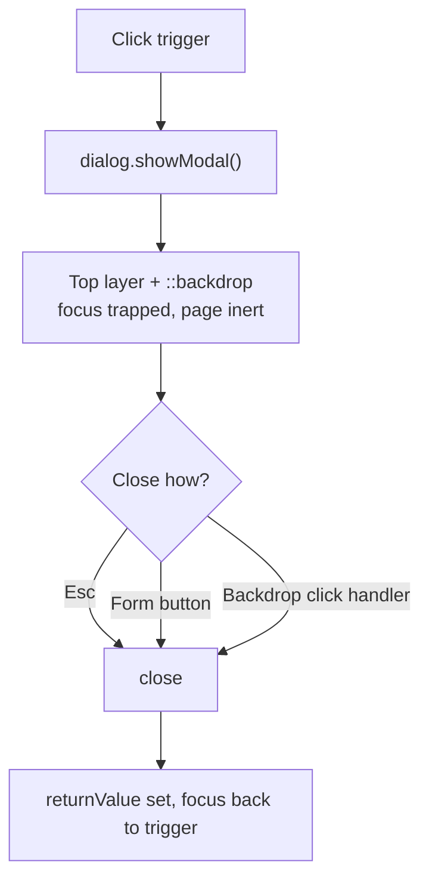

# Lesson 05 — Modals with `<dialog>`

## 🎯 Learning Objectives

- Build a modal using the native `<dialog>` element
- Style the backdrop with `backdrop:` and animate with `starting:`
- Close with the Escape key, a close button and a backdrop click
- Lock body scroll with `has-[dialog:modal]`
- Fix the Preflight centering gotcha
- Wrap the dialog in a React component

---

## Introduction

In Bootstrap (Book 05, Module 08) a modal needed Bootstrap's JavaScript, `data-bs-toggle`, backdrop elements and focus-trap code. The native **`<dialog>`** element does all of that for free when opened with `showModal()`:

| Behavior | Native `<dialog>` |
|---|---|
| Rendered above everything (top layer, no z-index wars) | ✅ |
| Backdrop (`::backdrop`) | ✅ |
| Focus trapped inside; rest of page inert | ✅ |
| Escape closes it | ✅ |
| Focus returns to the trigger on close | ✅ |

Tailwind just styles it.

---

## 1. Open and close

```html
<button id="open-btn" class="rounded-lg bg-red-600 px-4 py-2 text-sm text-white">Delete project</button>

<dialog id="confirm" aria-labelledby="confirm-title">
  <form method="dialog">
    <h2 id="confirm-title">Delete project?</h2>
    <p>This can't be undone.</p>
    <button value="cancel">Cancel</button>
    <button value="confirm">Delete</button>
  </form>
</dialog>
```

```js
const dialog = document.getElementById("confirm");
document.getElementById("open-btn").addEventListener("click", () => dialog.showModal());
dialog.addEventListener("close", () => console.log(dialog.returnValue)); // "cancel" | "confirm"
```

- `showModal()` makes it modal. Setting the `open` attribute directly does **not**.
- `<form method="dialog">` closes the dialog on submit and sets `returnValue` to the clicked button's `value`.

---

## 2. ⚠️ Preflight gotcha: centering

Browsers center a modal dialog with `margin: auto`. Preflight resets all margins to `0` and padding to `0`, so the dialog jumps to the top-left. Fix with **`m-auto`** and add your own padding:

```html
<dialog class="m-auto …">
```

---

## 3. Fully styled dialog

```html
<dialog id="confirm" aria-labelledby="confirm-title"
        class="m-auto w-[calc(100%-2rem)] max-w-md rounded-2xl bg-white p-0 text-slate-900 shadow-xl
               opacity-0 scale-95 transition-all transition-discrete duration-200
               open:scale-100 open:opacity-100
               starting:open:scale-95 starting:open:opacity-0
               backdrop:bg-slate-950/50 backdrop:backdrop-blur-sm">
  <form method="dialog" class="p-6">
    <div class="flex items-start gap-4">
      <div class="grid size-10 shrink-0 place-items-center rounded-full bg-red-100 text-red-600" aria-hidden="true">!</div>
      <div>
        <h2 id="confirm-title" class="text-lg font-semibold">Delete project?</h2>
        <p class="mt-1 text-sm text-slate-600">All files and history will be permanently removed.</p>
      </div>
    </div>
    <div class="mt-6 flex flex-col-reverse gap-2 sm:flex-row sm:justify-end">
      <button value="cancel" class="rounded-lg border border-slate-300 px-4 py-2 text-sm hover:bg-slate-50" autofocus>Cancel</button>
      <button value="confirm" class="rounded-lg bg-red-600 px-4 py-2 text-sm text-white hover:bg-red-700">Delete</button>
    </div>
  </form>
</dialog>
```

How the animation works (Module 05, lesson 03):

- Base: `opacity-0 scale-95`; open: `opacity-100 scale-100`.
- `starting:open:*` gives the **entry** its "from" state.
- `transition-discrete` lets the `display` change take part in the transition.
- Exit animation for top-layer elements may additionally need `overlay` in the transitioned properties and is newer. It degrades to an instant close.

`autofocus` on the safest action (Cancel) is a good default for destructive dialogs.

---

## 4. Backdrop click to close

```js
dialog.addEventListener("click", (e) => {
  if (e.target === dialog) dialog.close();   // click landed on the ::backdrop
});
```

This works because the dialog has `p-0` and the inner `<form>` fills it, so any click that targets the `<dialog>` element itself must be on the backdrop.

---

## 5. Lock body scroll

When a modal is open, the page behind shouldn't scroll. No JS needed:

```html
<body class="has-[dialog:modal]:overflow-hidden">
```

`:modal` matches a dialog opened with `showModal()` (Module 05, lesson 06 for `has-*`). For long dialog content: `max-h-[85dvh] overflow-y-auto overscroll-contain` (Module 05, lesson 02).

---

## 6. Sizes and positions

| Variant | Classes |
|---|---|
| Small / Large | `max-w-sm` / `max-w-2xl` |
| Full-screen mobile | `max-sm:h-dvh max-sm:max-h-none max-sm:w-full max-sm:max-w-none max-sm:rounded-none` |
| Bottom sheet | `m-0 mt-auto w-full max-w-none rounded-t-2xl rounded-b-none` |
| Side drawer | `m-0 ml-auto h-dvh max-h-none rounded-none` |



---

## 7. Accessibility checklist

- `aria-labelledby` pointing at the title (and `aria-describedby` for the description if needed).
- A visible close/cancel button; don't rely on Escape alone.
- Don't open modals automatically on page load.
- Use `<dialog>` for modals and the `popover` attribute for lightweight, non-modal overlays (Lesson 06).

---

## 🧪 Practical Example — Reusable React `ConfirmDialog`

```jsx
import { useEffect, useRef } from "react";

export function ConfirmDialog({ open, title, children, onCancel, onConfirm }) {
  const ref = useRef(null);

  useEffect(() => {
    const d = ref.current;
    if (open && !d.open) d.showModal();
    if (!open && d.open) d.close();
  }, [open]);

  return (
    <dialog
      ref={ref}
      aria-labelledby="dlg-title"
      onClose={onCancel}                                   // fires for Esc, form close, d.close()
      onClick={(e) => e.target === ref.current && onCancel()}
      className="m-auto w-[calc(100%-2rem)] max-w-md rounded-2xl p-0 shadow-xl
                 opacity-0 scale-95 transition-all transition-discrete duration-200
                 open:scale-100 open:opacity-100 starting:open:scale-95 starting:open:opacity-0
                 backdrop:bg-slate-950/50 backdrop:backdrop-blur-sm"
    >
      <div className="p-6">
        <h2 id="dlg-title" className="text-lg font-semibold">{title}</h2>
        <div className="mt-2 text-sm text-slate-600">{children}</div>
        <div className="mt-6 flex justify-end gap-2">
          <button onClick={onCancel} className="rounded-lg border px-4 py-2 text-sm hover:bg-slate-50">Cancel</button>
          <button onClick={onConfirm} className="rounded-lg bg-red-600 px-4 py-2 text-sm text-white hover:bg-red-700">Delete</button>
        </div>
      </div>
    </dialog>
  );
}
```

```jsx
<ConfirmDialog open={open} title="Delete project?" onCancel={() => setOpen(false)} onConfirm={handleDelete}>
  This can't be undone.
</ConfirmDialog>
```

In Vue use a template ref and `watch(() => props.open, …)` with the same `showModal()`/`close()` calls. For richer needs (nested dialogs, animations on exit), headless libraries are covered in Module 08.

---

## 📝 Revision Questions

<details>
<summary>1. What does `showModal()` give you that `open` attribute alone doesn't?</summary>

Top-layer rendering, a backdrop, focus trapping, inert background and Escape-to-close.
</details>

<details>
<summary>2. Why does a `<dialog>` appear at the top-left in Tailwind projects?</summary>

Preflight resets `margin` to 0, removing the UA's `margin: auto` centering. Add `m-auto`.
</details>

<details>
<summary>3. Which variant styles the dimmed overlay?</summary>

`backdrop:` (e.g. `backdrop:bg-slate-950/50`).
</details>

<details>
<summary>4. How do you lock page scroll while a modal dialog is open?</summary>

`has-[dialog:modal]:overflow-hidden` on `<body>`.
</details>

<details>
<summary>5. How does `<form method="dialog">` help?</summary>

Submitting closes the dialog and sets `returnValue` to the submitter's `value`, with no custom JS.
</details>
