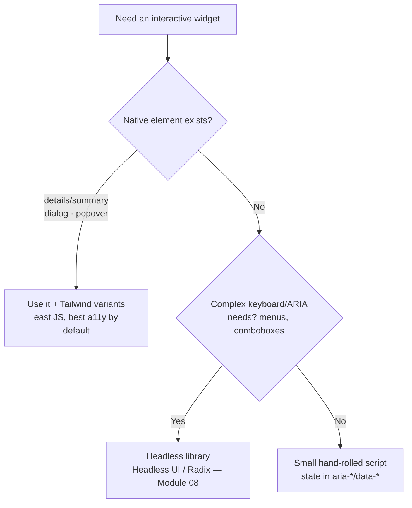

# Lesson 06 — Dropdowns, Tabs & Accordions

## 🎯 Learning Objectives

- Build a no-JS accordion with `<details name>` and `group-open:`
- Build a disclosure dropdown with `aria-expanded`, outside-click and Escape handling
- Build accessible tabs with `role="tab"`, `aria-selected` and arrow-key navigation
- Choose between native elements, hand-rolled code and headless libraries

---

## Introduction

Bootstrap's dropdown, tabs and accordion (Book 05, Modules 07–08) all depended on Bootstrap's JavaScript. With modern HTML and Tailwind's attribute variants (Module 05, lesson 07) you can build them with **state in attributes** and styling from those attributes. This lesson shows three levels, from least to most JS.



---

## 1. Accordion with native `<details>`

```html
<div class="divide-y divide-slate-200 rounded-xl border border-slate-200">
  <details name="faq" class="group p-4" open>
    <summary class="flex cursor-pointer list-none items-center justify-between gap-4 font-medium outline-hidden
                    marker:content-none focus-visible:underline [&::-webkit-details-marker]:hidden">
      What is Tailwind CSS?
      <svg class="size-5 shrink-0 transition-transform group-open:rotate-180" viewBox="0 0 20 20" fill="currentColor" aria-hidden="true">
        <path d="M5.23 7.21a.75.75 0 011.06.02L10 11.17l3.71-3.94a.75.75 0 111.08 1.04l-4.25 4.5a.75.75 0 01-1.08 0l-4.25-4.5a.75.75 0 01.02-1.06z" />
      </svg>
    </summary>
    <p class="mt-3 text-sm text-slate-600">A utility-first CSS framework for building custom designs in markup.</p>
  </details>

  <details name="faq" class="group p-4">
    <summary class="flex cursor-pointer list-none items-center justify-between gap-4 font-medium outline-hidden marker:content-none [&::-webkit-details-marker]:hidden">
      Do I need JavaScript?
      <svg class="size-5 shrink-0 transition-transform group-open:rotate-180" …></svg>
    </summary>
    <p class="mt-3 text-sm text-slate-600">Not for this accordion.</p>
  </details>
</div>
```

What's happening:

- `<details>/<summary>` is keyboard-accessible and screen-reader friendly with **zero JS**.
- **Same `name` on several `<details>` = exclusive accordion** (opening one closes the others).
- `group` + `group-open:rotate-180` rotates the chevron when open. (`open:` matches `[open]` — Module 05, lesson 04.)
- `list-none` and `[&::-webkit-details-marker]:hidden` remove the default triangle.

---

## 2. Dropdown (disclosure pattern)

For a menu of **links or actions**, the correct, simple pattern is a **disclosure**: a button that shows/hides a list. Avoid `role="menu"` unless you implement full arrow-key menu behavior; it promises screen-reader users a complex keyboard model.

```html
<div class="relative inline-block" id="user-menu">
  <button type="button" aria-expanded="false" aria-controls="user-menu-list"
          class="group inline-flex items-center gap-2 rounded-lg border border-slate-300 bg-white px-3 py-2 text-sm hover:bg-slate-50">
    Account
    <svg class="size-4 transition-transform group-aria-expanded:rotate-180" …></svg>
  </button>

  <ul id="user-menu-list" hidden
      class="absolute right-0 z-20 mt-2 w-48 origin-top-right rounded-xl border border-slate-200 bg-white p-1 shadow-lg">
    <li><a href="/profile" class="block rounded-lg px-3 py-2 text-sm hover:bg-slate-100 focus-visible:bg-slate-100 focus-visible:outline-hidden">Profile</a></li>
    <li><a href="/settings" class="block rounded-lg px-3 py-2 text-sm hover:bg-slate-100 focus-visible:bg-slate-100 focus-visible:outline-hidden">Settings</a></li>
    <li><hr class="my-1 border-slate-200" /></li>
    <li><button class="block w-full rounded-lg px-3 py-2 text-left text-sm text-red-600 hover:bg-red-50">Sign out</button></li>
  </ul>
</div>
```

```js
function initDropdown(root) {
  const btn = root.querySelector("button[aria-expanded]");
  const list = root.querySelector("ul");
  const setOpen = (open) => {
    btn.setAttribute("aria-expanded", String(open));
    list.hidden = !open;
  };
  btn.addEventListener("click", () => setOpen(btn.getAttribute("aria-expanded") !== "true"));
  document.addEventListener("click", (e) => { if (!root.contains(e.target)) setOpen(false); });   // outside click
  root.addEventListener("keydown", (e) => { if (e.key === "Escape") { setOpen(false); btn.focus(); } });
}
initDropdown(document.getElementById("user-menu"));
```

> ⚠️ Near viewport edges a plain `absolute` menu can overflow. For automatic flip/shift positioning, use a headless library (Module 08) or the newer CSS anchor positioning where your browser targets support it (Module 09, `browser-support-and-fallbacks`).

---

## 3. Tabs

```html
<div class="w-full max-w-xl">
  <div role="tablist" aria-label="Project sections" class="flex gap-1 border-b border-slate-200">
    <button role="tab" id="tab-overview" aria-controls="panel-overview" aria-selected="true" tabindex="0"
            class="-mb-px border-b-2 border-transparent px-4 py-2 text-sm text-slate-600 outline-hidden
                   hover:text-slate-900 focus-visible:bg-slate-50
                   aria-selected:border-indigo-600 aria-selected:font-medium aria-selected:text-indigo-600">Overview</button>
    <button role="tab" id="tab-activity" aria-controls="panel-activity" aria-selected="false" tabindex="-1"
            class="-mb-px border-b-2 border-transparent px-4 py-2 text-sm text-slate-600 outline-hidden
                   hover:text-slate-900 focus-visible:bg-slate-50
                   aria-selected:border-indigo-600 aria-selected:font-medium aria-selected:text-indigo-600">Activity</button>
    <button role="tab" id="tab-settings" aria-controls="panel-settings" aria-selected="false" tabindex="-1"
            class="-mb-px border-b-2 border-transparent px-4 py-2 text-sm text-slate-600 outline-hidden
                   hover:text-slate-900 focus-visible:bg-slate-50
                   aria-selected:border-indigo-600 aria-selected:font-medium aria-selected:text-indigo-600">Settings</button>
  </div>

  <div role="tabpanel" id="panel-overview" aria-labelledby="tab-overview" tabindex="0" class="py-4 text-sm">Overview content…</div>
  <div role="tabpanel" id="panel-activity" aria-labelledby="tab-activity" tabindex="0" hidden class="py-4 text-sm">Activity content…</div>
  <div role="tabpanel" id="panel-settings" aria-labelledby="tab-settings" tabindex="0" hidden class="py-4 text-sm">Settings content…</div>
</div>
```

```js
const tabs = [...document.querySelectorAll('[role="tab"]')];

function select(tab) {
  tabs.forEach((t) => {
    const on = t === tab;
    t.setAttribute("aria-selected", String(on));
    t.tabIndex = on ? 0 : -1;                                   // roving tabindex
    document.getElementById(t.getAttribute("aria-controls")).hidden = !on;
  });
  tab.focus();
}

tabs.forEach((tab, i) => {
  tab.addEventListener("click", () => select(tab));
  tab.addEventListener("keydown", (e) => {
    const target = { ArrowRight: i + 1, ArrowLeft: i - 1, Home: 0, End: tabs.length - 1 }[e.key];
    if (target === undefined) return;
    e.preventDefault();
    select(tabs[(target + tabs.length) % tabs.length]);
  });
});
```

Notes:

- **One style source:** `aria-selected:` classes. The same attribute drives accessibility and visuals.
- **Roving tabindex:** only the selected tab is in the Tab order. Arrow keys move between tabs (the expected tab-widget keyboard model). Tab then moves into the panel.
- The `hidden` attribute hides inactive panels.

---

## 4. Which approach when?

| Widget | Best default | Use a headless library when… |
|---|---|---|
| Accordion / FAQ | Native `<details name>` | You need animated height or controlled state |
| Dropdown of links/actions | Disclosure + small script | You need collision-aware positioning or a true `role="menu"` |
| Tabs | Hand-rolled with `aria-selected` | You need many tab sets or controlled/URL-synced tabs |
| Select/Combobox/Listbox | Native `<select>` | Custom options UI (always use a library) |

---

## 🧪 Practical Example — Vue tabs (state → attributes)

```vue
<script setup>
import { ref } from "vue";
const tabs = ["Overview", "Activity", "Settings"];
const active = ref(0);
</script>

<template>
  <div role="tablist" class="flex gap-1 border-b">
    <button
      v-for="(t, i) in tabs" :key="t" role="tab"
      :aria-selected="active === i" :tabindex="active === i ? 0 : -1"
      @click="active = i"
      class="-mb-px border-b-2 border-transparent px-4 py-2 text-sm text-slate-600
             aria-selected:border-indigo-600 aria-selected:font-medium aria-selected:text-indigo-600"
    >{{ t }}</button>
  </div>
  <div role="tabpanel" class="py-4 text-sm">{{ tabs[active] }} content</div>
</template>
```

Vue renders `:aria-selected="true/false"` as the strings `"true"`/`"false"`, which is exactly what `aria-selected:` matches. (Arrow-key handling would be added with `@keydown`.)

---

## 📝 Revision Questions

<details>
<summary>1. How do you make several `<details>` behave as an exclusive accordion?</summary>

Give them the same `name` attribute.
</details>

<details>
<summary>2. How does the chevron rotate when the details is open, without JS?</summary>

`group` on `<details>` and `group-open:rotate-180` on the icon.
</details>

<details>
<summary>3. Why avoid `role="menu"` for a simple nav dropdown?</summary>

It implies a full application-menu keyboard model (arrow keys, typeahead). A button + list disclosure is simpler and more honest.
</details>

<details>
<summary>4. What is a roving tabindex?</summary>

Only the active tab has `tabindex="0"` (others `-1`); arrow keys move focus between tabs, so the group is a single Tab stop.
</details>

<details>
<summary>5. When should you use Headless UI or Radix instead?</summary>

When you need collision-aware positioning, real menus/comboboxes, or robust controlled state, since they ship the keyboard and ARIA behavior.
</details>
