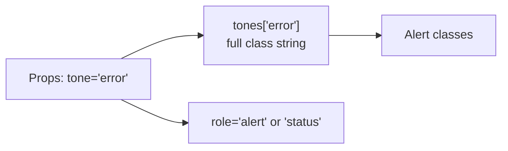

# Lesson 07 — Tables, Lists & Alerts

## 🎯 Learning Objectives

- Style data tables: dividers, zebra rows, sticky headers, numeric alignment
- Make tables work on small screens (scroll or stacked)
- Build list patterns: divided lists, description lists, selectable lists
- Build alert variants with a variant map and correct ARIA roles
- Connect these patterns to Bootstrap's `table`, `list-group` and `alert`

---

## Introduction

Bootstrap shipped `.table`, `.list-group` and `.alert` (Book 05, Modules 06–07). In Tailwind these are small compositions. They also show the **variant-map** idea that Lesson 08 builds on: one structure, a few swappable color sets.

---

## 1. Tables

```html
<div class="overflow-x-auto rounded-xl border border-slate-200">
  <table class="min-w-full divide-y divide-slate-200 text-sm">
    <caption class="sr-only">Recent invoices</caption>
    <thead class="bg-slate-50 text-left text-xs font-semibold tracking-wide text-slate-500 uppercase">
      <tr>
        <th scope="col" class="px-4 py-3">Invoice</th>
        <th scope="col" class="px-4 py-3">Customer</th>
        <th scope="col" class="px-4 py-3">Status</th>
        <th scope="col" class="px-4 py-3 text-right">Amount</th>
      </tr>
    </thead>
    <tbody class="divide-y divide-slate-100 bg-white">
      <tr class="hover:bg-slate-50">
        <td class="px-4 py-3 font-medium whitespace-nowrap">#1001</td>
        <td class="px-4 py-3 text-slate-600">Acme Corp</td>
        <td class="px-4 py-3"><span class="rounded-full bg-green-50 px-2 py-0.5 text-xs font-medium text-green-700 ring-1 ring-green-600/20 ring-inset">Paid</span></td>
        <td class="px-4 py-3 text-right tabular-nums">$1,200.00</td>
      </tr>
      <!-- more rows -->
    </tbody>
  </table>
</div>
```

Key choices:

- **Wrapper, not the table, holds the rounded border and `overflow-x-auto`.** Table elements don't clip to `border-radius` reliably (Module 04), and the wrapper gives you horizontal scrolling on phones.
- `divide-y` adds row separators (Module 04, `borders-radius-and-dividers`).
- `tabular-nums` + `text-right` for numbers so digits line up (Module 03).
- `scope="col"` on headers and a `<caption class="sr-only">` for screen readers.
- Zebra rows: `odd:bg-slate-50` on `<tr>` (Module 05, lesson 06). Row hover: `hover:bg-slate-50`.
- Sticky header inside a scrolling container: `sticky top-0` on `<th>`, with a background color so rows don't show through.

### Small screens

**Option 1 — horizontal scroll** (above) is the simplest and keeps the data intact.

**Option 2 — stacked cards** for tables with few columns, using `data-label` and a pseudo-element (Module 05, lesson 08):

```html
<table class="w-full text-sm max-md:block">
  <thead class="max-md:sr-only">…</thead>
  <tbody class="max-md:block max-md:space-y-3">
    <tr class="max-md:block max-md:rounded-lg max-md:border max-md:p-3">
      <td data-label="Customer" class="max-md:flex max-md:justify-between max-md:before:font-medium max-md:before:content-[attr(data-label)]">Acme Corp</td>
      <td data-label="Amount" class="max-md:flex max-md:justify-between max-md:before:font-medium max-md:before:content-[attr(data-label)]">$1,200.00</td>
    </tr>
  </tbody>
</table>
```

(`max-md:` is the "below md" variant — Module 05, lesson 09.) Overriding table display can drop table semantics in some screen readers, so test it, or prefer scrolling.

---

## 2. Lists

### Divided list with avatars

```html
<ul role="list" class="divide-y divide-slate-100 rounded-xl border border-slate-200 bg-white">
  <li class="flex items-center gap-3 px-4 py-3">
    
    <div class="min-w-0 flex-1">
      <p class="truncate text-sm font-medium text-slate-900">Priya Sharma</p>
      <p class="truncate text-sm text-slate-500">priya@example.com</p>
    </div>
    <span class="text-xs text-slate-400">2m ago</span>
  </li>
  <!-- more -->
</ul>
```

`min-w-0` on the flex child is what makes `truncate` work inside flex (Module 02).

### Description list (key–value details)

```html
<dl class="divide-y divide-slate-100">
  <div class="grid gap-1 py-3 sm:grid-cols-3 sm:gap-4">
    <dt class="text-sm font-medium text-slate-500">Plan</dt>
    <dd class="text-sm text-slate-900 sm:col-span-2">Pro (annual)</dd>
  </div>
  <div class="grid gap-1 py-3 sm:grid-cols-3 sm:gap-4">
    <dt class="text-sm font-medium text-slate-500">Renews</dt>
    <dd class="text-sm text-slate-900 sm:col-span-2">Jan 12, 2027</dd>
  </div>
</dl>
```

### Selectable list (like Bootstrap's `list-group`)

```html
<fieldset class="divide-y divide-slate-200 rounded-xl border border-slate-200">
  <legend class="sr-only">Notification channel</legend>
  <label class="flex cursor-pointer items-center gap-3 p-4 first:rounded-t-xl last:rounded-b-xl hover:bg-slate-50 has-checked:bg-indigo-50">
    <input type="radio" name="channel" class="accent-indigo-600" checked /> Email
  </label>
  <label class="flex cursor-pointer items-center gap-3 p-4 first:rounded-t-xl last:rounded-b-xl hover:bg-slate-50 has-checked:bg-indigo-50">
    <input type="radio" name="channel" class="accent-indigo-600" /> SMS
  </label>
</fieldset>
```

`has-checked:` highlights the whole row (Module 05, lesson 06).

---

## 3. Alerts

### Anatomy

An alert has an icon, a title/message, and optionally a dismiss button. The **color set** changes per type.

```html
<div role="alert" class="flex gap-3 rounded-lg bg-red-50 p-4 text-sm text-red-800 ring-1 ring-red-600/20 ring-inset">
  <svg class="mt-0.5 size-5 shrink-0 text-red-500" viewBox="0 0 20 20" fill="currentColor" aria-hidden="true">…</svg>
  <div class="flex-1">
    <p class="font-medium">Payment failed</p>
    <p class="mt-1 text-red-700">Your card was declined. Update your payment method and try again.</p>
  </div>
  <button type="button" aria-label="Dismiss" class="-m-1 grid size-7 place-items-center rounded-md hover:bg-red-100">×</button>
</div>
```

### ARIA roles

| Role | Use for | Behavior |
|---|---|---|
| `role="alert"` | Errors, urgent messages | Announced immediately (assertive) |
| `role="status"` | Success, info, "Saved" | Announced politely |
| none | Static page notice | Read in normal flow |

Insert `role="alert"` content **dynamically** (after load) so it's announced.

### The variant map

```jsx
const tones = {
  info:    "bg-sky-50 text-sky-800 ring-sky-600/20",
  success: "bg-green-50 text-green-800 ring-green-600/20",
  warning: "bg-amber-50 text-amber-900 ring-amber-600/20",
  error:   "bg-red-50 text-red-800 ring-red-600/20",
};

export function Alert({ tone = "info", title, children }) {
  return (
    <div role={tone === "error" ? "alert" : "status"}
         className={`flex gap-3 rounded-lg p-4 text-sm ring-1 ring-inset ${tones[tone]}`}>
      <div>
        {title && <p className="font-medium">{title}</p>}
        <div className={title ? "mt-1" : ""}>{children}</div>
      </div>
    </div>
  );
}
```

Full class strings in the map: never `` `bg-${tone}-50` `` (Module 06, lessons 04 and 08).



### Left-accent style

```html
<div role="status" class="border-l-4 border-sky-500 bg-sky-50 p-4 text-sm text-sky-900">Heads up…</div>
```

### Dark mode

```html
bg-red-50 text-red-800 dark:bg-red-950/40 dark:text-red-200 dark:ring-red-400/30
```

Or semantic tokens (`bg-danger-surface text-danger`) from Module 06, lesson 09.

Toasts are alerts that enter/exit the screen. Use `starting:` for the entry (Module 05, lesson 03).

---

## 🧪 Practical Example — Invoice dashboard section

```html
<section class="space-y-6">
  <div role="status" class="flex gap-3 rounded-lg bg-amber-50 p-4 text-sm text-amber-900 ring-1 ring-amber-600/20 ring-inset">
    2 invoices are overdue. <a class="font-medium underline" href="#overdue">Review them</a>
  </div>

  <div class="overflow-x-auto rounded-xl border border-slate-200">
    <table class="min-w-full divide-y divide-slate-200 text-sm">
      <thead class="bg-slate-50 text-left text-xs font-semibold tracking-wide text-slate-500 uppercase">
        <tr><th scope="col" class="px-4 py-3">Invoice</th><th scope="col" class="px-4 py-3">Customer</th><th scope="col" class="px-4 py-3 text-right">Amount</th></tr>
      </thead>
      <tbody class="divide-y divide-slate-100">
        <tr class="odd:bg-white even:bg-slate-50/60"><td class="px-4 py-3 font-medium">#1001</td><td class="px-4 py-3">Acme</td><td class="px-4 py-3 text-right tabular-nums">$1,200.00</td></tr>
        <tr class="odd:bg-white even:bg-slate-50/60"><td class="px-4 py-3 font-medium">#1002</td><td class="px-4 py-3">Globex</td><td class="px-4 py-3 text-right tabular-nums">$845.50</td></tr>
      </tbody>
    </table>
  </div>
</section>
```

---

## 📝 Revision Questions

<details>
<summary>1. Why put `rounded-xl border overflow-x-auto` on a wrapper div instead of the `<table>`?</summary>

Tables don't clip to rounded corners reliably, and the wrapper provides horizontal scrolling on small screens.
</details>

<details>
<summary>2. Which utilities align numeric columns properly?</summary>

`text-right` and `tabular-nums`.
</details>

<details>
<summary>3. Why does `truncate` need `min-w-0` inside a flex row?</summary>

Flex items have `min-width: auto` by default and won't shrink below their content; `min-w-0` lets them shrink so text can truncate.
</details>

<details>
<summary>4. When do you use `role="alert"` vs `role="status"`?</summary>

`alert` for urgent errors (announced immediately); `status` for polite updates like "Saved".
</details>

<details>
<summary>5. Why use a variant map for alert colors?</summary>

It keeps every class a complete string that Tailwind can detect and centralizes the color sets, instead of building class names dynamically.
</details>
