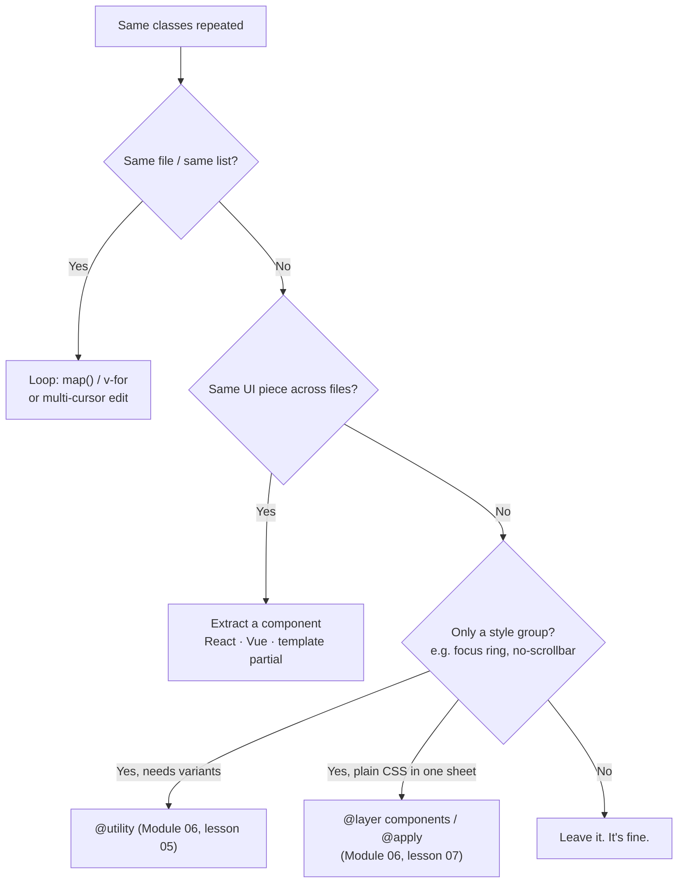

# Lesson 08 — Extracting Components & Managing Repetition

## 🎯 Learning Objectives

- Explain why long class lists aren't a problem on their own
- Apply the "refactor ladder": loops → components → CSS abstractions
- Build reusable React and Vue components with variant props
- Resolve class conflicts and know why order in `class` doesn't matter
- Use `data-*` variants as an alternative to class maps
- Choose between a component, `@utility`, `@layer components` and `@apply`

---

## Introduction

By now you've noticed Tailwind markup is long. The common objection: "What about repetition?" The honest answer has three parts:

1. **Repetition inside one file isn't repetition.** Edit it with multiple cursors, or loop over data.
2. **Repetition across files is a *component* problem**, not a CSS problem.
3. **CSS abstractions are the last resort**, not the first.

This is the same advice you got in Module 06 (lessons 05 and 07): reach for `@apply` rarely. This lesson shows what to reach for instead.

---

## 1. The refactor ladder



---

## 2. Step 1 — loops

```jsx
const features = [
  { title: "Fast", text: "Build in minutes." },
  { title: "Flexible", text: "Style anything." },
  { title: "Small", text: "Ships only what you use." },
];

<ul className="grid gap-6 sm:grid-cols-3">
  {features.map((f) => (
    <li key={f.title} className="rounded-xl border border-slate-200 p-6">
      <h3 className="font-semibold">{f.title}</h3>
      <p className="mt-2 text-sm text-slate-600">{f.text}</p>
    </li>
  ))}
</ul>
```

The card classes now exist **once**. No abstraction needed. In Vue, `v-for` does the same.

---

## 3. Step 2 — extract a component

Use components for the UI pieces from Lessons 01–07. Two principles:

- **Variants through props, with full class strings** (Module 06, lesson 04: no dynamic class names).
- **Composition through `children`/slots**, not dozens of props.

### React

```jsx
const base =
  "inline-flex cursor-pointer items-center justify-center gap-2 rounded-lg border border-transparent font-medium transition " +
  "outline-hidden focus-visible:outline-2 focus-visible:outline-offset-2 disabled:pointer-events-none disabled:opacity-50";

const variants = {
  solid: "bg-indigo-600 text-white hover:bg-indigo-700 focus-visible:outline-indigo-600",
  outline: "border-slate-300 bg-white text-slate-700 hover:bg-slate-50 focus-visible:outline-slate-400",
  danger: "bg-red-600 text-white hover:bg-red-700 focus-visible:outline-red-600",
};
const sizes = { sm: "px-3 py-1.5 text-xs", md: "px-4 py-2 text-sm", lg: "px-6 py-3 text-base" };

export function Button({ variant = "solid", size = "md", className = "", ...props }) {
  return <button className={[base, variants[variant], sizes[size], className].join(" ")} {...props} />;
}
```

### Vue (SFC)

```vue
<script setup>
const props = defineProps({
  variant: { type: String, default: "solid" },
  size: { type: String, default: "md" },
});

const variants = {
  solid: "bg-indigo-600 text-white hover:bg-indigo-700",
  outline: "border-slate-300 bg-white text-slate-700 hover:bg-slate-50",
  danger: "bg-red-600 text-white hover:bg-red-700",
};
const sizes = { sm: "px-3 py-1.5 text-xs", md: "px-4 py-2 text-sm", lg: "px-6 py-3 text-base" };
</script>

<template>
  <button
    :class="[
      'inline-flex cursor-pointer items-center justify-center gap-2 rounded-lg border border-transparent font-medium transition',
      'outline-hidden focus-visible:outline-2 focus-visible:outline-offset-2 disabled:opacity-50',
      variants[variant], sizes[size],
    ]"
  ><slot /></button>
</template>
```

---

## 4. The conflict problem

What if a caller passes `className="px-8"` to a button whose size already says `px-4`? Both classes are present. Which wins?

> ⚠️ **Not the one that appears last in the `class` attribute.** The winner is whichever utility is **defined later in the generated stylesheet**. Order inside `class="…"` is irrelevant. (Same reason `<div class="p-4 p-2">` isn't predictable.)

Solution: **tailwind-merge**, which understands Tailwind's conflicts and removes the loser:

```js
import { twMerge } from "tailwind-merge";
import clsx from "clsx";

const cn = (...inputs) => twMerge(clsx(inputs));

cn("px-4 py-2", "px-8");          // → "py-2 px-8"
cn("text-sm", isLarge && "text-lg"); // → "text-lg" when isLarge
```

- `clsx` builds a class string from conditionals.
- `twMerge` resolves conflicts so the caller's override wins.

Module 08 (`conditional-classes-clsx-tailwind-merge-and-cva`) covers these properly, including `cva` for typed variant APIs. For now, remember the *problem* they solve.

---

## 5. Alternative: variants through `data-*` attributes

Instead of a class map in JS, put the variant in an attribute and let CSS react (Module 05, lesson 07):

```jsx
export function Button({ variant = "solid", ...props }) {
  return (
    <button
      data-variant={variant}
      className="inline-flex items-center rounded-lg px-4 py-2 text-sm font-medium transition
                 data-[variant=solid]:bg-indigo-600 data-[variant=solid]:text-white data-[variant=solid]:hover:bg-indigo-700
                 data-[variant=outline]:border data-[variant=outline]:border-slate-300 data-[variant=outline]:hover:bg-slate-50
                 data-[variant=danger]:bg-red-600 data-[variant=danger]:text-white data-[variant=danger]:hover:bg-red-700"
      {...props}
    />
  );
}
```

Trade-off: the class list is longer, but there's no JS lookup and no conflict risk between variants. Handy for design systems where parents can style children by state.

---

## 6. When CSS abstractions *are* right

| Situation | Tool |
|---|---|
| Style group needing `hover:`/`md:` support (focus ring, `no-scrollbar`) | `@utility` |
| Content you can't add classes to (CMS HTML, markdown output) | `@layer components` + `@apply` |
| A tiny plain-HTML site with no component system | `@layer components` is acceptable |
| Large multi-element UI (card, navbar, table) | **Component, not CSS** |

If you find yourself writing `.btn`, `.btn-primary`, `.btn-lg` in CSS, you've rebuilt Bootstrap, with fewer features. A `<Button variant size>` component is the Tailwind way.

---

## 7. Keeping markup readable

- **Order classes consistently.** `prettier-plugin-tailwindcss` (Module 01, lesson 05) sorts them automatically.
- **Group by purpose in long lists:** layout → box → typography → color → state variants.
- **Extract complex conditional logic** out of `className` into a variable or helper.
- **Put design decisions in tokens** (`bg-primary`, `rounded-card`), so changing the design doesn't mean editing every component.
- **Don't extract too early.** Wait for the third repetition.

React Native note: NativeWind lets you reuse the same component patterns with `className`, but with platform limits. Module 08 covers it.

---

## 🧪 Practical Example — Six buttons → one component

**Before** (repeated across the codebase):

```jsx
<button className="inline-flex items-center justify-center rounded-lg bg-indigo-600 px-4 py-2 text-sm font-medium text-white hover:bg-indigo-700 focus-visible:outline-2 focus-visible:outline-indigo-600">Save</button>
<button className="inline-flex items-center justify-center rounded-lg bg-indigo-600 px-4 py-2 text-sm font-medium text-white hover:bg-indigo-700 focus-visible:outline-2 focus-visible:outline-indigo-600">Publish</button>
<button className="inline-flex items-center justify-center rounded-lg border border-slate-300 px-4 py-2 text-sm font-medium hover:bg-slate-50">Cancel</button>
```

**After:**

```jsx
<Button>Save</Button>
<Button>Publish</Button>
<Button variant="outline">Cancel</Button>
<Button variant="danger" size="sm" className="ml-auto">Delete</Button>
```

Now:

- The design lives in one file.
- Callers still use utilities for **layout** (`ml-auto`), but not for the component's look.
- With `twMerge`, an override like `className="px-8"` works predictably.

---

## 📝 Revision Questions

<details>
<summary>1. What's the first thing to try when you notice repeated classes?</summary>

A loop (`map`/`v-for`) or multi-cursor editing. Only repeat across files justifies a component.
</details>

<details>
<summary>2. Does a later class in the `class` attribute win over an earlier one?</summary>

No. The utility defined later in the generated CSS wins, so order inside `class` doesn't matter.
</details>

<details>
<summary>3. What do `clsx` and `tailwind-merge` each do?</summary>

`clsx` builds class strings from conditions; `tailwind-merge` removes conflicting Tailwind classes so overrides win.
</details>

<details>
<summary>4. Why must variant classes appear as full strings in the map?</summary>

Tailwind scans source for complete class names; dynamically built names aren't generated.
</details>

<details>
<summary>5. When is `@apply` / `@layer components` appropriate?</summary>

For markup you can't add classes to (CMS/markdown HTML) or tiny sites without a component system. Not for UI pieces you can make components.
</details>
