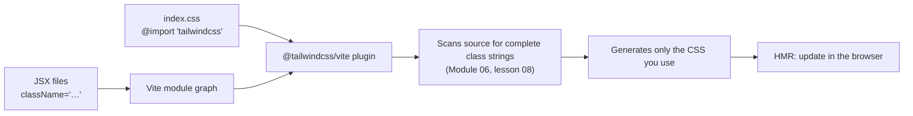

# Lesson 01 — Tailwind with React & Vite

## 🎯 Learning Objectives

By the end of this lesson you will be able to:

- Set up Tailwind v4 in a React + Vite project with the first-party Vite plugin
- Remove the Vite template CSS that fights with Tailwind
- Style React components with `className`, props, and CSS variables safely
- Drive styling from `aria-*` / `data-*` attributes instead of extra state
- Configure editor tooling (IntelliSense, Prettier) for React projects
- Diagnose the five most common "my styles don't show up" problems

---

## Introduction

Modules 01–07 used plain HTML so you could see Tailwind clearly. Real projects are **component trees**. This module connects everything you've learned to the frameworks you actually ship with, starting with React.

> 📌 **Version note (checked Oct 2026):** the current Tailwind line is **v4.3.x**. Everything below uses v4 — CSS-first, no `tailwind.config.js`.

---

## 1. Setup: React + Vite + Tailwind v4

```bash
npm create vite@latest my-app -- --template react
cd my-app
npm install
npm install tailwindcss @tailwindcss/vite
```

**`vite.config.js`**

```js
import { defineConfig } from "vite";
import react from "@vitejs/plugin-react";
import tailwindcss from "@tailwindcss/vite";

export default defineConfig({
  plugins: [react(), tailwindcss()],
});
```

**`src/index.css`** — replace its **entire** contents:

```css
@import "tailwindcss";
```

**`src/main.jsx`** — make sure the CSS is imported once:

```jsx
import { StrictMode } from "react";
import { createRoot } from "react-dom/client";
import "./index.css";
import App from "./App.jsx";

createRoot(document.getElementById("root")).render(
  <StrictMode>
    <App />
  </StrictMode>,
);
```

Test it:

```jsx
export default function App() {
  return <h1 className="p-8 text-3xl font-bold text-indigo-600">Tailwind works 🎉</h1>;
}
```



Why the **Vite plugin** and not PostCSS? It's the recommended integration for Vite projects: no `postcss.config` file, tight HMR, and the best build performance. Other first-party integrations exist (`@tailwindcss/postcss` for Next.js, `@tailwindcss/cli`, and `@tailwindcss/webpack` since v4.2).

---

## 2. ⚠️ Remove the Vite template CSS

The default Vite React template ships CSS that **conflicts with Tailwind**:

- `src/index.css` sets `body { display: flex; place-items: center; … }`, button styles, dark `:root` colors.
- `src/App.css` sets `#root { max-width: 1280px; padding: 2rem; text-align: center }`.

Symptoms: everything is centered, buttons look odd, layouts won't fill the screen. Fix:

1. Replace `index.css` with just `@import "tailwindcss";` (done above).
2. Delete `src/App.css` and its `import "./App.css"` line.
3. Delete unused template assets if you like.

---

## 3. Styling components in JSX

```jsx
export function Avatar({ src, name, size = "md" }) {
  const sizes = { sm: "size-8 text-xs", md: "size-10 text-sm", lg: "size-14 text-base" };
  return (
    
  );
}
```

Rules that carry over from earlier modules:

- **Complete class strings only.** `` `size-${n}` `` and `` `bg-${color}-500` `` don't work (Module 06, lessons 04 and 08). Use a lookup object as above.
- **Use `className`**, not `class`.
- **Long class lists:** break across lines with template literals or arrays joined — or let Prettier sort them (section 7).
- **Conditional classes:** simple ternaries are fine; once you have more than two conditions use `clsx` + `tailwind-merge` (Lesson 03).

### Per-instance dynamic values → CSS variables

```jsx
function ProgressBar({ value }) {
  return (
    <div className="h-2 w-full overflow-hidden rounded-full bg-slate-200">
      <div
        className="h-full w-(--value) rounded-full bg-indigo-600 transition-[width]"
        style={{ "--value": `${value}%` }}
      />
    </div>
  );
}
```

The class string is static, so Tailwind finds it; only the CSS variable changes at runtime. (In TypeScript, cast: `style={{ "--value": "50%" } as React.CSSProperties}`.)

---

## 4. State → attributes → variants

Instead of toggling classes in JS, set an attribute and let Tailwind variants (Module 05, lesson 07) react:

```jsx
function Accordion({ title, children }) {
  const [open, setOpen] = useState(false);
  return (
    <div className="rounded-xl border border-slate-200">
      <button
        aria-expanded={open}
        aria-controls="panel"
        onClick={() => setOpen(!open)}
        className="group flex w-full items-center justify-between p-4 text-left font-medium"
      >
        {title}
        <span className="transition-transform group-aria-expanded:rotate-180">⌄</span>
      </button>
      <div id="panel" hidden={!open} className="px-4 pb-4 text-sm text-slate-600">{children}</div>
    </div>
  );
}
```

### ⚠️ The `data-*` boolean gotcha (recap)

```jsx
<li data-active={isActive} />                    // ❌ renders data-active="false" → data-active: still matches
<li data-active={isActive ? "" : undefined} />   // ✅ present only when true
<li data-active={String(isActive)} className="data-[active=true]:bg-indigo-50" />  // ✅ explicit value
```

`aria-expanded={open}` is fine because ARIA expects the strings `"true"`/`"false"`.

---

## 5. Project structure that scales

```
src/
├─ index.css           ← @import "tailwindcss"; @theme tokens; base styles
├─ components/
│  ├─ ui/              ← Button, Field, Alert… (Module 07, lesson 08)
│  └─ …feature components
├─ lib/
│  └─ utils.js         ← cn() helper (Lesson 03)
└─ App.jsx
```

Put your design tokens in `index.css` (Module 06):

```css
@import "tailwindcss";

@theme {
  --color-brand-500: oklch(0.62 0.19 259);
  --font-display: "Fraunces", Georgia, serif;
}
```

### Path alias (needed by shadcn/ui in Lesson 04)

```js
// vite.config.js
import path from "node:path";
// …
resolve: { alias: { "@": path.resolve(import.meta.dirname, "./src") } },
```

```json
// jsconfig.json (or tsconfig.json "compilerOptions")
{ "compilerOptions": { "baseUrl": ".", "paths": { "@/*": ["./src/*"] } } }
```

---

## 6. Dark mode in React

Reuse the toggle from Module 06, lesson 01 (class strategy with `@custom-variant dark`). Put the blocking theme script in `index.html`'s `<head>` to avoid a flash — React renders too late to prevent it.

---

## 7. Editor tooling

**VS Code → Tailwind CSS IntelliSense** extension, plus a setting so autocomplete works inside helper functions:

```json
// .vscode/settings.json
{
  "tailwindCSS.classFunctions": ["cn", "cva", "clsx"]
}
```

**Prettier plugin** (sorts classes automatically — Module 01, lesson 05):

```bash
npm install -D prettier prettier-plugin-tailwindcss
```

```json
// .prettierrc
{
  "plugins": ["prettier-plugin-tailwindcss"],
  "tailwindStylesheet": "./src/index.css",
  "tailwindFunctions": ["cn", "cva", "clsx"]
}
```

`tailwindStylesheet` points the plugin at your v4 CSS entry so it sorts with your custom tokens.

---

## 8. Other React setups (quick map)

| Setup | Integration |
|---|---|
| **Vite** (React, React Router framework mode) | `@tailwindcss/vite` ← this lesson |
| **Next.js** | `@tailwindcss/postcss` + `postcss.config.mjs` + `@import "tailwindcss"` in `app/globals.css` (Book 10) |
| **Webpack / CRA-style** | `@tailwindcss/webpack` (v4.2+) |
| **React Native** | NativeWind (Lesson 05) |

---

## 9. Troubleshooting: "my styles don't show up"

| Symptom | Likely cause | Fix |
|---|---|---|
| Nothing is styled | CSS not imported, or still has old `@tailwind base;` lines | `@import "tailwindcss";` in the CSS imported from `main.jsx` |
| Everything centered / odd buttons | Vite template CSS | Section 2 |
| A class works in HTML but not in JSX | Class built dynamically | Full strings, lookup map, or `@source inline()` |
| Classes from a package missing | Package is in `node_modules` (ignored) | `@source "../node_modules/the-package"` |
| `tailwind.config.js` ignored | v4 doesn't auto-detect it | Move to CSS (`@theme`) or `@config` (Module 06) |
| Stale output | Cached dev server | Restart `npm run dev` |

---

## 🧪 Practical Example — Stat cards from data

```jsx
const trends = {
  up: "bg-green-50 text-green-700 ring-green-600/20",
  down: "bg-red-50 text-red-700 ring-red-600/20",
  flat: "bg-slate-50 text-slate-600 ring-slate-500/20",
};

function StatCard({ label, value, change, trend = "flat" }) {
  return (
    <div className="rounded-xl border border-slate-200 bg-white p-5 shadow-xs">
      <p className="text-sm text-slate-500">{label}</p>
      <p className="mt-1 text-3xl font-semibold tracking-tight tabular-nums">{value}</p>
      <span className={`mt-3 inline-flex items-center rounded-full px-2 py-0.5 text-xs font-medium ring-1 ring-inset ${trends[trend]}`}>
        {change}
      </span>
    </div>
  );
}

const stats = [
  { label: "Revenue", value: "$48,200", change: "+12.5%", trend: "up" },
  { label: "Churn", value: "2.4%", change: "+0.3%", trend: "down" },
  { label: "Active users", value: "8,431", change: "0%", trend: "flat" },
];

export default function App() {
  return (
    <main className="mx-auto max-w-5xl p-6">
      <h1 className="text-2xl font-bold">Dashboard</h1>
      <div className="mt-6 grid gap-4 sm:grid-cols-2 lg:grid-cols-3">
        {stats.map((s) => <StatCard key={s.label} {...s} />)}
      </div>
    </main>
  );
}
```

Everything from earlier modules is in play: the grid (Module 02), `tabular-nums` (Module 03), `ring-inset` (Module 07), breakpoints (Module 05), and a variant map with full class strings.

---

## 📝 Revision Questions

<details>
<summary>1. Which two packages do you install for Tailwind v4 in a Vite project?</summary>

`tailwindcss` and `@tailwindcss/vite`, then add `tailwindcss()` to the Vite `plugins` array and `@import "tailwindcss";` to your CSS.
</details>

<details>
<summary>2. Why does a fresh Vite React app look wrong after adding Tailwind?</summary>

The template's `index.css` / `App.css` set body flex centering, `#root` padding and button styles that conflict. Replace `index.css` and delete `App.css`.
</details>

<details>
<summary>3. How do you apply a runtime-computed width without dynamic class names?</summary>

A static class like `w-(--value)` plus `style={{ "--value": "42%" }}`.
</details>

<details>
<summary>4. Why is `data-active={false}` a bug with `data-active:` styles?</summary>

React renders `data-active="false"`, and the variant matches attribute presence, so it still applies. Use `undefined`/`""` or match the value explicitly.
</details>

<details>
<summary>5. What does `tailwindCSS.classFunctions` do?</summary>

It enables IntelliSense autocomplete for classes inside helpers such as `cn()`, `cva()` and `clsx()`.
</details>
