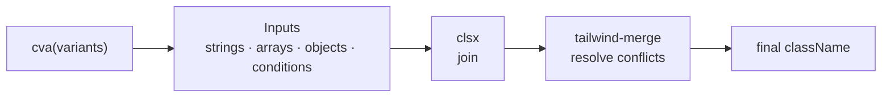

# Lesson 03 — Conditional Classes: `clsx`, `tailwind-merge` & `cva`

## 🎯 Learning Objectives

- Build conditional class strings with `clsx`
- Resolve conflicting Tailwind utilities with `tailwind-merge` and explain why it's needed
- Create the `cn()` helper used across the ecosystem
- Define typed component variants with `class-variance-authority` (the 0.7 API)
- Understand the new `cva` v1 API (config object, `defineConfig`) and its **beta** status
- Teach `tailwind-merge` about your custom theme tokens

---

## Introduction

Module 07, lesson 08 introduced the problems: **conditional classes** get messy, and **class order in `class="…"` does not decide which utility wins**. Three small libraries solve this, and nearly every Tailwind component system uses them together:

| Library | Job |
|---|---|
| **clsx** | Join class names conditionally |
| **tailwind-merge** | Remove conflicting Tailwind classes (last one wins) |
| **cva** | Declare variants (`intent`, `size`) once, get a function that returns classes |



---

## 1. `clsx` — conditional joining

```bash
npm install clsx
```

```js
import { clsx } from "clsx";

clsx("px-4", isActive && "bg-indigo-600", { "opacity-50": disabled }, ["rounded", "text-sm"]);
// → "px-4 bg-indigo-600 opacity-50 rounded text-sm"   (falsy values are dropped)
```

It accepts strings, arrays, objects (keys are classes, values are conditions) and falsy values, so you never write `${a ? "x" : ""}` template strings again.

---

## 2. `tailwind-merge` — resolve conflicts

```bash
npm install tailwind-merge
```

> ✅ Use **tailwind-merge v3 or newer with Tailwind v4** (v2 targets Tailwind v3 class names).

```js
import { twMerge } from "tailwind-merge";

twMerge("px-4 py-2", "px-8");                   // → "py-2 px-8"
twMerge("bg-red-500 bg-blue-500");              // → "bg-blue-500"
twMerge("text-sm text-lg");                     // → "text-lg"
twMerge("bg-red-500 hover:bg-blue-500");        // → both kept (different conditions)
twMerge("hover:bg-red-500 hover:bg-blue-500");  // → "hover:bg-blue-500"
```

It understands Tailwind's grammar: variants, shorthand vs longhand (`p-*` vs `px-*`), arbitrary values, and so on. It does **not** read your CSS. It works from a built-in list of Tailwind class groups (which is why custom tokens need configuration — section 6).

---

## 3. The `cn()` helper

Combine the two in one tiny file. You'll see this exact helper in almost every codebase:

```js
// src/lib/utils.js
import { clsx } from "clsx";
import { twMerge } from "tailwind-merge";

export function cn(...inputs) {
  return twMerge(clsx(inputs));
}
```

```jsx
export function Card({ className, ...props }) {
  return <div className={cn("rounded-xl border bg-white p-6", className)} {...props} />;
}

<Card className="p-2" />   // p-6 is removed; p-2 wins ✅
```

Always put the **caller's** `className` **last** so it wins.

---

## 4. `cva` — typed variants

The `cva` function (Class Variance Authority) takes your base classes and a variants definition, and returns a function that maps props → class string.

### Which package? (status as of Oct 2026)

| | `class-variance-authority` **0.7.x** | `cva` **1.0.0-beta.x** |
|---|---|---|
| Status | Stable; in maintenance mode (no new features) | **Pre-release (beta)** |
| Install | `npm i class-variance-authority` | `npm i cva@beta` |
| Call shape | `cva(base, { variants, … })` (two arguments) | `cva({ base, variants, … })` (one config object) |
| Conflict handling | Wrap the result yourself (`cn(...)`) | `defineConfig({ cx })` from `cva/config` |
| Used by | shadcn/ui's generated components, most existing code | New projects willing to follow a beta |

This book uses the **0.7 API** first (it's what you'll meet in real codebases), then shows the v1 shape.

### The 0.7 API

```bash
npm install class-variance-authority
```

```js
// src/components/ui/button-variants.js
import { cva } from "class-variance-authority";

export const buttonVariants = cva(
  // base classes (always applied)
  "inline-flex cursor-pointer items-center justify-center gap-2 rounded-lg border border-transparent font-medium transition " +
    "outline-hidden focus-visible:outline-2 focus-visible:outline-offset-2 disabled:pointer-events-none disabled:opacity-50",
  {
    variants: {
      intent: {
        solid: "bg-indigo-600 text-white hover:bg-indigo-700 focus-visible:outline-indigo-600",
        outline: "border-slate-300 bg-white text-slate-700 hover:bg-slate-50 focus-visible:outline-slate-400",
        danger: "bg-red-600 text-white hover:bg-red-700 focus-visible:outline-red-600",
      },
      size: {
        sm: "px-3 py-1.5 text-xs",
        md: "px-4 py-2 text-sm",
        lg: "px-6 py-3 text-base",
      },
    },
    compoundVariants: [
      // extra classes only for this combination
      { intent: "outline", size: "lg", class: "border-2" },
    ],
    defaultVariants: { intent: "solid", size: "md" },
  },
);
```

```js
buttonVariants();                                  // solid + md
buttonVariants({ intent: "danger", size: "sm" });  // danger + sm
```

Wire it into a React component with `cn()` so the caller's overrides win:

```jsx
import { cn } from "@/lib/utils";
import { buttonVariants } from "./button-variants";

export function Button({ intent, size, className, ...props }) {
  return <button className={cn(buttonVariants({ intent, size }), className)} {...props} />;
}

<Button intent="danger" size="sm" className="ml-auto px-6">Delete</Button>
```

Notes:

- Every class is a **complete string**, so Tailwind's scanner finds it.
- `cva` itself only **joins**; it does not resolve conflicts. The outer `cn()` does that. (cva also accepts `class`/`className` in the props object, but that bypasses merge unless you configure it.)
- TypeScript: `import { type VariantProps } from "class-variance-authority"` then `type ButtonProps = VariantProps<typeof buttonVariants>` gives you typed `intent`/`size` props.
- In Vue, use the same function in `computed(() => cn(buttonVariants({ intent: props.intent }), props.class))`.

### The same component in cva v1 (beta)

```bash
npm install cva@beta tailwind-merge
```

```js
// cva.config.js
import { defineConfig } from "cva/config";
import { cx as joinClasses } from "cva";
import { twMerge } from "tailwind-merge";

export const { cva, cx: cn } = defineConfig({
  cx: (...inputs) => twMerge(joinClasses(...inputs)),
});
```

```js
// button-variants.js
import { cva } from "../cva.config";

export const buttonVariants = cva({
  base: "inline-flex items-center justify-center gap-2 rounded-lg font-medium transition",
  variants: {
    intent: { solid: "bg-indigo-600 text-white", outline: "border border-slate-300" },
    size: { sm: "px-3 py-1.5 text-xs", md: "px-4 py-2 text-sm" },
  },
  defaultVariants: { intent: "solid", size: "md" },
});
```

With that config, `cva` **resolves Tailwind conflicts for you**, so you can pass `class`/`className` straight into the variants function.

What changed in v1 (from the project's docs):

| 0.7 | v1 beta |
|---|---|
| `cva(base, options)` | `cva({ base, …options })` |
| Package `class-variance-authority` | Package `cva` |
| `null` disables a variant | `null` is rejected; use `undefined` or define an explicit "none" variant. With `defaultVariants`, `undefined` applies the default |
| — | `defineConfig` lives in `cva/config`; `cx` option for your merge function (earlier betas used a hooks API, now deprecated) |
| — | `composes` property to combine several cva components (replaced the earlier `compose` function) |
| — | Optional `cva/tailwindcss` stylesheet with a `base:` variant (see below) |
| — | TypeScript users need TS 6+ on the latest beta |

> ⚠️ **Decision rule:** for production code today, use the **stable** `class-variance-authority` (or `tailwind-variants`), or adopt `cva@beta` knowingly and pin the exact version. Check the release notes before upgrading betas — the API has moved between beta releases.

### An alternative to runtime merging: the `base:` variant

The v1 docs describe a CSS-only approach, `base:`, which marks a utility as a **component default** that any ordinary utility overrides through the **cascade layers** you learned in Module 06, lesson 07 — no runtime merging:

```css
@import "tailwindcss";
@import "cva/tailwindcss";
```

```js
cva({ base: "base:bg-blue-600 base:px-4 hover:bg-blue-700" })({ className: "bg-violet-600" });
// bg-violet-600 beats base:bg-blue-600 via the cascade; hover:bg-blue-700 still applies
```

Limits worth knowing: conditional defaults (`base:hover:…`) lose to any ordinary utility, and two conflicting ordinary utilities are still decided by stylesheet order. For "I don't want to think about it," `tailwind-merge` is the more bulletproof option.

### Other options

`tailwind-variants` (`tv()`) is a popular alternative with built-in `tailwind-merge` support and a "slots" feature for multi-part components. Same idea, different API.

---

## 5. Alternative: variants via `data-*` attributes

```jsx
<button data-intent={intent}
  className="rounded-lg px-4 py-2 text-sm
             data-[intent=solid]:bg-indigo-600 data-[intent=solid]:text-white
             data-[intent=danger]:bg-red-600 data-[intent=danger]:text-white" />
```

No runtime library, no conflict risk between variants, and parents can restyle by state. Trade-off: longer class strings. (Module 07, lesson 08.)

---

## 6. Teach `tailwind-merge` about your tokens

`tailwind-merge` doesn't read your `@theme`. In Module 06 you added custom tokens like `text-eyebrow` (a font size). To `twMerge`, `text-eyebrow` and `text-white` both look like `text-*` utilities, so it can treat them as a conflict and **drop one**.

Fix by extending its config:

```js
// src/lib/utils.js
import { clsx } from "clsx";
import { extendTailwindMerge } from "tailwind-merge";

const twMerge = extendTailwindMerge({
  extend: {
    classGroups: {
      "font-size": [{ text: ["eyebrow", "hero"] }],   // your custom --text-* tokens
    },
  },
});

export const cn = (...inputs) => twMerge(clsx(inputs));
```

Check the tailwind-merge docs for the other class groups (`shadow`, `rounded`, `animate`…) if you add custom tokens in those namespaces.

---

## 7. Editor support

```json
// .vscode/settings.json
{ "tailwindCSS.classFunctions": ["cva", "cx", "cn", "clsx"] }
```

Add the same function names to `tailwindFunctions` in your Prettier config (Lesson 01) so class lists inside them are sorted.

---

## 🧪 Practical Example — Badge + Button from one pattern

```jsx
import { cva } from "class-variance-authority";
import { cn } from "@/lib/utils";

const badge = cva("inline-flex items-center rounded-full px-2.5 py-0.5 text-xs font-medium ring-1 ring-inset", {
  variants: {
    tone: {
      neutral: "bg-slate-50 text-slate-700 ring-slate-500/20",
      success: "bg-green-50 text-green-700 ring-green-600/20",
      danger: "bg-red-50 text-red-700 ring-red-600/20",
    },
  },
  defaultVariants: { tone: "neutral" },
});

export function Badge({ tone, className, ...props }) {
  return <span className={cn(badge({ tone }), className)} {...props} />;
}

<Badge tone="success">Paid</Badge>
<Badge tone="danger" className="uppercase">Overdue</Badge>
```

---

## 📝 Revision Questions

<details>
<summary>1. What do `clsx` and `tailwind-merge` each do, and why combine them?</summary>

`clsx` joins classes from conditions; `tailwind-merge` removes conflicting Tailwind utilities. Together (`cn()`), you can compose and override classes predictably.
</details>

<details>
<summary>2. Why should the caller's `className` come last in `cn(...)`?</summary>

`twMerge` keeps the last of two conflicting utilities, so the caller's override wins over the component's defaults.
</details>

<details>
<summary>3. What is the difference between the 0.7 and 1.0 call shapes of `cva`?</summary>

0.7: `cva(base, { variants })`. 1.0: `cva({ base, variants })`, from the `cva` package, with conflict handling configurable via `defineConfig`.
</details>

<details>
<summary>4. What is the status of the `cva` v1 package and what's your recommendation?</summary>

It's still in beta (1.0.0-beta.x). For production, use the stable `class-variance-authority` 0.7 (or `tailwind-variants`), or pin the beta deliberately and check release notes when upgrading.
</details>

<details>
<summary>5. Why might `twMerge("text-eyebrow text-white")` drop a class, and how do you fix it?</summary>

`tailwind-merge` doesn't know `text-eyebrow` is a custom font size and may treat both as text-color utilities. Register your tokens with `extendTailwindMerge`.
</details>
