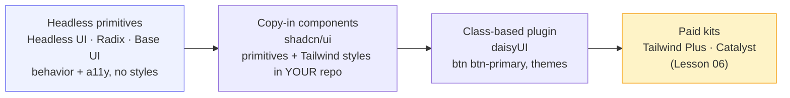
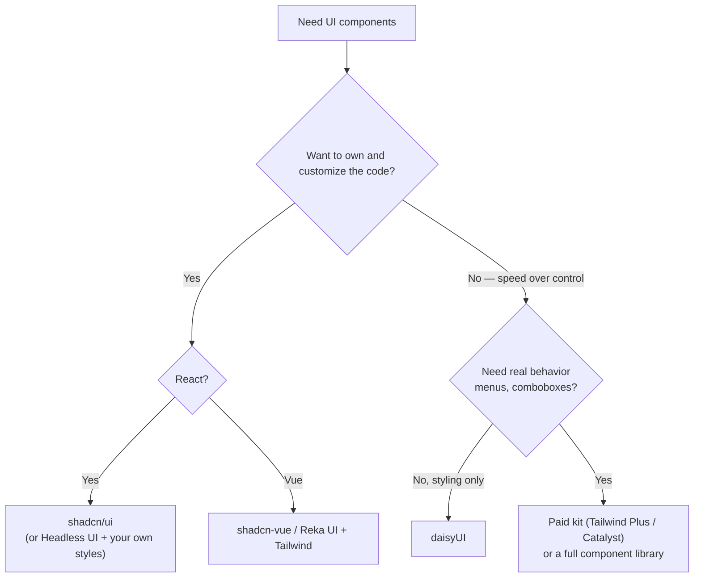

# Lesson 04 — Headless UI, shadcn/ui & daisyUI

## 🎯 Learning Objectives

- Place UI libraries on the spectrum from "unstyled primitives" to "ready-made components"
- Style Headless UI v2 components with Tailwind `data-*` variants
- Explain the shadcn/ui model (copy the code into your repo) and how it uses Tailwind v4 theming
- Install and theme daisyUI 5 with `@plugin`
- Choose the right option for a given project
- Connect each to concepts you already learned (Modules 05–07)

---

## Introduction

In Module 07 you built dropdowns, tabs and dialogs by hand. That's the best way to learn, but for production some widgets (menus with positioning, comboboxes, nested dialogs) are hard to get right. The ecosystem answers in four different ways:



More control and more work on the left; more speed and more opinions on the right.

> 📌 **Checked Oct 2026.** Libraries move quickly. Treat the commands below as the starting point and confirm them against each project's docs.

---

## 1. Headless UI (by Tailwind Labs)

**Unstyled, accessible components**: you bring all the classes. Headless UI v2 (React) highlights:

- Built-in **anchor positioning** (Floating UI) for menus/listboxes, so dropdowns flip and stay on screen.
- State exposed as **`data-*` attributes** — which fits Tailwind v4's variants perfectly: `data-open`, `data-focus`, `data-hover`, `data-active`, `data-checked`, `data-disabled`, `data-closed`.
- A `transition` prop that uses `data-closed` / `data-enter` / `data-leave` for enter/leave animations.

```bash
npm install @headlessui/react
```

```jsx
import { Menu, MenuButton, MenuItem, MenuItems } from "@headlessui/react";

export function AccountMenu() {
  return (
    <Menu>
      <MenuButton className="inline-flex items-center gap-2 rounded-lg border border-slate-300 bg-white px-3 py-2 text-sm
                             data-hover:bg-slate-50 data-open:bg-slate-100 data-focus:outline-2 data-focus:outline-indigo-600">
        Account
      </MenuButton>

      <MenuItems
        transition
        anchor="bottom end"
        className="w-48 origin-top-right rounded-xl border border-slate-200 bg-white p-1 shadow-lg [--anchor-gap:8px]
                   transition duration-100 ease-out focus:outline-hidden data-closed:scale-95 data-closed:opacity-0"
      >
        <MenuItem>
          <a href="/settings" className="block rounded-lg px-3 py-2 text-sm data-focus:bg-slate-100">Settings</a>
        </MenuItem>
        <MenuItem>
          <button className="block w-full rounded-lg px-3 py-2 text-left text-sm text-red-600 data-focus:bg-red-50">Sign out</button>
        </MenuItem>
      </MenuItems>
    </Menu>
  );
}
```

Connection to Module 05, lesson 07: `data-open:` is the v4 "presence" form of `data-[open]:`. Headless UI gives you the attributes, Tailwind turns them into styles.

> ⚠️ Headless UI v2 is for **React** (and Vue via `@headlessui/vue`, which has its own, older-style API and release cadence — check its docs for current status). Prefer **Reka UI** (the successor to Radix Vue) or similar when you need a very current Vue primitive set.

### Radix UI & Base UI

- **Radix UI**: unstyled primitives (dialog, popover, tabs, select…). State comes through attributes like `data-state="open|closed|checked"`, which you style with `data-[state=open]:…`. The ecosystem now ships a unified **`radix-ui`** package.
- **Base UI**: another headless primitive library (from the Material UI team); shadcn/ui can use it instead of Radix.

They solve the same problem as Headless UI. You pick one primitive library; shadcn/ui (below) picks it for you.

---

## 2. shadcn/ui — "not a library, a code generator"

shadcn/ui doesn't install components from npm. A **CLI copies the component source into your project**, built on a primitive library (Radix or Base UI) + Tailwind + `cva` + `cn()`. You then **own and edit** the code.

```bash
npx shadcn@latest init           # detects your framework, configures Tailwind v4 + aliases
npx shadcn@latest add button dialog
```

CLI v4 also offers templates and a base-library choice (`--base radix` or `--base base-ui`, `--template vite`/`next`). Run `npx shadcn@latest init --help` — flags have changed between versions.

What you get in your repo:

```
src/
├─ components/ui/button.jsx     ← the component source (yours to edit)
├─ components/ui/dialog.jsx
├─ lib/utils.js                 ← the cn() helper from Lesson 03
└─ index.css                    ← theme tokens
components.json                 ← CLI config
```

Simplified `components.json` (generated for you; fields vary by version):

```json
{
  "$schema": "https://ui.shadcn.com/schema.json",
  "tailwind": { "config": "", "css": "src/index.css", "cssVariables": true },
  "aliases": { "components": "@/components", "utils": "@/lib/utils", "ui": "@/components/ui" }
}
```

`"config": ""` is intentional: with Tailwind v4 there's **no `tailwind.config.js`**.

### How it connects to what you've learned

| shadcn/ui piece | Where you learned it |
|---|---|
| `cn()` | Lesson 03 |
| `cva` variants in `button.jsx` | Lesson 03 |
| Theme in CSS variables (`--background`, `--primary`…) exposed with `@theme inline` | **Module 06, lesson 09** (semantic tokens) |
| `.dark` class + `@custom-variant dark` | Module 06, lesson 01 |
| `data-[state=open]:…` styling | Module 05, lesson 07 |
| `tw-animate-css` for enter/exit animation utilities | Module 05, lesson 01 (the ecosystem package replacing `tailwindcss-animate`) |

You already understand the whole stack. shadcn/ui is that stack, pre-assembled.

### Trade-offs

- ✅ Full control; no version lock-in; accessibility from the primitives; consistent design tokens.
- ⚠️ **You maintain the code.** Updates mean re-running the CLI and merging diffs.
- ⚠️ Vue has community ports (`shadcn-vue`, built on Reka UI); React Native has separate projects. They are not the same packages as the React one — check each project.
- ⚠️ AI tools and older tutorials often generate **Tailwind v3 configs**; with v4, delete any generated `tailwind.config.js` and use CSS tokens.

---

## 3. daisyUI 5 — component classes on top of Tailwind

daisyUI is a **Tailwind plugin that adds semantic component classes** (`btn`, `card`, `modal`, `navbar`…). Think Bootstrap's vocabulary (Book 05) on top of Tailwind's engine. **daisyUI 5 requires Tailwind v4.**

```bash
npm install -D daisyui@latest
```

```css
@import "tailwindcss";
@plugin "daisyui";
```

```html
<button class="btn btn-primary">Save</button>
<button class="btn btn-outline btn-sm">Cancel</button>

<div class="card bg-base-100 shadow-sm">
  <div class="card-body">
    <h2 class="card-title">Hello</h2>
    <p>Semantic classes, Tailwind utilities for the rest.</p>
    <div class="card-actions justify-end"><button class="btn btn-primary">Buy</button></div>
  </div>
</div>
```

### Themes

```css
@plugin "daisyui" {
  themes: light --default, dark --prefersdark;
}
```

Themes switch with `data-theme` on any element, and daisyUI adds **semantic color names** you can use in utilities: `bg-primary`, `text-base-content`, `bg-base-100`. Those adapt to the active theme (unlike `bg-red-500`, which is the same red everywhere). Custom themes are defined in CSS with `@plugin "daisyui/theme" { … }`.

### Customizing

- Add Tailwind utilities beside daisyUI classes: `btn btn-primary w-full rounded-full`.
- If a utility loses a specificity fight with a daisyUI rule, add the **v4 `!` suffix**: `btn bg-red-500!` (Module 06, lesson 04).
- daisyUI works with any framework, including plain HTML, React and Vue, because it's just CSS.

### Trade-offs

- ✅ Fastest path to a good-looking UI; tiny JS footprint; works everywhere; real themes.
- ⚠️ Less control than hand-built components, and you learn daisyUI's vocabulary instead of utilities. It does **not** include behavior (a `dropdown` or `modal` uses CSS/`<dialog>` tricks) — you still need to handle accessibility.

---

## 4. Choosing



| Option | You write | You get | Best for |
|---|---|---|---|
| Hand-built (Module 07) | Everything | Max control, zero deps | Learning; simple sites |
| Headless UI / Radix / Base UI | All styling | Behavior + accessibility | Custom design systems |
| shadcn/ui | Edits to generated code | Styled, accessible components you own | React apps and design systems |
| daisyUI | A few utilities | Component classes + themes | Prototypes, dashboards, framework-agnostic |
| Tailwind Plus / Catalyst | Customization | Professional blocks and templates | Teams who want speed + quality |

---

## 🧪 Practical Example — Same dropdown, three ways

1. **Hand-built** (Module 07, lesson 06): a button with `aria-expanded` and a `hidden` list. ~20 lines of JS; no collision handling.
2. **Headless UI**: the `Menu` example above — keyboard model, positioning, focus management included.
3. **daisyUI**: `<details class="dropdown"><summary class="btn">Account</summary><ul class="dropdown-content menu bg-base-100 rounded-box z-10 w-52 p-2 shadow-sm"><li><a>Settings</a></li></ul></details>`.

Build all three, then compare: lines of code, keyboard behavior (Tab, arrows, Escape), and how easy each is to restyle. You'll see the spectrum for yourself.

---

## 📝 Revision Questions

<details>
<summary>1. What does "headless" mean for a UI library?</summary>

It provides behavior, state and accessibility but no visual styles, so you style it entirely with your own classes.
</details>

<details>
<summary>2. Why do Headless UI's `data-*` attributes pair well with Tailwind v4?</summary>

Variants like `data-open:` and `data-focus:` map straight onto those attributes, so state styling needs no extra JS.
</details>

<details>
<summary>3. How is shadcn/ui different from a normal npm component library?</summary>

A CLI copies the component source into your repo; you own and edit it. It's built on Radix/Base UI primitives, Tailwind, `cva` and `cn()`.
</details>

<details>
<summary>4. How do you install daisyUI 5 with Tailwind v4?</summary>

`npm i -D daisyui@latest`, then add `@plugin "daisyui";` after `@import "tailwindcss";` in your CSS. There is no `tailwind.config.js` plugin entry.
</details>

<details>
<summary>5. Why is `bg-primary` in daisyUI better for theming than `bg-indigo-600`?</summary>

`bg-primary` is a semantic color that changes with the active theme; `bg-indigo-600` is the same everywhere.
</details>
