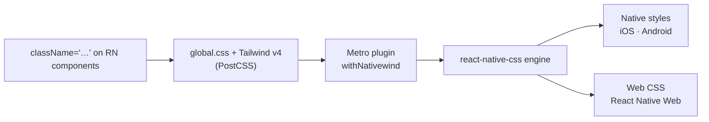

# Lesson 05 — NativeWind for React Native

## 🎯 Learning Objectives

- Explain what NativeWind is and how it differs from web Tailwind
- Choose between NativeWind **v4 (stable, Tailwind v3)** and **v5 (release candidate, Tailwind v4)**
- Set up NativeWind v5 RC in an Expo project
- Write components with `className` on React Native primitives
- Use platform variants, dark mode and pressed/disabled states
- Know the main React Native differences (no grid, text inheritance, units)
- Reuse `cn()` and `cva` from earlier lessons in React Native

---

## Introduction

React Native has no CSS, only a `StyleSheet` of JavaScript objects. **NativeWind** lets you write Tailwind classes on React Native components:

```jsx
<View className="flex-1 items-center justify-center bg-white">
  <Text className="text-xl font-bold text-blue-500">Hello</Text>
</View>
```

At build time it compiles Tailwind into native style objects and conditional logic (hover/focus/active, dark mode, media queries); at runtime it applies them. On web (React Native Web) it reuses a normal Tailwind stylesheet.

---

## 1. Which version? (checked Oct 2026)

| | **NativeWind v4** | **NativeWind v5** |
|---|---|---|
| Status | **Stable** (4.2.7) | **Release candidate** (`5.0.0-rc.0`); the docs say it is *not intended for production use* |
| Tailwind | **v3** | **v4.1+** (the docs pin 4.1.12) |
| Config | `tailwind.config.js` | CSS-first (`@theme`, `@utility`, `@source`…) |
| Needs | — | React Native 0.81+, new architecture, Reanimated v4+, `react-native-css` |
| Animations | Custom engine | Reanimated CSS animations |
| JSX transform | Yes (Babel preset) | **Removed**; use `styled()` for custom components |

**What this means for you:**

- If your **web** apps use Tailwind v4 (like this whole book), **v5 is the one that lets you share the same CSS-first config and mental model**. For learning and prototypes, use it.
- For an app going to production *today*, v4 is the supported choice, but it's on Tailwind v3 syntax, so `@theme` tokens from your web project don't carry over.
- An alternative Tailwind v4 engine for Expo exists: **UniWind** (Expo-only, processes styles natively without a PostCSS step). Evaluate it too.

---

## 2. Setup: NativeWind v5 RC with Expo

From the official v5 installation guide (RC0). Versions are pinned on purpose — **RC packages must match**.

**1. Create a project (quickest)**

```bash
npx rn-new@next --nativewind
```

…or add to an existing Expo app:

```bash
npm install --save-exact nativewind@5.0.0-rc.0 react-native-css@3.1.0-rc.0
npx expo install react-native-reanimated react-native-worklets react-native-safe-area-context expo-system-ui
npm install --save-dev --save-exact tailwindcss@4.1.12 @tailwindcss/postcss@4.1.12 postcss lightningcss@1.30.1
```

**2. `postcss.config.mjs`** (not `.cjs`)

```js
export default {
  plugins: { "@tailwindcss/postcss": {} },
};
```

**3. `global.css`**

```css
@import "tailwindcss/theme.css" layer(theme);
@import "tailwindcss/preflight.css" layer(base);
@import "tailwindcss/utilities.css";

@import "nativewind/theme";
```

Utilities stay **unlayered** here on purpose; a single `@import "tailwindcss"` can put utilities below React Native Web defaults in the cascade.

**4. `metro.config.js`**

```js
const { getDefaultConfig } = require("expo/metro-config");
const { withNativewind } = require("nativewind/metro");

const config = getDefaultConfig(__dirname);
module.exports = withNativewind(config);
```

(Note the lowercase `w` in `withNativewind`; v4 used `withNativeWind`.)

**5. Import the CSS once** — in `app/_layout.tsx` for Expo Router, or your top-level `App` file (not the file that calls `registerRootComponent`/`AppRegistry`, or Fast Refresh breaks):

```js
import "./global.css";
```

**6. Pin lightningcss** in `package.json` to avoid CSS deserialization errors:

```json
{ "overrides": { "lightningcss": "1.30.1" } }
```

**7. Appearance:** set `"userInterfaceStyle": "automatic"` in the `expo` section of `app.json`, rebuild native after changing native deps, then start with `npx expo start --clear`.

**TypeScript:** add a `nativewind-env.d.ts` containing `/// <reference types="react-native-css/types" />` (don't name it `nativewind.d.ts`).



**Migrating an existing v4 app?** The official guide recommends a branch, updating the dependency group together, converting `tailwind.config.js` to CSS, removing `nativewind/babel` and the JSX import source, and replacing `cssInterop`/`remapProps` with `styled`. Read it fully before you start.

---

## 3. Writing components

```jsx
import { Pressable, Text, View } from "react-native";

export function PlanCard({ title, price, onPress }) {
  return (
    <View className="m-4 gap-3 rounded-2xl bg-white p-5 dark:bg-slate-900">
      <Text className="text-lg font-semibold text-slate-900 dark:text-white">{title}</Text>
      <Text className="text-3xl font-bold text-indigo-600">{price}</Text>

      <Pressable
        onPress={onPress}
        className="items-center rounded-lg bg-indigo-600 px-4 py-3 active:bg-indigo-700 disabled:opacity-50"
      >
        <Text className="font-medium text-white">Choose plan</Text>
      </Pressable>
    </View>
  );
}
```

Things that work like web Tailwind: spacing, sizing, flex, colors, radii, opacity, `dark:`, `active:` / `hover:` / `focus:` on compatible components (like `Pressable`), responsive `sm:`/`md:` prefixes, arbitrary values, and your `cn()` / `cva` helpers.

### Platform variants

```jsx
<View className="flex-col ios:pt-12 android:pt-6 web:flex-row web:p-8" />

// layout that differs by platform
<View className="native:flex-col web:grid web:grid-cols-3">…</View>
```

`ios:`, `android:`, `native:` and `web:` select by platform.

---

## 4. React Native differences to expect

| On the web | In React Native |
|---|---|
| `display: flex` is opt-in; row by default | Every `View` is flex, **column by default** (no `flex` class needed) |
| **CSS Grid** exists | **No grid.** Grid classes work on web only; use flex on native |
| Text styles inherit from ancestors | **`Text` does not inherit from `View`.** Put text classes on every `Text` (nested `Text` inherits from its parent `Text`) |
| `rem`/`px`/`%` | Units are converted by NativeWind; cross-platform lengths need units (e.g. `"80px"` in variables) |
| Pseudo-elements (`before:`/`after:`), `::backdrop`, many CSS-only effects | Mostly unavailable. **Each utility's docs page states its native support** — check before depending on it |
| `box-shadow` | v5 maps shadows to React Native `boxShadow`; compare visual output per platform |
| Hover | Only on platforms/components that have a pointer (web, some devices) |

NativeWind accepts every class but only applies what the platform supports. That's convenient and easy to get silently wrong, so test on a real device or simulator.

### Safe areas

Use `react-native-safe-area-context` (installed above), or NativeWind's safe-area utilities, instead of `env(safe-area-inset-*)`.

---

## 5. Dark mode

`dark:` works, following the system appearance. To let users override:

```js
import { Appearance } from "react-native";

Appearance.setColorScheme("dark");   // or "light"
// restoring the system setting is documented per Expo version (see the Dark Mode page)
```

For web, NativeWind v5 notes you may keep a separate, class-based browser theme selection. Read the Dark Mode page of the v5 docs for your Expo SDK, as native/web behavior differs.

For runtime themes (user accent colors), v5 provides a `VariableContextProvider` and CSS variables, the same idea as Module 06, lesson 09 (semantic tokens).

---

## 6. Third-party and custom components

In v5 the old `cssInterop` and `remapProps` helpers are replaced by **`styled()`**. It returns a *wrapper* component that you must use, and prop mapping needs checking per component:

```jsx
import { styled } from "nativewind";
import { LinearGradient } from "expo-linear-gradient";

const StyledGradient = styled(LinearGradient, { className: "style" });
// <StyledGradient className="rounded-xl p-4" colors={[…]} />
```

(Verify the exact options in the `styled` API page for your RC; it was still changing.) In v4, the equivalent was `cssInterop(Component, { className: "style" })`.

---

## 7. Reusing the web patterns

The component helpers from earlier lessons work unchanged because they just return strings:

```jsx
import { cva } from "class-variance-authority";
import { cn } from "@/lib/utils";
import { Pressable, Text } from "react-native";

const button = cva("items-center justify-center rounded-lg px-4 py-3", {
  variants: {
    intent: { solid: "bg-indigo-600 active:bg-indigo-700", outline: "border border-slate-300 active:bg-slate-50" },
  },
  defaultVariants: { intent: "solid" },
});

export function Button({ intent, className, children, ...props }) {
  return (
    <Pressable className={cn(button({ intent }), className)} {...props}>
      <Text className={intent === "outline" ? "text-slate-900" : "text-white"}>{children}</Text>
    </Pressable>
  );
}
```

Differences from the web version: use `Pressable` + `Text` instead of `<button>`, no `focus-visible` outlines, and `aria-*`-driven variants are limited. Prefer React Native's `accessibilityRole`/`accessibilityState` props for accessibility.

---

## 🧪 Practical Example — A settings screen that runs on iOS, Android and web

```jsx
import { ScrollView, Switch, Text, View } from "react-native";
import { useState } from "react";

function Row({ label, children }) {
  return (
    <View className="flex-row items-center justify-between border-b border-slate-200 px-4 py-3 dark:border-slate-800">
      <Text className="text-base text-slate-900 dark:text-slate-100">{label}</Text>
      {children}
    </View>
  );
}

export default function Settings() {
  const [push, setPush] = useState(true);
  return (
    <ScrollView className="flex-1 bg-slate-50 dark:bg-slate-950" contentContainerClassName="mx-auto w-full max-w-xl p-4">
      <Text className="mb-3 text-2xl font-bold text-slate-900 dark:text-white">Settings</Text>
      <View className="overflow-hidden rounded-2xl bg-white dark:bg-slate-900">
        <Row label="Push notifications"><Switch value={push} onValueChange={setPush} /></Row>
        <Row label="Version"><Text className="text-slate-500">1.0.0</Text></Row>
      </View>
    </ScrollView>
  );
}
```

`max-w-xl` and `mx-auto` keep the layout tidy on web and tablets while it fills the screen on phones. (`contentContainerClassName` styles the scroll content; confirm the supported prop mappings in your version's docs.)

---

## 📝 Revision Questions

<details>
<summary>1. What are the two NativeWind versions and how do they relate to Tailwind versions?</summary>

v4 (stable) is built on Tailwind v3; v5 (release candidate) is built on Tailwind v4.1+ with CSS-first config.
</details>

<details>
<summary>2. Which Metro helper does v5 use, and what does the CSS entry import look like?</summary>

`withNativewind` from `nativewind/metro`; `global.css` imports Tailwind's theme, preflight and utilities (utilities unlayered) plus `nativewind/theme`.
</details>

<details>
<summary>3. Why doesn't `className="text-red-500"` on a `View` color its child `Text`?</summary>

React Native text styles don't inherit from `View`. Put text classes on each `Text` (or a parent `Text`).
</details>

<details>
<summary>4. Which web layout feature isn't available on native?</summary>

CSS Grid. Use flex on native; grid classes only work on web.
</details>

<details>
<summary>5. What replaces `cssInterop`/`remapProps` in NativeWind v5?</summary>

The `styled()` API, which returns a wrapper component with explicit prop mapping.
</details>
