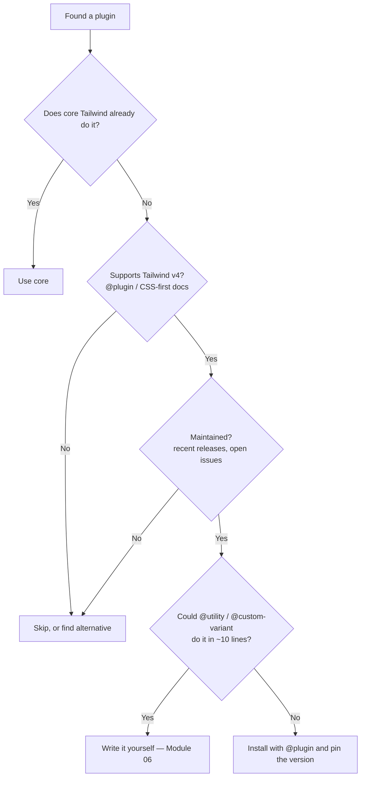

# Lesson 06 — Tailwind Plus & Official Plugins

## 🎯 Learning Objectives

- Add the official `@tailwindcss/typography` and `@tailwindcss/forms` plugins with `@plugin`
- Know which former plugins are now part of core Tailwind
- Choose the right first-party build integration (`vite`, `postcss`, `cli`, `webpack`)
- Understand what Tailwind Plus is (blocks, templates, Catalyst, Elements) and when it's worth it
- Evaluate third-party plugins safely
- Keep up with new core utilities (v4.2 and v4.3)

---

## Introduction

You've now used Tailwind from HTML, React, Vue and React Native, and with component libraries. This last lesson maps the **official ecosystem**: plugins, build tools, and the commercial product from the Tailwind team.

> 📌 **Checked Oct 2026.** Tailwind's current line is **v4.3.x**. The official site and Tailwind Plus both state they target the latest Tailwind version.

---

## 1. The two official plugins that remain separate

Both load with the CSS `@plugin` directive (Module 06, lesson 08) — **not** `@import`.

```bash
npm install -D @tailwindcss/typography @tailwindcss/forms
```

```css
@import "tailwindcss";
@plugin "@tailwindcss/typography";
@plugin "@tailwindcss/forms";
```

### `@tailwindcss/typography` — the `prose` class

Tailwind's Preflight removes all default styles from headings, lists, links, etc. That's right for UI but wrong for **content you don't control** (Markdown, CMS HTML, blog posts). `prose` styles it all in one class:

```html
<article class="prose prose-slate max-w-none lg:prose-lg dark:prose-invert prose-a:text-indigo-600 prose-img:rounded-xl">
  <h1>Release notes</h1>
  <p>Rendered Markdown or CMS HTML goes here…</p>
</article>
```

| Class | Use |
|---|---|
| `prose` | Base typographic styles |
| `prose-sm` … `prose-2xl` | Size scale (usable with breakpoints: `lg:prose-lg`) |
| `prose-slate`, `prose-zinc`… | Gray scale |
| `dark:prose-invert` | Dark mode |
| `prose-a:…`, `prose-headings:…`, `prose-img:…` | Element modifiers |
| `not-prose` | Opt a block (e.g. an embedded component) **out** of prose styles |

`prose` applies a default `max-width` (about 65ch); add `max-w-none` if you want to control the width yourself. This replaces the `@layer components .article-body { @apply … }` approach from Module 06, lesson 07.

### `@tailwindcss/forms` — a baseline for form controls

Preflight resets inputs, so they look unstyled (Module 07, lesson 04). The forms plugin applies a **minimal, consistent baseline** to text inputs, selects, checkboxes and radios, which you then style with utilities. It supports two strategies: **base** (styles the elements directly) and **class** (adds opt-in classes such as `form-input`). Configure it using the plugin options block:

```css
@plugin "@tailwindcss/forms" {
  strategy: class;
}
```

(Check the plugin's README for the current option names before relying on them.) Many teams skip this plugin and style controls by hand with a shared `<Field>` component; both are valid.

---

## 2. Former plugins that are now core

If an old tutorial tells you to install these, you don't need to in v4:

| Old plugin | Now |
|---|---|
| `@tailwindcss/container-queries` | **Core** — `@container`, `@md:` variants (Module 05, lesson 10) |
| `@tailwindcss/aspect-ratio` | **Core** — `aspect-video`, `aspect-square`, `aspect-[4/3]` |
| `@tailwindcss/line-clamp` | **Core** — `line-clamp-3` |
| `tailwindcss-animate` (community) | Replaced in the ecosystem by `tw-animate-css` (used by shadcn/ui) |

The trend continues: Tailwind keeps absorbing popular plugin features into the core engine.

---

## 3. What's new in core (v4.2 – v4.3)

| Feature | Notes |
|---|---|
| `scrollbar-auto`, `scrollbar-thin`, `scrollbar-none` | **v4.3.** First-party `scrollbar-width` utilities; `scrollbar-thumb-*` / `scrollbar-track-*` for colors; `scrollbar-gutter-*`. Replaces the `[scrollbar-width:none]` arbitrary property from Module 05 |
| `@container-size` | Container queries that can respond to **height** as well as width |
| `font-features-*` | Utility for `font-feature-settings` |
| `zoom-*` | Utility for the CSS `zoom` property |
| `@variant` improvements | More flexible use of variants inside your own CSS |
| `--default(…)` in `--value(…)` | Fallback values in functional `@utility` definitions (Module 06, lesson 05) |
| `@tailwindcss/webpack` | **v4.2.** First-party webpack loader |
| `@apply` inside CSS mixins | v4.3.1 |

> 💡 Habit for staying current: read the release notes at tailwindcss.com/blog and the GitHub changelog every couple of months. Things you hand-built last year may now be one class.

---

## 4. Build integrations

These aren't plugins in the utility sense; they connect Tailwind to your toolchain:

| Tool | Package | Use when |
|---|---|---|
| Vite | `@tailwindcss/vite` | Vite, React Router, Nuxt, SvelteKit… (Lessons 01–02) |
| PostCSS | `@tailwindcss/postcss` | Next.js, Parcel, anything PostCSS-based |
| CLI | `@tailwindcss/cli` | No bundler: `npx @tailwindcss/cli -i input.css -o output.css --watch` |
| Webpack | `@tailwindcss/webpack` | Webpack projects (v4.2+) |
| Upgrade tool | `@tailwindcss/upgrade` | `npx @tailwindcss/upgrade` — migrates v3 → v4 (Module 09) |

---

## 5. Tailwind Plus (formerly Tailwind UI)

Tailwind Plus is the **commercial product from the Tailwind team**. It's a one-time purchase (no subscription) that includes:

| Part | What it is |
|---|---|
| **UI blocks** | Hundreds of ready-made marketing, application UI and e-commerce components (copy the code; available in HTML and framework flavors — check the current product page for exact variants) |
| **Site templates** | Complete starter websites/apps (marketing sites, dashboards, course platforms, multi-theme kits) |
| **Catalyst** | A React application UI kit built with Tailwind and Headless UI — real components with a thought-out API, meant as a starter for *your* component system |
| **Tailwind Plus Elements** | A library for **vanilla JS** interactivity built on `<dialog>`, `popover` and custom elements (so blocks work without React/Vue) |

When it's worth it:

- ✅ You're shipping a product and want professionally designed, accessible starting points. It saves days of design work.
- ✅ You want to read high-quality Tailwind code from the people who make Tailwind (excellent as a learning resource).
- ⚠️ It's paid; read the license terms for client work, open source and reselling before buying.
- ⚠️ You still own the maintenance: components are copied code, like shadcn/ui.

Free alternatives: shadcn/ui and daisyUI (Lesson 04) and community kits. Evaluate any kit for **Tailwind v4 support**.

---

## 6. Third-party plugins: a safety checklist

Before adding a plugin or kit to a Tailwind v4 project:



Also check: license, size of generated CSS, whether it needs a JS config (`@config`, Module 06, lesson 08), and security — pin versions and avoid brand-new releases of dependencies (a habit worth keeping for every npm install).

---

## 7. Tooling recap

- **Tailwind CSS IntelliSense** (VS Code, Zed, Neovim, WebStorm): autocomplete, hover CSS previews, linting; set `classFunctions` for `cn`/`cva`/`clsx`.
- **`prettier-plugin-tailwindcss`:** consistent class order; set `tailwindStylesheet` for v4.
- **Tailwind Play** (play.tailwindcss.com): share and test snippets in the browser.
- **Browser DevTools:** inspect generated CSS; with v4 you'll see your tokens as `--color-*` variables on `:root`.

---

## 🧪 Practical Example — Blog post template with typography

```css
/* src/index.css */
@import "tailwindcss";
@plugin "@tailwindcss/typography";

@custom-variant dark (&:where(.dark, .dark *));

@theme {
  --color-brand-600: oklch(0.54 0.20 259);
}
```

```jsx
export function Post({ title, html }) {
  return (
    <main className="mx-auto max-w-3xl px-4 py-12">
      <h1 className="text-4xl font-bold tracking-tight text-slate-900 dark:text-white">{title}</h1>
      <article
        className="prose prose-slate mt-8 dark:prose-invert prose-a:text-brand-600 prose-img:rounded-xl"
        dangerouslySetInnerHTML={{ __html: html }}   // only for trusted/sanitized HTML!
      />
    </main>
  );
}
```

> ⚠️ `dangerouslySetInnerHTML` (and Vue's `v-html`) render raw HTML. Only use them with content you've sanitized (Book 04, security basics).

---

## 📝 Revision Questions

<details>
<summary>1. How do you load an official plugin in Tailwind v4?</summary>

With `@plugin "@tailwindcss/typography";` in your CSS file (not `@import`).
</details>

<details>
<summary>2. Why do you need the typography plugin for Markdown/CMS content?</summary>

Preflight strips default styles from headings, lists and links. `prose` restores good typographic defaults for content you can't add classes to.
</details>

<details>
<summary>3. Name two former plugins that are now part of core Tailwind.</summary>

Container queries (`@container`, `@md:`) and aspect-ratio / line-clamp utilities.
</details>

<details>
<summary>4. Which package do you use for Next.js, and which for Vite?</summary>

`@tailwindcss/postcss` for Next.js; `@tailwindcss/vite` for Vite.
</details>

<details>
<summary>5. What are the main parts of Tailwind Plus?</summary>

UI blocks (marketing, application UI, e-commerce), site templates, the Catalyst React UI kit, and Tailwind Plus Elements for vanilla JS interactivity.
</details>
