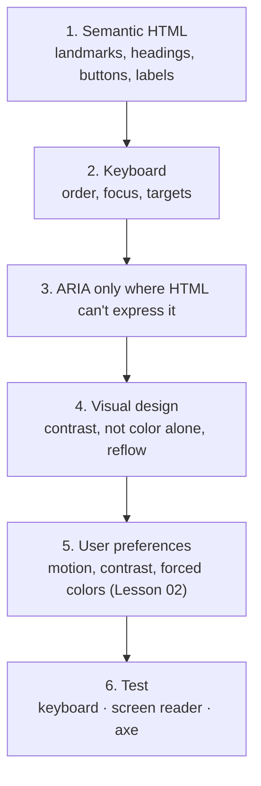

# Lesson 01 — Accessibility with Tailwind

## 🎯 Learning Objectives

By the end of this lesson you will be able to:

- Explain what Tailwind does and does **not** do for accessibility
- Keep semantics intact after Preflight and avoid common utility-induced a11y bugs
- Use `sr-only`, skip links, focus styles and `scroll-mt-*` correctly
- Meet WCAG 2.2 contrast, target-size and reflow requirements with utilities
- Choose between `hidden`, `invisible`, `sr-only`, `opacity-0` and `aria-hidden`
- Avoid visual-order tricks that break keyboard order
- Audit a component with keyboard, screen reader and automated tools

---

## Introduction

Tailwind is neither accessible nor inaccessible. It's a styling tool, and accessibility lives in your **HTML, ARIA, keyboard behavior and color choices**. But utilities make some mistakes very easy (removing outlines, hiding things the wrong way, reordering with flex), so this lesson collects the rules.

You've already used the good habits throughout the book: `focus-visible:`, `aria-*` variants, `sr-only`, `aria-current`, labeled icon buttons. Here they become a checklist.



---

## 1. Semantics survive only if you keep them

Preflight strips the *look* of headings, lists and buttons, never their meaning. Keep the right elements:

| Need | Use | Not |
|---|---|---|
| Clickable action | `<button>` | `<div onClick>` |
| Navigation | `<a href>` | `<span class="cursor-pointer">` |
| Page regions | `<header> <nav> <main> <aside> <footer>` | A pile of `<div>`s |
| Heading level | The right `<h1>`–`<h6>`, sized with `text-*` | A `<div class="text-3xl font-bold">` |

**Heading level is about structure; size is about style.** Pick the level by outline, then style it:

```html
<h2 class="text-base font-semibold text-muted-foreground">Small visual heading, still an h2</h2>
```

### Lists after `list-none`

Some screen reader and browser combinations (notably VoiceOver with Safari) stop announcing a list once its bullets are removed. Add the role back when you reset list styles:

```html
<ul role="list" class="space-y-2">…</ul>
```

---

## 2. Visually hidden content

```html
<span class="sr-only">Opens in a new tab</span>

<!-- Skip link: hidden until focused -->
<a href="#main"
   class="sr-only focus:not-sr-only focus:fixed focus:start-3 focus:top-3 focus:z-50
          focus:rounded-lg focus:bg-primary focus:px-4 focus:py-2 focus:text-primary-foreground">
  Skip to content
</a>
```

`sr-only` hides content visually but keeps it in the accessibility tree. `not-sr-only` undoes it (used to reveal on focus).

### Which "hide" do I use?

| Class | Visible | In accessibility tree | Focusable |
|---|---|---|---|
| `hidden` (`display: none`) | ❌ | ❌ | ❌ |
| `invisible` (`visibility: hidden`) | ❌ | ❌ | ❌ |
| `sr-only` | ❌ | ✅ | ✅ |
| `opacity-0` | ❌ | ✅ | ✅ ← **trap** |
| `aria-hidden="true"` | ✅ | ❌ | ✅ ← **trap** |

> ⚠️ `opacity-0` leaves an invisible control that keyboard users can still tab to and screen readers still announce. Use `hidden`/`invisible`, or `inert`, for things that must be unreachable. Never put `aria-hidden` on something focusable.

---

## 3. Focus

- **Never remove focus without replacement.** `outline-hidden` + a visible `focus-visible:` style, or define one global rule (Lesson 07 does this):

```css
@layer base {
  :focus-visible {
    outline: 2px solid var(--primary);
    outline-offset: 2px;
  }
}
```

- Prefer `outline` over `ring` for focus: rings are `box-shadow`, which **disappears in forced-colors mode** (Lesson 02).
- **Sticky headers must not hide the focused element** (WCAG 2.2 *Focus Not Obscured*). Use `scroll-mt-*` on anchor targets and `scroll-pt-*` on scroll containers (Module 05, lesson 02):

```html
<html class="scroll-pt-20"> … <header class="sticky top-0 h-16">…</header>
```

- Don't use `pointer-events-none` as a substitute for `disabled`. Keyboard users can still activate the element.

---

## 4. Target size

WCAG 2.2 (AA) requires pointer targets of at least **24×24 CSS px** (with spacing exceptions). Aim for **44×44** for touch.

| Utility | Size |
|---|---|
| `size-6` | 24px (minimum) |
| `size-10` / `size-11` | 40px / 44px |
| `min-h-11 min-w-11` | At least 44px, grows with content |

Small visual, large hit area:

```html
<button class="relative size-6 after:absolute after:-inset-2.5 after:content-['']" aria-label="Close">×</button>
```

Make touch targets bigger only where it matters: `p-2 pointer-coarse:p-3` (v4.1+ pointer variants).

---

## 5. Color and contrast

WCAG AA requires:

| What | Ratio |
|---|---|
| Normal text | **4.5 : 1** |
| Large text (≥ 24px, or ≥ ~18.7px bold) | **3 : 1** |
| UI components and meaningful graphics (borders of inputs, icons) | **3 : 1** |

Practical Tailwind guidance (always **measure**, since ratios depend on the exact background):

- Light text on white: the lightest gray that's usually safe for body text is around `slate-500`/`gray-500`. `slate-400` and lighter **fail**.
- `placeholder:text-slate-400` fails too: placeholder text needs contrast as well.
- Input borders at `border-slate-200` often fail the 3:1 non-text rule; use `slate-400`-ish or darker for field borders.
- **Don't use color alone** to convey state. Errors need text or an icon too, not just `border-red-500`.
- Check contrast in DevTools' color picker, or with an automated tool; recheck in **every theme** (Module 06, lesson 09).

---

## 6. Forms (recap, as a checklist)

```html
<label for="email" class="text-sm font-medium">Email</label>
<input id="email" type="email" autocomplete="email" required
       aria-describedby="email-help email-error"
       class="… user-invalid:border-danger aria-invalid:border-danger" />
<p id="email-help" class="text-xs text-muted-foreground">We never share it.</p>
<p id="email-error" role="alert" class="text-sm text-danger">Enter a valid email.</p>
```

- Every control has a real `<label>`. Placeholders are hints, not labels.
- Errors are associated with `aria-describedby` and announced (`role="alert"` or moving focus).
- `user-invalid:` / `user-valid:` (v4.1+) style after interaction; `aria-invalid` for framework validation.
- Correct `type` and `autocomplete`.

---

## 7. Keyboard order must match visual order

Utilities can reorder things visually without changing the DOM, which breaks tab order and reading order (WCAG *Meaningful Sequence* and *Focus Order*):

```html
<!-- ❌ Visual order ≠ DOM order -->
<div class="flex flex-row-reverse"><button>1</button><button>2</button></div>
<ul class="grid"><li class="order-3">A</li><li class="order-1">B</li></ul>
```

Use `order-*`, `flex-row-reverse`, `col-start-*` and grid placement only for **cosmetic** moves that don't change meaning, or reorder the DOM itself. Also: only use `tabindex="0"` and `tabindex="-1"`, never positive values.

---

## 8. Zoom, text size and reflow

- Use **rem-based** sizes. `text-[12px]` won't follow a user's larger default font size. Prefer `text-xs`.
- Use `min-h-*`, not fixed `h-*`, on containers with text.
- Content must reflow at **320 CSS px** width without horizontal scrolling (except data tables/maps). Wrap tables in `overflow-x-auto`; use `max-w-prose` for text blocks and `break-words` for long strings.
- Don't block zoom (`user-scalable=no`) in the viewport meta tag.

---

## 9. Testing workflow

1. **Keyboard only**: Tab, Shift+Tab, Enter, Space, Escape, arrows. Is every control reachable? Is focus always visible and in logical order?
2. **Screen reader** spot check: VoiceOver (macOS/iOS), NVDA (Windows), TalkBack (Android).
3. **Automated**: axe DevTools or Lighthouse in the browser; `@axe-core/playwright` in CI; `eslint-plugin-jsx-a11y` for React. Automated tools catch only about a third of issues, so they supplement manual checks.
4. **Zoom to 200% and 400%**, plus a 320px-wide window.
5. **Preferences** (Lesson 02): reduced motion, increased contrast, forced colors, dark mode.

---

## 🧪 Practical Example — Audit and fix

**Before** (eight problems):

```html
<div class="relative">
  <div class="text-3xl font-bold">Settings</div>
  <div class="text-slate-300 text-[11px]">Manage your account</div>
  <div onclick="save()" class="cursor-pointer rounded bg-blue-400 p-1 text-white outline-none">Save</div>
  <input class="border border-slate-200 placeholder:text-slate-300" placeholder="Email" />
  <div class="flex flex-row-reverse"><button class="opacity-0">Skip</button><button>Next</button></div>
  
</div>
```

**After:**

```html
<section aria-labelledby="settings-title">
  <h1 id="settings-title" class="text-3xl font-bold">Settings</h1>
  <p class="text-xs text-muted-foreground">Manage your account</p>

  <button type="button" class="min-h-11 rounded-lg bg-primary px-4 text-primary-foreground">Save</button>

  <label for="email" class="mt-4 block text-sm font-medium">Email</label>
  <input id="email" type="email" autocomplete="email"
         class="mt-1 block w-full rounded-lg border border-slate-500 px-3 py-2 placeholder:text-slate-500" placeholder="you@example.com" />

  <div class="mt-4 flex gap-2"><button type="button">Next</button></div>
  
</section>
```

What changed: real `<h1>` and `<button>`; contrast-safe gray text and border; no `outline-none` (the global `:focus-visible` rule stays); a real `<label>`; the invisible `opacity-0` button and visual reordering removed; `rem`-based text; image alt that carries the meaning; a ≥ 44px target.

---

## 📝 Revision Questions

<details>
<summary>1. What's wrong with `<div class="opacity-0">` hiding a button?</summary>

It's invisible but still focusable and announced. Use `hidden`, `invisible` or `inert` for things that must be unreachable.
</details>

<details>
<summary>2. Why prefer `outline` over `ring` for focus indicators?</summary>

Rings are box-shadows, which are removed in forced-colors mode; outlines are preserved.
</details>

<details>
<summary>3. What are the AA contrast ratios for normal text and for UI components?</summary>

4.5:1 for normal text; 3:1 for large text and for meaningful UI components/graphics.
</details>

<details>
<summary>4. Why is `flex-row-reverse` risky on a set of buttons?</summary>

It changes visual order but not DOM order, so keyboard focus and screen readers follow a different sequence.
</details>

<details>
<summary>5. How do you make a small icon button easy to hit?</summary>

Keep the visual size small but extend the hit area (`after:absolute after:-inset-2.5`) or use `min-h-11 min-w-11`, ideally 44px.
</details>
