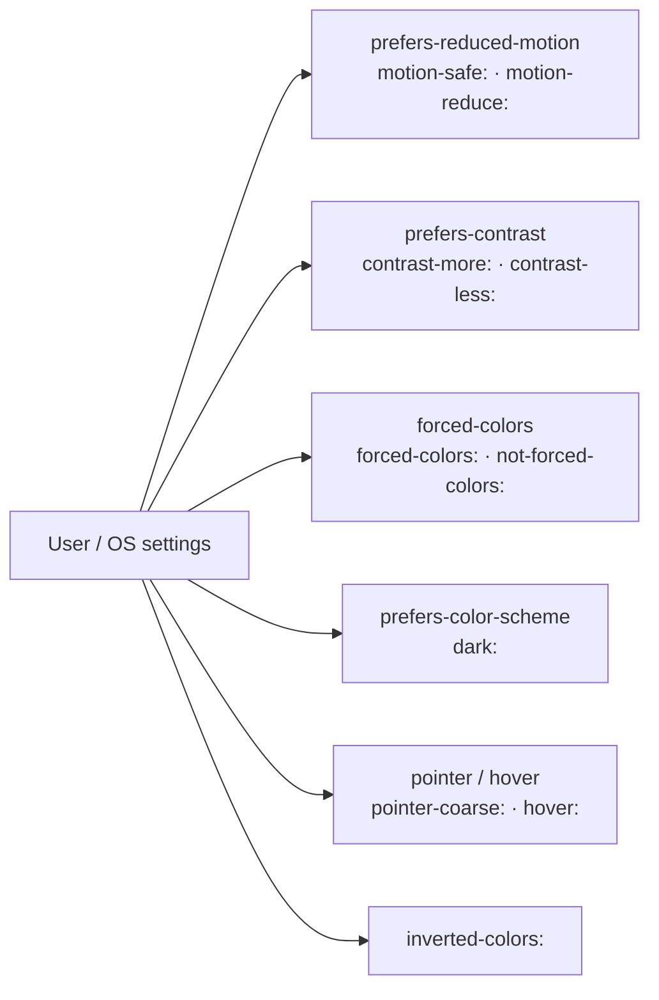

# Lesson 02 — Motion, Contrast & Forced Colors

## 🎯 Learning Objectives

- Respect `prefers-reduced-motion` with `motion-safe:` / `motion-reduce:` and design **replacements**, not just removals
- Use `contrast-more:` (and know it isn't the `contrast-*` filter)
- Make components survive **forced-colors** mode (Windows High Contrast and similar)
- Use `forced-color-adjust`, system color keywords and `not-forced-colors:`
- Use pointer and `inverted-colors` variants appropriately
- Test every user preference in DevTools

---

## Introduction

Dark mode is one user preference. Users also choose **less motion**, **more contrast**, **forced color palettes**, and use **touch or mouse**. Tailwind exposes each as a variant, so adapting costs a class or two. The mindset: **your design is a default, and the user's system settings can override it**.



---

## 1. Reduced motion

```html
<!-- Remove: decorative loop -->
<div class="motion-safe:animate-bounce">↓</div>

<!-- Turn off a default animation -->
<svg class="animate-spin motion-reduce:animate-none">…</svg>

<!-- Replace: slide becomes a fade -->
<div class="transition duration-300 motion-safe:translate-y-0 motion-safe:starting:translate-y-4 starting:opacity-0">…</div>
```

Guidelines:

- **Remove or replace large movement**: parallax, zooms, slides, bouncing, auto-scrolling. Opacity changes are fine.
- **Essential feedback stays**: a loading spinner can become a gentle pulse (`motion-reduce:animate-pulse`), not disappear.
- **Moving content that lasts over 5 seconds** (carousels, tickers, background video) needs a visible **pause/stop** control (WCAG *Pause, Stop, Hide*).
- Nothing should flash more than 3 times per second.
- Smooth scrolling: `motion-safe:scroll-smooth` (Module 05, lesson 02).

In JavaScript:

```js
const reduce = matchMedia("(prefers-reduced-motion: reduce)").matches;
if (!reduce) startAutoplay();
```

---

## 2. Increased contrast

`prefers-contrast: more` is a user request for stronger separation. Tailwind exposes it as `contrast-more:` (and `contrast-less:`):

```html
<p class="text-slate-600 contrast-more:text-slate-900">Body text</p>
<button class="border border-slate-300 contrast-more:border-slate-900 contrast-more:border-2">Edit</button>
<div class="bg-slate-50 contrast-more:bg-white contrast-more:border">Card</div>
```

> ⚠️ **Name clash:** the **`contrast-*` utilities** (`contrast-125`) are the CSS `filter: contrast()`. The **`contrast-more:` variant** is the user preference. Different things.

In a theme-token system (Module 06, lesson 09) you can raise contrast once for everything:

```css
@media (prefers-contrast: more) {
  :root {
    --muted-foreground: oklch(0.3 0.02 260);
    --border: oklch(0.45 0.02 260);
  }
}
```

---

## 3. Forced colors (Windows High Contrast and similar)

In **forced-colors mode** the browser replaces your colors with a small user-chosen palette so everything is readable. It overrides `color`, `background-color`, `border-color`, `outline-color`, `fill`, `stroke`, and similar. It also drops decoration you may rely on:

| Your design | In forced colors |
|---|---|
| Background colors on boxes | Replaced with the system background |
| **Box-shadows**, so Tailwind **`ring-*`** and `shadow-*` | **Removed** |
| Text shadows, many gradients | Removed/overridden |
| `outline` | **Kept** (recolored) |
| `border` | Kept (recolored) |
| `fill-current` / `stroke-current` SVGs | Follow the text color ✅ |

Consequences for the patterns in earlier modules:

- **Focus rings built from `ring-*` vanish.** Use `outline` (this is why Module 07's components use `focus-visible:outline-2`). `outline-hidden` (Module 05, lesson 04) leaves a transparent outline specifically so forced colors can show it.
- **State shown only by background color disappears.** A selected tab with `bg-indigo-50` or a toggle whose "on" state is only a color change looks identical when on and off.
- **Borders and underlines still work**, so add them to carry state.

### The `forced-colors:` variant and system colors

```html
<!-- Selected tab: add a border that survives forced colors -->
<button aria-selected="true"
        class="aria-selected:bg-primary aria-selected:text-primary-foreground
               forced-colors:aria-selected:border-2 forced-colors:aria-selected:border-[Highlight]">
  Overview
</button>

<!-- Prefer system colors inside forced-colors rules -->
<span class="forced-colors:border forced-colors:border-[ButtonText]">Badge</span>
```

System color keywords you can use in arbitrary values: `Canvas`, `CanvasText`, `LinkText`, `ButtonFace`, `ButtonText`, `Highlight`, `HighlightText`, `GrayText`.

Negate with `not-forced-colors:` (Module 05, lesson 06) for enhancements that only make sense otherwise:

```html
<div class="not-forced-colors:shadow-lg not-forced-colors:bg-linear-to-r">…</div>
```

### `forced-color-adjust`

`forced-color-adjust-none` stops the browser from overriding a specific element's colors. Use it **rarely**, for content where the color *is* the information (a color swatch, a chart legend):

```html
<span class="forced-color-adjust-none size-4 rounded-full bg-red-500"></span>
```

`forced-color-adjust-auto` restores the default.

---

## 4. Custom controls that survive all modes

A switch built with `peer` and backgrounds (Module 05, lesson 05) is the classic casualty. Fix:

```html
<label class="relative inline-flex cursor-pointer items-center">
  <input type="checkbox" class="peer sr-only" />
  <span class="h-6 w-11 rounded-full border-2 border-transparent bg-slate-400 transition-colors
               peer-checked:bg-primary
               peer-focus-visible:outline-2 peer-focus-visible:outline-offset-2 peer-focus-visible:outline-primary
               forced-colors:border-[ButtonText] forced-colors:peer-checked:bg-[Highlight]"></span>
  <span class="absolute start-0.5 size-5 rounded-full bg-white shadow transition-transform
               peer-checked:translate-x-5 rtl:peer-checked:-translate-x-5
               forced-colors:bg-[ButtonText] forced-colors:peer-checked:bg-[HighlightText]"></span>
</label>
```

The track gets a border, the checked state uses `Highlight`, the knob uses text colors, and the focus indicator is an outline. (`rtl:` and `start-0.5` prepare it for right-to-left layouts; Lesson 05.)

---

## 5. Pointer and hover

v4.1 added pointer-capability variants:

| Variant | Matches |
|---|---|
| `pointer-fine:` | Primary pointer is precise (mouse, trackpad) |
| `pointer-coarse:` | Primary pointer is coarse (touch) |
| `pointer-none:` | No pointer |
| `any-pointer-fine:` / `any-pointer-coarse:` | **Any** available input is fine/coarse |

```html
<button class="p-2 pointer-coarse:p-3.5">Tap target</button>
<div class="pointer-fine:hover:underline">…</div>
```

And remember (Module 05, lesson 04): in v4 `hover:` only applies when the device can hover. **Never hide essential information behind hover alone**. On touch there's no hover; show it persistently or on focus/tap.

### `inverted-colors:`

For users with OS-level inverted colors. Mostly relevant to images that shouldn't be inverted:

```html

```

---

## 6. Testing each preference

**Chrome/Edge DevTools → ⋮ → More tools → Rendering** lets you emulate:

- `prefers-reduced-motion`
- `prefers-contrast`
- `prefers-color-scheme`
- `forced-colors`

Also try:

- **Windows:** Settings → Accessibility → Contrast themes
- **macOS:** System Settings → Accessibility → Display → Increase contrast / Reduce motion
- Touch emulation for `pointer-coarse:`

Make a "preferences pass" part of your definition of done (Lesson 08).

---

## 🧪 Practical Example — A notification toast that adapts

```html
<div role="status"
     class="flex max-w-sm items-start gap-3 rounded-xl border border-border bg-surface p-4 text-sm text-foreground
            transition duration-300
            starting:translate-y-3 starting:opacity-0
            motion-reduce:transition-none motion-reduce:starting:translate-y-0
            not-forced-colors:shadow-lg
            contrast-more:border-2 contrast-more:border-foreground
            forced-colors:border-[CanvasText]">
  <span class="mt-1 size-2.5 shrink-0 rounded-full bg-success forced-colors:bg-[Highlight]" aria-hidden="true"></span>
  <p>Profile saved.</p>
</div>
```

Check it five ways: normal, dark, reduced motion, increased contrast, forced colors.

---

## 📝 Revision Questions

<details>
<summary>1. Why do `ring-*` focus styles fail in forced-colors mode?</summary>

Rings are `box-shadow`, which forced-colors mode removes. Use `outline` for focus indicators.
</details>

<details>
<summary>2. What's the difference between `contrast-125` and `contrast-more:`?</summary>

`contrast-125` applies a CSS contrast **filter**. `contrast-more:` is a **variant** matching the user's `prefers-contrast: more` setting.
</details>

<details>
<summary>3. A selected tab is shown only by a background color. What happens in forced colors and how do you fix it?</summary>

The background is overridden, so selected looks identical to unselected. Add a border/outline (e.g. `forced-colors:aria-selected:border-[Highlight]`).
</details>

<details>
<summary>4. When is `forced-color-adjust-none` appropriate?</summary>

When color itself carries meaning (swatches, legends). Use sparingly, since it overrides the user's choice.
</details>

<details>
<summary>5. Why shouldn't essential info live in a hover-only tooltip?</summary>

Touch devices can't hover (and v4's `hover:` only applies on hover-capable devices). Make it available on focus or persistently.
</details>
