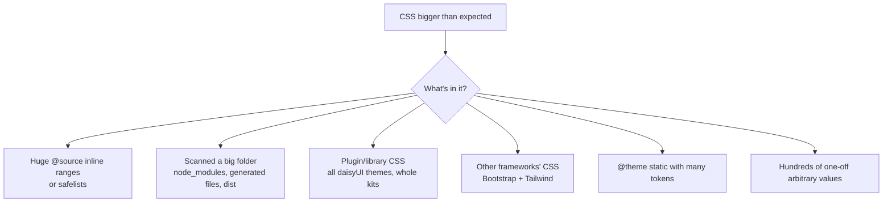

# Lesson 03 — Build Optimization & Bundle Size

## 🎯 Learning Objectives

- Explain why Tailwind's output is small and what makes it grow
- Measure your CSS (raw, gzip, brotli) and set a budget
- Find and remove common sources of CSS bloat
- Understand v4's built-in optimization (Lightning CSS) and what you no longer configure
- Optimize the things that usually matter more than CSS: fonts and images
- Avoid expensive CSS patterns at runtime

---

## Introduction

Tailwind generates **only the utilities you use**, so production CSS is typically small, and because utilities repeat, it compresses very well. The CSS file is rarely your biggest performance problem. This lesson shows how to **verify** that, and how to fix the cases where it isn't.

> 📌 Per the Tailwind v4 announcement, the new engine makes full builds several times faster and incremental builds dramatically faster. That's *build* speed, not output size, but it means large projects stay pleasant to work in.

---

## 1. What v4 does for you

| Task | v3 | v4 |
|---|---|---|
| Minification, vendor prefixing | `postcss` + `autoprefixer` + `cssnano` | **Built-in** (Lightning CSS) |
| `@import` bundling | `postcss-import` | **Built-in** |
| Content scanning | `content: []` globs | **Automatic**, `@source` for exceptions |
| Dead-code removal | Automatic (JIT) | Automatic |

If your project still lists `autoprefixer` or `postcss-import`, remove them (Lesson 05).

---

## 2. Measure first

```bash
npm run build
```

Vite prints each file's size, including gzip. For the full picture, measure raw, gzip and brotli:

```bash
node -e "
const fs=require('fs'),z=require('zlib');
for (const f of fs.readdirSync('dist/assets').filter(f=>f.endsWith('.css'))) {
  const b=fs.readFileSync('dist/assets/'+f);
  console.log(f.padEnd(34), String(b.length).padStart(8),'raw',
    String(z.gzipSync(b).length).padStart(7),'gzip',
    String(z.brotliCompressSync(b).length).padStart(7),'brotli');
}"
```

Without a bundler, minify straight from the CLI:

```bash
npx @tailwindcss/cli -i src/styles.css -o dist/out.css --minify
```

**Set a budget** and enforce it in CI. A reasonable starting point for a typical app is a CSS budget in the low tens of kilobytes gzipped. Small marketing sites are often far below that. Measure your own, then keep it from regressing:

```bash
# fail the build if CSS (gzip) exceeds 40 kB
node -e "
const fs=require('fs'),z=require('zlib');
const total=fs.readdirSync('dist/assets').filter(f=>f.endsWith('.css'))
  .reduce((n,f)=>n+z.gzipSync(fs.readFileSync('dist/assets/'+f)).length,0);
console.log('CSS gzip bytes:', total);
process.exit(total > 40*1024 ? 1 : 0);"
```

---

## 3. Common sources of bloat



| Cause | Fix |
|---|---|
| `@source inline("{hover:,focus:,}bg-{red,blue,…}-{50..950}")` generating thousands of rules | Narrow the ranges; only generate what runtime data can actually produce (Module 06, lesson 08) |
| Scanning generated/vendor files | Make sure build output and caches are in `.gitignore` (ignored by default); add `@source not "../some/dir"` |
| Library CSS you don't use | Limit daisyUI themes (`themes: light --default, dark --prefersdark`), import only needed parts of kits |
| Two frameworks | Finish the Bootstrap migration (Lesson 05) |
| `@theme static` | Use plain `@theme` so unused tokens aren't emitted |
| Many unique arbitrary values (`w-[137px]`, `mt-[13px]`) | Each unique value is a rule. Promote repeats to tokens (Module 06, lesson 04) |
| `@apply` everywhere | Each `@apply` copies declarations into another rule. Prefer utilities in markup or components |

### Look inside

- Open the built CSS and search for what you didn't expect.
- Chrome DevTools → **Coverage** tab shows unused CSS per page. In a utility system "unused on this page" is normal, since the file is shared, so look for large, wholly unused chunks.

---

## 4. Fonts matter more than CSS

A 3 kB difference in CSS is noise next to a 100 kB font.

```css
@font-face {
  font-family: "Inter Variable";
  src: url("/fonts/InterVariable-latin.woff2") format("woff2");
  font-weight: 100 900;
  font-display: swap;
  unicode-range: U+0000-00FF, U+0131, U+0152-0153, U+02BB-02BC, U+02C6, U+02DA, U+02DC, U+2000-206F;
}
```

```html
<link rel="preload" href="/fonts/InterVariable-latin.woff2" as="font" type="font/woff2" crossorigin />
```

- **WOFF2 only**, **self-hosted**, **subset** to the scripts you use, **variable** fonts when you need multiple weights.
- Only preload the 1–2 fonts needed above the fold.
- `font-display: swap` avoids invisible text; to reduce the layout shift when the font swaps, define a fallback with adjusted metrics (`size-adjust`, `ascent-override`).
- Fewer weights = fewer bytes. Do you really use five?

(Module 03, `web-fonts-and-font-features`, covered the details.)

---

## 5. Images and layout stability

Images are usually the heaviest assets and the main cause of layout shift:

```html
                     <!-- the LCP image: don't lazy-load it -->

```

- Always set `width`/`height` (or `aspect-*`) so the browser reserves space.
- Modern formats (AVIF/WebP), responsive `srcset`/`sizes`.
- Lazy-load below-the-fold images only.

---

## 6. Runtime CSS performance

| Pattern | Cost | Better |
|---|---|---|
| `transition-all` | Can animate layout properties accidentally | `transition-colors`, `transition-transform`, `transition-opacity` |
| Animating `width`/`height`/`top`/`left` | Layout + paint every frame | Animate `transform`/`opacity` (Module 05, lesson 01) |
| Large `backdrop-blur-*` areas | Expensive on mobile GPUs | Limit to small surfaces (sticky nav); consider `supports-*` and reduced-effects fallbacks |
| Big `blur-*` / `drop-shadow-*` filters | Costly repaints | Static images or smaller areas |
| Permanent `will-change` | Memory | Only while animating, or not at all |
| Huge DOM with deep selector variants (`[&_*]:…`, `*:`) | Style recalculation | Target specific elements |

Long pages: skip rendering off-screen sections with an arbitrary property (Module 06, lesson 04):

```html
<section class="[content-visibility:auto] [contain-intrinsic-size:auto_800px]">…</section>
```

---

## 7. Delivery

- **Hash filenames** (Vite does this) and serve with `Cache-Control: public, max-age=31536000, immutable`.
- **Compress** with brotli (and gzip fallback) at the CDN/server.
- One CSS file per page set is fine. Don't split into dozens of tiny files.
- Inline critical CSS only if you've measured a benefit. A small, cached, compressed Tailwind file rarely needs it.

---

## 8. Production checklist

- [ ] No `autoprefixer`/`postcss-import`/`cssnano` left over from v3
- [ ] CSS size measured (raw/gzip/brotli) and under budget in CI
- [ ] No giant `@source inline` ranges; no `@theme static` unless needed
- [ ] Library CSS trimmed (themes/components)
- [ ] Fonts: WOFF2, subset, preloaded sparingly, `font-display` set
- [ ] Images sized, modern formats, LCP image prioritized
- [ ] No `transition-all` on heavy elements; no animated layout properties
- [ ] Immutable caching + brotli enabled

---

## 🧪 Practical Example — Budget audit

1. Build your Module 07 component gallery or the Lesson 07 capstone.
2. Record raw/gzip/brotli CSS sizes with the script above.
3. Add `@source inline("{hover:,focus:,}bg-{red,blue,green}-{50..950}")`... that's far more than needed; rebuild and note the growth.
4. Remove it, switch a few `w-[137px]`-style values to tokens, rebuild.
5. Write the three numbers and what caused each change.

You'll learn more from the delta than from any rule of thumb.

---

## 📝 Revision Questions

<details>
<summary>1. Why is Tailwind's production CSS usually small?</summary>

It generates only the utilities found in your source, and repeated utilities compress extremely well.
</details>

<details>
<summary>2. Which v3-era PostCSS plugins are unnecessary in v4?</summary>

`autoprefixer`, `postcss-import` and minifiers like `cssnano`; v4 handles imports, prefixing and minification (Lightning CSS) itself.
</details>

<details>
<summary>3. Name three things that make Tailwind output bigger than needed.</summary>

Large `@source inline` ranges/safelists, scanning large generated folders, unused plugin/library CSS (e.g. all daisyUI themes), another CSS framework alongside, `@theme static`, many one-off arbitrary values.
</details>

<details>
<summary>4. Why is `transition-all` discouraged on heavy elements?</summary>

It can animate layout-affecting properties and triggers extra work; list only the properties you need (`transition-colors`, `transition-transform`).
</details>

<details>
<summary>5. What helps prevent layout shift with images?</summary>

Setting `width`/`height` or an `aspect-*` utility so the browser reserves space before the image loads.
</details>
