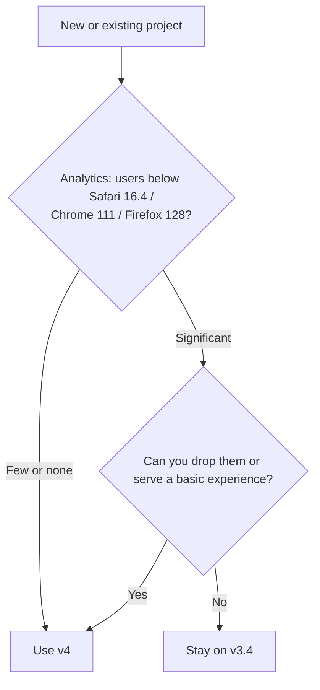

# Lesson 04 — Browser Support & Fallbacks

## 🎯 Learning Objectives

- State Tailwind v4's browser baseline and why it exists
- Decide when v4 is the wrong choice and v3.4 is the right one
- Classify CSS features as *safe*, *progressive* or *avoid* using Baseline data
- Write fallbacks with `supports-*`, `not-supports-*` and layered defaults
- Test across engines and with unusual conditions (no JS, no hover, no color)
- Add a print stylesheet with `print:`

---

## Introduction

Tailwind v4 is built on modern CSS. That makes the framework faster and simpler, and it sets a **minimum browser version**. Your job: know that line, decide if it fits your audience, and design the rest as **progressive enhancement**.

---

## 1. v4's baseline

From the official Compatibility page (v4.0):

| Browser | Minimum |
|---|---|
| Safari | **16.4** |
| Chrome | **111** |
| Firefox | **128** |

Why: v4 relies on **`@property`**, **`color-mix()`** and **cascade layers** (`@layer`), which these versions support. There is no polyfill path.

> ✅ Always check the Compatibility page in the current docs. Minimums are raised over time as Baseline moves.

### If you must support older browsers

- Stay on **Tailwind v3.4**, which is still a valid, working choice for projects with older audiences (some enterprise/kiosk environments, older embedded WebViews, old iPads).
- Don't try to hack v4 onto browsers that lack layers or `@property`. The result is unpredictable.

Also not supported in v4: **Sass, Less and Stylus** as preprocessors. Tailwind is the preprocessor.



---

## 2. Classify features with Baseline

**Baseline** (from the web platform community, shown on MDN and web.dev) labels features as **widely available** (safe for most users), **newly available** (all major engines recently), or **limited availability**.

| Class | Strategy |
|---|---|
| **Widely available** (flex, grid, container queries, `:has()`, `<dialog>`, `dvh` units, `aspect-ratio`, `@layer`) | Use directly |
| **Newly available** (e.g. `@starting-style`, `transition-behavior: allow-discrete`, `text-wrap: balance`, `popover`, `light-dark()`) | Use as **enhancement**: the page must still be usable without it |
| **Limited availability** (e.g. `field-sizing`, CSS anchor positioning, `@scope`) | Provide a fallback, or avoid for critical UI |

Check support on **caniuse.com** and **MDN's compatibility tables** before leaning on anything recent, because the tables change faster than books.

---

## 3. Progressive enhancement in Tailwind

The pattern: **write the baseline first, add the enhancement on top.** If the enhancement isn't supported, the baseline still works.

### `supports-*` and `not-supports-*`

```html
<!-- Glass navbar, solid fallback -->
<header class="sticky top-0 bg-surface supports-[backdrop-filter]:bg-surface/70 supports-[backdrop-filter]:backdrop-blur">

<!-- Grid with a flex fallback -->
<ul class="flex flex-wrap gap-4 supports-[display:grid]:grid supports-[display:grid]:grid-cols-3">

<!-- Style only when something is NOT supported -->
<div class="not-supports-[display:grid]:flex">
```

(`supports-*` is Tailwind's `@supports` variant; `not-*` came from Module 05, lesson 06.)

### Features that degrade gracefully by design

| Feature (Tailwind) | Without support |
|---|---|
| `starting:` / `transition-discrete` | Element appears instantly; fine |
| `text-balance` / `text-pretty` | Normal wrapping; fine |
| `has-*` variants | Base style applies; make sure the base is acceptable |
| `scheme-*` / `color-scheme` | Native controls stay light |
| `field-sizing-content` | Textarea keeps fixed height. Pair with `min-h-*` and `rows` |
| `@container` / `@md:` | Widely available; if you need to be safe, default layout = stacked |
| `pointer-coarse:` etc. | Baseline sizing applies |

### Layered defaults

Because utilities are mobile-first and additive, put the **safe default** unprefixed and layer enhancements:

```html
<div class="p-4 [@supports(color:oklch(0.5_0.2_30))]:bg-[oklch(0.5_0.2_30)] bg-[#c2410c]">
```

(Arbitrary `@supports` variants follow the pattern from Module 06, lesson 04.)

---

## 4. Design for the missing pieces

Progressive enhancement means the page should still work when something is **absent**:

| Missing | Check | Tailwind tool |
|---|---|---|
| JavaScript | Navigation, content and forms still usable? | `noscript:` variant (v4.1+) to show fallback messages |
| Hover | Is essential info available on touch? | `pointer-coarse:`, focus styles |
| Color perception / forced colors | State not color-only | Lesson 02 |
| Animations | Content still appears | `motion-reduce:`, `starting:` degrades |
| Images or fonts | Layout holds? | `aspect-*`, system font fallback stack |
| Wide/narrow screens | 320px to ultra-wide | Mobile-first utilities, `max-w-*` |

```html
<div class="hidden noscript:block rounded-lg bg-warning/15 p-4 text-sm">
  This page works best with JavaScript enabled.
</div>
```

---

## 5. Print styles

Content pages (invoices, docs, receipts) often get printed or saved as PDF. Tailwind has a `print:` variant:

```html
<header class="print:hidden">…nav…</header>
<main class="print:text-black print:bg-white">
  <table class="print:break-inside-avoid">…</table>
  <a href="https://example.com" class="print:after:content-['_('attr(href)')']">Link</a>
</main>
<footer class="hidden print:block">Printed from atlas.example.com</footer>
```

Hide navigation and controls, force readable colors, avoid breaking tables and figures across pages (`break-inside-avoid`), and reveal print-only content.

---

## 6. Testing across engines and conditions

- **Real engines:** Chromium, **WebKit** (Safari) and Firefox. Playwright runs all three:

```bash
npx playwright install
npx playwright test --project=chromium --project=firefox --project=webkit
```

- **Real devices** for iOS Safari quirks (dynamic toolbars, `dvh`, safe areas) and low-end Android.
- **Services** (BrowserStack, LambdaTest) for the long tail.
- **DevTools toggles:** disable JavaScript, emulate touch, slow CPU/network, forced colors (Lesson 02).
- **Policy:** write down your supported-browser matrix (see Lesson 08's style guide) so "does this work in X?" has an answer.

---

## 🧪 Practical Example — A card grid with enhancements and fallbacks

```html
<ul class="flex flex-col gap-4 supports-[display:grid]:grid supports-[display:grid]:grid-cols-[repeat(auto-fill,minmax(16rem,1fr))]">
  <li class="rounded-xl border border-border bg-surface p-5
             has-[a:focus-visible]:outline-2 has-[a:focus-visible]:outline-primary">
    <h3 class="text-balance text-lg font-semibold">
      <a href="#" class="outline-hidden after:absolute after:inset-0">A long heading that benefits from balanced wrapping</a>
    </h3>
    <p class="mt-2 text-pretty text-sm text-muted-foreground">Works everywhere; looks better where supported.</p>
  </li>
</ul>
```

- No grid support → stacked flex column.
- No `:has()` → the link's own focus ring still applies from the global `:focus-visible` rule.
- No `text-wrap` support → normal wrapping.

Nothing breaks.

---

## 📝 Revision Questions

<details>
<summary>1. What are Tailwind v4's minimum browser versions, and why?</summary>

Safari 16.4, Chrome 111, Firefox 128 — it relies on `@property`, `color-mix()` and cascade layers.
</details>

<details>
<summary>2. When should you stay on Tailwind v3.4?</summary>

When a significant part of your audience uses browsers older than those minimums and you can't drop or degrade for them.
</details>

<details>
<summary>3. How do you provide a solid background where `backdrop-filter` isn't supported?</summary>

Default `bg-surface`, then `supports-[backdrop-filter]:bg-surface/70 supports-[backdrop-filter]:backdrop-blur`.
</details>

<details>
<summary>4. Which variant lets you show a fallback message when JavaScript is off?</summary>

`noscript:` (v4.1+), e.g. `hidden noscript:block`.
</details>

<details>
<summary>5. Why test in WebKit specifically?</summary>

Safari/iOS has distinct behavior (dynamic toolbars, viewport units, safe areas) and feature timelines that Chromium testing won't reveal.
</details>
