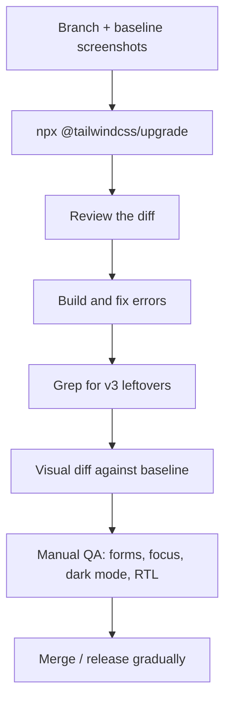

# Lesson 05 — Migrating from v3 and from Bootstrap

## 🎯 Learning Objectives

- Run the official upgrade tool and know what it cannot do for you
- Apply the v3 → v4 renames, removals and default changes
- Find leftover v3-isms (including in AI-generated code)
- Migrate from Bootstrap incrementally with CSS layers instead of a big-bang rewrite
- Map Bootstrap layout, utilities, components and Sass variables to Tailwind
- Convert physical left/right styles to **logical properties** and use `rtl:`/`ltr:` — Tailwind's replacement for Bootstrap's separate RTL build

---

# Part A — Tailwind v3 → v4

## 1. Before you start

- **Browsers:** v4 needs Safari 16.4+, Chrome 111+, Firefox 128+ (Lesson 04). If you can't meet that, stop here.
- **Node 20+** for the upgrade tool.
- Work on a **branch**, with the app building and tests passing first.
- Take **baseline screenshots** (Playwright or manual) of key pages.

```bash
git switch -c chore/tailwind-v4
npx @tailwindcss/upgrade
```

The tool updates dependencies, converts `tailwind.config.js` into CSS (`@theme`, `@plugin`, `@source`), swaps `@tailwind` directives for `@import "tailwindcss"`, and rewrites many class names in templates.



## 2. Tooling changes

| v3 | v4 |
|---|---|
| `@tailwind base; @tailwind components; @tailwind utilities;` | `@import "tailwindcss";` |
| `postcss` plugin `tailwindcss` | `@tailwindcss/postcss` (PostCSS) · `@tailwindcss/vite` · `@tailwindcss/cli` |
| `autoprefixer`, `postcss-import` | **Remove** (built in) |
| `tailwind.config.js` | CSS-first (`@theme`); or load with `@config "./tailwind.config.js"` |
| `content: [...]` | Automatic detection; `@source` for exceptions |
| `plugins: [require(...)]` | `@plugin "…"` |
| `safelist` | `@source inline("…")` |
| `corePlugins`, `separator`, `resolveConfig` | Not supported / removed |
| Sass / Less / Stylus | Not supported |

## 3. Removed utilities

| Removed | Use instead |
|---|---|
| `bg-opacity-*`, `text-opacity-*`, `border-opacity-*`, `divide-opacity-*`, `ring-opacity-*`, `placeholder-opacity-*` | Opacity modifier: `bg-black/50` |
| `flex-shrink-*` | `shrink-*` |
| `flex-grow-*` | `grow-*` |
| `overflow-ellipsis` | `text-ellipsis` |
| `decoration-slice` / `decoration-clone` | `box-decoration-slice` / `box-decoration-clone` |

## 4. Renamed utilities (watch the shifted meanings!)

The default scale shifted, so **the same word now means something different**:

| v3 | v4 |
|---|---|
| `shadow-sm` | `shadow-xs` |
| `shadow` | `shadow-sm` |
| `drop-shadow-sm` / `drop-shadow` | `drop-shadow-xs` / `drop-shadow-sm` |
| `blur-sm` / `blur` | `blur-xs` / `blur-sm` |
| `backdrop-blur-sm` / `backdrop-blur` | `backdrop-blur-xs` / `backdrop-blur-sm` |
| `rounded-sm` / `rounded` | `rounded-xs` / `rounded-sm` |
| `outline-none` | `outline-hidden` |
| `ring` | `ring-3` |
| `bg-gradient-to-r` | `bg-linear-to-r` |

> ⚠️ **Never re-run find-and-replace after the tool has run.** A `shadow-sm` in v4 code means the *new* `shadow-sm`. This is why you migrate once, via the tool.

## 5. Changed defaults (the sneaky ones)

| Change | Effect | Fix |
|---|---|---|
| Default **border color** is `currentColor` (was `gray-200`) | Borders suddenly dark | Add `border-gray-200` explicitly, or the compatibility base rule below |
| Default **ring** is 1px `currentColor` (was 3px blue) | Focus rings look thin/different | Use `ring-3 ring-blue-500`, or set `--default-ring-width` / `--default-ring-color` |
| **Placeholder** color is now text color at 50% | Different shade | Set `placeholder:text-*` explicitly |
| **Buttons** use `cursor: default` | Pointer cursor lost | Add `cursor-pointer` (or a base rule) |
| **`hover:`** only on hover-capable devices | No sticky hover on touch | Usually desired. Override with `@custom-variant hover (&:hover);` |
| **Variants stack left-to-right** | Order of `*:first:` style stacks flips | Re-read stacked variants |
| **`space-*` / `divide-*`** selectors changed | Layout differences with `hidden` or inline children | Prefer `flex`/`grid` + `gap-*` |
| **Transforms** use individual properties | `transform-none` no longer resets scale/rotate | Use `scale-none`, `rotate-none`, `translate-none` |
| **Gradient stops** persist across variants | `dark:from-…` no longer resets `via`/`to` | Use `via-none` to clear |
| **`container`** no longer centers/pads | Layouts shift | `@utility container { margin-inline: auto; padding-inline: 1rem; }` |
| **`<dialog>`** margins reset by Preflight | Dialogs at top-left | `m-auto` (Module 07, lesson 05) |
| **`hidden` attribute** wins over display utilities | Elements stay hidden | Remove `hidden` when you want it visible |
| `theme()` function | Deprecated | `var(--color-…)` |
| `bg-[--brand]` | Old arbitrary variable syntax | `bg-(--brand)` |
| `!bg-red-500` | Old important position | `bg-red-500!` |
| `prefix: 'tw-'` → `tw-flex` | New syntax | `@import "tailwindcss" prefix(tw);` → `tw:flex` |
| `@layer utilities { .foo {} }` | Not a utility anymore | `@utility foo { … }` |
| `@apply` in Vue/CSS Modules | Needs context | `@reference "…/app.css";` |

To restore v3's border color globally during the migration:

```css
@layer base {
  *,
  ::after,
  ::before,
  ::backdrop,
  ::file-selector-button {
    border-color: var(--color-gray-200, currentColor);
  }
}
```

Treat that as a *bridge*, and plan to set colors explicitly later.

## 6. Hunt for leftovers

Run these **on the migrated code**, and look at each hit:

```bash
rg -n "@tailwind (base|components|utilities)" .
rg -n "\b(bg|text|border|divide|ring|placeholder)-opacity-" src
rg -n "\bflex-(shrink|grow)(-[0-9]+)?\b" src
rg -n "\boverflow-ellipsis\b|\bdecoration-(slice|clone)\b" src
rg -n "\boutline-none\b" src            # usually should be outline-hidden
rg -n "bg-gradient-to-" src             # legacy names
rg -n "\[--[a-z-]+\]" src               # old [--var] arbitrary syntax
rg -n "tailwind\.config|autoprefixer|postcss-import" package.json postcss.config.* 2>/dev/null
```

### v3-isms in AI-generated code

AI assistants and older tutorials often emit v3 instructions: a `tailwind.config.js` for colors, `@tailwind base`, `bg-opacity-50`, `flex-shrink-0`, `outline-none`, `ring` assuming 3px, `darkMode: 'class'`. Treat them as **migration bugs** in review (Lesson 08).

---

# Part B — Bootstrap → Tailwind

## 7. Mindset

Bootstrap gives you **components with opinions** (`btn btn-primary`); Tailwind gives you **utilities** and you build the components (Module 07). A big-bang rewrite is risky. Migrate **incrementally**: both frameworks live together, page by page, then Bootstrap is removed.

## 8. Coexistence with CSS layers

Both frameworks reset browser defaults (Bootstrap's *Reboot*, Tailwind's *Preflight*) and both define utilities with similar names. Control the cascade with layers (Module 06, lesson 07):

```css
@layer theme, base, components, utilities;

@import "tailwindcss/theme.css" layer(theme);
@import "bootstrap/dist/css/bootstrap.min.css" layer(components);   /* Bootstrap keeps its own reset */
@import "tailwindcss/utilities.css" layer(utilities);              /* utilities beat Bootstrap */
/* Note: Tailwind's preflight is intentionally NOT imported during migration */
```

Effects:

- Tailwind utilities always win over Bootstrap styles, so you can adjust any Bootstrap element with a utility.
- No Preflight → existing Bootstrap pages don't suddenly change.
- Name collisions (`.container`, `.collapse`, `.hidden`-like names) are the risk. Alternatively use `@import "tailwindcss" prefix(tw);` and write `tw:flex` in new code, then remove the prefix at the end with a codemod.

Remember (Module 06, lesson 04) that the **`!`** suffix exists for the rare fight you can't win by layers.

## 9. Mirror Bootstrap's breakpoints temporarily

So existing layouts don't shift, define Bootstrap's breakpoints in Tailwind:

```css
@theme {
  --breakpoint-*: initial;
  --breakpoint-sm: 36rem;    /* 576px  */
  --breakpoint-md: 48rem;    /* 768px  */
  --breakpoint-lg: 62rem;    /* 992px  */
  --breakpoint-xl: 75rem;    /* 1200px */
  --breakpoint-2xl: 87.5rem; /* 1400px */
}
```

Later, move to Tailwind's defaults and re-test each page.

## 10. Mapping tables

### Layout and display

| Bootstrap | Tailwind |
|---|---|
| `.container` | `mx-auto max-w-6xl px-4` (or customized `container`) |
| `.row` + `.col-md-6` | `grid grid-cols-1 md:grid-cols-2` (or `flex` + widths) |
| `.g-3` / `.gx-3` | `gap-4` / `gap-x-4` |
| `.d-none .d-md-block` | `hidden md:block` |
| `.d-flex` · `.flex-column` · `.flex-wrap` | `flex` · `flex-col` · `flex-wrap` |
| `.justify-content-between` · `.align-items-center` | `justify-between` · `items-center` |
| `.w-100` · `.h-100` · `.vh-100` | `w-full` · `h-full` · `h-dvh` |
| `.position-relative` | `relative` |
| `.visually-hidden` / `.visually-hidden-focusable` | `sr-only` / `sr-only focus:not-sr-only` |

### Spacing (the scales differ!)

| Bootstrap | Size | Tailwind |
|---|---|---|
| `p-1` / `m-1` | 0.25rem | `p-1` |
| `p-2` | 0.5rem | `p-2` |
| `p-3` | 1rem | **`p-4`** |
| `p-4` | 1.5rem | **`p-6`** |
| `p-5` | 3rem | **`p-12`** |
| `ms-auto` / `me-3` | — | `ms-auto` / `me-4` (same logical names) |

> ⚠️ Same number ≠ same size. Convert by **size**, not by digit.

### Typography and color

| Bootstrap | Tailwind |
|---|---|
| `.fw-bold` · `.fw-semibold` | `font-bold` · `font-semibold` |
| `.fs-5` (1.25rem) · `.fs-6` (1rem) | `text-xl` · `text-base` |
| `.fs-1` … `.fs-4` | Closest `text-*` or arbitrary `text-[2.5rem]` |
| `.lead` | `text-xl text-muted-foreground` |
| `.text-muted` | `text-muted-foreground` (token) |
| `.text-center` · `.text-uppercase` · `.text-truncate` | `text-center` · `uppercase` · `truncate` |
| `.bg-primary` · `.text-primary` | Define `--color-primary` (Module 06) → `bg-primary` |
| `.rounded-pill` · `.rounded-3` | `rounded-full` · `rounded-lg` / `rounded-xl` |

### Components (rebuild with Module 07)

| Bootstrap | Tailwind approach |
|---|---|
| `.btn .btn-primary` | Button component (lesson 01) |
| `.card` | Card (lesson 02) |
| `.navbar` + collapse | Navbar with `aria-expanded` (lesson 03) |
| `.form-control` · `.form-select` · `.form-check` | Field patterns (lesson 04) |
| `.modal` (`data-bs-toggle`) | Native `<dialog>` (lesson 05) |
| `.dropdown` · `.accordion` · `.nav-tabs` | Disclosure, `<details>`, ARIA tabs (lesson 06) |
| `.alert` · `.badge` · `.table` · `.list-group` | Lesson 07 patterns |
| `.spinner-border` | `animate-spin` SVG |
| Tooltips/popovers (Popper) | Headless UI / Radix, or `popover` |

Bootstrap's **JavaScript** components are replaced by native elements or a headless library. Remove `data-bs-*` as you go and drop `bootstrap.bundle.js` last.

### Sass variables → tokens

| Sass | Tailwind v4 |
|---|---|
| `$primary` | `--color-primary` in `@theme` |
| `$font-family-sans-serif` | `--font-sans` |
| `$border-radius` | `--radius-*` |
| `$grid-breakpoints` | `--breakpoint-*` |
| `data-bs-theme="dark"` color modes | Semantic tokens + `.dark` / `data-theme` (Module 06, lesson 09) |

## 11. RTL: logical properties instead of a second stylesheet

Bootstrap's RTL support (Book 05, Module 11) ships a **separate RTL stylesheet** built from the LTR one. Tailwind needs no second stylesheet. You write **logical** utilities that follow the document direction, and use `rtl:`/`ltr:` for exceptions.

Set the direction on the root:

```html
<html lang="ar" dir="rtl">
```

| Physical (breaks in RTL) | Logical (flips automatically) |
|---|---|
| `ml-4` · `mr-4` | `ms-4` · `me-4` |
| `pl-4` · `pr-4` | `ps-4` · `pe-4` |
| `left-0` · `right-0` | `start-0` · `end-0` (newer v4.x releases deprecate these in favor of more explicit logical inset names — check the docs for your version) |
| `text-left` · `text-right` | `text-start` · `text-end` |
| `border-l` · `border-r` | `border-s` · `border-e` |
| `rounded-l-lg` · `rounded-r-lg` | `rounded-s-lg` · `rounded-e-lg` (corners: `rounded-ss`, `rounded-se`, `rounded-es`, `rounded-ee`) |
| `float-left` · `float-right` | `float-start` · `float-end` |

Things that **don't** flip on their own:

```html
<!-- Directional icons and transforms -->
<svg class="size-4 rtl:-scale-x-100">→</svg>
<aside class="ltr:-translate-x-full rtl:translate-x-full">…drawer…</aside>

<!-- Use gap instead of space-x/margin hacks -->
<div class="flex gap-3">…</div>

<!-- Button group from Module 07, converted -->
<button class="first:rounded-s-lg last:rounded-e-lg not-first:-ms-px">…</button>
```

Migration steps for RTL support: (1) find physical classes with `rg -n "\b(ml|mr|pl|pr|text-left|text-right|rounded-[lr]|border-[lr]|left-|right-)" src`, (2) convert to logical, (3) add `rtl:` overrides for icons and transforms, (4) test with `dir="rtl"` in DevTools and a real RTL language (fonts, numbers, mixed text).

> The examples in Modules 05–07 used physical classes (`ml-*`, `left-*`) in places for readability. Converting them is a good practice exercise.

## 12. Bootstrap migration plan

1. **Audit**: list pages, components, custom Sass, Bootstrap JS in use.
2. **Tokens**: recreate your Bootstrap theme in `@theme` (colors, fonts, radii, breakpoints).
3. **Coexist** with layers (section 8).
4. **Build the Tailwind components** you need (buttons, forms, cards…) as React/Vue components or partials.
5. **Migrate page by page**, lowest risk first (e.g., marketing pages before checkout). Use screenshots to compare.
6. **Remove Bootstrap JS**, then Bootstrap CSS, then the prefix/layer scaffolding.
7. **Enable Preflight** at the end (replace Reboot) and fix the resulting differences once.

---

## 🧪 Practical Example — Convert a Bootstrap form row

**Before (Bootstrap):**

```html
<div class="row g-3 align-items-center mb-4">
  <div class="col-md-6">
    <label for="n" class="form-label fw-semibold">Name</label>
    <input id="n" class="form-control" />
  </div>
  <div class="col-md-6 text-end">
    <button class="btn btn-primary ms-auto">Save</button>
  </div>
</div>
```

**After (Tailwind, logical, accessible):**

```html
<div class="mb-6 grid items-end gap-4 md:grid-cols-2">
  <div>
    <label for="n" class="block text-sm font-semibold">Name</label>
    <input id="n" class="mt-1 block w-full rounded-lg border border-slate-500 px-3 py-2 text-sm" />
  </div>
  <div class="md:text-end">
    <button class="min-h-11 rounded-lg bg-primary px-4 text-primary-foreground">Save</button>
  </div>
</div>
```

`g-3` → `gap-4` (converted by size), `row`/`col-md-6` → grid, `text-end` is already logical, and the control got a real border color (v4's border default is `currentColor`).

---

## 📝 Revision Questions

<details>
<summary>1. What does `npx @tailwindcss/upgrade` do, and what must you still do manually?</summary>

It updates dependencies, converts the JS config to CSS, replaces `@tailwind` directives and renames many classes. You must review the diff, check default changes (borders, rings, buttons), find leftovers, and visually test.
</details>

<details>
<summary>2. Why is re-running find-and-replace for `shadow-sm` after migrating dangerous?</summary>

The scale shifted: v3's `shadow-sm` became `shadow-xs`, and v4's `shadow-sm` is what v3 called `shadow`.
</details>

<details>
<summary>3. Name three changed defaults in v4 and their fixes.</summary>

Border color is `currentColor` → set a color or add a base rule; ring is 1px `currentColor` → use `ring-3 ring-blue-500`; buttons use `cursor: default` → add `cursor-pointer`. (Also placeholder color, `hover:` media query, `container`.)
</details>

<details>
<summary>4. How can Bootstrap and Tailwind coexist during migration?</summary>

Use cascade layers: import Bootstrap into `components`, import Tailwind's theme and utilities (no Preflight), so utilities win; or use a Tailwind class `prefix(tw)`.
</details>

<details>
<summary>5. How does Tailwind handle RTL compared with Bootstrap?</summary>

With logical utilities (`ms-*`, `pe-*`, `text-start`, `rounded-s-*`) that follow `dir`, plus `rtl:`/`ltr:` variants for icons and transforms. No separate RTL stylesheet.
</details>
