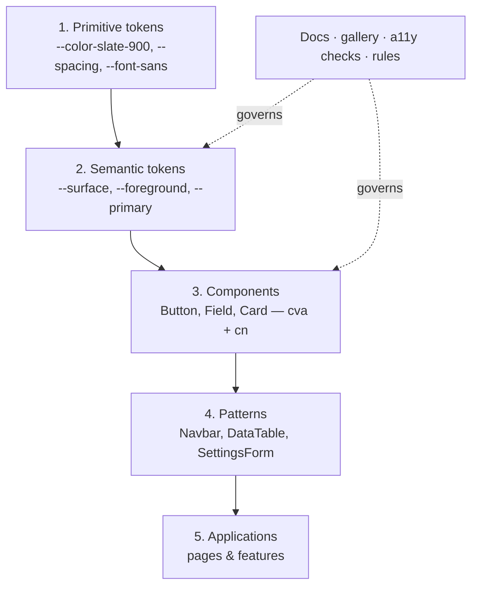

# Lesson 06 — Design System & Project Structure

## 🎯 Learning Objectives

- Describe a Tailwind-based design system as layers: tokens → semantic tokens → components → documentation
- Organize CSS into token, theme, base and utility files
- Structure a React/Vue project and a monorepo UI package
- Define component API rules (variants, `className`, composition, accessibility)
- Share a theme between apps with `@import` and `@source`
- Document and govern the system (gallery/Storybook, token rules, CI guards)

---

## Introduction

By Module 07 you had components, and by Module 06 you had tokens and themes. A **design system** is what you get when those become **shared, documented, governed** decisions instead of per-page choices. In Tailwind v4, the foundation is simply **a CSS file**.



**The rule that holds it together:** application code uses **semantic tokens and components**, never raw palette values.

---

## 1. Organize the CSS

```
src/styles/
├─ index.css        ← the entry point
├─ tokens.css       ← primitives and shape: @theme (fonts, radii, shadows, breakpoints)
├─ themes.css       ← semantic tokens per theme + @theme inline mapping
├─ base.css         ← @layer base (focus ring, element defaults)
└─ utilities.css    ← your @utility / @custom-variant definitions
```

```css
/* src/styles/index.css */
@import "tailwindcss";
@import "./tokens.css";
@import "./themes.css";
@import "./base.css";
@import "./utilities.css";
```

```css
/* tokens.css */
@theme {
  --font-sans: "Inter Variable", ui-sans-serif, system-ui, sans-serif;
  --radius-card: 1rem;
  --shadow-card: 0 1px 2px rgb(0 0 0 / 0.06), 0 8px 24px rgb(0 0 0 / 0.08);
  --text-eyebrow: 0.75rem;
  --text-eyebrow--line-height: 1rem;
}
```

```css
/* themes.css */
@custom-variant dark (&:where(.dark, .dark *));

:root {
  --surface: oklch(1 0 0);
  --foreground: oklch(0.21 0.02 260);
  --muted-foreground: oklch(0.47 0.02 260);
  --border: oklch(0.91 0.01 260);
  --primary: oklch(0.52 0.21 262);
  --primary-foreground: oklch(0.99 0 0);
  color-scheme: light;
}
.dark {
  --surface: oklch(0.18 0.01 260);
  --foreground: oklch(0.96 0.005 260);
  --muted-foreground: oklch(0.72 0.02 260);
  --border: oklch(0.32 0.01 260);
  --primary: oklch(0.72 0.16 262);
  --primary-foreground: oklch(0.15 0 0);
  color-scheme: dark;
}

@theme inline {
  --color-surface: var(--surface);
  --color-foreground: var(--foreground);
  --color-muted-foreground: var(--muted-foreground);
  --color-border: var(--border);
  --color-primary: var(--primary);
  --color-primary-foreground: var(--primary-foreground);
}
```

(Recall Module 06, lesson 09 for why `@theme inline`.)

> Splitting files is organization, not a requirement. A single `index.css` is fine for small projects.

---

## 2. Project structure

### React (feature-oriented)

```
src/
├─ styles/…
├─ lib/utils.js                ← cn()
├─ components/
│  ├─ ui/                      ← primitives: Button, Input, Badge, Dialog (design-system layer)
│  │   ├─ button.jsx
│  │   └─ button.variants.js   ← cva definition (optional split)
│  └─ patterns/                ← composed: Navbar, DataTable, PricingCard
├─ features/
│  ├─ billing/                 ← feature-specific components, hooks, API
│  └─ dashboard/
└─ routes/ or pages/
```

### Vue

```
src/
├─ assets/styles/…
├─ lib/utils.js
├─ components/ui/BaseButton.vue
├─ components/patterns/
├─ features/…
└─ views/
```

Rules of thumb:

- `ui/` knows nothing about your product (no API calls, no business words).
- `features/` may use `ui/` and `patterns/`; never the reverse.
- One component per file, PascalCase names, variants next to the component.

---

## 3. Component API rules

A good design-system component:

1. **Variants are props**, with a small vocabulary (`variant`/`intent`, `size`) defined with `cva` (Module 08, lesson 03).
2. **Accepts `className`/`class`** and merges it last with `cn()` so callers can adjust.
3. **Passes through native props** (`...props`, `v-bind="$attrs"`) such as `onClick`, `aria-*`, `disabled`.
4. **Composes with children/slots** rather than adding a prop for every inner element.
5. **Owns accessibility**: roles, labels, keyboard behavior, focus. Callers can't accidentally break it.
6. **Doesn't set outer margins**: spacing between components belongs to the parent layout (`gap-*`, `space-y-*`).
7. **Uses only semantic tokens** (`bg-surface`, `text-foreground`), so every theme works.
8. **Has every state**: hover, focus-visible, active, disabled, loading, error, empty where relevant.
9. **Works in all user preferences** (Lesson 02).

Polymorphism (render as a different element):

```jsx
// simplest: an `as` prop
export function Text({ as: Tag = "p", className, ...props }) {
  return <Tag className={cn("text-foreground", className)} {...props} />;
}
```

Radix's `Slot`/`asChild` is the more robust pattern when you need to merge props onto a child (Module 08, lesson 04).

---

## 4. Sharing a theme: monorepo

```
repo/
├─ packages/
│  └─ ui/
│     ├─ package.json        ← name: "@acme/ui"
│     ├─ theme.css           ← tokens + themes + base (no @import "tailwindcss")
│     └─ src/…               ← components using the tokens
└─ apps/
   ├─ web/src/styles.css
   └─ admin/src/styles.css
```

```css
/* apps/web/src/styles.css */
@import "tailwindcss" source("../src");          /* scan only this app... */
@import "@acme/ui/theme.css";                    /* ...share the tokens... */
@source "../../../packages/ui/src";              /* ...and scan the UI package's classes */
```

One theme file, many apps. Changing `--primary` updates all of them. (Module 06, lesson 08 covered `@source`.)

---

## 5. Document it

Undocumented components get rebuilt. Options, from cheap to rich:

| Option | Notes |
|---|---|
| **A gallery page** in the app (Module 07's stretch project) | Zero tooling; always in sync |
| **Storybook** | Interactive docs, a11y add-on, visual testing. Uses your Vite config, so add `tailwindcss()` to Storybook's Vite plugins and import the CSS in `preview` |
| **MDX / Markdown docs** | Token tables, usage rules, do/don't examples |

Document **tokens** as a table (name, purpose, light/dark values, contrast pairing). Document **rules** ("use `bg-surface`, never `bg-white`").

---

## 6. Governance and guards

A system only holds if it's enforced. Cheap, effective guards:

```bash
# CI step: no raw palette colors in feature code, only semantic tokens
if rg -n "\b(bg|text|border|ring|fill|stroke)-(slate|gray|zinc|red|blue|green|indigo)-[0-9]{2,3}\b" src/features; then
  echo "❌ Use semantic tokens (bg-surface, text-foreground, …), not raw palette colors."; exit 1
fi

# no v3-isms
if rg -n "@tailwind (base|components|utilities)|bg-opacity-|flex-shrink-|flex-grow-" src; then exit 1; fi
```

Plus:

- **Changes to tokens** go through review (they affect everything).
- **Version the UI package** (semver) and keep a changelog; deprecate before removing.
- **Visual regression** screenshots (Playwright, Chromatic) on component changes.
- **Accessibility tests** per component (axe via Storybook or Playwright).
- A short **STYLEGUIDE.md** (Lesson 08).

---

## 🧪 Practical Example — Scaffold the system

1. Create `src/styles/{index,tokens,themes,base,utilities}.css` from the snippets above.
2. In `components/ui/`, create `button.jsx` using `cva` + `cn` and **only semantic tokens**.
3. Create a `Gallery.jsx` page that renders every Button variant × size × state, in light and dark (add a theme toggle).
4. Add the CI guard script and make it fail by writing `bg-blue-500` in a feature file. Then fix it.
5. Write a token table in `docs/tokens.md` with each semantic token's purpose and contrast pairing.

---

## 📝 Revision Questions

<details>
<summary>1. What are the layers of a Tailwind-based design system?</summary>

Primitive tokens → semantic tokens → components → patterns → applications, with documentation and rules governing them.
</details>

<details>
<summary>2. Why should application code use semantic tokens rather than raw palette classes?</summary>

Semantic tokens change per theme and express intent, so themes, rebrands and dark mode work without editing application code.
</details>

<details>
<summary>3. Why shouldn't a design-system component set its own outer margin?</summary>

Spacing between components is a layout decision of the parent; baked-in margins make components hard to reuse.
</details>

<details>
<summary>4. How do two apps share one theme in a monorepo?</summary>

A shared `theme.css` imported by each app (`@import "@acme/ui/theme.css"`) plus `@source` pointing at the UI package's source so its classes are generated.
</details>

<details>
<summary>5. Name two automated guards that protect a design system.</summary>

A grep/lint step banning raw palette colors in feature code, and visual-regression or axe accessibility tests on components (also checks for v3 leftovers).
</details>
