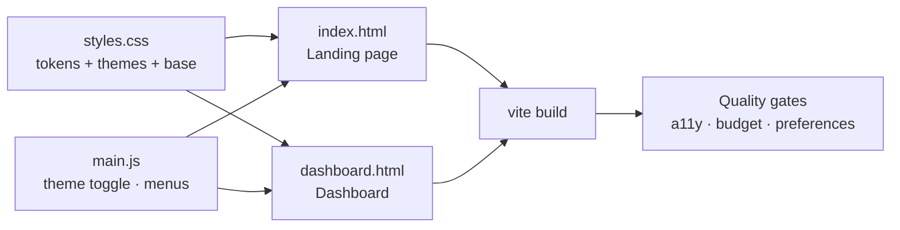

# Lesson 07 — Capstone: Landing Page & Dashboard

## 🎯 Learning Objectives

Build and ship a small two-page product, **"Atlas Analytics"**, applying all of Book 06:

- Tokens, semantic themes and dark mode (Module 06)
- Responsive layout, variants and states (Modules 02, 05)
- Accessible, keyboard-friendly components (Modules 07, 09)
- Preference support: reduced motion, contrast, forced colors (Lesson 02)
- A measured CSS budget (Lesson 03)

You'll deliver: a **marketing landing page** (`index.html`) and an **analytics dashboard** (`dashboard.html`), sharing one design system.



---

## 1. Requirements

**Landing page**

- Skip link, sticky navbar with mobile menu, dark-mode toggle
- Hero with primary and secondary calls to action
- 3 feature cards (equal-height), pricing (3 plans, one highlighted), FAQ (`<details name>`), final CTA, footer
- No horizontal scroll from 320px to 1440px

**Dashboard**

- Sidebar (hidden on mobile with an accessible toggle), top bar, theme toggle
- 4 KPI stat cards, a bar chart (**with a text alternative**), a "Recent orders" table with status badges and an empty state
- Table scrolls horizontally on small screens

**Quality gates (the grading rubric is in section 6)**

- Keyboard-only usable; visible focus everywhere
- Works with reduced motion, increased contrast, forced colors and dark mode
- No dynamic class names; no raw palette colors (only semantic tokens, plus status tokens)
- CSS under **25 kB gzip**

---

## 2. Setup

```bash
npm create vite@latest atlas-capstone -- --template vanilla
cd atlas-capstone
npm install
npm install tailwindcss @tailwindcss/vite
rm -f src/counter.js src/style.css public/vite.svg
```

**`vite.config.js`** (two pages):

```js
import { defineConfig } from "vite";
import tailwindcss from "@tailwindcss/vite";
import { resolve } from "node:path";

export default defineConfig({
  plugins: [tailwindcss()],
  build: {
    rollupOptions: {
      input: {
        main: resolve(import.meta.dirname, "index.html"),
        dashboard: resolve(import.meta.dirname, "dashboard.html"),
      },
    },
  },
});
```

**`src/styles.css`**

```css
@import "tailwindcss";

@custom-variant dark (&:where(.dark, .dark *));

:root {
  --surface: oklch(1 0 0);
  --surface-muted: oklch(0.97 0.005 260);
  --foreground: oklch(0.21 0.02 260);
  --muted-foreground: oklch(0.47 0.02 260);
  --border: oklch(0.88 0.01 260);
  --primary: oklch(0.52 0.21 262);
  --primary-foreground: oklch(0.99 0 0);
  --success: oklch(0.45 0.13 155);
  --warning: oklch(0.5 0.12 75);
  --danger: oklch(0.5 0.19 27);
  color-scheme: light;
}

.dark {
  --surface: oklch(0.18 0.01 260);
  --surface-muted: oklch(0.22 0.01 260);
  --foreground: oklch(0.96 0.005 260);
  --muted-foreground: oklch(0.72 0.02 260);
  --border: oklch(0.34 0.01 260);
  --primary: oklch(0.72 0.16 262);
  --primary-foreground: oklch(0.15 0 0);
  --success: oklch(0.78 0.15 155);
  --warning: oklch(0.82 0.13 80);
  --danger: oklch(0.75 0.16 27);
  color-scheme: dark;
}

@media (prefers-contrast: more) {
  :root { --muted-foreground: oklch(0.3 0.02 260); --border: oklch(0.45 0.02 260); }
  .dark { --muted-foreground: oklch(0.88 0.01 260); --border: oklch(0.6 0.01 260); }
}

@theme inline {
  --color-surface: var(--surface);
  --color-surface-muted: var(--surface-muted);
  --color-foreground: var(--foreground);
  --color-muted-foreground: var(--muted-foreground);
  --color-border: var(--border);
  --color-primary: var(--primary);
  --color-primary-foreground: var(--primary-foreground);
  --color-success: var(--success);
  --color-warning: var(--warning);
  --color-danger: var(--danger);
}

@theme {
  --font-sans: ui-sans-serif, system-ui, -apple-system, "Segoe UI", Roboto, sans-serif;
  --radius-card: 1rem;
}

@layer base {
  html { scroll-padding-top: 5rem; }
  body { @apply bg-surface text-foreground antialiased; }
  :focus-visible { outline: 2px solid var(--primary); outline-offset: 2px; }
}
```

**`src/main.js`**

```js
import "./styles.css";

const root = document.documentElement;

// Theme toggle(s)
document.querySelectorAll("[data-theme-toggle]").forEach((btn) => {
  btn.setAttribute("aria-pressed", String(root.classList.contains("dark")));
  btn.addEventListener("click", () => {
    const dark = !root.classList.contains("dark");
    root.classList.toggle("dark", dark);
    localStorage.theme = dark ? "dark" : "light";
    document.querySelectorAll("[data-theme-toggle]").forEach((b) => b.setAttribute("aria-pressed", String(dark)));
  });
});

// Disclosure menus: <button data-menu-toggle aria-controls="id"> + <div id hidden>
document.querySelectorAll("[data-menu-toggle]").forEach((btn) => {
  const panel = document.getElementById(btn.getAttribute("aria-controls"));
  const set = (open) => { btn.setAttribute("aria-expanded", String(open)); panel.hidden = !open; };
  btn.addEventListener("click", () => set(btn.getAttribute("aria-expanded") !== "true"));
  document.addEventListener("keydown", (e) => {
    if (e.key === "Escape" && btn.getAttribute("aria-expanded") === "true") { set(false); btn.focus(); }
  });
  matchMedia("(min-width: 48rem)").addEventListener("change", (e) => e.matches && set(false));
});
```

---

## 3. Landing page — `index.html`

```html
<!doctype html>
<html lang="en">
<head>
  <meta charset="UTF-8" />
  <meta name="viewport" content="width=device-width, initial-scale=1" />
  <meta name="color-scheme" content="light dark" />
  <title>Atlas Analytics — Know your numbers</title>
  <script>
    document.documentElement.classList.toggle("dark",
      localStorage.theme === "dark" || (!("theme" in localStorage) && matchMedia("(prefers-color-scheme: dark)").matches));
  </script>
  <script type="module" src="/src/main.js"></script>
</head>
<body>
  <a href="#main" class="sr-only focus:not-sr-only focus:fixed focus:start-3 focus:top-3 focus:z-50 focus:rounded-lg focus:bg-primary focus:px-4 focus:py-2 focus:text-primary-foreground">Skip to content</a>

  <header class="sticky top-0 z-40 border-b border-border bg-surface supports-[backdrop-filter]:bg-surface/80 supports-[backdrop-filter]:backdrop-blur">
    <nav aria-label="Primary" class="mx-auto flex h-16 max-w-6xl items-center justify-between px-4">
      <a href="/" class="text-lg font-bold tracking-tight">Atlas</a>
      <ul role="list" class="hidden items-center gap-6 md:flex">
        <li><a class="text-sm text-muted-foreground hover:text-foreground" href="#features">Features</a></li>
        <li><a class="text-sm text-muted-foreground hover:text-foreground" href="#pricing">Pricing</a></li>
        <li><a class="text-sm text-muted-foreground hover:text-foreground" href="#faq">FAQ</a></li>
        <li><a class="text-sm text-muted-foreground hover:text-foreground" href="/dashboard.html">Demo</a></li>
      </ul>
      <div class="flex items-center gap-2">
        <button data-theme-toggle type="button" aria-pressed="false" class="grid size-11 place-items-center rounded-lg hover:bg-surface-muted aria-pressed:bg-surface-muted">
          <span class="sr-only">Dark mode</span><span aria-hidden="true">◐</span>
        </button>
        <a href="#pricing" class="hidden min-h-11 items-center rounded-lg bg-primary px-4 text-sm font-medium text-primary-foreground hover:opacity-90 md:inline-flex">Get started</a>
        <button data-menu-toggle type="button" aria-expanded="false" aria-controls="mobile-menu" class="group grid size-11 place-items-center rounded-lg hover:bg-surface-muted md:hidden">
          <span class="sr-only">Menu</span>
          <span aria-hidden="true" class="group-aria-expanded:hidden">☰</span>
          <span aria-hidden="true" class="hidden group-aria-expanded:inline">✕</span>
        </button>
      </div>
    </nav>
    <div id="mobile-menu" hidden class="border-t border-border bg-surface md:hidden">
      <ul role="list" class="space-y-1 px-4 py-3">
        <li><a class="block rounded-lg px-3 py-3 hover:bg-surface-muted" href="#features">Features</a></li>
        <li><a class="block rounded-lg px-3 py-3 hover:bg-surface-muted" href="#pricing">Pricing</a></li>
        <li><a class="block rounded-lg px-3 py-3 hover:bg-surface-muted" href="#faq">FAQ</a></li>
        <li><a class="block rounded-lg bg-primary px-3 py-3 text-center text-primary-foreground" href="#pricing">Get started</a></li>
      </ul>
    </div>
  </header>

  <main id="main">
    <!-- Hero -->
    <section class="mx-auto max-w-6xl px-4 py-20 text-center sm:py-28">
      <p class="text-sm font-semibold tracking-wide text-primary uppercase">Analytics for small teams</p>
      <h1 class="mx-auto mt-3 max-w-3xl text-4xl font-bold tracking-tight text-balance sm:text-6xl">Know your numbers without a data team.</h1>
      <p class="mx-auto mt-6 max-w-xl text-lg text-pretty text-muted-foreground">Atlas turns your events into clear dashboards in minutes. No SQL, no setup meetings.</p>
      <div class="mt-10 flex flex-col items-center justify-center gap-3 sm:flex-row">
        <a href="#pricing" class="inline-flex min-h-11 items-center rounded-lg bg-primary px-6 font-medium text-primary-foreground hover:opacity-90">Start free</a>
        <a href="/dashboard.html" class="inline-flex min-h-11 items-center rounded-lg border border-border px-6 font-medium hover:bg-surface-muted">See the demo →</a>
      </div>
    </section>

    <!-- Features -->
    <section id="features" class="border-y border-border bg-surface-muted py-20">
      <div class="mx-auto max-w-6xl px-4">
        <h2 class="text-center text-3xl font-bold tracking-tight">Everything you need, nothing you don't</h2>
        <ul role="list" class="mt-12 grid gap-6 sm:grid-cols-2 lg:grid-cols-3">
          <li class="flex flex-col rounded-card border border-border bg-surface p-6">
            <h3 class="text-lg font-semibold">Live dashboards</h3>
            <p class="mt-2 text-sm text-muted-foreground">See traffic, signups and revenue update in real time.</p>
            <a href="#" class="mt-auto pt-4 text-sm font-medium text-primary underline-offset-4 hover:underline">Learn more<span class="sr-only"> about live dashboards</span> →</a>
          </li>
          <li class="flex flex-col rounded-card border border-border bg-surface p-6">
            <h3 class="text-lg font-semibold">Privacy first</h3>
            <p class="mt-2 text-sm text-muted-foreground">No cookies, no personal data stored. Compliant by default, so you can ship with confidence and skip the consent banner for analytics.</p>
            <a href="#" class="mt-auto pt-4 text-sm font-medium text-primary underline-offset-4 hover:underline">Learn more<span class="sr-only"> about privacy</span> →</a>
          </li>
          <li class="flex flex-col rounded-card border border-border bg-surface p-6">
            <h3 class="text-lg font-semibold">Share anywhere</h3>
            <p class="mt-2 text-sm text-muted-foreground">Send a link or schedule a weekly report.</p>
            <a href="#" class="mt-auto pt-4 text-sm font-medium text-primary underline-offset-4 hover:underline">Learn more<span class="sr-only"> about sharing</span> →</a>
          </li>
        </ul>
      </div>
    </section>

    <!-- Pricing -->
    <section id="pricing" class="mx-auto max-w-6xl px-4 py-20">
      <h2 class="text-center text-3xl font-bold tracking-tight">Simple pricing</h2>
      <div class="mt-12 grid gap-6 lg:grid-cols-3">
        <section aria-labelledby="p1" class="flex flex-col rounded-card border border-border p-8">
          <h3 id="p1" class="text-lg font-semibold">Starter</h3>
          <p class="mt-4"><span class="text-4xl font-bold tabular-nums">$0</span> <span class="text-sm text-muted-foreground">/month</span></p>
          <ul role="list" class="mt-6 space-y-2 text-sm text-muted-foreground"><li>1 site</li><li>10k events</li></ul>
          <a href="#" class="mt-8 inline-flex min-h-11 items-center justify-center rounded-lg border border-border font-medium hover:bg-surface-muted">Start free</a>
        </section>
        <section aria-labelledby="p2" class="relative flex flex-col rounded-card border-2 border-primary p-8 lg:-translate-y-2">
          <p class="absolute -top-3 start-1/2 -translate-x-1/2 rounded-full bg-primary px-3 py-0.5 text-xs font-semibold text-primary-foreground rtl:translate-x-1/2">Most popular</p>
          <h3 id="p2" class="text-lg font-semibold">Pro</h3>
          <p class="mt-4"><span class="text-4xl font-bold tabular-nums">$19</span> <span class="text-sm text-muted-foreground">/month</span></p>
          <ul role="list" class="mt-6 space-y-2 text-sm text-muted-foreground"><li>10 sites</li><li>1M events</li><li>Weekly reports</li></ul>
          <a href="#" class="mt-8 inline-flex min-h-11 items-center justify-center rounded-lg bg-primary font-medium text-primary-foreground hover:opacity-90">Start trial</a>
        </section>
        <section aria-labelledby="p3" class="flex flex-col rounded-card border border-border p-8">
          <h3 id="p3" class="text-lg font-semibold">Team</h3>
          <p class="mt-4"><span class="text-4xl font-bold tabular-nums">$49</span> <span class="text-sm text-muted-foreground">/month</span></p>
          <ul role="list" class="mt-6 space-y-2 text-sm text-muted-foreground"><li>Unlimited sites</li><li>10M events</li><li>Priority support</li></ul>
          <a href="#" class="mt-8 inline-flex min-h-11 items-center justify-center rounded-lg border border-border font-medium hover:bg-surface-muted">Contact sales</a>
        </section>
      </div>
    </section>

    <!-- FAQ -->
    <section id="faq" class="mx-auto max-w-2xl px-4 pb-20">
      <h2 class="text-center text-3xl font-bold tracking-tight">Questions</h2>
      <div class="mt-8 divide-y divide-border rounded-card border border-border">
        <details name="faq" class="group p-4" open>
          <summary class="flex min-h-11 cursor-pointer list-none items-center justify-between gap-4 font-medium [&::-webkit-details-marker]:hidden">
            Do I need to install anything?
            <span aria-hidden="true" class="transition-transform motion-reduce:transition-none group-open:rotate-180">⌄</span>
          </summary>
          <p class="mt-2 text-sm text-muted-foreground">One small script tag. No cookies required.</p>
        </details>
        <details name="faq" class="group p-4">
          <summary class="flex min-h-11 cursor-pointer list-none items-center justify-between gap-4 font-medium [&::-webkit-details-marker]:hidden">
            Can I cancel anytime?
            <span aria-hidden="true" class="transition-transform motion-reduce:transition-none group-open:rotate-180">⌄</span>
          </summary>
          <p class="mt-2 text-sm text-muted-foreground">Yes, from your account page in two clicks.</p>
        </details>
      </div>
    </section>
  </main>

  <footer class="border-t border-border py-10 text-center text-sm text-muted-foreground">
    <p>© 2026 Atlas Analytics. <a class="underline underline-offset-4 hover:text-foreground" href="#">Privacy</a></p>
  </footer>
</body>
</html>
```

---

## 4. Dashboard — `dashboard.html`

```html
<!doctype html>
<html lang="en">
<head>
  <meta charset="UTF-8" />
  <meta name="viewport" content="width=device-width, initial-scale=1" />
  <meta name="color-scheme" content="light dark" />
  <title>Dashboard — Atlas Analytics</title>
  <script>
    document.documentElement.classList.toggle("dark",
      localStorage.theme === "dark" || (!("theme" in localStorage) && matchMedia("(prefers-color-scheme: dark)").matches));
  </script>
  <script type="module" src="/src/main.js"></script>
</head>
<body class="min-h-dvh md:grid md:grid-cols-[14rem_1fr]">
  <a href="#main" class="sr-only focus:not-sr-only focus:fixed focus:start-3 focus:top-3 focus:z-50 focus:rounded-lg focus:bg-primary focus:px-4 focus:py-2 focus:text-primary-foreground">Skip to content</a>

  <!-- Sidebar -->
  <aside class="border-b border-border md:sticky md:top-0 md:h-dvh md:border-e md:border-b-0">
    <div class="flex h-16 items-center justify-between px-4">
      <a href="/" class="text-lg font-bold">Atlas</a>
      <button data-menu-toggle type="button" aria-expanded="false" aria-controls="side-nav" class="grid size-11 place-items-center rounded-lg hover:bg-surface-muted md:hidden">
        <span class="sr-only">Navigation</span><span aria-hidden="true">☰</span>
      </button>
    </div>
    <nav id="side-nav" hidden aria-label="Dashboard" class="px-2 pb-4 md:block!">
      <ul role="list" class="space-y-1">
        <li><a href="#" aria-current="page" class="flex min-h-11 items-center rounded-lg px-3 text-sm hover:bg-surface-muted aria-[current=page]:bg-surface-muted aria-[current=page]:font-semibold forced-colors:aria-[current=page]:border forced-colors:aria-[current=page]:border-[Highlight]">Overview</a></li>
        <li><a href="#" class="flex min-h-11 items-center rounded-lg px-3 text-sm text-muted-foreground hover:bg-surface-muted hover:text-foreground">Reports</a></li>
        <li><a href="#" class="flex min-h-11 items-center rounded-lg px-3 text-sm text-muted-foreground hover:bg-surface-muted hover:text-foreground">Settings</a></li>
      </ul>
    </nav>
  </aside>

  <div class="min-w-0">
    <header class="flex h-16 items-center justify-between gap-4 border-b border-border px-4">
      <h1 class="text-lg font-semibold">Overview</h1>
      <button data-theme-toggle type="button" aria-pressed="false" class="grid size-11 place-items-center rounded-lg hover:bg-surface-muted aria-pressed:bg-surface-muted">
        <span class="sr-only">Dark mode</span><span aria-hidden="true">◐</span>
      </button>
    </header>

    <main id="main" class="space-y-8 p-4 sm:p-6">
      <!-- KPIs -->
      <section aria-label="Key metrics">
        <dl class="grid gap-4 sm:grid-cols-2 xl:grid-cols-4">
          <div class="rounded-card border border-border p-5"><dt class="text-sm text-muted-foreground">Revenue</dt><dd class="mt-1 text-3xl font-semibold tabular-nums">$48,200</dd><dd class="mt-2 text-xs text-success">▲ 12.5% vs last month</dd></div>
          <div class="rounded-card border border-border p-5"><dt class="text-sm text-muted-foreground">Visitors</dt><dd class="mt-1 text-3xl font-semibold tabular-nums">84,310</dd><dd class="mt-2 text-xs text-success">▲ 4.1% vs last month</dd></div>
          <div class="rounded-card border border-border p-5"><dt class="text-sm text-muted-foreground">Conversion</dt><dd class="mt-1 text-3xl font-semibold tabular-nums">3.2%</dd><dd class="mt-2 text-xs text-danger">▼ 0.3% vs last month</dd></div>
          <div class="rounded-card border border-border p-5"><dt class="text-sm text-muted-foreground">Churn</dt><dd class="mt-1 text-3xl font-semibold tabular-nums">2.4%</dd><dd class="mt-2 text-xs text-muted-foreground">No change</dd></div>
        </dl>
      </section>

      <!-- Chart with text alternative -->
      <section aria-labelledby="chart-title" class="rounded-card border border-border p-5">
        <h2 id="chart-title" class="font-semibold">Revenue by month</h2>
        <p id="chart-desc" class="sr-only">Bar chart. Revenue grew from 28 thousand dollars in May to 48 thousand dollars in October. A data table follows.</p>
        <div role="img" aria-labelledby="chart-title" aria-describedby="chart-desc" class="mt-6 flex h-48 items-end gap-3">
          <div class="flex-1 rounded-t bg-primary/70" style="--h:58%;height:var(--h)"></div>
          <div class="flex-1 rounded-t bg-primary/70" style="--h:64%;height:var(--h)"></div>
          <div class="flex-1 rounded-t bg-primary/70" style="--h:71%;height:var(--h)"></div>
          <div class="flex-1 rounded-t bg-primary/70" style="--h:79%;height:var(--h)"></div>
          <div class="flex-1 rounded-t bg-primary/70" style="--h:88%;height:var(--h)"></div>
          <div class="flex-1 rounded-t bg-primary forced-colors:bg-[Highlight]" style="--h:100%;height:var(--h)"></div>
        </div>
        <p class="mt-2 flex justify-between text-xs text-muted-foreground" aria-hidden="true"><span>May</span><span>Jun</span><span>Jul</span><span>Aug</span><span>Sep</span><span>Oct</span></p>
      </section>

      <!-- Table -->
      <section aria-labelledby="orders-title">
        <h2 id="orders-title" class="mb-3 font-semibold">Recent orders</h2>
        <div class="overflow-x-auto rounded-card border border-border">
          <table class="min-w-full divide-y divide-border text-sm">
            <caption class="sr-only">Recent orders with status and amount</caption>
            <thead class="bg-surface-muted text-start text-xs font-semibold tracking-wide text-muted-foreground uppercase">
              <tr><th scope="col" class="px-4 py-3 text-start">Order</th><th scope="col" class="px-4 py-3 text-start">Customer</th><th scope="col" class="px-4 py-3 text-start">Status</th><th scope="col" class="px-4 py-3 text-end">Amount</th></tr>
            </thead>
            <tbody class="divide-y divide-border">
              <tr><td class="px-4 py-3 font-medium whitespace-nowrap">#1042</td><td class="px-4 py-3">Acme Corp</td>
                  <td class="px-4 py-3"><span class="inline-flex items-center gap-1.5 rounded-full border border-border px-2.5 py-0.5 text-xs font-medium"><span class="size-1.5 rounded-full bg-success forced-colors:bg-[Highlight]" aria-hidden="true"></span>Paid</span></td>
                  <td class="px-4 py-3 text-end tabular-nums">$1,200.00</td></tr>
              <tr><td class="px-4 py-3 font-medium whitespace-nowrap">#1041</td><td class="px-4 py-3">Globex</td>
                  <td class="px-4 py-3"><span class="inline-flex items-center gap-1.5 rounded-full border border-border px-2.5 py-0.5 text-xs font-medium"><span class="size-1.5 rounded-full bg-warning forced-colors:bg-[Highlight]" aria-hidden="true"></span>Pending</span></td>
                  <td class="px-4 py-3 text-end tabular-nums">$845.50</td></tr>
              <tr><td class="px-4 py-3 font-medium whitespace-nowrap">#1040</td><td class="px-4 py-3">Initech</td>
                  <td class="px-4 py-3"><span class="inline-flex items-center gap-1.5 rounded-full border border-border px-2.5 py-0.5 text-xs font-medium"><span class="size-1.5 rounded-full bg-danger forced-colors:bg-[Highlight]" aria-hidden="true"></span>Failed</span></td>
                  <td class="px-4 py-3 text-end tabular-nums">$310.00</td></tr>
            </tbody>
          </table>
        </div>
      </section>
    </main>
  </div>
</body>
</html>
```

Notes on what the reference solution demonstrates:

- **Status is text + dot**, never color alone, and the dot survives forced colors.
- **`md:block!`** uses the v4 important suffix to override the `hidden` attribute at `md` (otherwise the sidebar nav stays hidden on desktop).
- The chart is `role="img"` with a text description; for real products add the data table too.
- `text-start`/`text-end`, `border-e`, `start-3`, `rtl:` — logical from day one (Lesson 05).

---

## 5. Run, measure, test

```bash
npm run dev        # develop
npm run build      # production build
npm run preview    # serve dist/
```

```bash
# CSS budget
node -e "const fs=require('fs'),z=require('zlib');const t=fs.readdirSync('dist/assets').filter(f=>f.endsWith('.css')).reduce((n,f)=>n+z.gzipSync(fs.readFileSync('dist/assets/'+f)).length,0);console.log('CSS gzip bytes:',t);process.exit(t>25*1024?1:0)"
```

Checklist:

1. **Keyboard only** through both pages (skip link, menus, FAQ, tables).
2. **DevTools Rendering**: emulate reduced motion, increased contrast, forced colors, dark.
3. **Resize** from 320px to 1440px; zoom to 200%.
4. **Lighthouse** (Accessibility, Best Practices, SEO) and an axe scan.
5. **`dir="rtl"`** on `<html>`: does the layout mirror sensibly?
6. **Guards**: `rg` for raw palette colors and v3-isms (Lessons 05–06).

---

## 6. Grading rubric (100 points)

| Area | Points | What "full marks" looks like |
|---|---|---|
| Responsive layout | 15 | No horizontal scroll 320–1440px; sensible breakpoints; equal-height cards |
| Design system | 15 | Semantic tokens only; one theme file; dark mode works with no per-component hacks |
| Accessibility | 25 | Landmarks, headings, labels, skip link, focus visible, ≥ 44px targets, contrast ≥ AA, chart alternative |
| User preferences | 10 | Reduced motion, increased contrast, forced colors verified |
| Components | 10 | Navbar, FAQ, table, stat cards behave and are reusable |
| Performance | 10 | CSS under budget; sized images (if any); no layout shift |
| Code quality | 10 | No dynamic class names, no v3-isms, readable class order, no stray `!` |
| Stretch | 5 | Any of: RTL pass, print styles, Playwright axe test, Storybook |

---

## 🧪 Stretch ideas

- Convert both pages to React or Vue components (Module 08) with `cva` + `cn`.
- Add `dir="rtl"` support, then a real Arabic translation.
- Add a `print:` stylesheet for the dashboard.
- Add Playwright tests: axe scan, keyboard navigation, and screenshots in light/dark.
- Replace the CSS bars with an accessible SVG chart.

---

## 📝 Revision Questions

<details>
<summary>1. Why does the chart have both `role="img"` and a description?</summary>

Bars made of `<div>`s have no meaning to assistive tech; `role="img"` with a label and description conveys the data, and a table offers the details.
</details>

<details>
<summary>2. Why is status shown with text and a dot, not just a colored badge?</summary>

Color alone fails for color-blind users and forced-colors mode; text carries the meaning.
</details>

<details>
<summary>3. Why does the sidebar `<nav>` use `md:block!`?</summary>

The `hidden` attribute wins over normal display utilities, so the important suffix is used to show it at `md` and above while keeping it toggleable on mobile.
</details>

<details>
<summary>4. How does the page avoid a flash of the wrong theme?</summary>

A tiny blocking inline script in `<head>` applies the `dark` class from `localStorage`/`prefers-color-scheme` before first paint.
</details>

<details>
<summary>5. Which guards would catch a developer using `bg-blue-500` directly?</summary>

A CI grep/lint for raw palette colors in feature code, and code review against the style guide.
</details>
