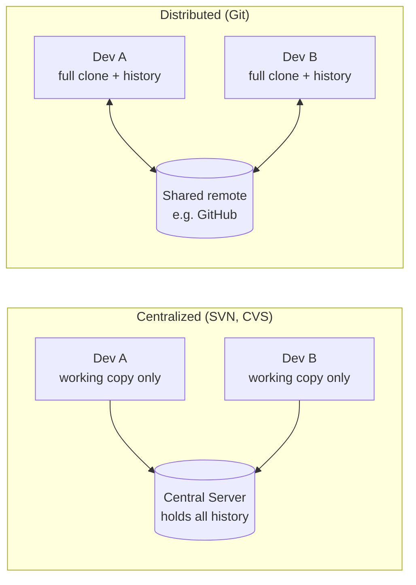

# Lesson 01 — Version Control and Why Git

> **Module 01 — Git Fundamentals & Setup** · Book 07 — Git & GitHub

## 🎯 Learning Objectives

By the end of this lesson you will be able to:

- Explain what version control is and which problems it solves
- Tell local, centralized and distributed version control systems apart
- Describe where Git came from and the design goals behind it
- Explain the difference between **Git** and **GitHub**
- Use the core vocabulary: repository, commit, branch, remote, clone, working tree

---

## 📖 Introduction

You have already built real projects in this curriculum: HTML pages in Book 02, styled layouts in Book 03, JavaScript apps in Book 04, and Bootstrap and Tailwind interfaces in Books 05 and 06. At some point you probably did this:

portfolio/
portfolio-copy/
portfolio-final/
portfolio-final-v2/
portfolio-final-v2-REAL/
portfolio-final-v2-REAL-fixed-navbar/

Copying folders is a version control system, just a terrible one. It tells you nothing about **what** changed, **why** it changed, **who** changed it, or how to combine two people's work. It also eats disk space, and nobody knows which copy is the real one.

**Version control** solves all of this. This lesson explains the idea, the history, and why Git became the tool nearly everyone uses.

---

## 1. What Is Version Control?

A **version control system (VCS)** records changes to files over time so you can:

| Capability | What it means |
|---|---|
| **History** | See every change ever made, who made it, when, and why |
| **Revert** | Return a file or the whole project to an earlier state |
| **Compare** | See exactly what differs between two versions |
| **Branch** | Work on a feature or experiment without disturbing the main code |
| **Collaborate** | Let many people work on the same project and merge their work |
| **Back up** | Every copy of the project carries its own history |

Think of it as an unlimited "undo" for an entire project, combined with a logbook that explains every change.

---

## 2. Three Generations of Version Control

### 2.1 Local version control

The earliest approach kept a simple database of changes on one machine (tools like RCS). It protected a single developer from their own mistakes but did nothing for teamwork.

### 2.2 Centralized version control (CVCS)

Tools like **CVS**, **Subversion (SVN)** and **Perforce** keep the history on **one central server**. Developers check out files from it and commit back to it.

- ✅ Everyone can see roughly what everyone else is doing
- ❌ **Single point of failure**: if the server is down, nobody can commit or view history
- ❌ If the server disk is lost and there are no backups, the history is gone
- ❌ Most operations need a network connection

### 2.3 Distributed version control (DVCS)

Tools like **Git** and **Mercurial** give **every developer a full copy of the repository, including its entire history**. A server (such as GitHub) is just another copy that everyone agrees to treat as the shared one.

- ✅ Most operations are local, so they are fast and work offline
- ✅ Every clone is a full backup
- ✅ You can commit, branch and browse history on a plane
- ✅ Many workflows are possible, because no copy is special by design

---

## 3. Where Git Came From

- In **2005**, the Linux kernel community lost access to the proprietary DVCS (BitKeeper) it had been using for free.
- **Linus Torvalds**, the creator of Linux, wrote a replacement himself, starting in April 2005 and reaching a usable state within weeks.
- He set clear goals:

| Design goal | Why it mattered |
|---|---|
| **Speed** | The Linux kernel is huge; operations had to be near-instant |
| **Simple design** | Easy to reason about and reliable |
| **Strong support for non-linear development** | Thousands of parallel branches must be cheap |
| **Fully distributed** | No single server dependency |
| **Able to handle large projects** | Kernel-scale history and contributors |

Git is free, open source, and maintained by a worldwide community. Releases arrive roughly every 12 weeks; this book targets **Git 2.55 (June 2026) or newer**, and Module 07 explains the upcoming Git 3.0.

---

## 4. Why Git Won

- **Branching is cheap.** Creating a branch is nearly instant (Module 03 shows why).
- **It is fast.** History, diffs and commits happen locally.
- **It scales.** Tiny scripts to the Linux kernel and Windows-scale monorepos use it.
- **The ecosystem is enormous.** GitHub, GitLab, Bitbucket, every editor, every CI system and every package workflow assumes Git.
- **It is the default skill.** Developer surveys have consistently put Git use above 90% among professional developers, so every job, tutorial and open-source project expects you to know it.

---

## 5. Git vs GitHub — Not the Same Thing

This is one of the most common beginner (and interview) confusions.

| | **Git** | **GitHub** |
|---|---|---|
| What it is | A version control **tool** | A **web platform** that hosts Git repositories |
| Where it runs | On your computer | In the cloud |
| Needs internet? | No (for most commands) | Yes |
| Created by | Linus Torvalds (2005) | GitHub Inc. (now owned by Microsoft) |
| Adds | History, branches, merging | Pull requests, issues, Actions, Pages, Copilot, access control |

Alternatives to GitHub exist (GitLab, Bitbucket, Codeberg and others, covered in Module 13), but they all host **Git** repositories. Learn Git once and it works everywhere.

---

## 6. Core Vocabulary

| Term | Meaning |
|---|---|
| **Repository (repo)** | A project folder plus its complete history, stored in a hidden `.git` directory |
| **Working tree** | The actual files you see and edit |
| **Commit** | A saved snapshot of the project, with a message, author and timestamp |
| **Branch** | A movable label pointing at a line of commits |
| **Remote** | A copy of the repository hosted elsewhere (e.g. on GitHub) |
| **Clone** | Download a full copy of a remote repository, history included |
| **HEAD** | A pointer to the commit/branch you are currently on |

You will meet each of these properly in the lessons ahead. For now, recognize the words.

---

## 🛠️ Practical Example — Audit Your Own History

No installation needed yet. Take any project you built earlier in this curriculum and answer on paper:

1. How many copies or "versions" of it exist on your computer right now?
2. If a bug appeared today, could you find out **which change** introduced it?
3. If you wanted to try a redesign without risking the working version, what would you do today?
4. If a friend joined the project, how would you merge your edits with theirs?

Write down your answers. By the end of Module 03 you will answer every one of these with a single Git command.

---

## 📝 Revision Questions

**1. What is the main weakness of centralized version control?**

Show answer

The central server is a single point of failure. If it is down nobody can commit or view history, and if its storage is lost without backups the whole history is lost. Most operations also need a network connection.

**2. What does "distributed" mean in a distributed VCS?**

Show answer

Every developer's clone contains the full repository with its complete history, not just the latest files. Any clone can serve as a backup, and most operations work offline.

**3. Who created Git, and why?**

Show answer

Linus Torvalds, in 2005, after the Linux kernel community lost access to BitKeeper. He wanted a fast, simple, fully distributed system that handled non-linear development and very large projects.

**4. What is the difference between Git and GitHub?**

Show answer

Git is the open-source version control tool that runs locally. GitHub is a hosting platform for Git repositories that adds collaboration features such as pull requests, issues and Actions.

**5. Where does Git store a project's history?**

Show answer

In a hidden `.git` directory at the root of the repository, which is why every clone has the full history.

---

➡️ **Next:** Lesson 02 — Snapshots and the Three States
