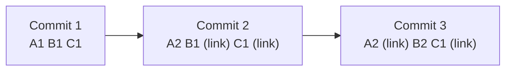
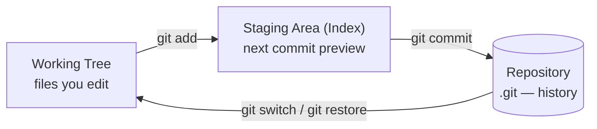
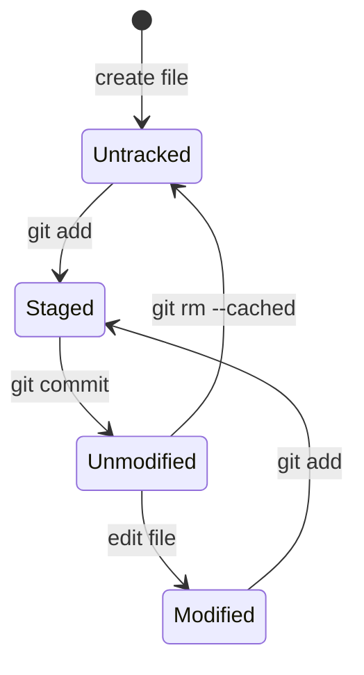

# Lesson 02 — Snapshots and the Three States

> **Module 01 — Git Fundamentals & Setup** · Book 07 — Git & GitHub

## 🎯 Learning Objectives

By the end of this lesson you will be able to:

- Explain why Git is described as storing **snapshots**, not differences
- Describe how Git guarantees data integrity with hashes
- Name the **three states** a file can be in and the **three areas** that hold them
- Trace a file through its lifecycle (untracked → staged → committed)
- Recognize the main contents of the `.git` directory

---

## 📖 Introduction

Lesson 01 explained *why* version control matters. Before you type a single Git command, you need the mental model of *how Git thinks*. Almost every confusing moment later (staging, resetting, merging) becomes simple once this picture is clear. Spend extra time here; it pays off in every later module.

---

## 1. Snapshots, Not Differences

Many older systems store a project as **a base file plus a list of changes (deltas)** per version.

Git thinks differently. Every time you commit, Git takes a **snapshot of what all your files look like at that moment** and stores a reference to it.

- If a file **changed**, Git stores the new version of it.
- If a file **did not change**, Git does not store it again; it just links to the identical file it already has.

Why this matters:

- Branching and switching are fast, because each commit is a complete picture rather than something to be re-assembled from deltas.
- Comparing any two commits is straightforward.
- Git behaves like a **mini filesystem with a time machine**.

---

## 2. Nearly Everything Is Local

Because every clone has the entire history, Git rarely needs a network:

- Browsing history, diffing, committing, branching and merging all run on your machine.
- You only touch the network when you **share** (push) or **fetch** work from a remote (Module 04).

---

## 3. Integrity: Everything Is Hashed

Everything Git stores is identified by a **checksum**, a long hexadecimal fingerprint computed from the content.

- Git has traditionally used **SHA-1** (40 hex characters), e.g. `a3f5c8e1b7...`
- A newer **SHA-256** mode (64 hex characters) exists, and Git 3.0 plans to make it the default for new repositories (Module 07).

Two consequences:

1. **You cannot change a file, a commit or its history without Git noticing.** If content changes, its hash changes.
2. Git can detect corruption, so data loss goes unnoticed far less often than in many systems.

You will usually use only the first 7 or so characters of a hash, e.g. `a3f5c8e`.

---

## 4. Git Mostly Adds Data

Almost every Git action **adds** information to the database rather than deleting it. That is why it is hard to lose committed work. In Module 02 you will meet `reflog`, which can recover commits even after you "lose" them.

> **Rule of thumb:** If it is committed, it is very hard to lose. If it is only in your working tree and was never staged or committed, Git cannot save you.

---

## 5. The Three States

A file in a Git repository is always in one of three states:

| State | Meaning |
|---|---|
| **Modified** | You changed the file, but have not told Git to include it in the next snapshot |
| **Staged** | You marked the changed file to go into your next commit |
| **Committed** | The change is safely stored in the local database (repository) |

---

## 6. The Three Areas

Those states correspond to three places:

| Area | Also called | What lives there |
|---|---|---|
| **Working tree** | Working directory | The real files you see and edit |
| **Staging area** | **Index** | A list of what will go into your next commit |
| **Repository** | The `.git` directory | The permanent history of commits |

### Why does a staging area exist?

It lets you **craft commits deliberately**. Suppose you fixed a bug and also reformatted an unrelated file. You can stage only the bug fix, commit it with a clear message, then commit the formatting separately. Clean history makes review, debugging and reverting dramatically easier (Module 02 goes deeper with interactive staging).

---

## 7. A File's Lifecycle

Every file in your working tree is either **tracked** (Git knows about it) or **untracked** (Git does not).

You will see these exact words in the output of `git status`, the command you will use more than any other.

---

## 8. What's Inside `.git`?

When you create a repository, Git creates a hidden `.git` folder. **That folder is the repository.** Delete it and the project becomes ordinary files again with no history.

| Item | Purpose |
|---|---|
| `HEAD` | Points to the branch or commit you are currently on |
| `config` | This repository's settings |
| `objects/` | The database of all snapshots, files and commits |
| `refs/` | Pointers to commits (branches, tags) |
| `index` | The staging area |
| `hooks/` | Scripts that can run on events such as commit (Module 08) |

> ⚠️ **Never edit files in `.git` by hand** while learning. Module 07 explores them safely.

---

## 🛠️ Practical Example — Trace a File by Hand

Git is not installed yet (Lesson 03), so do this as a thought exercise. You will run the real commands in Lesson 05.

You create `index.html` in an empty project folder, then follow this story. Fill in the state after each step.

| Step | Action | State of `index.html` |
|---|---|---|
| 1 | Create the file | ? |
| 2 | `git add index.html` | ? |
| 3 | `git commit -m "Add homepage"` | ? |
| 4 | Edit the file's title | ? |
| 5 | `git add index.html` | ? |
| 6 | Edit the file again (a typo fix) | ? |

Show answers

1. **Untracked**
2. **Staged**
3. **Committed** (unmodified)
4. **Modified**
5. **Staged**
6. **Modified and staged at the same time**: the staged version holds the title edit, while the working tree also holds the newer typo fix. If you committed now, only the title edit would go in. This is exactly why the staging area is powerful, and why `git status` can show the same file in two sections.

---

## 📝 Revision Questions

**1. Does Git store differences or snapshots?**

Show answer

Snapshots. Each commit records what all tracked files look like at that moment. Unchanged files are stored once and linked to rather than copied again.

**2. Name the three states and the three areas.**

Show answer

States: modified, staged, committed. Areas: working tree, staging area (index), repository (`.git`).

**3. Why does Git hash everything?**

Show answer

Hashes identify content and guarantee integrity. If any content changes, its hash changes, so Git can detect corruption or tampering.

**4. Why would you use the staging area instead of committing every change at once?**

Show answer

It lets you build focused commits, grouping only related changes. That produces a clear history that is easier to review, debug and revert.

**5. What happens if you delete the `.git` folder?**

Show answer

The project loses its history and stops being a Git repository. Your files remain as plain files, but all commits, branches and tags stored in `.git` are gone.

---

➡️ **Next:** Lesson 03 — Installing Git on Windows, macOS, Linux and WSL
