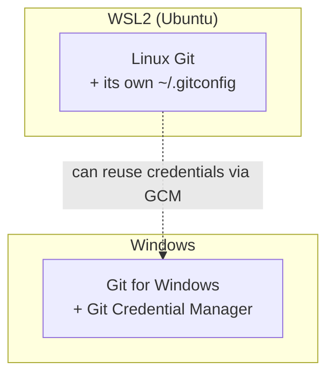

# Lesson 03 — Installing Git on Windows, macOS, Linux and WSL

> **Module 01 — Git Fundamentals & Setup** · Book 07 — Git & GitHub

## 🎯 Learning Objectives

By the end of this lesson you will be able to:

- Check whether Git is already installed and which version you have
- Install Git on Windows, macOS and Linux
- Understand the extra considerations when using Git inside **WSL**
- Choose a sensible terminal for Git work
- Update Git and troubleshoot a "command not found" error

---

## 📖 Introduction

Git is a command-line tool first. Graphical clients and editors (VS Code, GitHub Desktop, and others) are built on top of it, so installing the real Git is always step one. The command-line basics you learned earlier in this curriculum (moving between folders, listing files, running commands) are all you need.

This book targets **Git 2.55 (June 2026) or newer**. Newer is fine; the commands taught here are stable.

---

## 1. Is Git Already Installed?

Open a terminal and run:

```bash
git --version
```

Typical output:

git version 2.55.0


- If you see a version number, Git is installed. Check that it is reasonably recent.
- If you see `command not found` (macOS/Linux) or `'git' is not recognized` (Windows), install it using the section for your system.

---

## 2. Windows

### Option A — winget (recommended)

```powershell
winget install --id Git.Git -e --source winget
```

### Option B — the installer

Download **Git for Windows** from the official site (git-scm.com) and run it.

### Key installer choices

| Screen | Recommended choice |
|---|---|
| **Default editor** | Choose **Visual Studio Code** (or another editor you know); avoid Vim unless you use it |
| **Initial branch name** | **Override → `main`** |
| **PATH environment** | "Git from the command line and also from 3rd-party software" |
| **Line endings** | Default ("Checkout Windows-style, commit Unix-style") for Windows-native work (Module 08 explains why) |
| **Credential helper** | **Git Credential Manager** (securely stores GitHub logins) |

Git for Windows bundles:

- **Git Bash**, a terminal that gives you a Unix-like shell
- **Git GUI** and `gitk`, simple built-in graphical tools
- **Git Credential Manager (GCM)**, which handles secure sign-in to GitHub and other hosts

You can run the same Git from Git Bash, PowerShell, Command Prompt or **Windows Terminal**.

---

## 3. macOS

### Option A — Xcode Command Line Tools

```bash
xcode-select --install
```

Running `git --version` for the first time on a fresh Mac may also prompt you to install these. This gives you Apple's build of Git, which works but usually lags behind the latest version.

### Option B — Homebrew (recommended for a current version)

```bash
brew install git
```

Homebrew installs a newer Git and updates it with `brew upgrade git`. If `git --version` still shows an "Apple Git" version after installing, your shell is finding Apple's Git first. Check with `which git` and ensure Homebrew's directory comes first in your `PATH`.

---

## 4. Linux

Use your distribution's package manager:

| Distribution | Command |
|---|---|
| **Debian / Ubuntu / Mint** | `sudo apt update && sudo apt install git` |
| **Fedora / RHEL / Rocky** | `sudo dnf install git` |
| **Arch / Manjaro** | `sudo pacman -S git` |
| **openSUSE** | `sudo zypper install git` |
| **Alpine** | `sudo apk add git` |

Debian-family distributions often ship an older Git. To get a newer one on Ubuntu:

```bash
sudo add-apt-repository ppa:git-core/ppa
sudo apt update
sudo apt install git
```

You can also build Git from source, but a package manager is the right choice for nearly everyone.

---

## 5. Windows Subsystem for Linux (WSL)

WSL2 runs a real Linux environment inside Windows. Many web and React Native developers work this way. You will have **two separate Git installations**, one in Windows and one in WSL, each with its own configuration.



### Install Git inside WSL

```bash
sudo apt update && sudo apt install git
git --version
```

### Things to know

1. **Configure Git in both places.** Your name, email and settings (Lesson 04) must be set in WSL as well as in Windows if you use both.
2. **Keep your projects in the Linux filesystem** (for example `~/projects`), **not** under `/mnt/c/...`. File access across the boundary is much slower and can cause permission and line-ending surprises.
3. **Line endings differ.** Windows uses CRLF while Linux uses LF. Mixing the two on the same repository can make Git report changes that you did not make. Module 08 (`.gitattributes` and line endings) solves this properly.
4. **Share credentials.** You can point WSL's Git at the Windows Git Credential Manager so you only sign in to GitHub once:

```bash
git config --global credential.helper "/mnt/c/Program\ Files/Git/mingw64/bin/git-credential-manager.exe"
```

5. **Use VS Code's WSL integration** so the editor runs against your Linux files while its interface stays in Windows.

> 💡 Pick one environment as your main one for a given project, and use that environment's Git consistently.

---

## 6. Which Terminal Should I Use?

| Terminal | Notes |
|---|---|
| **Git Bash** (Windows) | Easy, ships with Git for Windows, Unix-like commands |
| **PowerShell / Windows Terminal** | Modern, fully usable with Git |
| **Terminal / iTerm2** (macOS) | Uses zsh by default |
| **Linux terminal** | bash or zsh |
| **VS Code integrated terminal** | Convenient, uses your default shell |

The Git commands are identical everywhere. Only shell details (such as how you quote a path) differ. Module 08 shows how to add a branch name to your prompt and enable tab completion.

---

## 7. Updating Git

| System | Command |
|---|---|
| Windows (winget) | `winget upgrade --id Git.Git` |
| macOS (Homebrew) | `brew upgrade git` |
| Ubuntu/Debian | `sudo apt update && sudo apt install --only-upgrade git` |
| Fedora | `sudo dnf upgrade git` |

Updating Git is safe. It does not touch your repositories or settings.

---

## 8. Troubleshooting

| Problem | Likely cause and fix |
|---|---|
| `git: command not found` right after installing | Close and reopen the terminal so the updated `PATH` is loaded |
| Old version after installing a new one | Another Git is earlier in `PATH`; run `which git` (macOS/Linux) or `where git` (Windows) |
| Windows installer asks about many options | The recommended choices in section 2 are enough |
| Permission errors on WSL files under `/mnt/c` | Move the project into the Linux filesystem (`~`) |

---

## 🛠️ Practical Example — Install and Verify

1. Install Git using the method for your system above.
2. Open a **new** terminal and run:

```bash
git --version
which git        # macOS/Linux/WSL  (use: where git  on Windows)
```

3. Open the built-in documentation to confirm everything works:

```bash
git help -a | head
```

4. Write down: your Git version, where it is installed, and which terminal you will use for this book.

**Checkpoint:** if you use WSL, repeat step 2 inside WSL and note that the two installations may report different versions.

---

## 📝 Revision Questions

**1. How do you check whether Git is installed?**

<details>
<summary>Show answer</summary>

Run `git --version`. A version number means it is installed; "command not found" or "not recognized" means it is not.
</details>

**2. What extra tools does Git for Windows include?**

<details>
<summary>Show answer</summary>

Git Bash (a Unix-like terminal), Git GUI and `gitk`, and Git Credential Manager for secure sign-in to hosts such as GitHub.
</details>

**3. Why might `git --version` on macOS show an "Apple Git" version even after you install Git with Homebrew?**

<details>
<summary>Show answer</summary>

The shell finds Apple's Git earlier in `PATH`. Check with `which git` and make sure Homebrew's directory comes before `/usr/bin`.
</details>

**4. Where should WSL users keep their projects, and why?**

<details>
<summary>Show answer</summary>

In the Linux filesystem (for example `~/projects`), not under `/mnt/c`. Cross-filesystem access is much slower and can cause permission and line-ending problems.
</details>

**5. Why must you configure Git separately inside WSL?**

<details>
<summary>Show answer</summary>

WSL has its own Git installation and its own `~/.gitconfig`, separate from Git for Windows. Settings like your name and email do not carry over automatically.
</details>

---

➡️ **Next:** Lesson 04 — First-Time Setup and Getting Help
