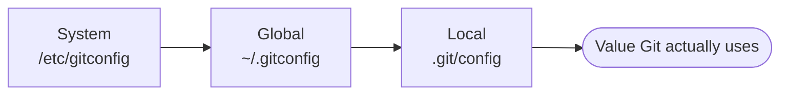

# Lesson 04 — First-Time Setup and Getting Help

> **Module 01 — Git Fundamentals & Setup** · Book 07 — Git & GitHub

## 🎯 Learning Objectives

By the end of this lesson you will be able to:

- Explain Git's three configuration levels and which wins when they conflict
- Set your identity and the essential first-time settings
- Read, change and inspect configuration with `git config`
- Use Git's built-in help (`git help`, `--help`, `-h`) and read command synopses
- Know where to find official documentation and free learning resources

---

## 📖 Introduction

Every commit Git records says **who** made it. Before your first commit you must tell Git your name and email. While you are there, a few other one-time settings will save you daily friction. Then you will learn to find answers inside Git itself, a skill that lets you solve problems without leaving the terminal.

---

## 1. The Three Configuration Levels

Git reads settings from several files. More specific files override more general ones.

| Level | Flag | Applies to | Typical file |
|---|---|---|---|
| **System** | `--system` | Every user on the machine | `/etc/gitconfig` |
| **Global** | `--global` | **You**, in every repository | `~/.gitconfig` (or `~/.config/git/config`) |
| **Local** | `--local` (default inside a repo) | **One repository only** | `.git/config` |
| **Worktree** | `--worktree` | One linked worktree (Module 03) | `.git/config.worktree` |

**Precedence:** local beats global, global beats system.



Most of what you set in this lesson belongs at the **global** level.

---

## 2. Set Your Identity (Required)

```bash
git config --global user.name "Your Name"
git config --global user.email "you@example.com"
```

- Git stamps this on **every commit**, and it is stored permanently in the history.
- On GitHub, commits are linked to your profile through the **email address**. You can use GitHub's private "noreply" address if you do not want your real email public. Module 04 covers this.
- You can override per project: run the same commands **without** `--global` inside a repository.

> ⚠️ This is just a label, not authentication. Anyone can write any name. Proving identity is the job of signed commits (Module 11).

---

## 3. Other Settings Worth Setting Now

```bash
# New repositories start on a branch called "main" (the future Git default)
git config --global init.defaultBranch main

# Your editor for commit messages (VS Code example)
git config --global core.editor "code --wait"

# First push of a new branch just works, with no extra flags
git config --global push.autoSetupRemote true
```

| Setting | Why |
|---|---|
| `init.defaultBranch` | Git 3.0 will default to `main`; setting it now avoids surprises and matches GitHub |
| `core.editor` | `--wait` makes Git pause until you close the file. Without a value Git uses its default editor, often Vim |
| `push.autoSetupRemote` | Saves you the "no upstream branch" error on the first `git push` of a new branch |

Line-ending, credential and many other settings come later (Modules 04 and 08).

---

## 4. Reading and Changing Configuration

### The classic commands

```bash
git config --list                  # every active setting
git config --list --show-origin    # ...and which file each came from
git config user.name               # read one value
git config --global --edit         # open the global file in your editor
```

### Newer subcommand style (Git 2.46+)

Modern Git adds clearer verbs:

```bash
git config list --global
git config get user.email
git config set --global user.name "Your Name"
git config unset --global some.setting
```

Both forms work. You will see the classic style in most tutorials and the newer one increasingly in documentation.

### What the file looks like

```ini
[user]
    name = Your Name
    email = you@example.com
[init]
    defaultBranch = main
[core]
    editor = code --wait
[push]
    autoSetupRemote = true
```

It is a plain-text file in INI format. Editing it directly is perfectly fine.

---

## 5. Getting Help Inside Git

Git has thorough built-in documentation.

| Command | What it shows |
|---|---|
| `git help <command>` | Full manual page (e.g. `git help commit`) |
| `git <command> --help` | Same as above |
| `git <command> -h` | A short usage summary only |
| `git help -a` | All available commands |
| `git help -g` | Concept guides (tutorial, glossary, workflows, and more) |
| `git help -w <command>` | Opens the documentation in your web browser |

Try:

```bash
git help glossary     # vocabulary reference
git help everyday     # the ~20 commands most people need
git help tutorial
```

### Reading a command synopsis

Help pages describe options with a standard notation:

git commit [-a | --interactive | --patch] [-m <msg>] [--amend] [--] [<pathspec>...]


| Symbol | Meaning |
|---|---|
| `[ ]` | Optional |
| `< >` | Replace with your own value |
| `\|` | Choose one of the alternatives |
| `...` | Can repeat |
| `--` | "End of options"; everything after is a path |

So `git commit -m "message"` is valid: `-m` is optional and `<msg>` is your text.

---

## 6. Beyond the Terminal

| Resource | Use it for |
|---|---|
| **git-scm.com/docs** | The official reference for every command (same text as `git help`) |
| **Pro Git** (free at git-scm.com/book) | The definitive free book on Git |
| **GitHub Docs** | Everything about GitHub features |
| **GitHub Skills** | Free, hands-on, interactive courses run inside GitHub |

Module 15 collects practice sites and further reading in one place.

---

## 🛠️ Practical Example — Configure Git and Explore Help

```bash
# 1. Identity
git config --global user.name "Your Name"
git config --global user.email "you@example.com"

# 2. Sensible defaults
git config --global init.defaultBranch main
git config --global core.editor "code --wait"
git config --global push.autoSetupRemote true

# 3. Verify
git config --list --show-origin

# 4. Explore help
git help -g
git commit -h
git help glossary
```

**Checkpoint tasks:**

1. Find out which file stores your `user.email` using `--show-origin`.
2. Run `git help -a` and find three commands you do not recognize yet. Note them; many are covered later in this book.
3. Use `git help glossary` to look up the word **index**. Which term from Lesson 02 does it match?

<details>
<summary>Show hints</summary>

1. The path printed beside the setting, usually `~/.gitconfig`.
2. Examples: `bisect`, `reflog`, `worktree`.
3. It is the **staging area**.
</details>

---

## 📝 Revision Questions

**1. What are Git's configuration levels, and which one wins?**

<details>
<summary>Show answer</summary>

System, global, local (and worktree). More specific wins: local overrides global, which overrides system.
</details>

**2. Why does Git require a name and email?**

<details>
<summary>Show answer</summary>

Every commit records its author. The values are stored in history. On GitHub the email links commits to your account.
</details>

**3. What does `git config --list --show-origin` do?**

<details>
<summary>Show answer</summary>

It lists all active settings and shows which configuration file each one comes from, which is useful when a setting behaves unexpectedly.
</details>

**4. What is the difference between `git commit --help` and `git commit -h`?**

<details>
<summary>Show answer</summary>

`--help` opens the full manual page, while `-h` prints a short usage summary in the terminal.
</details>

**5. In a synopsis, what do square brackets and angle brackets mean?**

<details>
<summary>Show answer</summary>

Square brackets mark optional parts. Angle brackets mark placeholders you must replace with your own value.
</details>

---

➡️ **Next:** Lesson 05 — Init, Add, Commit and Status
