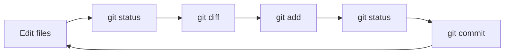

# Lesson 05 — Init, Add, Commit and Status

> **Module 01 — Git Fundamentals & Setup** · Book 07 — Git & GitHub

## 🎯 Learning Objectives

By the end of this lesson you will be able to:

- Create a repository with `git init`
- Read and interpret `git status` (long and short forms)
- Stage changes with `git add` and its common variants
- Record snapshots with `git commit`
- Perform the daily Git loop and take a first look at history with `git log` and `git diff`

---

## 📖 Introduction

Lessons 01 and 02 gave you the model: working tree → staging area → repository. Now you will drive it with real commands. These four (`init`, `status`, `add`, `commit`) account for the vast majority of your daily Git use.

---

## 1. Creating a Repository: `git init`

Inside any project folder:

```bash
git init
```

Git creates the hidden `.git` directory (Lesson 02) and your folder becomes a repository. Nothing is tracked yet.

To choose the first branch's name explicitly:

```bash
git init -b main
```

If you set `init.defaultBranch` in Lesson 04, plain `git init` already uses `main`.

> You can also get a repository by **cloning** an existing one (`git clone <url>`). Cloning is covered in Module 04.

---

## 2. Reading the State: `git status`

```bash
git status
```

This is your compass. It tells you the current branch, what is staged, what is modified, and what is untracked. Run it **constantly**, before and after almost every other command.

### Typical output

On branch main

No commits yet

Untracked files:
(use “git add <file>...” to include in what will be committed)
index.html

nothing added to commit but untracked files present (use “git add” to track)


### The short form

```bash
git status -s      # compact
git status -sb     # compact + branch info
```

M styles.css ← modified, not staged
M app.js ← modified and staged
MM main.js ← staged, then modified again
A new.html ← newly added and staged
?? notes.txt ← untracked


The **left column** is the staging area; the **right column** is the working tree.

---

## 3. Staging: `git add`

```bash
git add index.html          # one file
git add index.html app.js   # several files
git add src/                # a folder
git add .                   # everything in the current folder and below
git add -A                  # everything in the whole repository
git add -u                  # only files Git already tracks (modified/deleted)
```

Notes:

- `git add` means **"include this version in my next commit"**, not just "start tracking".
- If you edit a file **after** adding it, the new edit is *not* staged until you `git add` again (the `MM` state above).
- Since Git 2.0, `git add .` also stages deletions under the current folder.
- Staging only the lines you want is possible with `git add -p` (Module 02).

---

## 4. Committing: `git commit`

```bash
git commit -m "Add homepage"
```

A **commit** is a permanent snapshot plus metadata:

| Part | What it records |
|---|---|
| **Tree** | The complete snapshot of tracked files |
| **Parent(s)** | The previous commit(s), which forms the history chain |
| **Author** | Name, email and time (from your config) |
| **Message** | Your explanation of the change |
| **Hash** | A unique ID, e.g. `3f2a9c1` |

### Useful variants

```bash
git commit                  # opens your editor for a longer message
git commit -v               # editor + shows the diff while you write
git commit -a -m "Fix bug"  # auto-stage modified/deleted tracked files first
git commit -m "Title" -m "Longer body paragraph"
```

> `-a` does **not** include brand-new untracked files. They still need `git add`.

Writing *good* messages is the topic of Lesson 07. For now keep them short and meaningful.

---

## 5. The Daily Loop



---

## 6. A First Look at History and Changes

You will study these deeply in Module 02, but you need them now to see what you are doing:

```bash
git log                 # full history, newest first
git log --oneline       # one compact line per commit
git diff                # working tree vs staging area (unstaged changes)
git diff --staged       # staging area vs last commit (what will be committed)
git show                # the latest commit and its changes
```

Remember the pairing: **`git diff`** shows what you have *not* staged, **`git diff --staged`** shows what you *have*.

---

## 7. Common Situations

| You see | Meaning | What to do |
|---|---|---|
| `nothing to commit, working tree clean` | No changes since the last commit | Nothing needed |
| `Changes not staged for commit` | Tracked files are modified | `git add` the ones you want |
| `Changes to be committed` | Staged and ready | `git commit` |
| `Untracked files` | New files Git does not know yet | `git add` to include them |
| "Please tell me who you are" | No name/email configured | Complete Lesson 04 |

Made a mistake? Undoing changes (restore, amend, reset, revert) is all of Module 02, so do not worry yet.

---

## 🛠️ Practical Example — Your First Repository

Create a tiny site, like the ones you built in Book 02.

```bash
mkdir my-site
cd my-site
git init -b main
git status
```

Create `index.html`:

```bash
cat > index.html << 'HTML'
<!DOCTYPE html>
<html lang="en">
<head><meta charset="UTF-8"><title>My Site</title></head>
<body><h1>Hello, Git!</h1></body>
</html>
HTML
```

Now run the loop:

```bash
git status                       # index.html is untracked
git add index.html
git status                       # now "Changes to be committed"
git commit -m "Add homepage"
git status                       # working tree clean
```

Make a second change:

```bash
echo "body { font-family: sans-serif; }" > styles.css
sed -i.bak 's#</head>#<link rel="stylesheet" href="styles.css"></head>#' index.html && rm index.html.bak
git status -s
git diff
git add .
git diff --staged
git commit -m "Add stylesheet and link it"
git log --oneline
```

**Expected:** `git log --oneline` shows two commits, newest first.

**Checkpoint tasks:**

1. After the first commit, edit `<h1>` and run `git status -s`. What letters appear and in which column?
2. Stage the edit, then edit the file again. What does `git status -s` show now?
3. Run `ls -a`. Which hidden folder is the repository?

<details>
<summary>Show answers</summary>

1. ` M` (modified in the **right/working-tree** column, nothing staged).
2. `MM`: staged changes plus further unstaged changes in the same file.
3. `.git`
</details>

---

## 📝 Revision Questions

**1. What does `git init` do?**

<details>
<summary>Show answer</summary>

It creates the hidden `.git` directory in the current folder, turning it into a Git repository. Nothing is tracked until you add and commit files.
</details>

**2. What is the difference between `git diff` and `git diff --staged`?**

<details>
<summary>Show answer</summary>

`git diff` compares the working tree to the staging area (unstaged changes). `git diff --staged` compares the staging area to the last commit (what would be committed).
</details>

**3. Does `git commit -a` add new files?**

<details>
<summary>Show answer</summary>

No. It stages modified and deleted files that are already tracked. New (untracked) files must be added with `git add`.
</details>

**4. What does `MM` mean in `git status -s`?**

<details>
<summary>Show answer</summary>

The file has staged changes and also further unstaged modifications made after staging.
</details>

**5. What does a commit contain?**

<details>
<summary>Show answer</summary>

A snapshot (tree) of the tracked files, a reference to its parent commit(s), the author and time, the message, and a unique hash identifying it.
</details>

---

➡️ **Next:** Lesson 06 — Removing, Moving and Cleaning Files
