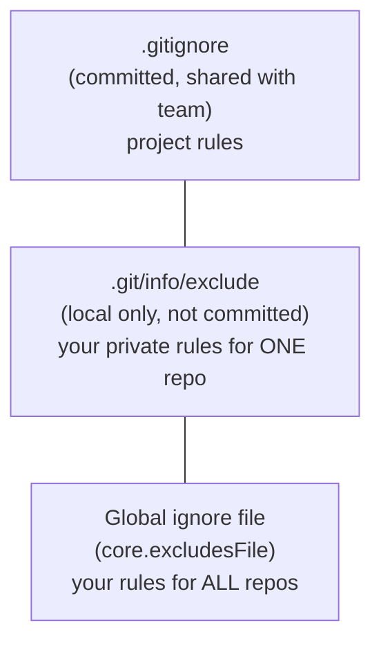

# Lesson 08 — .gitignore and Global Ignore

> **Module 01 — Git Fundamentals & Setup** · Book 07 — Git & GitHub

## 🎯 Learning Objectives

By the end of this lesson you will be able to:

- Decide which files should **never** be committed
- Write `.gitignore` patterns using wildcards, folders, anchors and negation
- Use the three ignore layers: `.gitignore`, `.git/info/exclude` and the global ignore file
- Debug why a file is (or is not) ignored with `git check-ignore`
- Fix the "I ignored it but Git still tracks it" problem

---

## 📖 Introduction

Look at any real project folder and you will find files that do not belong in version control: downloaded dependencies, build output, editor settings, operating-system junk and, most importantly, **secrets**. Committing them bloats the repository, causes constant merge conflicts, and can leak credentials.

You have already met these files in earlier books: `node_modules/` from the npm lesson in Book 04, `dist/` and `build/` output from bundlers (Book 04, Book 05 Module 11) and Vite projects (Book 06 Module 01). Now you will tell Git to leave them alone.

---

## 1. What Should You Ignore?

| Category | Examples |
|---|---|
| **Dependencies** | `node_modules/`, `vendor/` |
| **Build output** | `dist/`, `build/`, `.next/`, `out/`, `*.min.js` (when generated) |
| **Secrets and local config** | `.env`, `.env.local`, `*.pem`, `secrets.json` |
| **Logs and caches** | `*.log`, `.cache/`, `.parcel-cache/`, `coverage/` |
| **OS junk** | `.DS_Store`, `Thumbs.db`, `desktop.ini` |
| **Editor/IDE files** | `.idea/`, `*.swp`, personal `.vscode/` settings |
| **Mobile build artifacts** | `ios/Pods/`, `android/build/`, `.expo/` |

> 🔐 **Golden rule:** anything generated, downloaded, personal or secret does not go into Git. Anything someone needs to rebuild the project (source code, config templates, lockfiles) does.

Commit a **template** such as `.env.example` (with fake values) so teammates know which variables to create.

---

## 2. Creating a `.gitignore`

A `.gitignore` is a plain text file, usually at the repository root, with **one pattern per line**. Commit it so the whole team shares the same rules.

```gitignore
# Dependencies
node_modules/

# Build output
dist/
build/

# Secrets
.env
.env.*
!.env.example

# Logs
*.log

# OS and editor
.DS_Store
Thumbs.db
.idea/
```

Lines starting with `#` are comments. Blank lines are ignored.

---

## 3. Pattern Syntax

| Pattern | Meaning | Example match |
|---|---|---|
| `file.txt` | That filename anywhere | `a/file.txt`, `file.txt` |
| `*.log` | Any file ending in `.log` | `debug.log`, `logs/app.log` |
| `?` | Exactly one character | `file?.txt` → `file1.txt` |
| `[abc]` | One character from the set | `file[12].txt` |
| `build/` | **Trailing slash** → directories only | `build/` folder, not a file named `build` |
| `/todo.txt` | **Leading slash** → only at the repo root | `todo.txt`, not `docs/todo.txt` |
| `docs/*.md` | Wildcard inside one folder level | `docs/a.md`, not `docs/x/a.md` |
| `**/temp` | `**` matches any number of folders | `temp`, `a/temp`, `a/b/temp` |
| `!keep.log` | **Negation**: do not ignore this | re-includes `keep.log` |

### Negation caveat

You **cannot** re-include a file if one of its parent directories is ignored.

```gitignore
logs/
!logs/important.log     # ❌ does NOT work (the folder is excluded)
```

Fix it by ignoring the *contents* instead:

```gitignore
logs/*
!logs/important.log     # ✅ works
```

---

## 4. The Three Ignore Layers



| Layer | Location | Use it for |
|---|---|---|
| **Repository `.gitignore`** | In the repo (committed) | Rules **everyone** needs: `node_modules/`, `dist/`, `.env` |
| **`.git/info/exclude`** | Inside `.git` (never shared) | Private, one-repo-only rules |
| **Global ignore** | `~/.config/git/ignore` by default | **Your** machine's junk: `.DS_Store`, `.idea/`, editor swap files |

### Setting up a global ignore file

OS and editor files are *your* environment, not the project's, so keep them out of every team's `.gitignore`:

```bash
git config --global core.excludesFile ~/.gitignore_global
```

Then edit `~/.gitignore_global`:

```gitignore
.DS_Store
Thumbs.db
.idea/
*.swp
.vscode/settings.json
```

If you do not set `core.excludesFile`, Git automatically reads `~/.config/git/ignore`.

---

## 5. The "I Ignored It but Git Still Tracks It" Problem

`.gitignore` only applies to **untracked** files. If a file was already committed, ignoring it does nothing.

```bash
# 1. Add the rule to .gitignore
echo ".env" >> .gitignore

# 2. Stop tracking it, but keep the file on disk (Lesson 06)
git rm --cached .env

# 3. Commit both changes
git add .gitignore
git commit -m "Stop tracking .env and ignore it"
```

> ⚠️ This stops future tracking only. If the file ever contained a **secret**, it is still in your old commits. Treat the secret as compromised: **rotate it**. Module 06 teaches removing it from history, and Module 11 covers GitHub's push protection that blocks secrets before they leave your machine.

---

## 6. Debugging Ignore Rules

```bash
git check-ignore -v dist/app.js     # which rule matches this path?
git status --ignored                # show ignored files too
git ls-files --others --ignored --exclude-standard   # list ignored files
```

Example output:
.gitignore:3:dist/ dist/app.js


It tells you the file (`.gitignore`), the line number (3) and the pattern (`dist/`).

---

## 7. Other Handy Tricks

| Need | Solution |
|---|---|
| Track an **empty folder** | Git tracks files, not folders. Put a placeholder like `.gitkeep` inside it |
| Force-add an ignored file once | `git add -f path` |
| Get a ready-made file | Start from the community **github/gitignore** templates for Node, React, Vue, Android, Swift and more |
| Ignore changes to a tracked file locally | Rarely a good idea; prefer fixing the structure (e.g. a committed `.example` file) |

---

## 🛠️ Practical Example — Ignore Rules for a Vite + React Project

In `my-site`, simulate a front-end project:

```bash
mkdir -p node_modules/react dist logs
echo "module" > node_modules/react/index.js
echo "<h1>built</h1>" > dist/index.html
echo "SECRET_KEY=abc123" > .env
echo "SECRET_KEY=replace-me" > .env.example
echo "debug info" > logs/app.log
echo "keep this one" > logs/important.log
touch .DS_Store

git status -s
```

Everything shows as untracked. Create `.gitignore`:

```bash
cat > .gitignore << 'IGN'
# Dependencies
node_modules/

# Build output
dist/

# Secrets (but keep the template)
.env
.env.*
!.env.example

# Logs (keep one)
logs/*
!logs/important.log

# OS junk
.DS_Store
IGN

git status -s
```

Now only `.gitignore`, `.env.example` and `logs/important.log` should be untracked.

```bash
git check-ignore -v .env dist/index.html logs/app.log
git add .
git commit -m "chore: add .gitignore and env template"
```

**Checkpoint tasks:**

1. Which rule ignores `logs/app.log`, and which rescues `logs/important.log`?
2. Set up a **global** ignore file containing `.DS_Store` and `Thumbs.db`, then remove those lines from the project `.gitignore`. Why is that better for a team project?
3. Now run `git clean -nX`. What does it list, and why is it a safer preview than `git clean -nx`?

<details>
<summary>Show answers</summary>

1. `logs/*` ignores the contents; `!logs/important.log` re-includes that one file (it works because the folder itself is not ignored).
2. Those files come from *your* OS, not the project. Putting them in the global file keeps the shared `.gitignore` focused on what every contributor needs.
3. `-X` lists **only** ignored files (build output, dependencies, `.env`), so it never touches untracked-but-important new work. `-x` also includes other untracked files, so it is riskier. In both cases never run the real `-f` without reading the preview first.
</details>

---

## 📝 Revision Questions

**1. Why should `node_modules/` and `.env` never be committed?**

<details>
<summary>Show answer</summary>

`node_modules/` is large, generated and rebuilt from the lockfile. `.env` usually holds secrets, and once a secret is committed it stays in history and may leak.
</details>

**2. What is the difference between `.gitignore`, `.git/info/exclude` and the global ignore file?**

<details>
<summary>Show answer</summary>

`.gitignore` is committed and shared with the team. `.git/info/exclude` is private to one repository. The global ignore file applies to all your repositories and suits OS and editor files.
</details>

**3. A file is listed in `.gitignore` but still appears in `git status` as modified. Why?**

<details>
<summary>Show answer</summary>

It was already tracked before being ignored. Ignore rules only affect untracked files. Run `git rm --cached <file>` and commit to stop tracking it.
</details>

**4. What does a trailing slash in a pattern like `build/` mean?**

<details>
<summary>Show answer</summary>

It matches directories only, not a file with that name.
</details>

**5. How do you find out which rule is ignoring a particular file?**

<details>
<summary>Show answer</summary>

Run `git check-ignore -v <path>`. It prints the file, line number and pattern that match.
</details>

---

🎉 **Module 01 complete!** You can now install and configure Git, create repositories, commit with good messages, manage files and keep junk and secrets out of your history.

➡️ **Next module:** Module 02 — Inspecting & Undoing Changes
