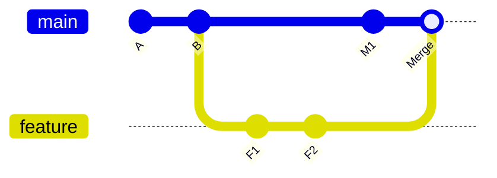
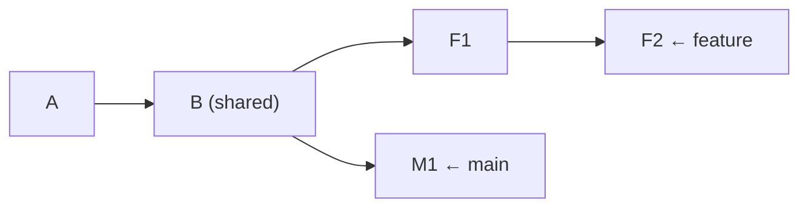

# Lesson 01 — Log Formatting, Filtering and Revision Ranges

> **Module 02 — Inspecting & Undoing Changes** · Book 07 — Git & GitHub

## 🎯 Learning Objectives

By the end of this lesson you will be able to:

- Read history in several formats with `git log`
- Filter commits by author, date, message, file and number
- Build custom output with `--pretty=format:` placeholders
- Name commits precisely with **revision syntax** (`HEAD~2`, `HEAD^2`, `@{u}`, `:/text`)
- Use **ranges** (`A..B` and `A...B`) to ask "what is in one branch but not the other?"

---

## 📖 Introduction

In Module 01 you made commits and glanced at `git log --oneline`. That was the doorway. Real projects have thousands of commits, many authors and many branches, and the real skill is asking history **precise questions**: *What did Asha change last week? Which commits touched the navbar? What is on my branch that is not on `main` yet?*

This lesson gives you the vocabulary for those questions. Lessons 02 and 03 build on it with diffs and searching.

---

## 1. Setting Up a Practice Repository

Run this once. It builds a small history with three authors and real dates, so the filters below have something to find.

```bash
mkdir -p ~/git-practice && cd ~/git-practice
rm -rf history-lab && mkdir history-lab && cd history-lab
git init -b main

mk() {  # author, email, date, message, file, line
  echo "$6" >> "$5"
  git add "$5"
  GIT_AUTHOR_DATE="$3" GIT_COMMITTER_DATE="$3" \
    git -c user.name="$1" -c user.email="$2" commit -q -m "$4"
}

mk "Asha Rao"  asha@example.com "2026-01-05T09:00:00" "feat: add homepage"        index.html   "<h1>Home</h1>"
mk "Ben Ortiz" ben@example.com  "2026-01-12T14:30:00" "feat: add navbar"          index.html   "<nav>Menu</nav>"
mk "Asha Rao"  asha@example.com "2026-02-02T11:15:00" "fix: navbar link colour"    styles.css   "nav a { color: navy; }"
mk "Chen Wei"  chen@example.com "2026-02-20T16:45:00" "docs: add README"          README.md    "# History Lab"
mk "Ben Ortiz" ben@example.com  "2026-03-09T10:05:00" "feat: add contact form"     contact.html "<form></form>"
mk "Asha Rao"  asha@example.com "2026-03-30T08:20:00" "fix: contact form label"    contact.html "<label>Email</label>"
```

Check it worked:

```bash
git log --oneline
```

You should see six commits.

---

## 2. Choosing How Much to Show

| Command | What you get |
|---|---|
| `git log` | Full entries: hash, author, date, message |
| `git log --oneline` | One line per commit (short hash + subject) |
| `git log --stat` | Files changed and lines added/removed per commit |
| `git log --shortstat` | Only the one-line totals |
| `git log -p` (or `--patch`) | The full diff of each commit |
| `git log --name-only` | Names of changed files |
| `git log --name-status` | Names plus a status letter (`A`dded, `M`odified, `D`eleted, `R`enamed) |
| `git log -3` or `-n 3` | Only the latest 3 commits |
| `git log --reverse` | Oldest first |

### The graph view

```bash
git log --oneline --graph --decorate --all
```

| Flag | Effect |
|---|---|
| `--graph` | Draws the branch structure as ASCII art |
| `--decorate` | Shows branch and tag names beside commits (usually on by default in a terminal) |
| `--all` | Includes **every** branch, not just the current one |

This is the single most useful `git log` incantation. You will want it as an alias (aliases are covered in Module 08):

```bash
git config --global alias.lg "log --oneline --graph --decorate --all"
git lg
```

On very busy histories, Git 2.55 added `--graph-lane-limit=<n>` to cap how many lanes the graph draws, so wide merge-heavy histories stay readable.

---

## 3. Filtering Commits

### By author, committer and message

```bash
git log --author="Asha"            # author name or email (regular expression)
git log --committer="Ben"          # who committed it (may differ from the author)
git log --grep="fix"               # message contains "fix"
git log --grep="fix" -i            # case-insensitive
git log --grep="navbar" --grep="form"            # navbar OR form (default)
git log --grep="navbar" --grep="fix" --all-match # navbar AND fix
```

### By date

```bash
git log --since="2026-02-01"
git log --until="2026-03-01"
git log --since="2 weeks ago"
git log --after="2026-01-01" --before="2026-02-28"
```

Git understands natural phrases such as `yesterday`, `3 days ago` and `last friday`.

### By content type

```bash
git log --no-merges        # hide merge commits
git log --merges           # only merge commits
git log --first-parent     # follow only the "main line" through merges
```

### By file or folder (a *pathspec*)

Put `--` before paths so Git never confuses a filename with a branch name:

```bash
git log -- contact.html
git log --oneline -- index.html styles.css
git log --stat -- src/
git log --follow -- renamed-file.js     # keep following across renames (single file)
```

### By line history

```bash
git log -L 1,3:index.html           # history of lines 1–3
git log -L :functionName:app.js     # history of one function
```

You can combine any of these:

```bash
git log --author="Asha" --since="2026-02-01" --oneline -- contact.html
```

---

## 4. Custom Output with `--pretty=format:`

```bash
git log --pretty=format:"%h  %an  %ad  %s" --date=short
```

```
d4e8f21  Asha Rao  2026-03-30  fix: contact form label
a91c3b7  Ben Ortiz  2026-03-09  feat: add contact form
...
```

| Placeholder | Meaning |
|---|---|
| `%H` / `%h` | Full / abbreviated commit hash |
| `%an` / `%ae` | Author name / email |
| `%cn` / `%ce` | Committer name / email |
| `%ad` / `%ar` | Author date / relative date ("3 weeks ago") |
| `%s` | Subject (first line of message) |
| `%b` | Body |
| `%d` | Branch and tag decorations |
| `%C(yellow)` ... `%Creset` | Colours |

`--date=` accepts `short`, `iso`, `relative`, `human`, `format:"%Y-%m-%d"` and more.

A colourful one-liner:

```bash
git log --graph --pretty=format:"%C(yellow)%h%Creset %C(green)%ar%Creset %s %C(blue)<%an>%Creset%C(red)%d%Creset"
```

Built-in styles also exist: `--pretty=oneline|short|medium|full|fuller`.

---

## 5. Revision Syntax — Naming Commits Precisely

Everywhere Git wants a "commit" you can give a **revision expression**.

| Expression | Meaning |
|---|---|
| `3f2a9c1` | A hash (any unique prefix works) |
| `main`, `feature/login` | A branch name (the commit it points to) |
| `v1.2.0` | A tag |
| `HEAD` or `@` | The commit you are on |
| `HEAD~1` or `HEAD^` | First parent (one commit back) |
| `HEAD~3` | Three commits back (following first parents) |
| `HEAD^2` | The **second parent** of a merge commit |
| `main~2^2` | Combinations: two back from `main`, then second parent |
| `@{-1}` | The previous branch you were on |
| `@{u}` or `@{upstream}` | The branch your current branch tracks (Module 04) |
| `main@{yesterday}` | Where `main` pointed yesterday (from the reflog, Lesson 08) |
| `:/navbar` | The most recent commit whose message matches "navbar" |

### `~` versus `^`

- `~N` means "N generations back, always taking the **first** parent".
- `^N` means "the **N-th parent** of this commit". It only matters for **merge commits**, which have two or more parents.



For the `Merge` commit: `Merge^1` (or `Merge~1`) is `M1`, while `Merge^2` is `F2`.

Test any expression safely with:

```bash
git rev-parse HEAD~2        # print the full hash it resolves to
git show -s --oneline HEAD~2
```

---

## 6. Ranges — "What's in X but not in Y?"

Ranges are how you compare branches and prepare releases.

### Two dots: `A..B`

> **Commits reachable from B that are not reachable from A.**

```bash
git log main..feature      # what does feature have that main doesn't?
git log feature..main      # what does main have that feature doesn't?
git log origin/main..HEAD  # my local commits not yet pushed (Module 04)
git log v1.0..v2.0         # everything shipped between two releases
```

### Three dots: `A...B`

> **Commits reachable from either A or B, but not from both** (the symmetric difference).

```bash
git log main...feature
git log --left-right --oneline main...feature
```

`--left-right` marks each commit with `<` (only on the left side) or `>` (only on the right side).

### The mental picture



- `main..feature` → `F1, F2`
- `feature..main` → `M1`
- `main...feature` → `F1, F2, M1`

### Equivalent forms

```bash
git log main..feature
git log feature ^main              # same thing
git log feature --not main         # same thing
```

> 💡 Caution: `git diff` treats `..` and `...` differently from `git log`. Lesson 02 explains.

---

## 🛠️ Practical Example — Interrogate the History

In `history-lab`, answer each question with **one command**:

1. Show the latest 3 commits in one line each.
2. Show only commits by Ben.
3. Show commits from February 2026.
4. Show every commit that touched `contact.html`, with file statistics.
5. Show commits whose message mentions "fix".
6. Print `hash | author | short date | subject` for all commits.
7. Show the hash of the commit **two before** `HEAD`.
8. Show the one commit whose message mentions "README".

<details>
<summary>Show solutions</summary>

```bash
git log --oneline -3
git log --oneline --author="Ben"
git log --oneline --since="2026-02-01" --until="2026-02-28"
git log --stat -- contact.html
git log --oneline --grep="fix"
git log --pretty=format:"%h | %an | %ad | %s" --date=short
git rev-parse HEAD~2
git log --oneline :/README -1      # or: git show -s --oneline :/README
```
</details>

### Range experiment

```bash
git switch -c experiment HEAD~2
echo "<p>Extra</p>" >> index.html
git commit -am "feat: experiment paragraph"
git switch main
git log --oneline main..experiment
git log --oneline experiment..main
git log --oneline --left-right main...experiment
git log --oneline --graph --all
```

**Checkpoint:** which side shows `<` and which `>` in the `--left-right` output, and why?

<details>
<summary>Show answer</summary>

`<` marks commits only on the **left** side (`main`), `>` marks commits only on the **right** side (`experiment`). Left and right follow the order you typed the two names.
</details>

---

## 📝 Revision Questions

**1. How do you see the history of only one file?**

<details>
<summary>Show answer</summary>

`git log -- <path>`. Put `--` before the path so it is never mistaken for a branch name. Add `--follow` to track the file across renames.
</details>

**2. What is the difference between `HEAD~2` and `HEAD^2`?**

<details>
<summary>Show answer</summary>

`HEAD~2` is two generations back along first parents. `HEAD^2` is the second parent of the current commit, which only exists for merge commits.
</details>

**3. What does `git log main..feature` show?**

<details>
<summary>Show answer</summary>

Commits reachable from `feature` but not from `main`, meaning the work on `feature` that has not reached `main`.
</details>

**4. What is the difference between `A..B` and `A...B` in `git log`?**

<details>
<summary>Show answer</summary>

Two dots give commits in B that are not in A. Three dots give commits that are in either A or B but not in both (the symmetric difference).
</details>

**5. How do you combine two `--grep` filters so that **both** must match?**

<details>
<summary>Show answer</summary>

Add `--all-match`. Without it, multiple `--grep` options are combined with OR.
</details>

---

➡️ **Next:** Lesson 02 — Diff, Show and External Diff Tools
