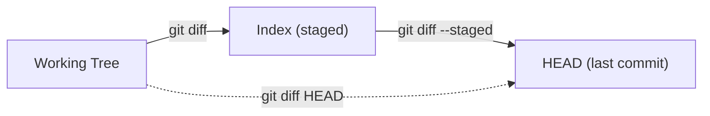

# Lesson 02 — Diff, Show and External Diff Tools

> **Module 02 — Inspecting & Undoing Changes** · Book 07 — Git & GitHub

## 🎯 Learning Objectives

By the end of this lesson you will be able to:

- State exactly what each form of `git diff` compares
- Read the unified diff format line by line
- Summarize and refine diffs (`--stat`, `--name-status`, `-w`, `--word-diff`, `--color-moved`)
- Inspect commits, tags and file versions with `git show`
- Configure and use an external graphical tool with `git difftool`

---

## 📖 Introduction

`git log` tells you **that** something changed. `git diff` and `git show` tell you **what** changed, line by line. You will lean on them before every commit, during every code review and while hunting every bug. This lesson makes you fluent in both.

---

## 1. What Does Each `git diff` Compare?

Git has three places files can live (Module 01, Lesson 02): the **working tree**, the **index** (staging area) and the **last commit (HEAD)**. Each `git diff` form compares two of them.



| Command | Compares | Answers the question |
|---|---|---|
| `git diff` | working tree ↔ index | "What have I changed but **not staged**?" |
| `git diff --staged` (or `--cached`) | index ↔ HEAD | "What **will** my next commit contain?" |
| `git diff HEAD` | working tree ↔ HEAD | "Everything I changed since the last commit" |
| `git diff <commit>` | working tree ↔ that commit | "How far have I moved from it?" |
| `git diff <A> <B>` | commit A ↔ commit B | "How do these two snapshots differ?" |
| `git diff <A>..<B>` | same as `<A> <B>` | |
| `git diff <A>...<B>` | merge-base of A and B ↔ B | "What did **B** change since it branched?" |

### Two dots vs three dots in `git diff`

Careful: `..` and `...` mean something different from `git log` (Lesson 01).

- `git diff main..feature` compares the **tips** of both branches (identical to `git diff main feature`).
- `git diff main...feature` compares `feature` with the **common ancestor**, showing only what the feature branch added. This is what a pull request displays.

### Limiting to paths

```bash
git diff -- index.html
git diff --staged -- src/
git diff main feature -- styles.css
```

---

## 2. Reading a Unified Diff

```diff
diff --git a/index.html b/index.html
index 4c1e2a7..9b3d5f0 100644
--- a/index.html
+++ b/index.html
@@ -1,3 +1,4 @@
 <h1>Home</h1>
-<nav>Menu</nav>
+<nav>Main Menu</nav>
+<p>Welcome!</p>
 <footer></footer>
```

| Part | Meaning |
|---|---|
| `diff --git a/... b/...` | The file being compared (`a` = old side, `b` = new side) |
| `index 4c1e2a7..9b3d5f0 100644` | Old and new content hashes, plus the file mode |
| `--- a/index.html` / `+++ b/index.html` | Old and new file names |
| `@@ -1,3 +1,4 @@` | A **hunk header**: old file lines 1–3, new file lines 1–4 |
| Lines starting with a space | Unchanged context |
| Lines starting with `-` | Removed |
| Lines starting with `+` | Added |

A changed line appears as a `-` followed by a `+`. A **hunk** is one contiguous group of changes with surrounding context. Hunks matter again in Lesson 04.

---

## 3. Summaries and Filters

```bash
git diff --stat           # per-file +/- graph
git diff --shortstat      # one summary line
git diff --numstat        # machine-friendly numbers
git diff --name-only      # just the file names
git diff --name-status    # names + A/M/D/R status
git diff --summary        # new/deleted files and mode changes
```

Typical `--stat` output:

```
 index.html   | 3 ++-
 styles.css   | 1 +
 2 files changed, 3 insertions(+), 1 deletion(-)
```

---

## 4. Refining What You See

| Option | Effect |
|---|---|
| `-w` (`--ignore-all-space`) | Ignore **all** whitespace differences |
| `-b` (`--ignore-space-change`) | Ignore changes in the *amount* of whitespace |
| `--word-diff` | Show changes within a line, word by word |
| `--color-words` | Same idea using colours instead of markers |
| `--color-moved` | Colour code that was **moved** rather than rewritten |
| `-U<n>` | Show `n` lines of context (default 3), e.g. `-U10` |
| `--check` | Report whitespace errors (trailing spaces, conflict markers) |
| `--diff-algorithm=histogram` | Often produces cleaner, more readable hunks |

Make good defaults permanent:

```bash
git config --global diff.algorithm histogram
git config --global diff.colorMoved default
```

### Diffing things that are not in Git

```bash
git diff --no-index file1.txt file2.txt
```

### Using diff in scripts and CI

```bash
git diff --exit-code     # exit status 1 if there are differences, 0 if none
git diff --quiet         # same, with no output
```

Pipelines use this to check, for example, that generated files were committed.

---

## 5. Inspecting Objects with `git show`

`git show` displays a commit (message **and** its diff), but it also shows tags, trees and files.

```bash
git show                      # the latest commit
git show 3f2a9c1              # a specific commit
git show HEAD~2               # two commits back
git show v1.0.0               # a tag (tag info + commit)
git show HEAD:index.html      # a FILE as it was in HEAD
git show main~3:styles.css    # a file as it was 3 commits before main
git show --stat               # summary only
git show --name-only          # file names only
git show -s --format="%h %an %s"   # message only (no diff), custom format
```

`git show <commit>:<path>` is a lifesaver: print any old version of a file, then redirect it to recover content:

```bash
git show HEAD~5:config.json > config.old.json
```

---

## 6. External Diff Tools with `git difftool`

The terminal diff is powerful, but a side-by-side view helps with big changes.

### Configure VS Code

```bash
git config --global diff.tool vscode
git config --global difftool.vscode.cmd 'code --wait --diff "$LOCAL" "$REMOTE"'
git config --global difftool.prompt false
```

### Use it

```bash
git difftool                    # unstaged changes, file by file
git difftool --staged           # staged changes
git difftool main feature       # between two branches
git difftool -d                 # open ONE directory-style comparison of all changed files
git difftool --tool-help        # list tools Git knows about (vimdiff, meld, kdiff3, ...)
```

| Tool | Notes |
|---|---|
| **VS Code** | Familiar, no extra install |
| **Meld / KDiff3 / Beyond Compare** | Dedicated three-pane diff and merge tools |
| **delta** (optional) | A pager that makes terminal diffs syntax-highlighted: `git config --global core.pager delta` |

The same tools can resolve merge conflicts through `git mergetool` (Module 03).

---

## 🛠️ Practical Example — Tour the Diffs

In `history-lab` from Lesson 01:

```bash
# 1. Make two kinds of change
echo "<footer>© 2026</footer>" >> index.html
echo "body { margin: 0; }" >> styles.css
git add styles.css                 # stage only one of them
echo "<p>Extra</p>" >> styles.css  # and modify the staged file again

git status -s
```

Now answer using diff commands:

1. Which command shows only the changes **not yet staged**?
2. Which shows exactly what the next commit would contain?
3. Which shows everything changed since the last commit?
4. How would you list only the **names** of files with changes since HEAD?

Run each one and compare.

<details>
<summary>Show solutions</summary>

```bash
git diff                  # 1: unstaged (index.html and the extra line in styles.css)
git diff --staged         # 2: only "body { margin: 0; }" in styles.css
git diff HEAD             # 3: staged + unstaged together
git diff HEAD --name-only # 4
```
</details>

### Compare commits and branches

```bash
git diff HEAD~3 HEAD --stat
git show HEAD~3:index.html
git diff main experiment          # tips of both branches
git diff main...experiment        # only what experiment added
```

If `experiment` does not exist in your repo, create it as in Lesson 01's range experiment.

### Optional: set up a difftool

Configure VS Code as shown above, then run `git difftool HEAD~2 HEAD`.

**Checkpoint:** why does `git diff main...experiment` often show fewer changes than `git diff main experiment`?

<details>
<summary>Show answer</summary>

The three-dot form starts from the common ancestor, so it ignores changes that happened only on `main` after the branch point. The two-dot (tip-to-tip) form also shows those `main`-only changes, but reversed.
</details>

---

## 📝 Revision Questions

**1. What does `git diff` show with no arguments?**

<details>
<summary>Show answer</summary>

The differences between your working tree and the index, meaning changes that have not been staged.
</details>

**2. How do you see what the next commit will contain?**

<details>
<summary>Show answer</summary>

`git diff --staged` (also written `--cached`), which compares the index with HEAD.
</details>

**3. In a hunk header `@@ -10,6 +10,8 @@`, what do the numbers mean?**

<details>
<summary>Show answer</summary>

The hunk starts at line 10 in the old file spanning 6 lines, and at line 10 in the new file spanning 8 lines.
</details>

**4. How do you view a file as it was five commits ago without changing your files?**

<details>
<summary>Show answer</summary>

`git show HEAD~5:path/to/file`. Redirect with `>` to save it.
</details>

**5. How can a script detect whether there are uncommitted differences?**

<details>
<summary>Show answer</summary>

`git diff --exit-code` (or `--quiet`) returns exit status 1 when there are differences and 0 when there are none.
</details>

---

➡️ **Next:** Lesson 03 — Searching History: Grep, Pickaxe and Blame
