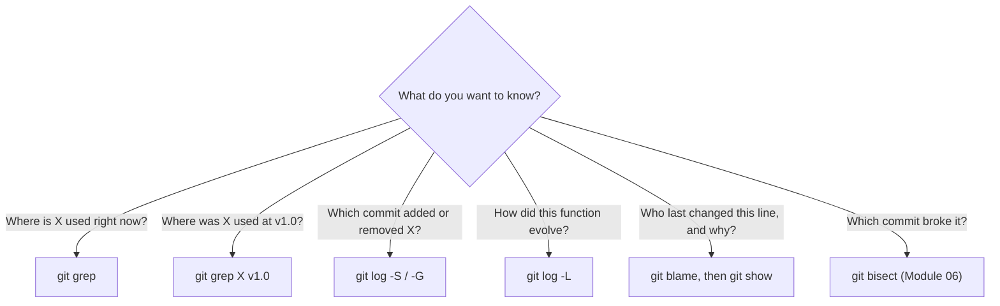

# Lesson 03 — Searching History: Grep, Pickaxe and Blame

> **Module 02 — Inspecting & Undoing Changes** · Book 07 — Git & GitHub

## 🎯 Learning Objectives

By the end of this lesson you will be able to:

- Search the contents of your project, now or at any point in the past, with `git grep`
- Find the commit that **introduced or removed** a piece of code with the pickaxe options `-S` and `-G`
- Trace the history of a function or line range with `git log -L`
- Find who last changed each line with `git blame`, and ignore noisy commits
- Pick the right search tool for the question you are asking

---

## 📖 Introduction

Every developer eventually asks one of these:

- *Where in the codebase is `formatPrice` used?*
- *When did this line get added, and by whom?*
- *Which commit deleted the `retry` option?*
- *Why does this weird condition exist?*

Git can answer all of them without leaving the terminal. Each question calls for a different tool, and this lesson shows which.

---

## 1. Searching Files: `git grep`

`git grep` searches the **tracked files** of your project. It is faster than `grep -r` because it skips `node_modules`, build output and anything else Git ignores or does not track.

```bash
git grep "formatPrice"
git grep -n "formatPrice"          # show line numbers
git grep -i "formatprice"          # ignore case
git grep -w "price"                # whole word only
git grep -c "TODO"                 # count matches per file
git grep -l "TODO"                 # list only the file names
git grep -p "TODO"                 # show the enclosing function name
git grep -W "TODO"                 # show the whole function around the match
git grep -n "TODO" -- "*.js"       # limit to certain files
git grep -E "get(User|Order)"      # extended regular expression
git grep -F "a.b(c)"               # fixed string, no regex
```

### Combining conditions

```bash
git grep -e "useState" --and -e "useEffect"        # lines containing both
git grep -e "TODO" --or -e "FIXME"                 # either
git grep --not -e "test" -e "TODO"                 # TODO lines not mentioning test
```

### Searching the past

Add a revision and Git searches the files **as they were then**:

```bash
git grep "oldFunction" v1.0.0
git grep -n "API_URL" HEAD~20
git grep "TODO" main feature       # in two branches at once
```

Other helpful flags: `--untracked` (also search untracked files), `--no-index` (search outside a repository), `--break --heading` (nicer grouped output).

---

## 2. Searching Changes: The Pickaxe (`-S` and `-G`)

`git grep` finds what **is** there. The pickaxe finds **when something changed**.

### `-S"string"` — the number of occurrences changed

```bash
git log -S"formatPrice" --oneline
git log -S"formatPrice" -p            # also show the diffs
git log -S"formatPrice" --all         # search every branch
```

`-S` lists commits where the **count** of that string went up or down: the commit that introduced it, or the one that removed it. A commit that only moves the string around does not count.

### `-G"regex"` — the diff lines match a pattern

```bash
git log -G"function \w+Price" --oneline -p
```

`-G` lists commits whose **changed lines** match the regular expression, even if the count is the same. It is broader than `-S`.

### `-S` with a regular expression

```bash
git log -S"price" --pickaxe-regex --oneline
```

| Option | Finds commits where... | Best for |
|---|---|---|
| `-S"text"` | the number of occurrences of text changed | "Who added or deleted this?" |
| `-G"regex"` | a changed line matches the pattern | "Who touched lines like this?" |

---

## 3. Following a Function or Line Range: `git log -L`

```bash
git log -L :formatPrice:src/utils.js       # history of one function
git log -L 20,40:src/utils.js              # history of lines 20-40
git log -L :formatPrice:src/utils.js --oneline -s   # just the commits
```

Git shows each commit that changed that region together with the **exact lines** it changed, a precise view of how a function evolved. Function boundaries are detected with language-aware rules, which Module 08 (`.gitattributes`) shows how to improve.

---

## 4. Who Changed This Line? `git blame`

```bash
git blame index.html
```

```
^a1b2c3d (Asha Rao  2026-01-05 09:00:00 +0000 1) <h1>Home</h1>
d4e8f21e (Ben Ortiz 2026-01-12 14:30:00 +0000 2) <nav>Menu</nav>
```

Each line shows the **last commit that changed it**, the author and the date.

> "Blame" is not about fault. It is about **context**: find the commit and read its message to learn *why* the line exists.

### Useful options

```bash
git blame -L 10,20 app.js          # only lines 10-20
git blame -L :formatPrice app.js   # only one function
git blame -w app.js                # ignore whitespace-only changes
git blame -e app.js                # show emails
git blame -s app.js                # hide author and date (compact)
git blame v1.0.0 -- app.js         # blame as of an older revision
git blame --since=3.weeks app.js   # ignore older history
```

### Detecting moved and copied lines

By default, blame credits whoever last touched a line, **even if they only moved it**. These flags look through such moves:

| Flag | Detects |
|---|---|
| `-M` | Lines moved **within** the same file |
| `-C` | Lines moved or copied from **other files in the same commit** |
| `-C -C` | ...also from files in the commit that created the file |
| `-C -C -C` | ...from any commit (slowest) |

```bash
git blame -w -M -C -C app.js
```

### Ignoring noisy commits (mass reformatting)

When a team runs Prettier over every file, blame blames *the formatter* for everything. Record those commits in a file:

```bash
# .git-blame-ignore-revs
# Apply Prettier to the whole codebase
9f3c2a1d4e5b6a7c8d9e0f1a2b3c4d5e6f7a8b9c
```

Tell Git to use it:

```bash
git config blame.ignoreRevsFile .git-blame-ignore-revs
```

GitHub's blame view honours a file with this name automatically, so the whole team sees useful blame. You can also pass `--ignore-rev <hash>` once.

---

## 5. A Newer Helper: `git last-modified`

Recent Git releases added `git last-modified`, which answers a different question: *"Which commit last touched each file in this directory?"* That is the same information a web file browser shows beside each file name. Check `git help last-modified` on your version for the options. Git 2.55 also introduced a small helper, `git format-rev`, designed to turn those commit IDs into readable text.

---

## 6. Which Tool for Which Question?



| Question | Tool |
|---|---|
| Where is it used? | `git grep` |
| When was it added or removed? | `git log -S` / `-G` |
| How did it change over time? | `git log -L` |
| Who last changed this line? | `git blame` |
| Which commit introduced the bug? | `git bisect` (Module 06) |

---

## 🛠️ Practical Example — Detective Work

Build a small project with history to investigate:

```bash
mkdir -p ~/git-practice && cd ~/git-practice
rm -rf search-lab && mkdir search-lab && cd search-lab
git init -b main

cat > app.js << 'JS'
function formatPrice(n) {
  return "$" + n;
}

function getUser(id) {
  // TODO: add caching
  return { id };
}
JS
git add . && git commit -q -m "feat: add price and user helpers"

git commit -q --allow-empty --author="Ben Ortiz <ben@example.com>" -m "chore: placeholder"

sed -i.bak 's/return "\$" + n;/return "$" + n.toFixed(2);/' app.js && rm app.js.bak
git commit -q -am "fix: always show two decimals" --author="Ben Ortiz <ben@example.com>"

sed -i.bak '/TODO: add caching/d' app.js && rm app.js.bak
git commit -q -am "chore: remove stale TODO" --author="Chen Wei <chen@example.com>"

echo "const LEGACY = true;" >> app.js
git commit -q -am "feat: add legacy flag" --author="Asha Rao <asha@example.com>"

git log --oneline
```

Now investigate:

1. Which lines in the project contain `TODO` **right now**? (none)
2. In which commit did the `TODO` disappear?
3. Which commit added the `toFixed` call, and who wrote it?
4. Who last changed the `return` line inside `formatPrice`?
5. Show the full history of just the `formatPrice` function.
6. Find the `TODO` as it existed in the **first** commit, without checking it out.

<details>
<summary>Show solutions</summary>

```bash
git grep -n "TODO"                        # 1: no output
git log -S"TODO" --oneline                # 2: first commit (added) and the "remove stale TODO" commit
git log -S"toFixed" --format="%h %an %s" # 3
git blame -L :formatPrice app.js          # 4
git log -L :formatPrice:app.js            # 5
git grep -n "TODO" $(git rev-list --max-parents=0 HEAD)   # 6: search the root commit
```

For 6, `git rev-list --max-parents=0 HEAD` prints the first (root) commit's hash.
</details>

**Checkpoint:** why does `git blame` on the `return` line in `formatPrice` point at the "two decimals" commit and not the original one?

<details>
<summary>Show answer</summary>

Blame reports the **last** commit that changed each line. Since the "fix: always show two decimals" commit rewrote that line, it takes the credit, and the original commit is only visible by blaming an older revision (`git blame <older-commit> -- app.js`).
</details>

---

## 📝 Revision Questions

**1. Why use `git grep` instead of `grep -r`?**

<details>
<summary>Show answer</summary>

It searches only tracked files, so it skips `node_modules` and build output, runs faster, and can search any past revision without checking it out.
</details>

**2. What is the difference between `git log -S` and `git log -G`?**

<details>
<summary>Show answer</summary>

`-S` finds commits where the number of occurrences of a string changed (added or removed). `-G` finds commits whose changed lines match a regular expression, even if the count stayed the same.
</details>

**3. How do you see how a single function changed over time?**

<details>
<summary>Show answer</summary>

`git log -L :functionName:path/to/file`. It lists each commit that touched the function together with the lines changed.
</details>

**4. A formatter touched every line in the repo. How do you stop blame from blaming it?**

<details>
<summary>Show answer</summary>

List the commit hash in a `.git-blame-ignore-revs` file and set `git config blame.ignoreRevsFile .git-blame-ignore-revs`. GitHub's blame view also honours that filename automatically.
</details>

**5. What do `-M` and `-C` do in `git blame`?**

<details>
<summary>Show answer</summary>

`-M` detects lines moved within a file and `-C` detects lines moved or copied from other files, so blame credits the original author instead of whoever moved the code.
</details>

---

➡️ **Next:** Lesson 04 — Interactive Staging
