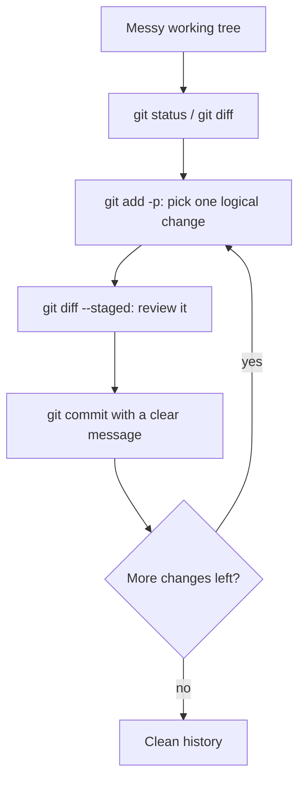

# Lesson 04 — Interactive Staging

> **Module 02 — Inspecting & Undoing Changes** · Book 07 — Git & GitHub

## 🎯 Learning Objectives

By the end of this lesson you will be able to:

- Stage **parts of a file** with `git add -p`
- Use every hunk command: `y n s e q a d j k g /`
- Split hunks and manually edit a hunk when Git cannot split it further
- Use the `git add -i` menu and `git add -N` for new files
- Turn a messy working tree into several clean, **atomic commits**

---

## 📖 Introduction

In Module 01 you learned that commits should be **atomic**: one logical change each. In practice you rarely work that tidily. You fix a bug, notice a typo, rename a variable and add a feature, all in the same file, before you remember to commit.

Staging a whole file with `git add file.js` would mix everything into one commit. **Interactive staging** lets you choose, **hunk by hunk or even line by line**, what goes into each commit, so the history stays clean no matter how messy the working tree was.

---

## 1. Patch Mode: `git add -p`

```bash
git add -p              # walk through every changed hunk in all files
git add -p app.js       # only this file
```

Git shows each hunk and asks what to do:

```diff
@@ -1,6 +1,7 @@
 function formatPrice(n) {
-  return "$" + n;
+  return "$" + n.toFixed(2);
 }
 
 function getUser(id) {
(1/2) Stage this hunk [y,n,q,a,d,j,J,g,/,e,?]?
```

### The commands

| Key | Action |
|---|---|
| `y` | **Yes** — stage this hunk |
| `n` | **No** — skip this hunk |
| `q` | **Quit** — stop (hunks already chosen stay staged) |
| `a` | Stage **all** remaining hunks in this file |
| `d` | Do **not** stage this or any remaining hunk in this file |
| `s` | **Split** this hunk into smaller hunks |
| `e` | **Edit** the hunk by hand |
| `j` / `J` | Leave this undecided, go to the next undecided / next hunk |
| `k` / `K` | Go to the previous undecided / previous hunk |
| `g` | Go to a specific hunk |
| `/` | Search for a hunk by regular expression |
| `?` | Show help |

The `s` option only appears when Git can actually split the hunk (when unchanged lines separate two changes).

---

## 2. Splitting Hunks

If one hunk contains two unrelated changes with **at least one unchanged line between them**, press `s`:

```
Split into 2 hunks.
@@ -1,3 +1,3 @@
 ...first change...
Stage this hunk [y,n,q,a,d,j,J,g,/,e,?]? y
@@ -10,3 +10,3 @@
 ...second change...
Stage this hunk [y,n,q,a,d,j,J,g,/,e,?]? n
```

---

## 3. Editing a Hunk by Hand (`e`)

When changes sit on **adjacent lines**, `s` cannot split them. Press `e` and Git opens the hunk in your editor.

| To do this... | Edit the hunk like this |
|---|---|
| **Do not stage** an added line (`+`) | Delete that line from the hunk |
| **Do not stage** a removed line (`-`) | Change the `-` to a space (turning it into context) |
| Stage everything | Leave the hunk unchanged |

Then save and close. Git stages only what remains. Do **not** change the content of lines or the numbers in the `@@` header. If you make the hunk invalid, Git reports an error and lets you retry.

---

## 4. The Interactive Menu: `git add -i`

```bash
git add -i
```

```
           staged     unstaged path
  1:    unchanged        +3/-1 app.js

*** Commands ***
  1: status     2: update      3: revert      4: add untracked
  5: patch      6: diff        7: quit        8: help
What now>
```

| Command | Purpose |
|---|---|
| `status` | Show staged vs unstaged line counts |
| `update` | Stage whole files |
| `revert` | Unstage files |
| `add untracked` | Stage new files |
| `patch` | Enter patch mode (same as `git add -p`) |
| `diff` | Review what is staged |

Most developers use `git add -p` directly and skip the menu.

---

## 5. New Files and Patch Mode: `git add -N`

Patch mode only works on files Git already knows. For a brand-new file, register your **intent to add** it first:

```bash
git add -N newfile.js     # "intent to add": appears as an empty tracked file
git add -p newfile.js     # now you can stage it in parts
```

---

## 6. The Same Idea in Other Commands

Patch mode is a general interface used across Git:

| Command | Use |
|---|---|
| `git add -p` | Stage chosen hunks |
| `git restore -p <file>` | **Discard** only chosen hunks from the working tree (Lesson 05) |
| `git restore --staged -p <file>` | **Unstage** only chosen hunks |
| `git reset -p` | Unstage chosen hunks |
| `git commit -p` | Choose hunks and commit in one step |
| `git stash -p` | Stash only chosen hunks (Module 03) |

---

## 7. The Atomic-Commit Workflow



**Always review with `git diff --staged` before committing.** Patch mode makes it easy to forget a hunk or stage one too many.

> 💡 Tip: a partially staged file means the commit contains a version of the file that **never existed on your disk**. If your project has tests, make sure that version still works (Module 03's `git stash --keep-index` can help test it).

---

## 🛠️ Practical Example — One Messy File, Three Clean Commits

```bash
mkdir -p ~/git-practice && cd ~/git-practice
rm -rf staging-lab && mkdir staging-lab && cd staging-lab
git init -b main

cat > app.js << 'JS'
function formatPrice(n) {
  return "$" + n;
}

function greet(name) {
  return "Hello " + name;
}

function getUser(id) {
  return { id };
}
JS
git add . && git commit -q -m "chore: initial helpers"
```

Now make **three unrelated changes** in one go:

```bash
cat > app.js << 'JS'
function formatPrice(n) {
  return "$" + n.toFixed(2);
}

function greet(name) {
  return "Hello, " + name + "!";
}

function getUser(id) {
  return { id, active: true };
}
JS
git diff
```

Goal — three commits:

1. `fix: show two decimals in prices`
2. `style: polish greeting text`
3. `feat: add active flag to users`

Steps:

```bash
git add -p app.js
```

Answer `y` for the `formatPrice` hunk and `n` for the others (use `s` if they are grouped in one hunk), then:

```bash
git diff --staged
git commit -m "fix: show two decimals in prices"

git add -p app.js      # stage only the greeting change
git commit -m "style: polish greeting text"

git add -p app.js      # stage the last change
git commit -m "feat: add active flag to users"

git log --oneline --stat
```

**Checkpoint tasks:**

1. If `s` is not offered because the changes are adjacent, which key do you use instead?
2. A hunk contains `-old` and `+new` and you only want to stage the `+new` line. What do you edit?
3. How do you see exactly what is staged before committing?

<details>
<summary>Show answers</summary>

1. `e` (edit the hunk manually).
2. Change the `-old` line's leading `-` to a space (so it becomes unchanged context) and keep the `+new` line. The result stages the addition without removing the old line.
3. `git diff --staged`.
</details>

---

## 📝 Revision Questions

**1. What does `git add -p` do?**

<details>
<summary>Show answer</summary>

It shows each changed hunk and lets you choose whether to stage it, so you can stage part of a file.
</details>

**2. What does the `s` option do, and when is it unavailable?**

<details>
<summary>Show answer</summary>

It splits a hunk into smaller ones. It is unavailable when the changes are adjacent with no unchanged lines between them. Use `e` in that case.
</details>

**3. How do you stage part of a brand-new file?**

<details>
<summary>Show answer</summary>

Register it first with `git add -N <file>` (intent to add), then use `git add -p <file>`.
</details>

**4. Why can a partially staged commit be risky?**

<details>
<summary>Show answer</summary>

The committed version of the file may never have existed on your disk as a whole, so it might not compile or pass tests. Review with `git diff --staged` and test it if your project has tests.
</details>

**5. Which command discards only some hunks from your working tree?**

<details>
<summary>Show answer</summary>

`git restore -p <file>` (patch mode), covered in the next lesson.
</details>

---

➡️ **Next:** Lesson 05 — Restore and Unstaging
