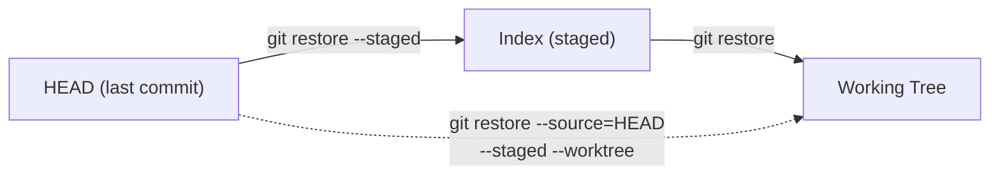

# Lesson 05 — Restore and Unstaging

> **Module 02 — Inspecting & Undoing Changes** · Book 07 — Git & GitHub

## 🎯 Learning Objectives

By the end of this lesson you will be able to:

- Discard uncommitted edits to a file with `git restore`
- Unstage files with `git restore --staged`
- Recover a file from **any** earlier commit with `--source`
- Translate between the modern `restore` commands and the legacy `checkout`/`reset` forms
- Understand which of these actions are **irreversible**

---

## 📖 Introduction

Everyone makes mistakes before committing: you edit the wrong file, stage something you did not mean to, or break a file so thoroughly you want it back as it was. This lesson covers the **safe, local, pre-commit** undo tools. (Fixing commits you have already made is the job of Lessons 06–08.)

Since **Git 2.23 (2019)**, `git restore` is the dedicated command for this. Older tutorials use `git checkout -- file` and `git reset HEAD file` for the same jobs. You will see both in the wild, so you will learn both.

---

## 1. The Two Places You Can Restore

Remember the three areas: **working tree**, **index** (staging), **HEAD**.



`git restore` has two **targets** and one **source**:

| Option | Meaning | Default source |
|---|---|---|
| *(none)* — same as `--worktree` (`-W`) | Restore the **working tree** file | the **index** |
| `--staged` (`-S`) | Restore the **index** (unstage) | **HEAD** |
| `--staged --worktree` | Restore both | HEAD |
| `--source=<commit>` (`-s`) | Take content from a specific commit | overrides the default |

The rule to remember: **the source is the index when you restore the working tree, and HEAD when you restore the index**, unless you say otherwise with `--source`.

---

## 2. Discard Working-Tree Changes

```bash
git restore index.html          # throw away edits, return to the staged (or committed) version
git restore src/ styles.css     # several paths
git restore .                   # every modified tracked file in the current folder
```

> 🚨 **Irreversible.** Edits that were never staged or committed are not stored anywhere in Git. After `git restore file` they are **gone**. Use `git diff file` first. If unsure, `git stash` instead (Module 03).

### Discard only some changes

```bash
git restore -p index.html       # choose hunks to discard (patch mode from Lesson 04)
```

### Bring back a deleted file

```bash
rm styles.css              # oops
git restore styles.css     # back, as of the index/HEAD
```

---

## 3. Unstage Files

You ran `git add` on something you did not mean to include:

```bash
git restore --staged index.html     # unstage; your edits stay in the working tree
git restore --staged .              # unstage everything
git restore --staged -p index.html  # unstage only chosen hunks
```

Nothing is lost: the file simply moves from "Changes to be committed" back to "Changes not staged".

`git status` even tells you the command:

```
Changes to be committed:
  (use "git restore --staged <file>..." to unstage)
```

---

## 4. Restore From Any Commit: `--source`

```bash
git restore --source=HEAD~2 index.html            # working tree gets the file from 2 commits ago
git restore --source=v1.0.0 -- config.json        # from a tag
git restore --source=main --staged --worktree app.js   # overwrite both index and working tree
```

This changes only the files you name. Your branch and history do not move. It is the clean way to "grab one file from an old version".

Notice that `--source` on its own affects only the **working tree**. To bring the old version into the index as well, add `--staged`.

### Undo everything about a file

```bash
git restore --staged --worktree --source=HEAD index.html
```

That makes `index.html` identical to the last commit, in both the index and the working tree.

### Recover a file deleted in an earlier commit

```bash
git log --oneline -- old-page.html       # find the commit that deleted it
git restore --source=<deleting-commit>~1 old-page.html
```

The `~1` points to the commit **before** the deletion, where the file still existed.

---

## 5. Old Commands You Will Still See

| Goal | Modern | Legacy equivalent |
|---|---|---|
| Discard working-tree edits to a file | `git restore file` | `git checkout -- file` |
| Unstage a file | `git restore --staged file` | `git reset HEAD file` (or `git reset -- file`) |
| File from another commit into the working tree **only** | `git restore --source=<c> file` | no direct equivalent (see next row) |
| File from another commit into **both** index and working tree | `git restore --source=<c> --staged --worktree file` | `git checkout <c> -- file` |
| Switch branches | `git switch <branch>` (Module 03) | `git checkout <branch>` |

`git checkout` did too many jobs (switching branches, restoring files, detaching HEAD), which confused beginners. Git split it into **`switch`** (branches) and **`restore`** (files). The legacy `git checkout <commit> -- file` also stages the result, which is one more reason `restore` is clearer: you choose the targets yourself.

Prefer the new commands; recognize the old ones.

---

## 6. Which Undo Tool Do I Need?

| Situation | Tool |
|---|---|
| I edited a file and want the old version back | `git restore <file>` |
| I staged something by mistake | `git restore --staged <file>` |
| I want one file from a past commit | `git restore --source=<commit> <file>` |
| I want to throw away untracked files | `git clean` (Module 01, careful!) |
| I committed something wrong | Lessons 06–07: `--amend`, `reset`, `revert` |
| I lost commits | Lesson 08: `reflog` |

---

## 7. Safety Notes

| Action | Recoverable? |
|---|---|
| `git restore --staged file` | ✅ Nothing lost; edits remain in the working tree |
| `git restore file` after the edit was **staged** | ⚠️ Often yes: the staged content still exists as an object (see Module 07, `git fsck --lost-found`), but this is a rescue operation, not a feature |
| `git restore file` on **never-staged** edits | ❌ Permanently gone |
| `git restore --source=...` overwriting uncommitted edits | ❌ The overwritten edits are gone |

> **Habit:** run `git status` and `git diff` first. If there is any doubt, `git stash` before discarding.

---

## 🛠️ Practical Example — Break It and Fix It

```bash
mkdir -p ~/git-practice && cd ~/git-practice
rm -rf undo-lab && mkdir undo-lab && cd undo-lab
git init -b main

echo "<h1>Home</h1>" > index.html
echo "body { margin: 0; }" > styles.css
git add . && git commit -q -m "feat: initial site"

echo "<h1>Home v2</h1>" > index.html
git add . && git commit -q -m "feat: update heading"
```

### Scenario A — discard a bad edit

```bash
echo "GARBAGE" >> index.html
git diff
git restore index.html
git status
```

### Scenario B — unstage by mistake

```bash
echo "p { color: red; }" >> styles.css
echo "<p>Draft</p>" >> index.html
git add .
git status
git restore --staged index.html     # unstage only index.html
git status
git restore .                       # clean up before the next scenario
```

### Scenario C — get an old version of one file

```bash
git restore --source=HEAD~1 index.html
cat index.html                      # the original "Home" heading
git status -s                       # " M index.html": working tree differs from the index
git restore index.html              # copies from the INDEX, which still holds the HEAD version
cat index.html                      # "Home v2" again
```

> 💡 `--source` replaced only the **working-tree** file. The index still held the HEAD version, so a plain `git restore index.html` (whose default source is the index) brought it back. Had you used `--source=HEAD~1 --staged --worktree`, the index would also have changed, and you would need `--source=HEAD --staged --worktree` to return to the last commit.

### Scenario D — recover a deleted file

```bash
rm styles.css
git restore styles.css
ls
```

**Checkpoint tasks:**

1. What is the difference between `git restore file` and `git restore --staged file`?
2. Write the legacy equivalent of `git restore --staged style.css`.
3. You edit `app.js`, run `git add app.js`, then edit it again. What does `git restore app.js` do?
4. After `git restore --source=HEAD~1 file`, how do you get back to the last commit's version?

<details>
<summary>Show answers</summary>

1. The first overwrites the **working-tree** file from the index (discarding edits). The second moves the staged version back to HEAD (**unstaging**) and leaves your working-tree edits alone.
2. `git reset HEAD style.css`
3. It overwrites the working-tree file with the **staged** version, discarding only the edits made after `git add`. The staged content stays.
4. A plain `git restore file` works, because the index still holds the HEAD version. If you had also changed the index with `--staged`, use `git restore --source=HEAD --staged --worktree file`.
</details>

---

## 📝 Revision Questions

**1. Which command discards uncommitted edits to a file?**

<details>
<summary>Show answer</summary>

`git restore <file>`. It is irreversible for edits that were never staged or committed.
</details>

**2. How do you unstage a file without losing your edits?**

<details>
<summary>Show answer</summary>

`git restore --staged <file>` (legacy: `git reset HEAD <file>`).
</details>

**3. How do you copy one file from two commits ago into your working tree?**

<details>
<summary>Show answer</summary>

`git restore --source=HEAD~2 <file>`. Branch and history do not change.
</details>

**4. Why did Git introduce `switch` and `restore`?**

<details>
<summary>Show answer</summary>

`git checkout` handled too many unrelated jobs (switching branches, restoring files, detaching HEAD). `switch` now handles branches and `restore` handles files, which is clearer and safer.
</details>

**5. After `git restore --source=HEAD~1 file`, what does a plain `git restore file` do, and why?**

<details>
<summary>Show answer</summary>

It brings back the HEAD version. `--source` changed only the working tree, so the index still holds the HEAD version, and a plain `git restore` copies from the index. If you had also used `--staged`, the index would have changed too, and you would need `--source=HEAD` to return to the last commit.
</details>

---

➡️ **Next:** Lesson 06 — Amending Commits
